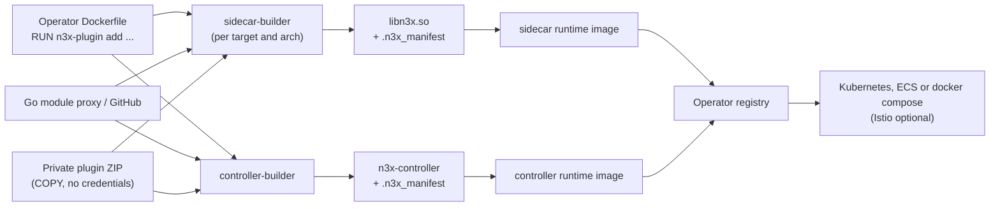
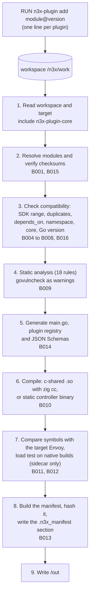
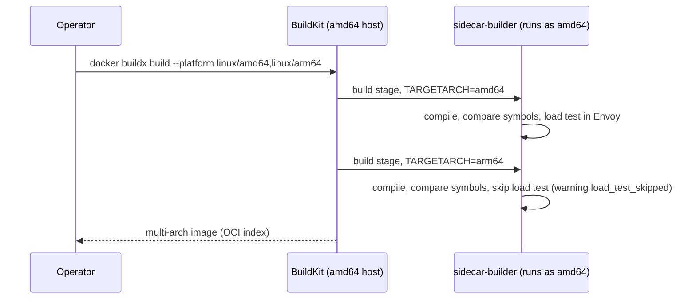
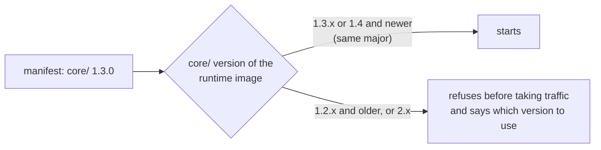
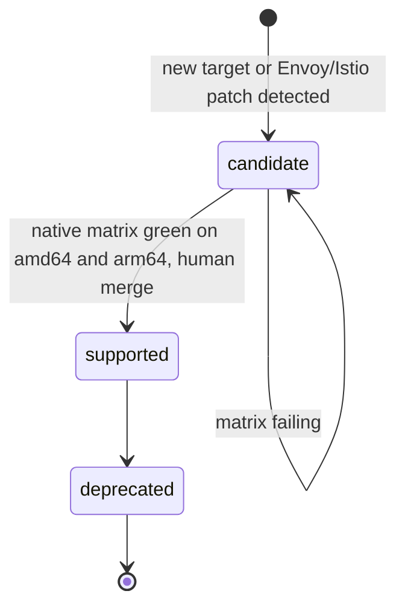

# n3x-builder

Build images and the `n3x-plugin` CLI that compile N3X plugins into a reproducible Envoy dynamic module (`libn3x.so`) and a controller binary, entirely inside `docker build`.

> **Status: pre-implementation (v1 design).** This repository currently holds the approved design: PRD, HLD, ADRs and FDDs under [`docs/`](docs/). Everything below describes the v1 target behavior. Image tags in the examples are illustrative, and the target catalog values (Envoy digest, commit, glibc and Envoy Go SDK pseudo-version) are pending phase 0.

## Contents

- [What is N3X](#what-is-n3x)
- [What n3x-builder does](#what-n3x-builder-does)
- [How it works](#how-it-works)
- [Images and targets](#images-and-targets)
- [Quick start](#quick-start)
- [Usage by environment](#usage-by-environment)
- [Build scenarios](#build-scenarios)
- [Command reference](#command-reference)
- [Errors and exit codes](#errors-and-exit-codes)
- [The embedded manifest](#the-embedded-manifest)
- [Versioning and compatibility](#versioning-and-compatibility)
- [Security model](#security-model)
- [Target lifecycle and CI](#target-lifecycle-and-ci)
- [Repository layout and documentation](#repository-layout-and-documentation)
- [Development](#development)

## What is N3X

N3X (Network Navigation Node eXtensible, pronounced "Nex") is an extensible network middleware. It works as an override layer over an Envoy proxy in the sidecar model:

- Every application gets a sidecar next to it, and the sidecar becomes the application's only entry point (HTTP/1.1, HTTP/2 and gRPC).
- Every sidecar connects to a central **controller** that only observes. A read-only web panel shows the inventory, the effective config of each instance and drift between instances. A gRPC server's services grow as plugins are added.
- Network behaviors that each product used to reimplement become **plugins**. All plugins are compiled into a single Go dynamic module loaded inside Envoy.
- Each service keeps its own configuration in an `n3x.yaml` file, plugins included. Changing a behavior means editing that file and redeploying, with zero changes to application code.
- N3X is agnostic of language and orchestrator. It runs on Kubernetes, Amazon ECS or docker compose. Istio is a compatibility requirement, not a runtime requirement.

### The problem N3X solves

- Network behaviors (rate limiting, observability, forwarding, redirects and others) are rebuilt from scratch in every service and on every platform. Every new product hits them and ships later.
- Network logic is coupled to each application's code and language. Every language needs its own implementation.
- The usual alternatives fall short. Per-service libraries mean rework per language. A service mesh such as Istio is heavy and requires Kubernetes. API gateways are hard to extend with custom logic or only cover the edge.

| Goal | Metric | v1 target |
| --- | --- | --- |
| Ship new products faster | Time to put a new service behind N3X, registered and visible in the panel | Up to 30 minutes, no application code change |
| Change behavior without touching the app | Application code lines changed to enable, disable or reconfigure a plugin | Zero: edit `n3x.yaml` and redeploy |
| Keep infrastructure light | What it takes to run controller, sidecar and application | A single docker compose, no Kubernetes, in up to 5 minutes |
| Stay language agnostic | Result of the same plugin in services written in different languages | Same behavior over HTTP and gRPC in at least 2 languages |

### The N3X repositories

| Repository | Role |
| --- | --- |
| `n3x-sdk` | Plugin contracts (proxy and controller halves), test kit, plugin generator and example plugin |
| `n3x-sidecar` | Sidecar runtime image (Envoy 1.40 or Istio proxyv2 1.31), Go supervisor entrypoint and the `core/` of the `.so` |
| `n3x-controller` | Controller binary: gRPC server, read-only web panel and plugin host (`host/`) |
| **`n3x-builder`** | **Build images, the `n3x-plugin` CLI and the target catalog (this repository)** |
| `n3x-plugin-core` | Mandatory plugin, always included: sidecar login, registration, heartbeat, effective config and events |

## What n3x-builder does

Operators customize N3X only through a multi-stage Dockerfile. `n3x-builder` turns the plugin list written in that Dockerfile into two artifacts, each with an embedded manifest:

| Artifact | Built by | Copied into | Contains |
| --- | --- | --- | --- |
| `libn3x.so` (one per target and architecture) | `sidecar-builder` | `sidecar` runtime image | Proxy halves of the plugins, the sidecar `core/` and the plugin core |
| `n3x-controller` (static binary) | `controller-builder` | `controller` runtime image | Controller halves of the plugins, the controller `host/` and the plugin core |

The builder exists only during `docker build`. It has no service, no port and no state.

### Problems it solves

Its main job is to fail the build for anything that would otherwise only break in production:

| Without the builder | What the builder does | Code |
| --- | --- | --- |
| A `.so` built for the wrong Envoy loads in istio-proxy 1.31 and only fails on the first call, because symbols resolve lazily | Compares the `.so` symbols with the target Envoy and loads the `.so` in a real Envoy on native builds | `N3X-B011`, `N3X-B012` |
| A plugin needs a newer SDK than the image provides | Checks every plugin's `sdk` range against the image | `N3X-B004` |
| Two plugins claim the same ID or gRPC service | Checks for duplicates before compiling | `N3X-B005` |
| Plugin code breaks the isolation between plugins or takes down Envoy (raw goroutines, `os.Exit`, `unsafe`, cgo, `context.Background()` and others) | Runs 18 static analysis rules on every plugin | `N3X-B009` |
| Someone removes or swaps the mandatory core plugin | Always includes the core, pinned to the image version | `N3X-B008` |
| The same Dockerfile produces different binaries on different machines | Pins the toolchain in the image, builds reproducibly and double-compiles in CI | none |
| A runtime cannot tell what is inside a binary without loading it | Embeds a JSON manifest in an ELF section, readable without loading | none |
| Vulnerable dependencies go unnoticed | Runs `govulncheck` on every build and records warnings in the manifest | none |

## How it works



### The build pipeline

Each `RUN n3x-plugin add` line validates one plugin and records it in the workspace (`/n3x/work`), so every line is its own cached layer. `RUN n3x-plugin build` then runs nine steps. It fails fast: the build stops at the step that failed and lists every failure of that step.



After step 2, nothing touches the module network. The final stage of the Dockerfile copies the artifact from `/out` into the runtime image.

### Native and cross-architecture builds

The builder compiles both amd64 and arm64 from any host with `zig cc`, without QEMU. The load test needs to run Envoy, so it only runs when the build architecture matches the host.



Every published `sidecar-builder` image is load-tested on native arm64 runners in this repository's CI. Cross builds therefore only skip the load test for your specific plugin set. If an ABI error slips through, the sidecar refuses to start before it receives traffic.

## Images and targets

| Image | Tag | Contents |
| --- | --- | --- |
| `ghcr.io/giustech/n3x/sidecar-builder` | `<semver>-envoy-1.40`, `<semver>-istio-1.31` | Go 1.26, `zig cc` with the target glibc, `objcopy`, the target Envoy binary and symbol index, `/etc/n3x/target.yaml`, `n3x-plugin`, and pre-fetched `core/`, SDK and plugin core modules |
| `ghcr.io/giustech/n3x/controller-builder` | `<semver>` | Go 1.26, `objcopy`, `n3x-plugin`, and pre-fetched `host/`, SDK and plugin core modules. No C toolchain: the binary is static, without cgo |

- Both images are published for amd64 and arm64 in an OCI index.
- Tags are immutable and never deleted. There are no floating tags such as `latest`.
- Base images (`golang`, `envoyproxy/envoy`, `istio/proxyv2`) are pinned by digest.
- The controller does not depend on the Envoy target, so `controller-builder` has no target suffix.

| Target | Proxy | Status |
| --- | --- | --- |
| `envoy-1.40` | Official `envoyproxy/envoy:v1.40.x` image | First target, pending phase 0 values |
| `istio-1.31` | `istio/proxyv2:1.31.x` (Envoy commit derived from Istio's `istio.deps`) | `candidate` until the load-test spike passes; its capability list starts empty |

## Quick start

A sidecar with two plugins, for amd64 and arm64:

```dockerfile
# syntax=docker/dockerfile:1
FROM --platform=$BUILDPLATFORM ghcr.io/giustech/n3x/sidecar-builder:1.0.0-envoy-1.40 AS build
RUN --mount=type=cache,target=/go/pkg/mod \
    n3x-plugin add github.com/giustech/n3x-plugin-ratelimit@v1.0.0
RUN --mount=type=cache,target=/go/pkg/mod \
    n3x-plugin add github.com/acme/n3x-plugin-tenant@v0.4.2
ARG TARGETARCH
RUN --mount=type=cache,target=/go/pkg/mod \
    --mount=type=cache,target=/root/.cache \
    n3x-plugin build

FROM ghcr.io/giustech/n3x/sidecar:1.0.0-envoy-1.40
COPY --from=build /out/libn3x.so /usr/lib/n3x/libn3x.so
```

```sh
docker buildx build --platform linux/amd64,linux/arm64 \
  -t registry.acme/n3x-sidecar:2026.10 --push .
```

- Use exact versions in `add`. The core plugin is always included and never needs to be declared.
- Keep `FROM --platform=$BUILDPLATFORM` and `ARG TARGETARCH` before `build`. Without `--platform`, a multi-arch build on a runner without `binfmt` fails with `exec format error`.
- CLI messages are in Brazilian Portuguese. Codes, rules, fields and commands are in English.

## Usage by environment

The image you build depends on where the sidecar runs. The controller image is the same everywhere.

| Environment | Build image | Runtime image | Notes |
| --- | --- | --- | --- |
| docker compose | `sidecar-builder:<semver>-envoy-1.40` | `sidecar:<semver>-envoy-1.40` | Sidecar shares the app's network namespace (`network_mode: service:<app>`) |
| Kubernetes without Istio | `sidecar-builder:<semver>-envoy-1.40` | `sidecar:<semver>-envoy-1.40` | Sidecar is a second container in the app's pod |
| Kubernetes with Istio | `sidecar-builder:<semver>-istio-1.31` | `sidecar:<semver>-istio-1.31` | Runtime image is a customized `istio/proxyv2` 1.31 |
| Amazon ECS | `sidecar-builder:<semver>-envoy-1.40` | `sidecar:<semver>-envoy-1.40` | Sidecar is a second container in the app's task |
| Controller (any environment) | `controller-builder:<semver>` | `controller:<semver>` | Use the same plugin list as the sidecar |

What the environments have in common:

- The sidecar reads `/etc/n3x/n3x.yaml`, or the path passed with `--config`. Encrypted values (`ENC[...]`) need the key file mounted into the container, never passed as an environment variable.
- The application stays private. It listens on a local address (for example `127.0.0.1:3000`) and only the sidecar's entry port is exposed.
- Outside Istio, the sidecar answers health checks on port `17021` by default. Its Envoy admin listens only on `127.0.0.1:17001`.
- On shutdown the sidecar drains for 20 s by default, below the 30 s that Kubernetes and ECS usually allow.

The `n3x.yaml` schema and the runtime settings belong to the [`n3x-sidecar`](https://github.com/giustech/n3x-sidecar) and [`n3x-controller`](https://github.com/giustech/n3x-controller) repositories. The snippets below only show where the images built here go. Values in `<angle brackets>` are placeholders.

### docker compose

Build with the `envoy-1.40` target, as in the [quick start](#quick-start).

```yaml
services:
  orders:
    image: registry.acme/orders:1.4.2
    ports:
      - "8080:<sidecar entry port>"   # published here: the sidecar shares this network namespace
  orders-n3x:
    image: registry.acme/n3x-sidecar:2026.10
    network_mode: "service:orders"
    volumes:
      - ./orders/n3x.yaml:/etc/n3x/n3x.yaml:ro
  n3x-controller:
    image: registry.acme/n3x-controller:2026.10
    ports:
      - "17443:17443"   # gRPC for sidecars (TLS 1.3)
      - "17444:17444"   # web panel (HTTPS)
    # controller n3x.yaml and certificates: see n3x-controller docs
```

This is the lightest N3X setup: one compose file, no Kubernetes. Outside Kubernetes, each instance is identified by its container ID.

### Kubernetes without Istio

Build with the `envoy-1.40` target. Add the sidecar as a second container in the pod and point the Service at the sidecar's entry port.

```yaml
apiVersion: apps/v1
kind: Deployment
metadata:
  name: orders
spec:
  replicas: 2
  selector:
    matchLabels: { app: orders }
  template:
    metadata:
      labels: { app: orders }
    spec:
      containers:
        - name: app
          image: registry.acme/orders:1.4.2
        - name: n3x-sidecar
          image: registry.acme/n3x-sidecar:2026.10
          volumeMounts:
            - name: n3x-config
              mountPath: /etc/n3x/n3x.yaml
              subPath: n3x.yaml
              readOnly: true
          # also mount the ENC[...] key file from a Secret (path: see n3x-sidecar docs)
      volumes:
        - name: n3x-config
          configMap:
            name: orders-n3x
```

Inside Kubernetes, the instance identity is the pod name with its hash (for example `orders-7d9f8b-xk2lp`).

### Kubernetes with Istio

Build with the `istio-1.31` target and its matching runtime image:

```dockerfile
# syntax=docker/dockerfile:1
FROM --platform=$BUILDPLATFORM ghcr.io/giustech/n3x/sidecar-builder:1.0.0-istio-1.31 AS build
RUN --mount=type=cache,target=/go/pkg/mod \
    n3x-plugin add github.com/giustech/n3x-plugin-ratelimit@v1.0.0
ARG TARGETARCH
RUN --mount=type=cache,target=/go/pkg/mod \
    --mount=type=cache,target=/root/.cache \
    n3x-plugin build

FROM ghcr.io/giustech/n3x/sidecar:1.0.0-istio-1.31
COPY --from=build /out/libn3x.so /usr/lib/n3x/libn3x.so
```

How it differs from the other environments:

- The runtime image is a customized `istio/proxyv2` 1.31. Its entrypoint reads the same `n3x.yaml`, applies the Go runtime settings and hands control to `pilot-agent`, which generates the bootstrap and handles draining.
- A static `EnvoyFilter`, the same for the whole mesh, inserts the N3X filter pointing to the `n3x.yaml` mounted in the pod. The `EnvoyFilter` and the injection settings are documented in `n3x-sidecar`.
- Ports and health checks are Istio's own. The connection from the `.so` to the controller goes out directly, because Istio does not intercept the proxy's own traffic.
- A `.so` is tied to one exact Envoy commit. Each Istio patch is a separate entry in the target catalog and must pass the native matrix before it becomes `supported`.
- Istio support is not official and the `EnvoyFilter` is fragile across Istio versions. If an Istio patch breaks loading, keep the last patch that passed and run the plain N3X sidecar (without Istio) for that service.

### Amazon ECS

Build with the `envoy-1.40` target. Run the app and the sidecar as containers of the same task, so they share `localhost` (`awsvpc` network mode).

```json
{
  "family": "orders",
  "networkMode": "awsvpc",
  "containerDefinitions": [
    { "name": "app", "image": "registry.acme/orders:1.4.2", "essential": true },
    {
      "name": "n3x-sidecar",
      "image": "registry.acme/n3x-sidecar:2026.10",
      "essential": true,
      "portMappings": [{ "containerPort": "<sidecar entry port>" }]
    }
  ]
}
```

Deliver `n3x.yaml` at `/etc/n3x/n3x.yaml` or pass another path with `--config` (see `n3x-sidecar` docs). In v1, ECS is validated by a guided manual test. Kubernetes and docker compose are validated in CI.

### Controller

```dockerfile
# syntax=docker/dockerfile:1
FROM --platform=$BUILDPLATFORM ghcr.io/giustech/n3x/controller-builder:1.0.0 AS build
RUN --mount=type=cache,target=/go/pkg/mod \
    n3x-plugin add github.com/giustech/n3x-plugin-ratelimit@v1.0.0
RUN --mount=type=cache,target=/go/pkg/mod \
    n3x-plugin add github.com/acme/n3x-plugin-tenant@v0.4.2
ARG TARGETARCH
RUN --mount=type=cache,target=/go/pkg/mod --mount=type=cache,target=/root/.cache \
    n3x-plugin build

FROM ghcr.io/giustech/n3x/controller:1.0.0
COPY --from=build /out/n3x-controller /usr/local/bin/n3x-controller
```

- Declare the same plugin list as in the sidecar Dockerfile. If the lists differ, the build still passes, and the panel flags the drift through the manifests (FR-006).
- Plugins without a controller half are still listed in the controller manifest, so the panel can show them in the inventory.
- In v1 the controller runs as a single replica in every environment. It exposes `17443` (gRPC, TLS 1.3) to sidecars and `17444` (HTTPS panel) to users.

## Build scenarios

### Multi-architecture builds

```sh
docker buildx build --platform linux/amd64,linux/arm64 \
  -t registry.acme/n3x-sidecar:2026.10 --push .
```

- One `.so` is produced per architecture. The native one is load-tested and the cross-compiled one is checked by symbols only (`load_test_skipped` is recorded in the manifest).
- For the strongest guarantee on arm64, build on a native arm64 runner.

### Private plugins

The builder never receives credentials. A private plugin enters as a Go module ZIP copied into the build stage. Its private dependencies come from a local module source.

```dockerfile
# syntax=docker/dockerfile:1
FROM --platform=$BUILDPLATFORM ghcr.io/giustech/n3x/sidecar-builder:1.0.0-envoy-1.40 AS build
ARG GOPRIVATE=github.com/acme/*
RUN --mount=type=cache,target=/go/pkg/mod \
    n3x-plugin add github.com/giustech/n3x-plugin-ratelimit@v1.0.0
COPY dist/n3x-plugin-tenant-v0.4.2.zip /n3x/private/plugin.zip
COPY private-proxy/ /n3x/private-proxy/
ENV GOPROXY=file:///n3x/private-proxy,https://proxy.golang.org
RUN --mount=type=cache,target=/go/pkg/mod \
    n3x-plugin add --archive /n3x/private/plugin.zip --sha256 <hex>
ARG TARGETARCH
RUN --mount=type=cache,target=/go/pkg/mod \
    --mount=type=cache,target=/root/.cache \
    n3x-plugin build

FROM ghcr.io/giustech/n3x/sidecar:1.0.0-envoy-1.40
COPY --from=build /out/libn3x.so /usr/lib/n3x/libn3x.so
```

- The module path and version come from the ZIP's prefix. `--sha256` is optional and pins the exact archive.
- The ZIP is confidential code, not a credential. It never reaches the final image or the manifest, but it stays in the build stage's layers and cache, so protect your build context, cache and intermediate layers.
- Tokens, `.netrc` files and secret mounts are not accepted, in any form.

### Corporate proxies and air-gapped networks

Only an allowlist of variables reaches the `go` process. Pass them as build arguments:

| Variable | Use |
| --- | --- |
| `GOPROXY`, `GOPRIVATE`, `GONOPROXY`, `GONOSUMDB` | Corporate module proxy and private module patterns |
| `GOSUMDB`, `GOINSECURE` | Accepted, but `GOSUMDB=off` raises the `sumdb_off` warning and `GOINSECURE` raises `insecure_fetch` |
| `HTTP_PROXY`, `HTTPS_PROXY`, `NO_PROXY`, `SSL_CERT_FILE`, `SSL_CERT_DIR` | Outbound proxy and corporate certificates |
| `N3X_VULNDB` | Vulnerability database: `auto` (default, `https://vuln.go.dev`), `https://<mirror>` or `image` (copy bundled in the image, no network) |
| `N3X_LOG_FORMAT` | `text` (default) or `json`; the `--log-format` flag wins |

```dockerfile
FROM --platform=$BUILDPLATFORM ghcr.io/giustech/n3x/sidecar-builder:1.0.0-envoy-1.40 AS build
ARG GOPROXY=https://goproxy.acme.internal
ARG GOSUMDB=off
ARG N3X_VULNDB=image
# ... add and build as usual
```

A vulnerability database problem never fails the build. If the network database cannot be reached, the build falls back to the bundled copy and warns with `vuln_db_fallback`. A database older than 30 days raises `vuln_db_stale`.

### CI pipelines

- Use `--log-format json` (or `N3X_LOG_FORMAT=json`). Each step emits events (`step`, `problem`, `warning`, `usage`, `summary`) with `ts`, `level`, `msg`, `cmd`, `step`, `code`, `status` (`ok`, `failed`, `skipped`) and `duration_ms`.
- Decide on the exit code (see [Errors and exit codes](#errors-and-exit-codes)). Warnings never change the exit code.
- To inspect the manifest, export it from an extra stage:

```dockerfile
FROM scratch AS manifest
COPY --from=build /out/manifest.json /
```

```sh
docker buildx build --target manifest --output type=local,dest=./n3x-out .
# list the plugins in the artifact
jq -r '.plugins[] | "\(.id) \(.version)"' n3x-out/manifest.json
# fail your pipeline on vulnerabilities whose function is actually called
jq -e '[.warnings[] | select(.kind == "vuln" and .called)] | length == 0' n3x-out/manifest.json
```

`govulncheck` only warns (ADR-008). Whether a vulnerability blocks your deploy is your pipeline's decision.

### Mirroring the images

GHCR download limits may require a mirror in your own registry. Copy by digest to keep the digest, and with it the tested pair, verifiable:

```sh
docker buildx imagetools create \
  --tag registry.acme/mirror/sidecar-builder:1.0.0-envoy-1.40 \
  ghcr.io/giustech/n3x/sidecar-builder@sha256:<digest>
```

## Command reference

| Command | Purpose |
| --- | --- |
| `n3x-plugin add <module>@<version>` | Resolve the module, read its `n3x-plugin.yaml`, check the repository structure and record it in the workspace. Exact versions only, one line per plugin |
| `n3x-plugin add --archive <zip> [--sha256 <hex>]` | Same for a private plugin delivered as a Go module ZIP |
| `n3x-plugin build [--log-format text\|json]` | Run the nine-step pipeline and write `/out` |
| `n3x-plugin version [--log-format text\|json]` | Show the versions embedded in the image (builder, Go, SDK, runtime `core/` or `host/`, plugin core) and, in `sidecar-builder`, the target and its status |
| `n3x-plugin targets [--log-format text\|json]` | Show the target of the image |

```sh
docker run --rm ghcr.io/giustech/n3x/sidecar-builder:1.0.0-envoy-1.40 n3x-plugin version --log-format json
```

- `add` never picks another version, never uses `latest` and never records a partially validated plugin. A failed `add` leaves the workspace untouched, and repeating an `add` changes nothing.
- There is no plugin-list file and no remove command in v1. The list lives in the Dockerfile (ADR-005).
- `build` writes `/out/libn3x.so` (or `/out/n3x-controller`) plus `/out/manifest.json`. A failed build leaves nothing new in `/out`.

Text output, one line per step:

```text
[5/9] gerando registro (3 plugins) ... ok 0.4s
```

## Errors and exit codes

Every failure carries a stable code, the reason, a "how to fix" line and a link to the error catalog (`docs/erros.md`, generated from the code):

```text
erro N3X-B004: plugin giustech.ratelimit@1.0.0 exige sdk >=1.3.0 <2.0.0; esta imagem tem sdk 1.2.0
  como resolver: use n3x/sidecar-builder >= 1.4.0-envoy-1.40 ou uma versão anterior do plugin
  doc: https://github.com/giustech/n3x-builder/blob/main/docs/erros.md#n3x-b004
```

| Code | Scenario | Exit |
| --- | --- | --- |
| `N3X-B001` | Module not found, not accessible or unreachable (private plugin: use `add --archive`) | 2 |
| `N3X-B002` | Repository outside the standard structure: manifest missing, or a declared half without its folder | 2 |
| `N3X-B003` | Invalid `n3x-plugin.yaml` | 2 |
| `N3X-B004` | Version incompatible with the image: plugin `sdk` range, runtime module or Envoy Go SDK (shows required and available) | 3 |
| `N3X-B005` | Duplicate plugin ID, gRPC service name, metric prefix or module | 3 |
| `N3X-B006` | `depends_on` missing from the image or in a cycle (error in `controller-builder`, warning in `sidecar-builder`) | 3 |
| `N3X-B007` | `n3x` namespace used by a module outside `github.com/giustech/` | 3 |
| `N3X-B008` | Attempt to remove or replace the core plugin, or core in a version other than the image's | 3 |
| `N3X-B009` | Static analysis failed (lists the violated rules with file and line) | 4 |
| `N3X-B010` | Compilation failure, including type errors found during analysis | 5 |
| `N3X-B011` | Symbol missing in the target Envoy | 6 |
| `N3X-B012` | The `.so` failed the load test in the target Envoy | 6 |
| `N3X-B013` | Failed to write or verify the manifest or the output | 7 |
| `N3X-B014` | Plugin config without a valid schema | 5 |
| `N3X-B015` | Checksum mismatch against `go.sum`, `sum.golang.org`, the hash recorded by `add` or `--sha256` | 2 |
| `N3X-B016` | Plugin or dependency requires a newer Go than the image's | 3 |

- Exit `0` means success. Exit `1` means a usage, environment or internal error, which carries no code.
- A code never changes its family or exit code. It may cover new cases of the same family, and new codes are only added.
- A failed step reports up to 100 problems.

### Static analysis rules (`N3X-B009`)

| Rule | Forbids |
| --- | --- |
| `raw_go` | Raw `go` statements |
| `process_exit` | `os.Exit`, `log.Fatal`, `runtime.Goexit` and process kill or signal calls |
| `process_global` | Changing process-wide state: signals, environment, `debug.Set*`, raw syscalls |
| `init_side_effect` | Package initializers with side effects |
| `unsafe` | Importing `unsafe`, `unsafe.Pointer` conversions and `//go:linkname` |
| `reflect_sdk` | Reflection that reaches SDK types |
| `cgo` | `import "C"` and native code |
| `forbidden_import` | SDK `secret/`, the Envoy SDK, sidecar or controller internals, `sdktest`, `runtime/cgo`, `plugin` |
| `ctx_root` | `context.Background`, `context.TODO` and `context.WithoutCancel` |
| `blocking_call` | Blocking calls without a `ctx` |
| `raw_network` | Network access outside the SDK dialer and HTTP client (proxy half) |
| `chan_no_ctx` | Channel operations without `select` on `ctx.Done()` (heuristic, proxy half) |
| `loop_no_ctx` | Loops that never check the `ctx` (heuristic, proxy half) |
| `reveal_in_log` | `Secret.Reveal()` reaching a log, error, panic or denial |
| `foreign_var_write` | Writing package variables of another module |
| `ctx_field` | Storing `context.Context` in struct fields or package variables |
| `runtime_api` | Calling runtime-only SDK APIs from a plugin |
| `allow_invalid` | Malformed `//n3x:allow` comments, or ones that cover no violation |

Only the two heuristic rules accept a per-line exception, `//n3x:allow <rule> <reason>`, with a mandatory reason. The exception is recorded as an `analysis_exception` warning in the manifest. Calls to APIs marked `// Deprecated:` only warn.

## The embedded manifest

Every artifact carries a JSON manifest in the ELF section `.n3x_manifest`, readable without loading or running the file. A byte-identical copy goes to `/out/manifest.json`.

```json
{
  "format": 1,
  "kind": "sidecar",
  "target": "envoy-1.40",
  "arch": "amd64",
  "builder": "1.0.0",
  "runtime": { "module": "github.com/giustech/n3x-sidecar/core", "version": "1.0.0" },
  "sdk": "1.2.0",
  "go": "1.26.1",
  "built_at": "2026-10-20T14:00:00Z",
  "plugins": [
    {
      "id": "giustech.ratelimit",
      "module": "github.com/giustech/n3x-plugin-ratelimit",
      "version": "1.0.0",
      "halves": ["proxy", "controller"],
      "manifest": { "...": "the plugin's n3x-plugin.yaml" },
      "schemas": { "proxy": { "...": "JSON Schema" }, "controller": { "...": "JSON Schema" } }
    }
  ],
  "warnings": [
    { "kind": "vuln_scan", "status": "ok", "source": "network", "modified": "2026-10-20T03:11:42Z" },
    { "kind": "vuln", "id": "GO-2026-1234", "module": "github.com/redis/go-redis/v9", "version": "v9.7.0", "fixed": "v9.7.3", "called": true, "plugins": ["giustech.ratelimit"] }
  ],
  "integrity": { "alg": "sha256", "scope": "alloc-sections", "value": "b9afdfef..." }
}
```

- In the controller, `kind` is `controller`, `target` is omitted and `runtime.module` is `github.com/giustech/n3x-controller/host`.
- `plugins` lists every plugin in ID order, including the core and plugins that have no half in this artifact.
- **Integrity** is a SHA-256 over the content of the ELF sections flagged `SHF_ALLOC`, in file order. The manifest section is not `SHF_ALLOC`, and `built_at` is not hashed, so the runtime can recompute the hash without modifying the file. It detects corrupted or accidentally swapped files, not deliberate tampering. Signing is out of scope for v1.
- **Evolution**: `format` only grows by adding fields. Readers ignore unknown fields and refuse a `format` newer than they know.
- **Consumers**: the sidecar entrypoint checks target, integrity, `format` and runtime version before loading the `.so`, and the controller host does the same for its binary. Both validate each plugin's section of `n3x.yaml` against the schemas. The plugin core uses the schemas to mask secrets and reports the plugin list for the panel's inventory and drift alerts.

## Versioning and compatibility

The four `n3x/*` images (`sidecar-builder`, `controller-builder`, `sidecar` and `controller`) each have their own semver and evolve independently (ADR-001). The manifest records the runtime module that was compiled in: `core/` for the sidecar, `host/` for the controller. At startup, the runtime image accepts the artifact only on these conditions:



- Same major, and the runtime image's minor equal to or greater than the manifest's. The rule also applies to the 0.x series, with no exception.
- On a mismatch, the runtime prints which image version to use:

```text
erro: libn3x.so feito com core 1.3.0; esta imagem (sidecar 1.1.2) aceita core >=1.0 <=1.1
use n3x/sidecar >= 1.3.0-envoy-1.40
```

### Tested image pairs

The CI publishes the builder and runtime pairs it tested on both architectures. The full history, failed pairs included, lives in `compat/pairs.json`.

<!-- n3x:pairs:begin -->
_No image pairs have been published yet._
<!-- n3x:pairs:end -->

## Security model

- **No credentials, no secrets.** The builder never receives tokens, `.netrc` files or secret mounts. The `ENC[...]` decryption key never passes through it, and it never reads `n3x.yaml` or any personal data.
- **Supply chain.** Module checksums are verified against `go.sum` and `sum.golang.org` (except `GOPRIVATE` and `GONOSUMDB`, or when the operator disables it, which raises a warning). Private ZIPs can be pinned with `--sha256`. Base images are pinned by digest.
- **Isolation.** Static analysis blocks code that would break the isolation between plugins. It is not a sandbox: the malicious-plugin corpus grows with every bypass found.
- **Reproducibility as provenance.** With no signing or SBOM in v1, rebuilding the same Dockerfile and comparing the hash proves where a `.so` came from.
- **Vulnerabilities.** `govulncheck` runs on every build and records findings in the manifest. They are warnings only, never a failure.
- **Logs.** Credentials embedded in URLs and absolute module-cache paths are always masked.
- **Out of scope for v1:** artifact signing, SBOM and build attestations.

## Target lifecycle and CI



- A new Envoy 1.40.x or Istio 1.31.x patch becomes a `candidate` image within 7 days (goal). Patches are checked daily, and the next Envoy candidate weekly.
- Every pull request runs `go vet`, `gofmt`, `go test -race`, `gosec`, `govulncheck`, golden files, the analysis corpus and a double compilation that compares hashes.
- The nightly matrix covers target × architecture on native runners, without QEMU. It runs symbol comparison and load tests, plus reproducibility across the four host and target combinations.
- Publishing pushes by digest, verifies each platform, refuses to overwrite an existing tag and only then creates the OCI index.

Performance goals for v1 (to be confirmed):

| Measure | Goal |
| --- | --- |
| Build with 5 plugins plus the core, amd64, warm cache | up to 60 s |
| Same build, cold cache | up to 180 s |
| `.so` load test | about 2 s (p95 3 s) |
| `sidecar-builder` image size | up to 650 MiB compressed |
| `controller-builder` image size | up to 450 MiB compressed |

## Repository layout and documentation

Planned layout:

```text
n3x-builder/
├── cmd/n3x-plugin/   CLI: add, build, version, targets
├── internal/         pipeline core, ports and adapters
├── targets/          target catalog: envoy-1.40.yaml, istio-1.31.yaml
├── images/           build image Dockerfile and image tools
├── ci/n3xci/         CI tool: release gate, publishing, matrix, pairs
├── compat/           published images and tested pairs (append-only)
├── examples/         operator Dockerfiles, generated at release
├── testdata/         test plugins, malicious corpus, fixtures
└── docs/             PRD, HLD, ADRs, FDDs and the error catalog
```

Design documents (in Brazilian Portuguese):

- Product requirements: [`docs/prd/PRD-N3X.md`](docs/prd/PRD-N3X.md) (FR-015 covers this repository)
- High-level design: [`docs/HLD.md`](docs/HLD.md)
- Architecture decisions: [`docs/adr/`](docs/adr/README.md)
- Feature designs: [`docs/fdd/`](docs/fdd/) (BLD-01 to BLD-07)
- Implementation order: [`specs/README.md`](specs/README.md)

## Development

- **Flow:** PRD → HLD → FDD → [GitHub Spec Kit](https://github.com/github/spec-kit). Each group in `specs/README.md` goes through `specify`, `clarify`, `plan`, `tasks` and `implement`.
- **Stack:** Go 1.26, `cobra` for the CLIs and `testify` for tests.
- **Architecture:** hexagonal. Pipeline rules live in the core as pure functions, and ports wrap the toolchain, `objcopy`, Envoy, the module network, the filesystem and the clock.
- **Tests:** TDD driven by failure scenarios, with one test per `N3X-Bxxx` code, golden files, a malicious-plugin corpus and nightly fuzzing. Minimum line coverage is 85%, and 90% for symbols and the manifest reader.
- **Branches and commits:** one Spec Kit branch per feature (`NNN-slug`), pull requests to `main` with CI as the gate, and Conventional Commits. Every merge is reviewed by a human.
- **Releases:** the maintainer tags `sidecar-builder/vX.Y.Z` or `controller-builder/vX.Y.Z` on a `main` commit. The CI bot may create `-rc.N` tags.
- **Language:** design docs and CLI messages are in Brazilian Portuguese. Identifiers, fields, commands and this README are in English.

## License

[Apache License 2.0](LICENSE)
