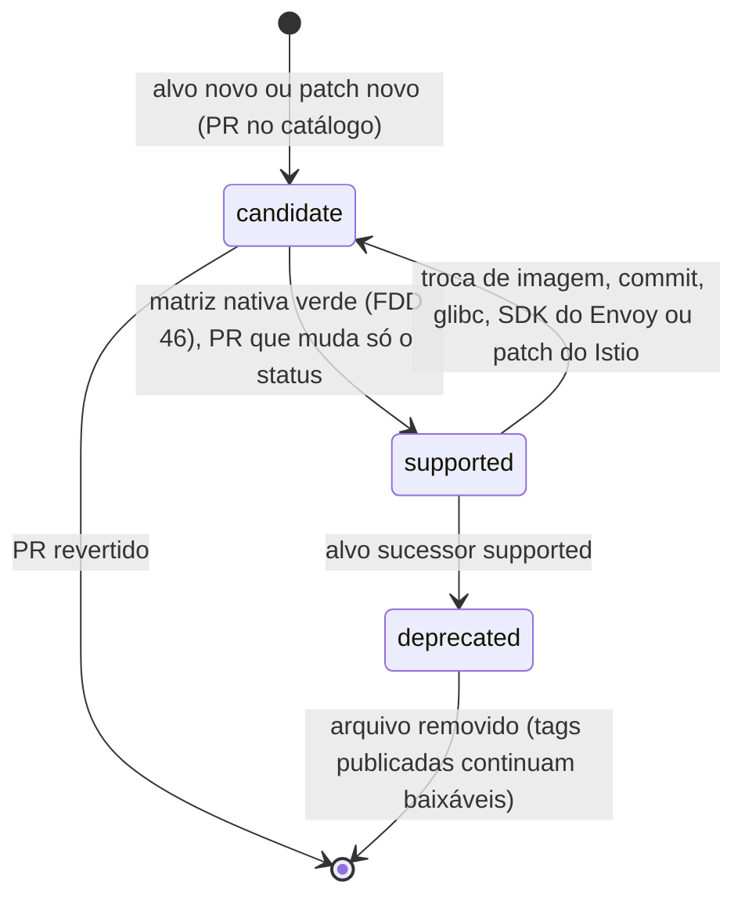
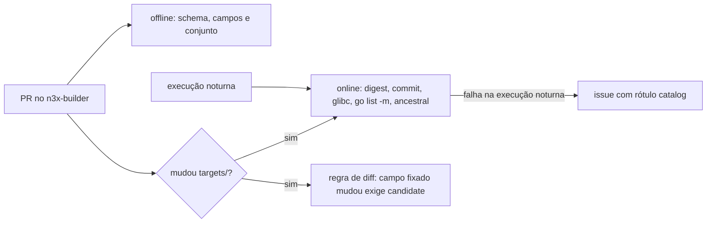

### FDD: Catálogo de alvos e `n3x-plugin add` (BLD-01)

Versão: 1.0
Data: 2026-10-20
Responsável: Guilherme Giusti

---

### 1. Contexto e motivação técnica

**Problema técnico.** O builder só existe durante o `docker build` do operador. Entre uma linha `RUN` e outra, o único estado que sobrevive é o sistema de arquivos da camada, e o `n3x-plugin add` é o primeiro ponto em que um plugin errado pode ser barrado. Hoje os documentos dizem o que o `add` faz ("resolve, confere a estrutura, registra"), mas não fixam o comportamento verificável: o que é "versão exata", o que acontece com o mesmo módulo duas vezes, como o plugin core é tratado, em que ordem as checagens rodam e como o workspace fica igual byte a byte. Além disso, o HLD promete que o `add` "baixa só o `n3x-plugin.yaml` e a árvore de pastas", o que o protocolo do Go module proxy não permite (L-61).

Do outro lado está o catálogo de alvos (`targets/<alvo>.yaml`), a fonte de verdade que fixa a imagem do Envoy por digest, o commit, a glibc, a pseudo-versão do SDK Go do Envoy (que não tem tag), as capacidades e o status de cada alvo. Sem schema, regras e checagem na CI, um digest ou commit errado só aparece no teste de carga, e um nome de capacidade digitado errado só aparece em runtime.

**Encaixe no HLD.** Esta FDD especifica, no repositório `n3x-builder` (HLD, "Componentes e responsabilidades", linhas Catálogo de alvos, Workspace e `add`):

- o formato e a validação de `targets/<alvo>.yaml`, o ciclo de vida do alvo e a primeira versão dos arquivos `envoy-1.40.yaml` e `istio-1.31.yaml`
- os arquivos que a imagem de build embute para o `n3x-plugin` ler: `/etc/n3x/target.yaml` (cópia do alvo) e `/etc/n3x/builder.yaml` (identidade da imagem)
- o comando `n3x-plugin add <módulo>@<versão>` e o workspace `/n3x/work`
- os comandos de consulta `n3x-plugin version` e `n3x-plugin targets`

Quem consome:

- FDD 20 (BLD-02): passo 1 do `build` lê o workspace e o `/etc/n3x/target.yaml`; o relator dá o formato das mensagens dos códigos que o `add` emite
- FDD 21 (BLD-03): build tag do alvo, pseudo-versão do SDK Go do Envoy e ordem fixa dos plugins
- FDD 22 (BLD-04): `target`, versões da imagem e `plugins[].manifest` do manifesto embutido
- FDD 23 (BLD-05): imagem do Envoy do alvo para símbolos e teste de carga
- FDD 28 (SID-08): digest da base da imagem de runtime do sidecar
- FDD 46 (BLD-07): cópia do arquivo do alvo na imagem, promoção de `candidate` para `supported`
- FDDs 16 (SID-02) e 49 (SID-11): capacidades de cada alvo

**Atores.** Operador (escreve o Dockerfile com uma linha `RUN n3x-plugin add` por plugin), autor de plugin (publica o repositório com `n3x-plugin.yaml` e tag semver), mantenedor do `n3x-builder` (edita o catálogo e promove alvos), CI do `n3x-builder` (valida o catálogo), `n3x-plugin build` (consome o workspace e o alvo).

**Limites.** O `add` resolve e valida um único módulo por chamada, sem baixar dependências transitivas, sem compilar e sem conferir regras que dependem do conjunto de plugins (IDs duplicados entre módulos diferentes, `depends_on`), que são do `build` (FDD 20). O `add` não lê o alvo: o mesmo `add` funciona igual na `sidecar-builder` e na `controller-builder`.

**Suposições**
- A fase 0 do README roda antes da implementação: o spike `envoy-1.40` é obrigatório antes da FDD 16, que vem antes desta; o spike `istio-1.31` pode faltar até a FDD 49
- O SDK `v0.1.0` (marco M1) já traz `plugin.DecodeManifest`, `plugin.ReadSDKRange`, `plugin.CheckNamespace`, `yamlconv.ToJSON` (FDD 01) e `proxy.ParseCapability`, `proxy.NewTarget` (FDD 05)
- O Docker do operador usa BuildKit, com `--mount=type=cache` e `COPY` de arquivos locais; plugins privados entram por ZIP de módulo Go, sem secret (decisão aprovada na clarificação e refletida no PRD, no HLD e no ADR-005)
- Os plugins são módulos Go publicados com tag semver e acessíveis pelo `GOPROXY` configurado ou pelo VCS (PRD, "Dependências")

**Restrições**
- Lista de plugins só por `RUN n3x-plugin add <módulo>@<versão>`, uma linha por plugin, versão exata, sem arquivo de lista (ADR-005 do `n3x-builder`)
- Códigos `N3X-B001` a `N3X-B016` nunca mudam de significado; exit code 1 uso, 2 resolução, 3 compatibilidade (ADR-006 do `n3x-builder`; catálogo completo na FDD 20)
- Toda saída do `add` passa pelo relator `internal/report` da FDD 20 (formato, eventos, mascaramento e exit code); o `add` usa também o ambiente do `go` de `internal/resolve` e as funções `check.SDKRange` e `check.Namespace` de `internal/check` (FDD 20)
- O plugin core entra sempre, na versão da imagem (FR-015)
- O builder reaproveita as regras do SDK e não reimplementa nenhuma (FDD 01): ID, manifesto, faixa `sdk` e namespace vêm de `plugin/`; capacidades vêm de `proxy/`
- O `n3x-plugin` nunca importa `secret/` (a chave AES nunca passa pelo builder, HLD do `n3x-builder`)
- Documentação e mensagens em pt-BR; identificadores, campos e comandos em inglês

**Rastreabilidade**
- PRD 1.5: FR-015 (fluxo `RUN n3x-plugin add <módulo>@<versão>`; plugin core sempre incluído; erro "tentativa de remover o plugin core"); FR-014 (erro "repositório fora da estrutura: o `n3x-plugin add` falha e diz o que falta"); "Dependências" (SDK Go do Envoy sem tag, pseudo-versão confirmada com `go list -m`; istio-proxy 1.31 e commit derivado do `istio.deps`; glibc igual ou anterior à das imagens do Envoy); critério de aceite "os mesmos plugins geram `.so` para `envoy-1.40` e `istio-1.31`"
- HLD do `n3x-builder`: "Catálogo de alvos", "Componentes e responsabilidades", "Fluxo de requisição" (passo `add`), "Interfaces públicas", "Erros do build", "Observabilidade" e "Segurança"; HLD de plataforma: "Regras de versionamento entre repositórios" e "Matriz de CI"; HLD do `n3x-sdk`: "Estrutura padrão de um repositório de plugin" e "Manifesto `n3x-plugin.yaml`"
- ADRs do `n3x-builder`: ADR-001 (semver por imagem), ADR-005 (lista só por `RUN n3x-plugin add`), ADR-006 (códigos `N3X-Bxxx`), ADR-007 (build reproduzível); ADRs do `n3x-sdk`: ADR-011 (módulo único), ADR-012 (ID com namespace), ADR-013 (manifesto `n3x-plugin.yaml`), ADR-021 (faixa `sdk` e semver estrito)
- FDD 20 (BLD-02): relator, evento JSON, códigos `N3X-B015` (checksum divergente) e `N3X-B016` (Go mais novo que o da imagem), ambiente do `go` e funções de checagem compartilhadas (ajuste pós-FDD 20); o helper `git-credential` deixou de existir (decisão aprovada na clarificação da FDD 20)
- Lacunas do README:
  - **L-61 fechada:** o `add` baixa o `.zip` inteiro do módulo com `go mod download -json`, lê o manifesto e a árvore no diretório extraído do cache de módulos e grava os hashes `h1:` no `go.sum` do workspace; o custo é absorvido pelo cache do BuildKit nas linhas `add` (contrato 4)
  - **L-20 aplicada:** o campo `capabilities` usa os nomes da FDD 05, validados por `proxy.ParseCapability`; `envoy-1.40` declara `[request_body, route_change]`; `istio-1.31` começa com `[]` até o spike e a FDD 49 (contrato 1)
  - **L-21 registrada:** campos `envoy_go_sdk`, `envoy.image` (patch e digest), `envoy.commit`, `envoy.glibc` e `istio.version`, com o processo de preenchimento e a checagem online; decisão aprovada na clarificação: manter os valores reais pendentes até a fase 0, incluindo os dados e capacidades do alvo Istio que dependem do spike (seção 4, "Preenchimento e promoção de um alvo")

---

### 2. Objetivos técnicos

- **Veredito estável por cenário.** Medida: cada recusa do `add` sai com um código `N3X-Bxxx` e o exit code da categoria do ADR-006; há um teste por cenário com plugin de `testdata/` servido por um `GOPROXY` local, conferindo código, exit code e a linha "como resolver".
- **Workspace determinístico.** Invariante: o mesmo conjunto de `add` bem-sucedidos gera os mesmos bytes em `plugins.json`, `go.mod` e `go.sum`, em qualquer ordem das linhas `RUN` (lista ordenada por ID). Conferido com as 6 permutações de 3 plugins, comparando SHA-256.
- **Idempotência.** Invariante: `add` repetido com o mesmo módulo e a mesma versão termina com exit 0 e não muda nenhum byte do workspace.
- **Falha sem efeito colateral.** Invariante: um `add` que falha não muda nenhum byte do workspace (gravação atômica; e no Docker a camada da linha que falhou nem é criada).
- **Mesmas regras do SDK.** Medida: o `add` chama `plugin.ReadSDKRange`, `plugin.DecodeManifest` e `plugin.CheckNamespace` do SDK embutido na imagem; nenhum código do builder repete regex de ID ou regra de manifesto (busca na CI do builder).
- **Imagem antiga falha pela faixa, não pelo campo novo.** Invariante: um manifesto com campo de uma minor futura do SDK e faixa `sdk` que exclui o SDK da imagem falha com `N3X-B004`, nunca com `N3X-B003` (pedido da FDD 01).
- **Catálogo correto antes de virar imagem.** Medida: em todo PR, os arquivos de `targets/` passam na validação offline (schema e regras); em todo PR que muda `targets/` e toda noite, a validação online confere digest no registro, commit pelo `envoy --version`, glibc pela imagem e pseudo-versão pelo `go list -m`.
- **Sem credenciais no `add`.** Invariante aprovado na clarificação: o `add` não lê secret, não configura helper Git e não recebe token; o ZIP privado é conteúdo confidencial, não credencial. Conferido por teste: nenhum processo filho do `add --archive` é um `git` e o ambiente do `go` não contém variável de credencial.
- **Custo do `add` previsível.** Medida: com o módulo já no cache de módulos, `add` termina em até 2 s no p95 de 20 execuções num runner amd64 da CI (hipótese).

---

### 3. Escopo e exclusões

**Incluído**
- Schema de `targets/<alvo>.yaml` (formato 1): `format`, `id`, `status`, `envoy.image`, `envoy.commit`, `envoy.glibc`, `envoy_go_sdk`, `runtime_image`, `capabilities`, `archs` e o bloco `istio.version` do alvo `istio-1.31`; build tag derivada do `id`
- Ciclo de vida `candidate`, `supported`, `deprecated` e o efeito de cada status no `add` e no `build`
- Validação do catálogo: biblioteca `internal/catalog` (mesmo leitor do `build` e do `targets`), checagens offline em todo PR, checagens online e regra de diff do PR
- Primeira versão de `targets/envoy-1.40.yaml` e `targets/istio-1.31.yaml`, com o processo de preenchimento a partir dos spikes da fase 0
- Arquivos da imagem `/etc/n3x/target.yaml` (cópia byte a byte do alvo) e `/etc/n3x/builder.yaml` (identidade da imagem: tipo, versões de builder, Go, SDK, runtime e plugin core) (hipótese para o segundo)
- Comando `n3x-plugin add <módulo>@<versão>`: sintaxe, versão exata, resolução do módulo, leitura do `n3x-plugin.yaml`, conferência da estrutura, validação do manifesto pelo SDK, faixa `sdk`, namespace `n3x`, tratamento do plugin core e registro no workspace
- Workspace `/n3x/work`: `plugins.json`, `go.mod` e `go.sum`, ordem, idempotência e o caso do mesmo módulo em versões diferentes
- Comandos `n3x-plugin version` e `n3x-plugin targets`, em texto e JSON
- Códigos emitidos pelo `add`: `N3X-B001`, `N3X-B002`, `N3X-B003`, `N3X-B008` (escopo do ASSUNTO) e também `N3X-B004`, `N3X-B005`, `N3X-B007`, `N3X-B015` e `N3X-B016` (seção 6), sempre pelo relator da FDD 20
- Conferência da diretiva `go` do `go.mod` do plugin contra o Go da imagem (`N3X-B016`)

**Excluído**
- `go mod download` completo do grafo, conferência de todo o `go.sum` no `sum.golang.org`, IDs e serviços gRPC duplicados entre módulos diferentes, `depends_on`, inclusão do core no build e checagem repetida da faixa e do namespace para o conjunto: FDD 20 (BLD-02)
- Formato da mensagem de erro, relator `internal/report`, evento JSON, valores de `status`, catálogo de códigos e avisos e `docs/erros.md`: FDD 20 (BLD-02); aqui se define o que o `add` emite
- Ambiente do processo `go`, `GOPROXY` com o proxy em arquivo da imagem, fonte local de módulos privados `/n3x/private-proxy/` e classificação dos erros do `go` (`resolve.Classify`): FDD 20 (BLD-02); aqui só se usam
- Geração de código e compilação, uso da build tag e de `TARGETARCH`: FDD 21 (BLD-03)
- Manifesto embutido e campo `warnings`: FDD 22 (BLD-04)
- Publicação das imagens, matriz alvo × arquitetura, execução da promoção `candidate` para `supported` e política de publicar imagens `candidate`: FDD 46 (BLD-07)
- Regras do manifesto do plugin (campos e validação): FDD 01 (SDK-01); aqui só se aplicam
- Lista de capacidades e semântica de `Target().Has`: FDD 05 (SDK-05); confirmação por alvo nas FDDs 16 (SID-02) e 49 (SID-11)
- Arquivo de lista de plugins (`add -f`): fora da v1 (ADR-005 do `n3x-builder`)
- Comando para remover plugin: não existe na v1; a lista é o próprio Dockerfile
- Pendência não bloqueante: o aviso `archive_unverified` do `add --archive` fica só no log do `add`, como os demais avisos do `add` (FDD 22, contrato 5, "Ficam só no log"); se deve ir ao `warnings` do manifesto é decisão futura da FDD 22, sem impacto no planejamento

---

### 4. Fluxos detalhados e diagramas

**Fluxo principal: `RUN n3x-plugin add <módulo>@<versão>`**

1. **Sintaxe (sem rede).** Exatamente um argumento posicional; separa módulo e versão no último `@`. O módulo passa em `module.CheckPath`; a versão precisa ser semver canônica (`semver.Canonical(v) == v`), não pode ser pseudo-versão e precisa casar com o sufixo de major do caminho (`module.Check`). Falha: erro de uso (`rep.Usage`, regra `usage`), exit 1. A única exceção é a palavra `none`, que segue até o passo 4 para ser tratada como tentativa de remoção. Antes disso, o `add` cria o relator (`report.New` com `Cmd: "add"`, `Total: 0` e o formato de `report.ParseFormat`) e abre a etapa com `rep.Begin(0, report.StepAdd, "<módulo>@<versão>")`.
2. **Identidade da imagem (sem rede).** Lê `/etc/n3x/builder.yaml` (contrato 2): tipo do artefato, versão do Go, versão do SDK da imagem e módulo e versão do plugin core. Arquivo ausente ou inválido: erro de uso com a regra `image_invalid`, exit 1.
3. **Workspace (sem rede).** Lê `/n3x/work/plugins.json`; se não existe, começa vazio. `format` maior que o conhecido ou arquivo ilegível: erro de uso com a regra `workspace_invalid`, exit 1.
4. **Plugin core (sem rede).** Se o caminho do módulo, sem o sufixo de major, é o do plugin core da imagem:
   - mesma versão e mesmo caminho: aviso `core_implicit`, nada é gravado, exit 0
   - versão `none`, outra versão ou outra major: `N3X-B008`, exit 3
5. **Mesmo módulo já na lista (sem rede).** Comparação pelo caminho sem o sufixo de major:
   - mesma versão: resultado `unchanged`, nada é gravado, exit 0
   - versão ou major diferente: `N3X-B005`, exit 3 (seção 6)
6. **Resolução.** Executa `go mod download -json <módulo>@<versão>` num diretório temporário vazio, com prazo total de 120 s e o ambiente de `resolve.NewEnv(environ, resolve.ModeAdd)` (FDD 20, contrato 10): lista de permissão de variáveis, `GOFLAGS` vazio, `GOPROXY` com `file:///usr/share/n3x/pinned/proxy` na frente do valor do operador. Sem helper nem secret. Os avisos devolvidos por `NewEnv` (`goflags_ignored`, `sumdb_off`, `insecure_fetch`, `pinned_bypass`) saem com `Step.Warn`. O comando baixa `.info`, `.mod` e `.zip` do módulo do plugin (nunca das dependências), confere o checksum no `sum.golang.org` quando o módulo não é privado, extrai no cache de módulos e devolve `Dir`, `GoMod`, `Sum` e `GoModSum`. Erro: classificado por `resolve.Classify` (FDD 20, contrato 6): `N3X-B015` (`checksum`) e `N3X-B001` (`not_found`, `no_access`, `network`, `not_in_sumdb`, `proxy_off`, `go_error`), exit 2; `N3X-B016` (`go_version`), exit 3, se o próprio `go` recusar pela versão.
7. **Manifesto presente.** `Dir/n3x-plugin.yaml` precisa ser arquivo regular na raiz do módulo. Ausente: `N3X-B002` (`manifest_missing`), exit 2, citando o nome parecido se existir (por exemplo, `n3x-plugin.yml`).
8. **Leitura.** Lê até `plugin.MaxManifestSize` (64 KiB); maior: `N3X-B003` (`size`). Converte com `yamlconv.ToJSON`; erro de sintaxe: `N3X-B003` (`syntax`, com linha e coluna).
9. **Faixa `sdk` antes da decodificação estrita (pedido da FDD 01).** `check.SDKRange(json, info.SDKVersion(), plugin)` da FDD 20, que usa `plugin.ReadSDKRange` e `SDKRange.Contains`:
   - faixa válida que não contém o SDK da imagem: `N3X-B004` (`sdk_range`), exit 3, com a faixa exigida e a versão disponível; a decodificação estrita não roda
   - faixa ausente ou inválida: segue para o passo 10, que relata o problema junto com os outros
10. **Manifesto.** `plugin.DecodeManifest(json)`: qualquer problema vira `N3X-B003`, exit 2, com todos os `FieldError` (caminho, regra e texto), na ordem do SDK, convertidos por `report.FromFieldErrors` e entregues com `Step.FailAll`.
11. **Coerência com o pedido e estrutura** (todos os problemas juntos, exit 2):
    - `version` do manifesto diferente da versão pedida sem o `v`: `N3X-B003` (`version_mismatch`)
    - cada metade em `halves` precisa da sua pasta com pelo menos um arquivo `.go` que não seja `_test.go`: `proxy` exige `agent/`, `controller` exige `controller/`; falta: `N3X-B002` (`half_folder_missing`), um problema por pasta
12. **Compatibilidade** (todos os problemas juntos, exit 3):
    - `check.Namespace(m.ID, módulo, plugin)` da FDD 20, que usa `plugin.CheckNamespace`: `N3X-B007` (`reserved_namespace`) (hipótese: conferido já no `add`)
    - ID `n3x.core` vindo de módulo que não é o plugin core da imagem: `N3X-B008` (`core_replacement`)
    - diretiva `go` do `go.mod` do plugin (arquivo `GoMod` devolvido no passo 6, lido com `modfile.ParseLax`) maior que o `go` de `/etc/n3x/builder.yaml`, comparada com `go/version.Compare`: `N3X-B016` (`go_version`), com a versão exigida e a disponível (ajuste pós-FDD 20). Só a diretiva do próprio plugin é conferida aqui; a das dependências é do passo 2 do `build`
13. **Avisos, sem falhar:**
    - pasta `agent/` ou `controller/` com código, mas a metade não está em `halves`: aviso `undeclared_half_folder` (hipótese)
    - plugin sem a metade deste artefato (por exemplo, só de controller na `sidecar-builder`): registrado mesmo assim, com a informação "entra só no manifesto" (HLD do `n3x-builder`: o plugin fica no manifesto para o inventário)
14. **Registro.** Monta a entrada `{id, module, version, sum, go_mod_sum, manifest}`, com `manifest = json.Marshal(m)` (forma que vai para `plugins[].manifest` do manifesto embutido, FDD 01). Insere em ordem de `id` e, no empate, de `module`. Renderiza `go.mod` e `go.sum` a partir da lista e prepara os três arquivos temporários no mesmo diretório, com `fsync`. Substitui os arquivos por `rename`, com `plugins.json` por último. Se qualquer substituição falhar, restaura por rollback os arquivos originais (ou remove os que ainda não existiam) antes de retornar erro; não deixa uma combinação parcial dos três arquivos como estado final. A substituição não garante que leitores concorrentes vejam os três arquivos mudarem simultaneamente.
15. **Saída.** A etapa recebe os campos próprios com `Step.Set` (`plugin_id`, `plugin_module`, `plugin_version`, `halves`, `result`, `cache_hit`, `zip_bytes`) e a nota com `Step.Note`; `Step.End` escreve a linha da etapa, depois os avisos e os blocos de erro; `rep.Finish` escreve o resumo e devolve o exit code (0 em sucesso). O `add` não escreve nada no stderr fora do relator.

**Fluxos alternativos e exceções**
- **Repositório privado por referência remota:** `add <módulo>@<versão>` não recebe credencial. O erro é `N3X-B001` (`no_access`) com "como resolver: copie o ZIP do módulo e use `n3x-plugin add --archive`" (seção 6).
- **Plugin privado por `--archive` (decisão aprovada na clarificação):** `COPY dist/plugin.zip /n3x/private/plugin.zip` e `RUN n3x-plugin add --archive /n3x/private/plugin.zip [--sha256 <hex>]`. Sem rede e sem Git:
  - módulo e versão vêm do prefixo interno `<módulo>@<versão>/` do ZIP no formato de módulo Go; a versão segue as regras do passo 1 e o prefixo precisa casar com o `module` do `go.mod` interno
  - extrai para o `GOMODCACHE`, calcula `Sum` (`h1:` do ZIP) e `GoModSum` e segue do passo 7 em diante do fluxo principal, com as mesmas checagens
  - `--sha256` é opcional: informado e divergente, `N3X-B015` (`archive_sha256`); ausente, aviso `archive_unverified`, e o `h1:` calculado é gravado no workspace
  - `--archive` e `<módulo>@<versão>` são mutuamente exclusivos; uma linha `RUN` por plugin
  - dependências privadas transitivas não passam pelo `add`: ficam na fonte local `/n3x/private-proxy/` (formato `GOPROXY=file://`) e são resolvidas no passo 2 do `build` (FDD 20); falta de módulo vira `N3X-B001`
- **Erro de rede transitório** (regra `network` de `resolve.Classify`): uma nova tentativa depois de 2 s, dentro do prazo total de 120 s (hipótese). Nenhuma outra regra é repetida.
- **Checksum divergente** (`SECURITY ERROR` ou `checksum mismatch` do `go`): `N3X-B015` (`checksum`), exit 2, sem nova tentativa e sem gravar nada (ajuste pós-FDD 20). A regra `workspace_sum` do mesmo código é do passo 2 do `build`, quando o `h1:` baixado difere do que o `add` gravou.
- **Plugin que exige Go mais novo que o da imagem:** `N3X-B016` (`go_version`), exit 3, pelo passo 12 ou, se o `go` recusar antes, pela classificação do passo 6.
- **Pasta da metade que é um módulo aninhado** (`agent/go.mod`): o `.zip` do módulo não inclui módulos aninhados, então a pasta não aparece e o resultado é `N3X-B002`.
- **Plugin dentro de um subdiretório de outro módulo:** não é aceito; o `n3x-plugin.yaml` precisa estar na raiz de um módulo. Isso afeta o plugin de exemplo do SDK (inconsistência I-05, pedido à FDD 13).
- **`add` depois de um `build` no mesmo estágio:** não suportado; o `add` renderiza `go.mod` e `go.sum` só a partir de `plugins.json` e descarta o que o `build` acrescentou. O `build` sempre parte do workspace.
- **Argumento `@none`:** no plugin core, `N3X-B008` ("o plugin core não pode ser removido"); em outro módulo, exit 1 ("não existe remoção; tire a linha do Dockerfile").
- **Alvo `candidate` ou `deprecated`:** decisão aprovada na clarificação: manter o comportamento em que o `add` não lê o alvo e não muda nada. O `build` avisa no passo 1 e nunca falha por status (pedido à FDD 20) (hipótese). O status embutido é um retrato do momento em que a imagem foi construída: uma tag publicada não muda quando o catálogo muda depois.

**Fluxo: preenchimento e promoção de um alvo (L-21)**

1. Escolher o patch: o último `v1.40.x` do `envoyproxy/envoy` (ou o último `1.31.x` do Istio).
2. Digest: `docker buildx imagetools inspect <imagem>:<tag>` e gravar `envoy.image` como `<imagem>:<tag>@sha256:<digest>`.
3. Commit: `docker run --rm --entrypoint envoy <imagem>@<digest> --version` e gravar os 40 hex em `envoy.commit`. No Istio, o commit vem do `istio.deps` daquele patch (repositório `istio/proxy`, que fixa o commit do Envoy), conferido pelo mesmo `envoy --version` dentro da `istio/proxyv2`.
4. glibc: `docker run --rm --entrypoint getconf <imagem>@<digest> GNU_LIBC_VERSION` e gravar `X.Y` em `envoy.glibc`.
5. SDK Go do Envoy: num módulo temporário, `GOPROXY=https://proxy.golang.org GOFLAGS=-mod=mod go list -m <módulo do SDK>@<commit>`; a saída `"<módulo> <pseudo-versão>"` vai, sem mudança, para `envoy_go_sdk` (PRD, "Dependências"). Para `envoy-1.40`, o commit é o da tag `v1.40.0` (PRD); a regra geral é que a revisão da pseudo-versão seja ancestral ou igual a `envoy.commit` (hipótese, contrato 1).
6. Abrir PR com `status: candidate`. A CI roda a validação offline, a online e a regra de diff.
7. A matriz nativa da FDD 46 compila, compara símbolos e faz o teste de carga em amd64 e arm64. Verde: PR de promoção que muda só `status` para `supported`.

Os passos 2 a 5 ficam num utilitário da CI, `go run ./internal/catalog/probe -target <id> -image <imagem>:<tag>`, que imprime o trecho YAML para revisão (hipótese de nome).

**Fluxo: validação do catálogo na CI do `n3x-builder`**
- **Todo PR (offline, sem rede):** `go test ./internal/catalog/... ./targets/...` carrega todos os `targets/*.yaml` com `catalog.LoadDir`, aplicando o schema, as regras de campo e as regras de conjunto (contrato 1).
- **PR que muda `targets/` e execução noturna (online):** `go test -tags catalog_online ./targets/...` confere, por alvo, que o digest existe e que a tag ainda aponta para ele no registro, que o manifest list tem as plataformas de `archs`, o commit pelo `envoy --version`, a glibc pelo `getconf`, a pseudo-versão pelo `go list -m` e a ancestralidade pela API de comparação do GitHub (`GET /repos/envoyproxy/envoy/compare/<revisão>...<commit>` com status `identical` ou `ahead`). Prazo de 60 s por chamada e 10 min por job (hipótese).
- **Regra de diff do PR (offline, contra a branch base):** mudar `envoy.image`, `envoy.commit`, `envoy.glibc`, `envoy_go_sdk` ou `istio.version` exige `status: candidate` no mesmo PR; um PR que muda `status` para `supported` não pode mudar mais nada no arquivo; um arquivo só pode ser removido a partir de `deprecated` (hipótese).

**Fluxo: `n3x-plugin version` e `n3x-plugin targets`**
- `version` lê `/etc/n3x/builder.yaml` e, na `sidecar-builder`, o `id` e o `status` de `/etc/n3x/target.yaml`; imprime no stdout (contrato 6).
- `targets` lê `/etc/n3x/target.yaml` com `catalog.Load` e imprime o alvo da imagem; na `controller-builder`, informa que não há alvo, com exit 0 (contrato 7).
- Os dois são locais: não abrem rede e terminam em menos de 100 ms.

**Diagramas**

Sequência do `add`:

```mermaid
sequenceDiagram
    participant D as RUN no Dockerfile
    participant A as n3x-plugin add
    participant W as /n3x/work
    participant G as go mod download
    participant P as GOPROXY ou VCS
    participant S as n3x-sdk (yamlconv e plugin/)
    D->>A: add módulo@versão
    A->>A: sintaxe e versão exata (senão exit 1)
    A->>A: lê /etc/n3x/builder.yaml
    A->>W: lê plugins.json
    A->>A: core? mesmo módulo na lista? (sem rede; N3X-B008, N3X-B005)
    A->>G: go mod download -json módulo@versão (prazo 120 s)
    G->>P: proxy em arquivo da imagem, depois GOPROXY do operador (e sum.golang.org)
    G-->>A: Dir, GoMod, Sum e GoModSum, ou Error (resolve.Classify: N3X-B001, N3X-B015)
    A->>A: n3x-plugin.yaml na raiz? (N3X-B002)
    A->>S: yamlconv.ToJSON
    A->>A: check.SDKRange: faixa contém o SDK da imagem? (N3X-B004)
    A->>S: plugin.DecodeManifest (N3X-B003)
    A->>A: version igual à tag; pastas das metades (N3X-B003, N3X-B002)
    A->>A: check.Namespace (N3X-B007); n3x.core de outro módulo (N3X-B008); diretiva go (N3X-B016)
    A->>W: grava go.mod, go.sum e plugins.json (ordem por ID)
    A-->>D: relator: linha da etapa, avisos, resumo e exit code
```

Ciclo de vida do alvo:



Validação do catálogo na CI:



---

### 5. Contratos públicos (assinaturas, endpoints, headers, exemplos)

**Contrato 1: arquivo de alvo `targets/<alvo>.yaml`**
- Tipo: arquivo YAML, formato 1 (interno ao builder; copiado para as imagens)
- Assinatura/Rota: `n3x-builder/targets/<id>.yaml`
- Método: n/a (lido por `catalog.Parse`, `catalog.Load` e `catalog.LoadDir`, contrato 3)
- Semântica:

| Campo | Tipo | Obrigatório | Regra de validação (`Rule`) | Exemplo |
| --- | --- | --- | --- | --- |
| `format` | inteiro | sim | igual a 1 (`format`) | `1` |
| `id` | texto | sim | casa com `^(envoy\|istio)-[0-9]+\.[0-9]+$`, é aceito por `proxy.NewTarget` e é igual ao nome do arquivo sem `.yaml` (`id_format`, `file_name`) | `envoy-1.40` |
| `status` | texto | sim | `candidate`, `supported` ou `deprecated` (`enum`) | `candidate` |
| `istio` | objeto | só em `istio-*` | obrigatório em `istio-*` e proibido em `envoy-*` (`block_missing`, `block_unexpected`) | |
| `istio.version` | texto | sim no bloco | semver `X.Y.Z` sem `v`, com `X.Y` igual ao do `id` (`istio_version`) | `1.31.2` |
| `envoy.image` | texto | sim | referência com tag e `@sha256:` de 64 hex (`image_ref`); em `envoy-X.Y`, tag `vX.Y.<patch>`; em `istio-X.Y`, repositório `istio/proxyv2` e tag igual a `istio.version` (`image_tag`) | `envoyproxy/envoy:v1.40.2@sha256:<64 hex>` |
| `envoy.commit` | texto | sim | 40 hex minúsculos (`commit_format`) | `<40 hex>` |
| `envoy.glibc` | texto | sim | `^[0-9]+\.[0-9]+$`, entre aspas no YAML (`glibc_format`) | `"2.35"` |
| `envoy_go_sdk` | texto | sim | `"<módulo> <versão>"` com um espaço, igual à saída de `go list -m`; módulo válido por `module.CheckPath`; versão é pseudo-versão canônica (`go_sdk_format`, `pseudo_version`) | ver exemplo |
| `runtime_image` | texto | sim | `ghcr.io/giustech/n3x/sidecar`, sem tag nem digest (`runtime_image`) | |
| `capabilities` | lista de texto | sim, pode ser `[]` | cada item aceito por `proxy.ParseCapability` (`capability`); sem repetição (`duplicate`); na ordem de `proxy.AllCapabilities()` (`order`) | `[request_body, route_change]` |
| `archs` | lista de texto | sim, não vazia | `amd64` ou `arm64` (`enum`); sem repetição (`duplicate`); ordem `amd64, arm64` (`order`) | `[amd64, arm64]` |

  - Regras gerais: arquivo até 64 KiB (`size`); YAML pelo `yamlconv.ToJSON` (`syntax`); campo desconhecido é erro (`unknown_field`); tipo errado (`type`); campo ausente (`required`). Todos os problemas saem numa passada, como `plugin.FieldErrors`, com o caminho na convenção L-34
  - Regras de conjunto (`catalog.LoadDir`): `id` único no diretório (`duplicate`); nenhum arquivo fora do padrão `<id>.yaml` (`file_name`)
  - Regras online (CI): digest existe e a tag aponta para ele (`image_digest`); manifest list com as plataformas de `archs` (`image_platform`); `envoy --version` mostra `envoy.commit` (`commit_mismatch`); `getconf GNU_LIBC_VERSION` mostra `envoy.glibc` (`glibc_mismatch`); `go list -m` imprime exatamente `envoy_go_sdk` (`go_list_mismatch`); a revisão da pseudo-versão é ancestral ou igual a `envoy.commit` (`sdk_not_ancestor`) (hipótese para a regra de ancestral)
  - **Build tag derivada:** `Target.BuildTag()` devolve `n3x_` mais o `id` sem `-` e `.`: `n3x_envoy140` e `n3x_istio131`, as tags dos adaptadores no HLD do `n3x-sidecar` (hipótese: derivação, não campo)
  - **Status:** `candidate` (ainda sem a matriz nativa verde), `supported` (matriz nativa verde no patch fixado) e `deprecated` (sem patches novos; existe sucessor). No `add`, nenhum efeito; no `build`, `candidate` e `deprecated` geram aviso e nunca falha (hipótese; emissão pela FDD 20)
  - **Capacidades (L-20 aplicada):** só `request_body` e `route_change` existem na v1 (FDD 05). `envoy-1.40` declara as duas (HLD do `n3x-builder`; confirmação do adaptador pela FDD 16). `istio-1.31` começa com `[]`, valor conservador até o spike e a FDD 49 (hipótese): com `[]`, um plugin que exige body falha na subida, de forma explícita (FDD 05), em vez de achar que tem body
  - **Versionamento do arquivo:** o leitor do builder é estrito e sempre tem a mesma versão do arquivo que a imagem embute. Campo opcional novo mantém `format: 1`; mudança que quebra leitores externos (FDDs 28 e 48) sobe para `format: 2`. Leitores externos ignoram campo desconhecido

**Exemplo de requisição** (primeira versão dos dois arquivos; valores entre `<>` pendentes da fase 0)
```yaml
# targets/envoy-1.40.yaml
format: 1
id: envoy-1.40
status: candidate
envoy:
  image: envoyproxy/envoy:v1.40.<patch>@sha256:<fase 0>
  commit: <fase 0: 40 hex de envoy --version>
  glibc: "<fase 0: getconf GNU_LIBC_VERSION>"
envoy_go_sdk: github.com/envoyproxy/envoy/source/extensions/dynamic_modules/sdk/go v0.0.0-<fase 0>
runtime_image: ghcr.io/giustech/n3x/sidecar
capabilities: [request_body, route_change]
archs: [amd64, arm64]
---
# targets/istio-1.31.yaml (criado nesta FDD se o spike do Istio já rodou; senão, na FDD 49)
format: 1
id: istio-1.31
status: candidate
istio:
  version: 1.31.<fase 0>
envoy:
  image: istio/proxyv2:1.31.<patch>@sha256:<fase 0>
  commit: <fase 0: derivado do istio.deps>
  glibc: "<fase 0>"
envoy_go_sdk: github.com/envoyproxy/envoy/source/extensions/dynamic_modules/sdk/go v0.0.0-<fase 0>
runtime_image: ghcr.io/giustech/n3x/sidecar
capabilities: []
archs: [amd64, arm64]
```

O caminho do módulo do SDK Go do Envoy é o do HLD do `n3x-builder` e também é confirmado no spike.

**Exemplo de resposta** (`catalog.Parse` com valores ilustrativos, e um arquivo com erros)
```json
{
  "valid": {
    "id": "envoy-1.40",
    "status": "candidate",
    "BuildTag()": "n3x_envoy140",
    "GoSDK()": { "Path": "github.com/envoyproxy/envoy/source/extensions/dynamic_modules/sdk/go", "Version": "v0.0.0-20260115093000-7c1f0e2a9b31" },
    "ProxyTarget().Capabilities()": ["request_body", "route_change"]
  },
  "invalid": [
    "capabilities[0]: capacidade desconhecida \"request_trailers\" [capability]",
    "envoy.image: falta o digest @sha256 [image_ref]",
    "status: \"stable\" não é candidate, supported nem deprecated [enum]"
  ]
}
```

---

**Contrato 2: arquivos da imagem `/etc/n3x/target.yaml` e `/etc/n3x/builder.yaml`**
- Tipo: arquivos YAML dentro das imagens de build (escritos pelo Dockerfile da imagem, FDDs 21 e 46; lidos pelo `n3x-plugin`)
- Assinatura/Rota: `/etc/n3x/target.yaml` (só na `sidecar-builder`) e `/etc/n3x/builder.yaml` (nas duas)
- Método: n/a
- Semântica:
  - `/etc/n3x/target.yaml`: cópia byte a byte de `targets/<alvo>.yaml` na tag da imagem, modo `0444`. Lido pelo `build` (FDDs 20 a 23) e pelos comandos `targets` e `version`, com o mesmo `catalog.Load`. Não existe na `controller-builder`
  - `/etc/n3x/builder.yaml` (hipótese de nome e de formato): identidade da imagem, modo `0444`, campos `format` (1), `kind` (`sidecar` ou `controller`), `builder` (semver da imagem, sem o sufixo do alvo), `go` (versão do toolchain), e `sdk`, `runtime` e `core` com `module` e `version` (versão de módulo Go, com `v`). Leitura estrita: campo desconhecido é erro
  - Invariante da imagem: `sdk.version` é a mesma versão do SDK compilada dentro do `n3x-plugin` (lida por `debug.ReadBuildInfo`), para que o `add` valide o manifesto com as regras do mesmo SDK que compila os plugins; conferido no teste da imagem (FDD 46) (hipótese)
  - `runtime.module`: `github.com/giustech/n3x-sidecar/core` na `sidecar-builder` e `github.com/giustech/n3x-controller/host` na `controller-builder` (HLD do `n3x-builder`)

**Exemplo de requisição** (`/etc/n3x/builder.yaml` da `sidecar-builder:1.0.0-envoy-1.40`)
```yaml
format: 1
kind: sidecar
builder: 1.0.0
go: 1.26.1
sdk: { module: github.com/giustech/n3x-sdk, version: v1.2.0 }
runtime: { module: github.com/giustech/n3x-sidecar/core, version: v1.0.0 }
core: { module: github.com/giustech/n3x-plugin-core, version: v1.0.0 }
```

**Exemplo de resposta** (`image.Load` no Go)
```json
{
  "Kind": "sidecar",
  "Builder": "1.0.0",
  "Go": "1.26.1",
  "SDK": { "Path": "github.com/giustech/n3x-sdk", "Version": "v1.2.0" },
  "Runtime": { "Path": "github.com/giustech/n3x-sidecar/core", "Version": "v1.0.0" },
  "Core": { "Path": "github.com/giustech/n3x-plugin-core", "Version": "v1.0.0" },
  "SDKVersion()": "1.2.0"
}
```

---

**Contrato 3: pacotes internos `internal/catalog` e `internal/image`**
- Tipo: method (API Go interna do `n3x-builder`, usada pelo `add`, `build`, `version`, `targets` e pela CI)
- Assinatura/Rota:
  ```go
  package catalog // github.com/giustech/n3x-builder/internal/catalog

  const FormatVersion = 1
  const MaxFileSize = 64 << 10

  type Status string

  const (
      StatusCandidate  Status = "candidate"
      StatusSupported  Status = "supported"
      StatusDeprecated Status = "deprecated"
  )

  type Arch string

  const (
      ArchAMD64 Arch = "amd64"
      ArchARM64 Arch = "arm64"
  )

  type Target struct {
      Format       int      `json:"format"`
      ID           string   `json:"id"`
      Status       Status   `json:"status"`
      Istio        *Istio   `json:"istio,omitempty"`
      Envoy        Envoy    `json:"envoy"`
      EnvoyGoSDK   string   `json:"envoy_go_sdk"`
      RuntimeImage string   `json:"runtime_image"`
      Capabilities []string `json:"capabilities"`
      Archs        []Arch   `json:"archs"`
  }

  type Envoy struct {
      Image  string `json:"image"`
      Commit string `json:"commit"`
      GLibc  string `json:"glibc"`
  }

  type Istio struct {
      Version string `json:"version"`
  }

  func Parse(name string, yaml []byte) (Target, error) // yamlconv + JSON estrito + Validate; name = nome do arquivo
  func Load(path string) (Target, error)
  func LoadDir(dir string) ([]Target, error)          // ordenado por id; regras de conjunto
  func (t Target) Validate() error                    // regras offline; plugin.FieldErrors
  func (t Target) BuildTag() string                   // "n3x_envoy140"
  func (t Target) GoSDK() (module.Version, error)     // separa módulo e pseudo-versão
  func (t Target) ProxyTarget() (proxy.Target, error) // proxy.NewTarget(ID, caps...)
  func (t Target) HasArch(a Arch) bool

  var ErrInvalidCatalog = errors.New("catalog: alvo inválido")

  package image // github.com/giustech/n3x-builder/internal/image

  const (
      InfoPath   = "/etc/n3x/builder.yaml"
      TargetPath = "/etc/n3x/target.yaml"
  )

  type Kind string

  const (
      KindSidecar    Kind = "sidecar"
      KindController Kind = "controller"
  )

  type Info struct {
      Format  int
      Kind    Kind
      Builder string
      Go      string
      SDK     module.Version
      Runtime module.Version
      Core    module.Version
  }

  func Load(path string) (Info, error)
  func (i Info) SDKVersion() plugin.Version // sem o "v", para SDKRange.Contains
  func (i Info) IsCore(modulePath string) bool // compara sem o sufixo de major
  ```
- Método: n/a (chamada local)
- Semântica:
  - Os erros embrulham `ErrInvalidCatalog` e a lista `plugin.FieldErrors` com `Unwrap() []error`, no mesmo padrão da FDD 01; os testes conferem `Path` e `Rule`
  - `Parse` não abre rede; as regras online ficam no teste com a build tag `catalog_online`
  - `ProxyTarget()` é a ponte com o contrato de proxy: o mesmo nome e as mesmas capacidades que o adaptador do alvo informa em runtime (FDDs 16 e 49)

**Exemplo de requisição**
```go
t, err := catalog.Load(image.TargetPath)
tag := t.BuildTag()
pt, _ := t.ProxyTarget()
info, _ := image.Load(image.InfoPath)
core := info.IsCore("github.com/giustech/n3x-plugin-core/v2")
```

**Exemplo de resposta**
```json
{ "err": null, "tag": "n3x_envoy140", "pt.Name()": "envoy-1.40", "pt.Has(CapRequestBody)": true, "core": true }
```

---

**Contrato 4: CLI `n3x-plugin add`**
- Tipo: sdk (CLI externa, usada no Dockerfile do operador)
- Assinatura/Rota:
  ```text
  n3x-plugin add [--log-format text|json] <módulo>@<versão>
  n3x-plugin add [--log-format text|json] --archive <caminho.zip> [--sha256 <hex>]
  ```
- Método: n/a
- Semântica de status/headers:
  - **Formato:** `--log-format` vence a variável `N3X_LOG_FORMAT`; padrão `text` (`report.ParseFormat`, FDD 20)
  - **Argumento:** exatamente um `<módulo>@<versão>` por chamada (uma linha por plugin, ADR-005). Mais de um argumento, nenhum, `-f` ou flag desconhecida: erro de uso (`usage`), exit 1
  - **Versão exata:** semver canônica com `v` (`v1.0.0`, `v1.1.0-rc.1`, `v2.3.4` em módulo `/v2`). Recusadas com exit 1: `latest`, `upgrade`, `patch`, nome de branch, hash de commit, `v1`, `v1.2`, `1.0.0` sem `v`, `>=v1.0.0`, pseudo-versão, `+incompatible` e major que não casa com o sufixo do caminho (hipótese para a pseudo-versão: a regra de versão igual à tag torna a pseudo-versão sempre inválida)
  - **Versão igual ao manifesto:** `version` do `n3x-plugin.yaml` precisa ser a versão pedida sem o `v` (`v1.1.0-rc.1` exige `version: 1.1.0-rc.1`); senão `N3X-B003` com regra `version_mismatch` (hipótese, fecha a pergunta P-02 da FDD 01). Motivo: uma única versão do plugin no inventário e no painel, sem duas fontes que divergem
  - **Ambiente do `go`:** o de `resolve.NewEnv(environ, resolve.ModeAdd)` (FDD 20, contrato 10). Herda só a lista de permissão (`PATH`, `HOME`, `TMPDIR`, `GOPROXY`, `GOPRIVATE`, `GONOPROXY`, `GONOSUMDB`, `GOSUMDB`, `GOINSECURE`, `GOMODCACHE`, `GOCACHE`, proxies HTTP e certificados; sem `GOAUTH` nem `NETRC`, alinhado à FDD 20), por `ARG` ou `ENV`; fixa `GOWORK=off`, `GOTOOLCHAIN=local`, `GOENV=off` e `GOFLAGS` vazio
  - **`GOPROXY` efetivo:** `file:///usr/share/n3x/pinned/proxy,` seguido do valor do operador (padrão `https://proxy.golang.org,direct`); o proxy em arquivo da imagem só tem os módulos fixados (SDK, runtime e plugin core), então um plugin comum cai no proxy seguinte
  - **Sem credencial, com `--archive`:** o `add` não lê secret nem configura helper Git. Plugin privado entra por `--archive <zip>` (identidade pelo prefixo do ZIP, `--sha256` opcional com aviso `archive_unverified`; exclusivo com `<módulo>@<versão>`). Dependências privadas transitivas ficam em `/n3x/private-proxy/`, resolvidas no `build` (FDD 20). Acesso remoto negado: `N3X-B001` (`no_access`) sugere `--archive`
  - **Cache:** o `.zip` e o diretório extraído vão para `GOMODCACHE` (padrão `/go/pkg/mod`). Com `--mount=type=cache,target=/go/pkg/mod` nas linhas `add`, o passo 2 do `build` reaproveita o download; sem o cache, o download fica na camada do estágio de build (nunca na imagem final) e o `build` baixa de novo
  - **Saída:** só pelo relator `internal/report` (FDD 20), no stderr; stdout vazio. Ordem: linha da etapa, avisos, blocos de erro e resumo. O prefixo da linha da etapa do `add` é `[add]`, porque o `add` usa `Total: 0` (hipótese de renderização; P-10 para a FDD 20)
  - **Exit codes:** 0 (registrado, sem mudança ou core implícito); 1 (uso: `usage`, `image_invalid`, `workspace_invalid`); 2 (`N3X-B001`, `N3X-B002`, `N3X-B003`, `N3X-B015`); 3 (`N3X-B004`, `N3X-B005`, `N3X-B007`, `N3X-B008`, `N3X-B016`). Quem calcula é `rep.Finish`
  - **Limites:** um módulo por chamada; prazo total de 120 s, com uma nova tentativa só na regra `network` (hipótese); manifesto até 64 KiB (FDD 01); até 100 problemas e 1 KiB por detalhe (relator da FDD 20); sem limite próprio de tamanho do `.zip` (vale o limite de 500 MiB do próprio Go)

**Exemplo de requisição**
```dockerfile
# syntax=docker/dockerfile:1
FROM ghcr.io/giustech/n3x/sidecar-builder:1.0.0-envoy-1.40 AS build
ARG GOPRIVATE=github.com/acme/*
RUN --mount=type=cache,target=/go/pkg/mod \
    n3x-plugin add github.com/giustech/n3x-plugin-ratelimit@v1.0.0
COPY dist/n3x-plugin-tenant-v0.4.2.zip /n3x/private/plugin.zip
COPY private-proxy/ /n3x/private-proxy/
RUN --mount=type=cache,target=/go/pkg/mod \
    n3x-plugin add --archive /n3x/private/plugin.zip
RUN --mount=type=cache,target=/go/pkg/mod \
    --mount=type=cache,target=/root/.cache/go-build \
    n3x-plugin build
```

**Exemplo de resposta** (texto, gramática do contrato 2 da FDD 20: sucesso, sem mudança, core implícito, uma falha e um erro de uso, cada um de uma linha `RUN`; a linha `resumo:` do relator foi omitida)
```text
[add] github.com/giustech/n3x-plugin-ratelimit@v1.0.0 (giustech.ratelimit; proxy e controller; 47 KiB baixados) ... ok 1.8s

[add] github.com/giustech/n3x-plugin-ratelimit@v1.0.0 (já na lista; nada mudou) ... ok 0.0s

[add] github.com/giustech/n3x-plugin-core@v1.0.0 (core implícito; nada mudou) ... ok 0.0s
aviso core_implicit: o plugin core entra sempre, na versão da imagem (v1.0.0); esta linha pode ser removida

[add] github.com/acme/n3x-plugin-tenant@v0.4.2 ... falhou 1.2s (1 problema)
erro N3X-B002: controller/: halves declara controller, mas a pasta controller/ não existe [half_folder_missing]
  como resolver: crie controller/ com a metade de controller, ou tire controller de halves no n3x-plugin.yaml, e publique uma nova tag
  doc: https://github.com/giustech/n3x-builder/blob/main/docs/erros.md#n3x-b002

erro: "latest" não é versão exata; use a tag semver publicada [usage]
  como resolver: n3x-plugin add <módulo>@<versão exata>, ex.: github.com/giustech/n3x-plugin-ratelimit@v1.0.0
  doc: https://github.com/giustech/n3x-builder/blob/main/docs/erros.md#erros-de-uso
```

Eventos com `--log-format json` (um objeto por linha; campos de base `ts`, `level`, `msg`, `cmd`, `step` e `code` da FDD 20, contrato 3). Sucesso, com os eventos `step` e `summary`:
```json
{"ts":"2026-10-20T14:00:01.834Z","level":"info","msg":"step","cmd":"add","step":"add","code":"","step_index":0,"step_total":0,"status":"ok","duration_ms":1834,"codes":[],"problems":0,"warnings":0,"plugin_id":"giustech.ratelimit","plugin_module":"github.com/giustech/n3x-plugin-ratelimit","plugin_version":"v1.0.0","halves":["proxy","controller"],"result":"added","cache_hit":false,"zip_bytes":48213}
{"ts":"2026-10-20T14:00:01.835Z","level":"info","msg":"summary","cmd":"add","step":"add","code":"","status":"ok","exit_code":0,"duration_ms":1835,"failed_step":"","failed_step_index":0,"codes":[],"problems":0,"warnings":0,"warning_rules":{},"kind":"sidecar","target":"","arch":"","builder":"1.0.0","go":"1.26.1","sdk":"v1.2.0","runtime":{"module":"github.com/giustech/n3x-sidecar/core","version":"v1.0.0"},"plugins":[{"id":"giustech.ratelimit","module":"github.com/giustech/n3x-plugin-ratelimit","version":"v1.0.0","halves":["proxy","controller"],"compiled":true,"core":false}],"artifact":null}
```

Falha com `N3X-B016` (evento `problem`; depois vêm `step` com `status` `failed` e `summary` com `exit_code` 3):
```json
{"ts":"2026-10-20T14:05:00.410Z","level":"error","msg":"problem","cmd":"add","step":"add","code":"N3X-B016","exit_code":3,"rule":"go_version","plugin_id":"acme.tenant","plugin_module":"github.com/acme/n3x-plugin-tenant","plugin_version":"v0.4.2","path":"go.mod","detail":"github.com/acme/n3x-plugin-tenant@v0.4.2 exige go 1.27.0; esta imagem tem go 1.26.1","fix":"use uma imagem de build com o Go exigido, ou uma versão do plugin que aceite o Go desta imagem","doc":"https://github.com/giustech/n3x-builder/blob/main/docs/erros.md#n3x-b016","required":"1.27.0","available":"1.26.1"}
```

No `summary` do `add`, `target` e `arch` ficam vazios (o `add` não lê o alvo) e `plugins` traz só o plugin desta linha, vazio se a falha veio antes de ler o manifesto (hipótese).

---

**Contrato 5: workspace `/n3x/work`**
- Tipo: arquivos (estado entre linhas `RUN`; interno ao builder)
- Assinatura/Rota:
  ```text
  /n3x/work/
  ├── plugins.json   fonte da lista (formato 1)
  ├── go.mod         derivado de plugins.json
  └── go.sum         derivado de plugins.json (hashes vistos pelo add)
  ```
  ```go
  package workspace // github.com/giustech/n3x-builder/internal/workspace

  const (
      Dir           = "/n3x/work"
      ListFile      = "plugins.json"
      FormatVersion = 1
      ModulePath    = "n3x.local/work"
  )

  type Entry struct {
      ID       plugin.ID       `json:"id"`
      Module   string          `json:"module"`
      Version  string          `json:"version"`    // versão de módulo, com "v"
      Sum      string          `json:"sum"`        // h1: do .zip
      GoModSum string          `json:"go_mod_sum"` // h1: do go.mod
      Manifest json.RawMessage `json:"manifest"`   // json.Marshal(plugin.Manifest)
  }

  type Workspace struct{ /* entradas ordenadas por ID e módulo */ }

  func Open(dir string) (*Workspace, error)                // vazio se plugins.json não existe
  func (w *Workspace) Lookup(modulePath string) (Entry, bool) // compara sem o sufixo de major
  func (w *Workspace) Put(e Entry) (changed bool, err error)
  func (w *Workspace) Entries() []Entry                    // cópia, na ordem gravada
  func (w *Workspace) Save(goVersion string) error         // grava os três arquivos de forma atômica
  ```
- Método: n/a
- Semântica:
  - **Ordem:** por `id` e, no empate, por `module` (hipótese: ordem por ID, não de inserção). A ordem das linhas `add` não tem significado: a ordem de execução da cadeia vem do `n3x.yaml` do serviço (fase e `order`), não do Dockerfile. Com a ordem por ID, o registro gerado (FDD 21) e o `plugins[]` do manifesto (FDD 22, HLD "em ordem de ID") saem iguais para a mesma lista
  - **`plugins.json`:** `json.MarshalIndent` com dois espaços e quebra de linha final; `format: 1`. O plugin core nunca aparece aqui: quem o inclui é o passo 1 do `build` (FDD 20)
  - **`go.mod`:** `module n3x.local/work`, `go <versão do Go da imagem>` e um bloco `require` com cada plugin, ordenado por caminho de módulo; renderizado com `golang.org/x/mod/modfile` e formatado (hipótese para o nome do módulo)
  - **`go.sum`:** duas linhas por plugin (`<módulo> <versão> <Sum>` e `<módulo> <versão>/go.mod <GoModSum>`), em ordem lexicográfica, como o `go` grava. Assim o `build` compila exatamente o código que o `add` validou: o `go` recusa um `.zip` com hash diferente
  - **Gravação:** só depois de todas as checagens; prepara arquivos temporários no mesmo diretório, com `fsync`, e substitui por `rename`, `plugins.json` por último. Se qualquer `rename` falhar, `Save` restaura por rollback os bytes originais dos três arquivos (ou remove os que não existiam antes), antes de retornar erro. Isso preserva o estado final após falha, mas não oferece troca simultânea visível para leitores concorrentes. `go.mod` e `go.sum` são derivados e sempre renderizados de novo a partir de `plugins.json`
  - **Compatibilidade:** só a ferramenta da mesma imagem lê o workspace; `format` maior que o conhecido é erro de uso (exit 1)

**Exemplo de requisição** (`add` de `ratelimit` e depois de `tenant`, ou na ordem inversa)
```text
RUN n3x-plugin add github.com/giustech/n3x-plugin-ratelimit@v1.0.0
RUN n3x-plugin add github.com/acme/n3x-plugin-tenant@v0.4.2
```

**Exemplo de resposta** (mesmos bytes nas duas ordens; hashes encurtados)
```json
{
  "format": 1,
  "plugins": [
    {
      "id": "acme.tenant",
      "module": "github.com/acme/n3x-plugin-tenant",
      "version": "v0.4.2",
      "sum": "h1:Qk2...=",
      "go_mod_sum": "h1:9xT...=",
      "manifest": {
        "id": "acme.tenant",
        "version": "0.4.2",
        "sdk": ">=1.0.0 <2.0.0",
        "halves": [
          "proxy"
        ],
        "proxy": {
          "phases": [
            "authz"
          ],
          "default_phase": "authz",
          "default_order": 100,
          "default_failure": "closed"
        }
      }
    },
    {
      "id": "giustech.ratelimit",
      "module": "github.com/giustech/n3x-plugin-ratelimit",
      "version": "v1.0.0",
      "sum": "h1:aB3...=",
      "go_mod_sum": "h1:Zz8...=",
      "manifest": { "...": "json.Marshal do manifesto" }
    }
  ]
}
```
```text
module n3x.local/work

go 1.26.1

require (
	github.com/acme/n3x-plugin-tenant v0.4.2
	github.com/giustech/n3x-plugin-ratelimit v1.0.0
)
```

---

**Contrato 6: CLI `n3x-plugin version`**
- Tipo: sdk (CLI externa)
- Assinatura/Rota:
  ```text
  n3x-plugin version [--log-format text|json]
  ```
- Método: n/a
- Semântica de status/headers:
  - Mostra as versões embutidas na imagem: `builder`, Go, SDK, runtime (`core/` ou `host/`), plugin core e, na `sidecar-builder`, o alvo com o status
  - Saída no stdout; em JSON, um único objeto numa linha, com o conteúdo de `/etc/n3x/builder.yaml` mais `target` (`id` e `status`), omitido na `controller-builder` (hipótese: `--log-format json`, ou `N3X_LOG_FORMAT=json` pelo `report.ParseFormat` da FDD 20, também escolhe o formato da saída dos comandos de consulta, para haver uma flag só)
  - Exit 0; exit 1 se `/etc/n3x/builder.yaml` ou o alvo faltar ou for inválido, com o erro de uso do relator (`image_invalid` ou `target_invalid`) no stderr
  - Campos novos só por adição; quem lê o JSON ignora campo desconhecido

**Exemplo de requisição**
```text
docker run --rm ghcr.io/giustech/n3x/sidecar-builder:1.0.0-envoy-1.40 n3x-plugin version --log-format json
```

**Exemplo de resposta**
```json
{"format":1,"kind":"sidecar","builder":"1.0.0","go":"1.26.1","sdk":{"module":"github.com/giustech/n3x-sdk","version":"v1.2.0"},"runtime":{"module":"github.com/giustech/n3x-sidecar/core","version":"v1.0.0"},"core":{"module":"github.com/giustech/n3x-plugin-core","version":"v1.0.0"},"target":{"id":"envoy-1.40","status":"supported"}}
```

Em texto (padrão):
```text
n3x-plugin  1.0.0 (sidecar-builder)
go          1.26.1
sdk         github.com/giustech/n3x-sdk v1.2.0
runtime     github.com/giustech/n3x-sidecar/core v1.0.0
core        github.com/giustech/n3x-plugin-core v1.0.0
target      envoy-1.40 (supported)
```

---

**Contrato 7: CLI `n3x-plugin targets`**
- Tipo: sdk (CLI externa)
- Assinatura/Rota:
  ```text
  n3x-plugin targets [--log-format text|json]
  ```
- Método: n/a
- Semântica de status/headers:
  - Mostra o alvo da imagem, lido de `/etc/n3x/target.yaml` com `catalog.Load`; o nome no plural é do HLD, e o JSON usa lista para permitir mais de um alvo no futuro sem quebrar
  - Na `controller-builder`: texto "nenhum alvo: a controller-builder não depende do Envoy" e JSON `{"targets":[]}`, exit 0 (hipótese)
  - Em JSON, cada item é o `Target` com os mesmos nomes de campo do arquivo, mais `build_tag`
  - Exit 1 se o arquivo do alvo faltar na `sidecar-builder` ou for inválido, com o erro de uso `target_invalid` do relator no stderr

**Exemplo de requisição**
```text
docker run --rm ghcr.io/giustech/n3x/sidecar-builder:1.0.0-envoy-1.40 n3x-plugin targets --log-format json
```

**Exemplo de resposta** (valores ilustrativos)
```json
{"targets":[{"format":1,"id":"envoy-1.40","status":"supported","envoy":{"image":"envoyproxy/envoy:v1.40.2@sha256:3b1d...","commit":"7c1f0e2a9b31...","glibc":"2.35"},"envoy_go_sdk":"github.com/envoyproxy/envoy/source/extensions/dynamic_modules/sdk/go v0.0.0-20260115093000-7c1f0e2a9b31","runtime_image":"ghcr.io/giustech/n3x/sidecar","capabilities":["request_body","route_change"],"archs":["amd64","arm64"],"build_tag":"n3x_envoy140"}]}
```

Em texto (padrão):
```text
envoy-1.40  supported
  envoy          envoyproxy/envoy:v1.40.2@sha256:3b1d...
  commit         7c1f0e2a9b31...
  glibc          2.35
  envoy_go_sdk   github.com/envoyproxy/envoy/source/extensions/dynamic_modules/sdk/go v0.0.0-20260115093000-7c1f0e2a9b31
  capabilities   request_body, route_change
  archs          amd64, arm64
  runtime_image  ghcr.io/giustech/n3x/sidecar
  build_tag      n3x_envoy140
```

---

### 6. Erros, exceções e fallback

**Matriz de erros previstos e tratamentos**

O formato da mensagem, do aviso, do erro de uso e do evento JSON é o da FDD 20 (contratos 2 e 3), produzido pelo relator `internal/report`; aqui ficam só os códigos, as regras e o texto de "como resolver" de cada cenário do `add`, que entram no catálogo `internal/report/catalog.go`. O `add` para no primeiro grupo que falha e lista todos os problemas desse grupo.

| Condição | Código e exit | Regra (`rule`) | Como resolver (texto) |
| --- | --- | --- | --- |
| Argumento ausente, mais de um, `-f`, flag desconhecida, `--log-format` inválido | sem código, exit 1 | `usage` | "n3x-plugin add <módulo>@<versão exata>" |
| Versão não exata (`latest`, branch, `v1.2`, sem `v`, pseudo-versão, `+incompatible`, major sem sufixo) | sem código, exit 1 | `usage` | "use a tag semver publicada, ex.: ...@v1.0.0" |
| `@none` em módulo que não é o core | sem código, exit 1 | `usage` | "não existe remoção; tire a linha do Dockerfile" |
| `/etc/n3x/builder.yaml` ausente ou inválido | sem código, exit 1 | `image_invalid` | "rode dentro de uma imagem sidecar-builder ou controller-builder" |
| `plugins.json` ilegível ou com `format` desconhecido | sem código, exit 1 | `workspace_invalid` | "não edite /n3x/work à mão; refaça as linhas add" |
| Módulo ou versão não encontrados (404, 410, `unknown revision`) | `N3X-B001`, 2 | `not_found` | "confira o caminho e a tag; se o repositório é privado, copie o ZIP do módulo e use n3x-plugin add --archive" |
| Sem acesso (401, 403, credencial pedida) | `N3X-B001`, 2 | `no_access` | "o add não usa credencial: copie o ZIP do módulo privado para o build e use n3x-plugin add --archive <caminho>" |
| Rede ou proxy fora do ar, prazo de 120 s estourado | `N3X-B001`, 2 | `network` | "confira GOPROXY e a rede; o build pode usar um proxy corporativo" |
| Módulo ausente do `sum.golang.org`, `GOPROXY=off`, outro erro do `go` | `N3X-B001`, 2 | `not_in_sumdb`, `proxy_off`, `go_error` | texto da regra no catálogo da FDD 20 |
| Checksum divergente (`SECURITY ERROR`, `checksum mismatch`) | `N3X-B015`, 2 (ajuste pós-FDD 20) | `checksum` | "não use esta versão; a tag foi republicada ou adulterada; peça uma tag nova ao autor" |
| `n3x-plugin.yaml` ausente na raiz | `N3X-B002`, 2 | `manifest_missing` | "crie n3x-plugin.yaml na raiz do módulo (encontrado: n3x-plugin.yml)" |
| Metade declarada sem pasta, ou pasta sem `.go` de pacote | `N3X-B002`, 2 | `half_folder_missing` | "crie agent/ (ou controller/) ou tire a metade de halves" |
| Manifesto maior que 64 KiB, YAML inválido, regra do SDK violada | `N3X-B003`, 2 | regras da FDD 01 (`size`, `syntax`, `unknown_field`, `not_in_phases` e outras) | "corrija os campos listados" |
| `version` diferente da tag pedida | `N3X-B003`, 2 | `version_mismatch` | "publique uma tag igual a version, ou ajuste version e publique nova tag" |
| Faixa `sdk` válida que exclui o SDK da imagem | `N3X-B004`, 3 | `sdk_range` | "use uma imagem com sdk dentro da faixa ou uma versão anterior do plugin" |
| Mesmo módulo já na lista em outra versão ou outra major | `N3X-B005`, 3 (hipótese) | `module_duplicate` | "uma linha por plugin, com uma versão só" |
| ID no namespace `n3x` fora de `github.com/giustech/` | `N3X-B007`, 3 (hipótese: já no `add`) | `reserved_namespace` | "use o seu namespace no id" |
| Core em versão ou major diferente, `@none` no core, ou ID `n3x.core` de outro módulo | `N3X-B008`, 3 | `core_version`, `core_removal`, `core_replacement` | "o plugin core entra sempre, na versão da imagem; tire a linha ou troque a imagem de build" |
| Diretiva `go` do `go.mod` do plugin maior que o Go da imagem, ou `requires go >=` do próprio `go` | `N3X-B016`, 3 (ajuste pós-FDD 20) | `go_version` | "use uma imagem de build com o Go exigido, ou uma versão do plugin que aceite o Go desta imagem" |

Avisos do `add` (nunca mudam o exit code; catálogo de avisos da FDD 20): `core_implicit` e `undeclared_half_folder`, desta FDD, e os que `resolve.NewEnv` devolve (`goflags_ignored`, `sumdb_off`, `insecure_fetch`, `pinned_bypass`). No texto, cada aviso sai depois da linha da etapa, no formato `aviso <regra>: <detalhe>`.

Exemplos de mensagem (cada bloco vem depois da linha `[add] ... falhou` da sua etapa):
```text
erro N3X-B004: plugin github.com/giustech/n3x-plugin-ratelimit@v1.3.0 exige sdk >=1.3.0 <2.0.0; esta imagem tem sdk 1.2.0
  como resolver: use n3x/sidecar-builder com sdk 1.3.0 ou mais novo, ou uma versão anterior do plugin
  doc: https://github.com/giustech/n3x-builder/blob/main/docs/erros.md#n3x-b004

erro N3X-B003: n3x-plugin.yaml inválido em github.com/acme/n3x-plugin-tenant@v0.4.2 (2 problemas)
  version: "0.4.1" diferente da versão pedida 0.4.2 [version_mismatch]
  proxy.default_fase: campo desconhecido [unknown_field]
  como resolver: corrija os campos listados e publique uma nova tag
  doc: https://github.com/giustech/n3x-builder/blob/main/docs/erros.md#n3x-b003

erro N3X-B008: github.com/giustech/n3x-plugin-core@v1.1.0 pedido, mas esta imagem fixa o plugin core em v1.0.0
  como resolver: tire esta linha (o core entra sempre) ou use uma imagem de build com o core v1.1.0
  doc: https://github.com/giustech/n3x-builder/blob/main/docs/erros.md#n3x-b008

erro N3X-B015: verificação de github.com/acme/n3x-plugin-tenant@v0.4.2 falhou: checksum mismatch no sum.golang.org
  como resolver: não use esta versão; a tag foi republicada ou adulterada; peça uma tag nova ao autor
  doc: https://github.com/giustech/n3x-builder/blob/main/docs/erros.md#n3x-b015

erro N3X-B016: go.mod: github.com/acme/n3x-plugin-tenant@v0.4.2 exige go 1.27.0; esta imagem tem go 1.26.1 [go_version]
  como resolver: use uma imagem de build com o Go exigido, ou uma versão do plugin que aceite o Go desta imagem
  doc: https://github.com/giustech/n3x-builder/blob/main/docs/erros.md#n3x-b016
```

**Ordem dos grupos no `add`:** sintaxe e arquivos da imagem e do workspace (exit 1); core e módulo repetido (exit 3, sem rede); resolução (exit 2 para `N3X-B001` e `N3X-B015`; exit 3 se o `go` recusar com `N3X-B016`); manifesto ausente (exit 2); tamanho e sintaxe do YAML (exit 2); faixa `sdk` (exit 3); decodificação estrita (exit 2); versão e pastas (exit 2); namespace, substituição do core e diretiva `go` (exit 3). O primeiro grupo que falha define o exit code, calculado por `rep.Finish`.

**Estratégias de resiliência**
- **Timeout:** prazo total de 120 s por `add`, aplicado ao processo `go` por `exec.CommandContext` com `WaitDelay` de 5 s (hipótese; o passo 2 do `build` usa 300 s, FDD 20). `version` e `targets` não fazem I/O de rede
- **Retry:** uma nova tentativa, depois de 2 s, só quando `resolve.Classify` devolve a regra `network`, dentro do mesmo prazo total (hipótese, igual à regra do passo 2 da FDD 20)
- **Backoff e circuit breaker:** não se aplicam a um comando de vida curta, executado uma vez por linha do Dockerfile
- **Mascaramento:** todo texto sai pelo `report.Masker` do ambiente (`Env.Masker()`, FDD 20): `usuário:senha@` de URL e caminho absoluto do cache de módulos (`$GOMODCACHE`) são trocados, e o detalhe é cortado em 1 KiB

**Política de fallback**
- Não há fallback silencioso: o `add` nunca escolhe outra versão, nunca usa `latest`, nunca ignora problema do manifesto e nunca grava um plugin parcialmente validado
- Módulo público é baixado de forma anônima; módulo privado só entra por `--archive`, sem fallback para rede
- Status `candidate` ou `deprecated` não muda o `add`; no `build`, só aviso

**Invariantes**
- O workspace só muda num `add` que passou em todas as checagens
- `plugins.json` está sempre ordenado por (`id`, `module`), sem duas entradas da mesma família de módulo (caminho sem sufixo de major) e sem o plugin core
- Toda entrada de `plugins.json` passou, com o SDK e o Go da imagem, por `check.SDKRange`, `DecodeManifest`, `check.Namespace`, conferência de versão, de estrutura e da diretiva `go`
- O `add` não escreve no stderr fora do relator `internal/report`
- `go.mod` e `go.sum` do workspace são funções puras de `plugins.json` e da versão do Go da imagem
- O `add` não lê o alvo; o mesmo `add` dá o mesmo resultado na `sidecar-builder` e na `controller-builder` da mesma versão de SDK e core
- `/etc/n3x/target.yaml` é byte a byte igual a `targets/<alvo>.yaml` na tag da imagem
- Nenhum token é recebido, gravado nem impresso pelo `add`
- O `n3x-plugin` não importa `secret/`

---

### 7. Observabilidade

**Métricas**
- O builder não tem serviço nem endpoint de métricas (HLD do `n3x-builder`); não há métricas Prometheus `n3x_*` nesta feature. A duração vai no log de cada `add` (`duration_ms`)
- Na CI do `n3x-builder`, cada job publica um resumo por alvo (`GITHUB_STEP_SUMMARY`) e o artefato `catalog-report.json` com, por `id`: `offline` (`ok` ou a lista de `rule`), `online.digest`, `online.platforms`, `online.commit`, `online.glibc`, `online.go_list`, `online.ancestor` e `duration_ms` (hipótese de nome)
- No teste de integração do `add`: duração com e sem o módulo no cache, comparada com a meta de 2 s no p95 com cache

**Logs**
- Tudo pelo relator `internal/report` da FDD 20 (`report.New` com `Cmd: "add"` e `Total: 0`; `Begin`, `Step.Fail`, `Step.FailAll`, `Step.Warn`, `Step.Note`, `Step.Set`, `Step.End` e `Finish`); o `add` não define formato próprio
- Texto por padrão, no stderr: a linha da etapa `[add] <módulo>@<versão> (<nota>) ... ok|falhou <duração>`, depois os avisos (`aviso <regra>: <detalhe>`), os blocos de erro e o resumo, na gramática do contrato 2 da FDD 20
- `--log-format json` (ou `N3X_LOG_FORMAT=json`): eventos `step`, `problem`, `warning`, `usage` e `summary`, todos com os campos de base `ts`, `level`, `msg`, `cmd` (`add`), `step` (`add`) e `code` (contrato 3 da FDD 20). Campos próprios do evento `step` do `add`, gravados com `Step.Set`: `plugin_id` (quando lido), `plugin_module`, `plugin_version`, `halves`, `result` (`added`, `unchanged`, `core_implicit`), `cache_hit` e `zip_bytes`. O evento `problem` traz `exit_code`, `rule`, `plugin_*`, `path`, `detail`, `fix`, `doc` e atributos da regra (ex.: `required` e `available` em `N3X-B004` e `N3X-B016`)
- Caminhos escritos pela convenção L-34
- Proteção de dados: mascaramento centralizado no relator (`report.Masker`, FDD 20); credenciais em URL e o caminho absoluto do cache de módulos nunca aparecem

**Tracing**
- Sem tracing (ADR-009 de plataforma). Não há spans

**Dashboards e alertas**
- Execução noturna do `catalog_online` que falha (tag do Envoy apontando para outro digest, pseudo-versão sumida do proxy, commit ou glibc diferentes) abre uma issue com o rótulo `catalog` e marca o job como vermelho (hipótese)
- Falha da validação offline bloqueia o merge do PR (check obrigatório)
- O painel da CI (resumo do job) mostra, por alvo: `id`, `status`, e um sinal por checagem online

---

### 8. Dependências e compatibilidade

| Componente | Versão mínima | Observações |
| --- | --- | --- |
| Go | 1.26 | Toolchain do `n3x-plugin` e das imagens (ADR-021 do `n3x-sdk`); `GOTOOLCHAIN=local` no `add` |
| `github.com/giustech/n3x-sdk` | v0.1.0 (marco M1) | `plugin/` (`ReadSDKRange`, `DecodeManifest`, `CheckNamespace`, `ParseVersion`, `FieldError`, `MaxManifestSize`), `yamlconv` (FDD 01) e `proxy/` (`ParseCapability`, `NewTarget`, `AllCapabilities`, FDD 05); a versão compilada no `n3x-plugin` é a mesma do `sdk.version` da imagem |
| `golang.org/x/mod` | versão fixada no `go.mod` do `n3x-builder` (hipótese: a estável mais recente em 2026-10) | `module.CheckPath`, `module.Check`, `module.IsPseudoVersion`, `module.SplitPathVersion`, `semver` e `modfile` |
| Comando `go mod download -json` | Go 1.26 | Único meio oficial de buscar o módulo pelo protocolo do `GOPROXY` (`.info`, `.mod`, `.zip`) |
| `go/version` (biblioteca padrão) | Go 1.26 | `version.Compare` para a diretiva `go` do plugin contra o Go da imagem (`N3X-B016`) |
| `/usr/share/n3x/pinned/proxy` | criado pelo Dockerfile da imagem (FDDs 21 e 46) | Primeiro item do `GOPROXY` efetivo (FDD 20) |
| Go module proxy, GitHub e `sum.golang.org` | n/a | Rede no `add`; `GOPROXY` e `GOPRIVATE` configuráveis por `ARG` |
| Docker com BuildKit | `# syntax=docker/dockerfile:1` | `--mount=type=cache` nas linhas `add` e `COPY` do ZIP privado |
| `envoyproxy/envoy` | v1.40.x (patch da fase 0) | Base do alvo `envoy-1.40` |
| `istio/proxyv2` | 1.31.x (patch da fase 0) | Base do alvo `istio-1.31` |
| `docker buildx imagetools` e API de comparação do GitHub | n/a | Só na checagem online da CI |
| FDD 20 (BLD-02) | mesma sessão S14 | Relator `internal/report` (formato, eventos, catálogo de códigos e avisos, mascaramento), `resolve.NewEnv` (`ModeAdd`), `resolve.Classify`, `check.SDKRange` e `check.Namespace` |

**Garantias de compatibilidade**
- Os códigos `N3X-Bxxx` nunca mudam de significado (ADR-006); o `add` passa a emitir também `N3X-B004`, `N3X-B005` e `N3X-B007` com o mesmo significado do HLD e os códigos novos `N3X-B015` e `N3X-B016` do catálogo da FDD 20 (reflexo pendente)
- Eventos JSON do `add` seguem o schema `docs/build-events.schema.json` da FDD 20; campos novos só por adição
- Sintaxe `n3x-plugin add <módulo>@<versão>` estável nas minors do builder; flags novas só por adição
- Saída JSON de `version` e `targets`: campos só por adição; consumidores ignoram campo desconhecido
- `targets/<alvo>.yaml` formato 1: campo opcional novo mantém o formato; mudança que quebra sobe o formato. O leitor do builder é estrito porque sempre tem a versão do arquivo que a imagem embute
- `/etc/n3x/target.yaml` e `/etc/n3x/builder.yaml` são imutáveis com a tag da imagem (ADR-009): um alvo marcado `deprecated` depois não muda imagens já publicadas
- `plugins.json` formato 1 é lido só pela ferramenta da mesma imagem; não há leitura entre versões
- Semver por imagem (ADR-001): troca de valor fixado no catálogo (patch do Envoy, pseudo-versão, glibc) gera uma nova versão da `sidecar-builder`; a regra de patch ou minor é da FDD 46

---

### 9. Critérios de aceite técnicos

- **Sintaxe do `add`:** teste de tabela aceita `mod@v1.0.0`, `mod@v1.1.0-rc.1` e `mod/v2@v2.3.4`; recusa com exit 1 e sem nenhuma chamada de rede (resolvedor falso com 0 chamadas): sem `@`, `@latest`, `@master`, `@v1`, `@v1.2`, `@1.0.0`, hash de commit, pseudo-versão, `+incompatible`, `mod@v2.0.0` sem `/v2`, dois argumentos e `-f lista.txt`
- **Um teste por código**, com plugins de `testdata/` servidos por `GOPROXY=file://` e `GOSUMDB=off`, conferindo código, exit code, linha "como resolver" e workspace inalterado byte a byte:
  - `N3X-B001`: módulo inexistente; tag inexistente; proxy HTTP falso que responde 403; proxy falso que não responde (prazo, com prazo reduzido no teste); cada caso com a regra de `resolve.Classify`
  - `N3X-B015`: `GOSUMDB` de teste (servidor de `golang.org/x/mod/sumdb`) que publica outro hash para a versão; nada gravado e nenhuma nova tentativa
  - `N3X-B002`: sem `n3x-plugin.yaml` (e com `n3x-plugin.yml`, citado na mensagem); `halves: [proxy]` sem `agent/`; `agent/` só com `_test.go`; `agent/` como módulo aninhado
  - `N3X-B003`: YAML inválido com linha e coluna; campo desconhecido; manifesto de 65 KiB; `version_mismatch`
  - `N3X-B004`: manifesto com campo desconhecido e `sdk: ">=9.0.0 <10.0.0"` sai com `N3X-B004`, não com `N3X-B003` (pedido da FDD 01)
  - `N3X-B005`: `add` do mesmo módulo em `v1.0.0` e depois `v1.1.0`; e `mod@v1.0.0` seguido de `mod/v2@v2.0.0`
  - `N3X-B007`: ID `n3x.metrics` vindo de `github.com/acme/n3x-metrics`
  - `N3X-B008`: core em outra versão; core `/v2`; core `@none`; ID `n3x.core` vindo de outro módulo
  - `N3X-B016`: plugin com `go 1.99` no `go.mod` numa imagem com Go 1.26.1, com `required` e `available` no evento; plugin com `go` igual ao da imagem é aceito
- **Relator:** todos os testes do `add` rodam o relator em modo estrito (`Strict`, FDD 20); todo evento JSON do `add` valida contra `docs/build-events.schema.json`; no texto, o aviso `core_implicit` sai depois da linha `[add]`; o `add` não tem escrita no stderr fora de `internal/report` (busca da FDD 20)
- **`--archive`:** ZIP válido de módulo Go registra o plugin com `sum` e `go_mod_sum` calculados; prefixo interno divergente do `go.mod`, `n3x-plugin.yaml` ausente ou inválido, ZIP corrompido e `--sha256` divergente (`N3X-B015`, `archive_sha256`) falham sem gravar nada; sem `--sha256`, aviso `archive_unverified`; nenhum processo `git` é iniciado e o `go` não recebe variável de credencial
- **Determinismo:** as 6 permutações de `add` de 3 plugins geram o mesmo SHA-256 em `plugins.json`, `go.mod` e `go.sum`; `add` repetido com a mesma versão termina com exit 0 e não muda nenhum byte
- **Core implícito:** `add` do core na versão da imagem termina com exit 0, aviso `core_implicit` e workspace sem mudança
- **Metade ausente no artefato:** plugin só de controller na `sidecar-builder` é registrado (exit 0) com a informação "entra só no manifesto"
- **Integridade:** o `go.sum` do workspace contém os `h1:` do `.zip` e do `go.mod` iguais aos de `go mod download -json` para cada plugin
- **Rollback da gravação:** falha simulada em cada `rename` de `Save` deixa os três arquivos com os bytes anteriores (ou ausentes, se não existiam); a falha de rollback também é reportada sem ocultar a falha original
- **Sem credencial:** URL com `usuário:senha@` na saída do `go` sai mascarada; o `add` não lê `/run/secrets/*`
- **Catálogo offline:** `targets/envoy-1.40.yaml` passa em `catalog.LoadDir`; cada regra da tabela do contrato 1 tem um arquivo de `testdata/` que produz exatamente aquele `Path` e aquela `Rule`; `request_trailers` em `capabilities` é recusado via `proxy.ParseCapability`; `BuildTag()` devolve `n3x_envoy140` e `n3x_istio131`
- **Catálogo online:** `go test -tags catalog_online ./targets/...` passa para `envoy-1.40` com os valores da fase 0 (digest, plataformas amd64 e arm64, commit, glibc, `go list -m` e ancestral); para `istio-1.31`, o mesmo assim que o arquivo existir
- **Regra de diff:** um PR de teste que muda `envoy.image` mantendo `status: supported` falha no check; um PR que promove para `supported` e muda outro campo falha
- **Saídas de consulta:** golden de `version` e `targets` em texto e em JSON, para uma `sidecar-builder` e uma `controller-builder` de teste; o JSON é válido; `targets` em JSON tem os mesmos valores do arquivo do alvo
- **Desempenho:** `add` com o módulo já no cache de módulos termina em até 2 s no p95 de 20 execuções num runner amd64 da CI; `version` e `targets` em até 100 ms (hipótese)
- **Qualidade:** `go vet` e `go test -race ./...` passam; cobertura de linhas de no mínimo 85% em `internal/catalog`, `internal/image`, `internal/workspace` e no comando `add` (hipótese); nenhuma expressão regular de ID fora do SDK no repositório (busca na CI)

---

### 10. Riscos e mitigação

### SDK Go do Envoy, sem tag, muda e quebra o adaptador

- **Probabilidade:** alta
- **Impacto:** alvo novo ou patch não compila, ou muda de comportamento no `.so`
- **Mitigação:**
    - Pseudo-versão fixada no catálogo e confirmada com `go list -m` na checagem online (PRD, "Dependências")
    - Regra de ancestral: a revisão do SDK nunca é mais nova que o commit do Envoy do alvo
    - Regra de diff: qualquer troca de pseudo-versão volta o alvo para `candidate` até a matriz nativa passar (FDD 46)
- **Plano de contingência:** manter o alvo na pseudo-versão anterior e reverter o PR do catálogo

### Patch do Istio quebra o carregamento do `.so`

- **Probabilidade:** alta
- **Impacto:** o N3X não carrega, ou derruba o proxy, num cluster com Istio
- **Mitigação:**
    - Patch novo entra como `candidate` e só vira `supported` depois da matriz nativa (HLD do `n3x-builder`)
    - Capacidades do `istio-1.31` começam vazias até o spike e a FDD 49
- **Plano de contingência:** fixar o último patch que passou; adiar o alvo `istio-1.31` (contingência do PRD)

### Ler o manifesto exige baixar o módulo inteiro (L-61)

- **Probabilidade:** alta (é como o protocolo funciona)
- **Impacto:** `add` mais lento sem cache e camada do estágio de build maior; com plugin grande, o primeiro build demora mais
- **Mitigação:**
    - Só o módulo do plugin é baixado, nunca as dependências
    - `--mount=type=cache,target=/go/pkg/mod` nas linhas `add` do Dockerfile recomendado; o passo 2 do `build` reaproveita o download
    - Log com `zip_bytes` e `cache_hit` para medir o custo real
- **Plano de contingência:** se o custo pesar, mover a leitura para o passo 1 do `build` e deixar o `add` só com a sintaxe, aceitando falhar mais tarde (decisão de nova minor do builder)

### Catálogo editado à mão com digest, commit ou glibc errados

- **Probabilidade:** média
- **Impacto:** imagem de build com Envoy diferente do declarado; erro só no teste de carga ou na produção
- **Mitigação:**
    - Checagem online em todo PR que muda `targets/`: digest no registro, `envoy --version`, `getconf` e `go list -m`
    - Execução noturna para detectar tag do upstream que passou a apontar para outro digest
    - Utilitário `probe` que gera o trecho YAML em vez de digitação
- **Plano de contingência:** reverter o PR do catálogo; tags já publicadas continuam valendo (ADR-009)

### Capacidades do catálogo divergem do adaptador do alvo

- **Probabilidade:** média
- **Impacto:** `targets` e documentação prometem uma capacidade que o `.so` não oferece, ou o contrário
- **Mitigação:**
    - Nomes validados por `proxy.ParseCapability` e `catalog.ProxyTarget()` usando `proxy.NewTarget`
    - Pedido às FDDs 16, 46 e 48: teste na matriz que carrega um plugin de sonda e compara `env.Target().Capabilities()` com o `capabilities` do catálogo
- **Plano de contingência:** corrigir o catálogo (minor da imagem) ou o adaptador (patch do sidecar)

### ZIP privado trocado ou código privado exposto no contexto do build

- **Probabilidade:** baixa
- **Impacto:** o `.so` é compilado com código diferente do que o operador pretendia, ou o código privado fica em camada e cache do estágio de build
- **Mitigação:**
    - `--sha256` opcional confere o ZIP contra um hash de fonte independente; sem ele, aviso `archive_unverified`
    - `go.sum` e `plugins.json` fixam o `h1:` calculado no `add`; o `build` recusa divergência (`N3X-B015`, `workspace_sum`)
    - Sem token no builder: não há credencial para vazar; lista de permissão de variáveis e mascaramento no relator (`report.Masker`) cobrem credenciais em URL
    - Guia do operador (FDD 47): tratar ZIPs, camadas e cache do estágio como confidenciais
- **Plano de contingência:** reconstruir a imagem com o ZIP correto; revisar o histórico de camadas do estágio de build

### Sem lockfile, módulo ou tag removidos

- **Probabilidade:** baixa
- **Impacto:** `add` falha com `N3X-B001`
- **Mitigação:**
    - Versão exata obrigatória e `h1:` gravado no `go.sum` do workspace
    - `GOPROXY` corporativo opcional por `ARG` (HLD do `n3x-builder`)
- **Plano de contingência:** apontar o build para o proxy corporativo, que mantém a cópia

### Regra "version igual à tag" gera atrito para autores

- **Probabilidade:** média
- **Impacto:** primeiro `add` de uma tag nova falha com `version_mismatch` quando o autor esquece de atualizar o `n3x-plugin.yaml`
- **Mitigação:**
    - Mensagem que mostra os dois valores e o que fazer
    - Pedido à FDD 14: o `n3x-new` gera uma checagem na CI do plugin que compara a tag com `version`
- **Plano de contingência:** se o atrito for alto, rebaixar para aviso numa minor do builder (relaxar é compatível)

### Valores da fase 0 ainda não existem na implementação

- **Probabilidade:** média
- **Impacto:** `targets/envoy-1.40.yaml` não fecha e a S14 não termina
- **Mitigação:**
    - O spike `envoy-1.40` é pré-requisito da FDD 16, que vem antes desta
    - Os testes do validador usam arquivos de `testdata/`; só o critério do arquivo real depende da fase 0
    - `istio-1.31.yaml` pode nascer na FDD 49
- **Plano de contingência:** fechar a S14 com `envoy-1.40` e registrar o `istio-1.31` como pendente da FDD 49
