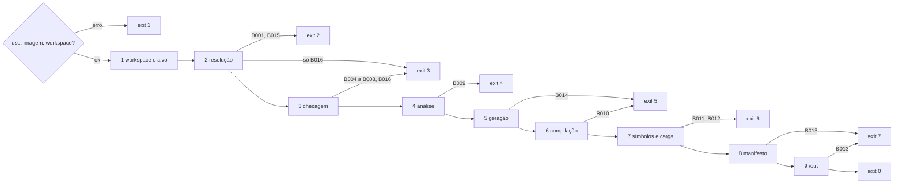
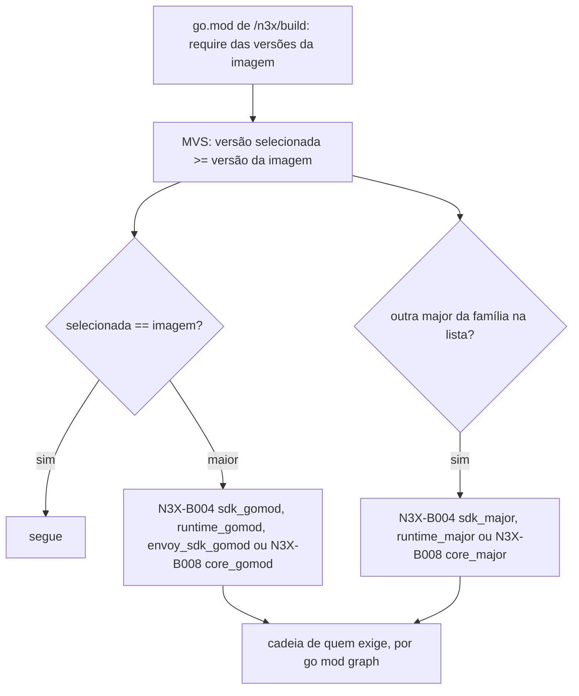

### FDD: Resolução de módulos, checagem de compatibilidade e códigos de erro (BLD-02)

Versão: 1.0
Data: 2026-10-20
Responsável: Guilherme Giusti

---

### 1. Contexto e motivação técnica

**Problema técnico.** O `n3x-plugin build` junta, num único `go build`, código de origens diferentes: os plugins do operador, o SDK, o runtime (`core/` do sidecar ou `host/` do controller) e o plugin core. Cada um tem o próprio `go.mod`, e a seleção de versão mínima do Go (MVS) escolhe, para cada módulo, a maior versão exigida no grafo. Isso cria um furo que nenhum documento fecha (L-57): um plugin cujo `go.mod` exige o SDK `v1.4.0` faz o build compilar o SDK `v1.4.0`, mesmo que a imagem anuncie e valide com o SDK `v1.2.0`. A checagem da faixa `sdk` do `n3x-plugin.yaml` passa (a faixa diz `>=1.0.0 <2.0.0`), o manifesto embutido grava `sdk: 1.2.0`, e o `.so` sai com outro SDK, compilado contra um `core/` que não conhece os métodos novos. O mesmo vale para o runtime, o plugin core e o SDK Go do Envoy.

Além disso, o builder ainda não tem um formato de erro definido. O ADR-006 fixa os códigos `N3X-B001` a `N3X-B013`, os exit codes por categoria e a regra "lista todas as falhas da etapa", mas não define: o texto exato da mensagem, o evento JSON, os valores de `status`, como várias falhas aparecem, o resumo final, o catálogo `docs/erros.md` e a interface que as outras etapas usam para reportar. A FDD 19 já emite sete códigos no `add` e deixou para esta FDD o formato e o código de checksum divergente. O acesso a módulos privados por secret foi substituído por decisão aprovada na clarificação: ZIPs privados copiados para o build. A FDD 02 pediu um código para falha do gerador de schema (`N3X-B014`).

**Encaixe no HLD.** Esta FDD especifica, no repositório `n3x-builder` (HLD, "Componentes e responsabilidades"), três componentes:

- **Resolvedor** (`internal/resolve`): passo 2 do `build`, com o ambiente do `go`, arquivos privados de módulos Go copiados para o contexto, `ARG GOPROXY` e `ARG GOPRIVATE`, e o módulo de build onde as etapas seguintes trabalham
- **Checador de compatibilidade** (`internal/check`): passo 3, com faixa `sdk`, versões fixadas pela imagem (L-57), toolchain Go, duplicidades, `depends_on`, namespace `n3x` e presença do core
- **Relator** (`internal/report`): formato da mensagem, evento JSON, exit code, log por etapa, resumo final e catálogo `docs/erros.md`, usado por todas as etapas e pelo `add`

E o passo 1 do `build`: leitura do workspace, da identidade da imagem e do alvo, e inclusão automática do plugin core.

Quem consome:

- FDD 19 (BLD-01): o `add` usa o relator, o ambiente do `go`, a ingestão de ZIP privado e as funções `check.SDKRange` e `check.Namespace`
- FDD 21 (BLD-03): gera e compila no módulo de build `/n3x/build`, sem rede de módulos; usa o relator para `N3X-B010` e `N3X-B014`
- FDD 22 (BLD-04): monta `plugins[]` do manifesto a partir da lista checada no passo 3 (inclusive o manifesto do core) e copia avisos para `warnings`; usa o relator para `N3X-B013`
- FDD 23 (BLD-05): usa o relator para `N3X-B011` e `N3X-B012` e para a etapa 7 pulada
- FDD 24 (BLD-06): usa o relator para `N3X-B009` e para os avisos `vuln` e `deprecated_api`
- FDD 46 (BLD-07): embute na imagem os módulos fixados e mede a duração das etapas
- FDDs 47 e 48: guia do operador e CI cruzada leem os exit codes e o evento JSON

**Atores.** Operador e a CI dele (leem o log em texto ou o evento JSON e decidem pelo exit code), autor de plugin (corrige o plugin a partir da mensagem), mantenedor do `n3x-builder` (mantém o catálogo de códigos), etapas 4 a 9 do pipeline (FDDs 21 a 24) e o comando `add` (FDD 19).

**Limites.** Esta FDD cobre só os passos 1 a 3 do `build` e o relator. Ela não compila, não analisa código e não grava manifesto. O resolvedor é o único ponto do `build` que acessa a rede para módulos; depois do passo 2, nenhuma etapa baixa módulo (hipótese, pedido às FDDs 21 e 24). O checador é uma função pura sobre dados já resolvidos.

**Suposições**
- A FDD 19 está implementada: `internal/catalog`, `internal/image`, `internal/workspace`, o `add` e os arquivos `/etc/n3x/target.yaml` e `/etc/n3x/builder.yaml` (FDD 19, contratos 1 a 5)
- O SDK `v0.1.0` (marco M1) traz `plugin.ReadSDKRange`, `SDKRange.Contains`, `plugin.DecodeManifest`, `plugin.CheckNamespace`, `ID.MetricPrefix`, `ID.GRPCPackage`, `plugin.FieldErrors` (FDD 01), `yamlconv.ToJSON` (FDD 01) e `schemagen` (FDD 02)
- O Docker do operador usa BuildKit e `--mount=type=cache`; módulos privados são fornecidos como ZIPs de módulo Go e arquivos locais no contexto do build, sem credencial disponível aos comandos do builder (decisão aprovada na clarificação)
- Os módulos `github.com/giustech/*` fixados pela imagem são públicos

**Restrições**
- Códigos `N3X-Bxxx` nunca mudam de significado; novos só por adição; exit codes por categoria: 1 uso, 2 resolução, 3 compatibilidade, 4 análise estática, 5 compilação, 6 símbolos ou carga, 7 manifesto (ADR-006 do `n3x-builder`)
- O build termina a etapa em que falhou e lista todas as falhas dela (ADR-006)
- Namespace `n3x` reservado a módulos `github.com/giustech/`; ID duplicado faz o build falhar (ADR-012 do `n3x-sdk`)
- Cada imagem traz uma versão do SDK, e o build recusa plugin cuja faixa `sdk` não a inclua (ADR-021 do `n3x-sdk`)
- O builder não recebe token de acesso ao GitHub; plugin privado e dependências privadas transitivas são fornecidos no contexto por arquivos de módulo Go, validados e resolvidos sem credencial (decisão aprovada na clarificação)
- Go proxy ou GitHub fora do ar: o build falha com `N3X-B001`, sem efeito em runtime (HLD)
- Log em texto por padrão, uma linha por etapa com duração; `--log-format json` com `step`, `status`, `duration_ms` e `code` (HLD)
- O builder reaproveita as regras do SDK e não reimplementa nenhuma (FDDs 01 e 19); o `n3x-plugin` não importa `secret/`
- Documentação e mensagens em pt-BR; identificadores, campos e comandos em inglês

**Rastreabilidade**
- PRD 1.5: FR-015 (o `build` "resolve as dependências com o toolchain Go fixado na imagem, checa a compatibilidade de cada plugin com a versão do SDK da imagem"; erros "plugin incompatível com a versão do SDK: mostra a versão exigida e a disponível", "dois plugins com o mesmo ID", "tentativa de remover o plugin core", "toda falha do build tem um código estável, uma linha de como resolver e o link"; credencial privada: o PRD agora prevê ZIP de módulo Go e `add --archive`, sem secret, conforme a decisão aprovada na clarificação); FR-013 ("dependência declarada que não está na imagem: o build falha"; "ID no namespace `n3x` de fora dos repositórios oficiais: o build recusa"); FR-011 ("dois plugins com o mesmo ID ou o mesmo nome de serviço gRPC: o build falha"); critério de aceite "o `n3x-plugin build` falha, com o código do cenário, nos casos de plugin incompatível com o SDK, ID duplicado [...] e tentativa de remover o plugin core"; "Estratégia de validação" (TDD do pipeline)
- HLD do `n3x-builder`: "Componentes e responsabilidades" (Resolvedor, Checador, Relator), "Fluxo de requisição" (passos 1 a 3), "Erros do build", "Observabilidade", "Segurança", "Considerações de escalabilidade"; HLD de plataforma: "Regras de versionamento entre repositórios"; HLD do `n3x-sdk`: "Estrutura padrão de um repositório de plugin" e "Manifesto"
- ADRs do `n3x-builder`: ADR-001 (semver por imagem), ADR-005 (lista só por `RUN n3x-plugin add`), ADR-006 (códigos `N3X-Bxxx`), ADR-007 (build reproduzível); ADRs do `n3x-sdk`: ADR-011 (módulo único), ADR-012 (ID e namespace), ADR-021 (faixa `sdk` e semver estrito)
- FDDs anteriores: 01 (regras do manifesto, `MetricPrefix`, pedido de recusar prefixo de métrica igual), 02 (pedido do `N3X-B014`, programa auxiliar do passo 5), 05 (L-57 citada no contrato de compatibilidade do proxy), 19 (workspace, arquivos da imagem, códigos do `add`, pedidos P-01 a P-03)
- Lacunas do README:
  - **L-57 fechada:** o módulo de build exige explicitamente o SDK, o runtime, o plugin core e, no sidecar, o SDK Go do Envoy nas versões da imagem, o que vira piso no MVS; o checador exige que a versão selecionada seja exatamente a da imagem. Se o `go.mod` de qualquer plugin, direta ou transitivamente, puxar versão maior ou outra major, o build falha com `N3X-B004` (SDK, runtime e SDK Go do Envoy) ou `N3X-B008` (plugin core), mostrando quem exige o quê. Não há `replace`: rebaixar em silêncio compilaria o plugin contra uma API que o autor não testou (contrato 9, regras 2 a 5)
- Decisão aprovada na clarificação: plugins públicos continuam sendo adicionados por módulo e versão; para plugins privados, o operador copia um ZIP no formato de módulo Go e usa `n3x-plugin add --archive <caminho>`. Os arquivos locais também precisam cobrir as dependências privadas transitivas; nenhum token é montado ou passado ao builder. O contrato detalhado de ingestão do ZIP pertence à FDD 19 (BLD-01) e será reavaliado nela.
- Pontos abertos da FDD 19 fechados aqui: P-01 (formato da mensagem e do evento, `status`, link, variável de ambiente do formato) e P-03 (código de checksum divergente e de Go mais novo). P-02 (mecanismo do `git_auth`) foi substituído pela decisão de usar arquivos privados locais, sem credencial no builder.

---

### 2. Objetivos técnicos

- **Mesmo veredito para a mesma entrada.** Invariante: o mesmo workspace na mesma imagem produz o mesmo resultado (exit code, códigos, regras, ordem dos problemas e bytes de `/n3x/build/go.mod` e `go.sum`). Medida: 20 execuções seguidas com o cache de módulos aquecido dão stderr idêntico, com `ts` e durações normalizados, em texto e em JSON.
- **Código estável por cenário.** Medida: cada cenário de falha dos passos 1 a 3 tem um teste com plugins de `testdata/` servidos por `GOPROXY=file://`, conferindo código, regra, exit code, linha "como resolver" e link.
- **Todas as falhas da etapa numa execução.** Medida: um workspace com problemas de três códigos diferentes no passo 3 (`N3X-B005`, `N3X-B006` e `N3X-B007`) mostra os três numa única execução, em ordem determinística.
- **SDK compilado igual ao anunciado (L-57).** Invariante: depois de um passo 3 sem falhas, a versão selecionada do SDK, do runtime, do plugin core e, no sidecar, do SDK Go do Envoy é exatamente a da imagem (`builder.yaml` e alvo). Conferido no próprio passo 3 e por teste com plugin que exige versão maior.
- **Erro com código e caminho de correção.** Invariante: todo problema de build sai com código `N3X-Bxxx`, motivo, "como resolver" e link para `docs/erros.md#n3x-bxxx`; todo erro de uso sai com exit 1, "como resolver" e link para `docs/erros.md#erros-de-uso`.
- **Catálogo e código nunca divergem.** Medida: `docs/erros.md` é gerado do catálogo em Go e a CI falha se o arquivo estiver desatualizado; nos testes, o relator em modo estrito entra em panic se uma etapa reportar regra não declarada para o código.
- **Sem credenciais no builder.** Invariante aprovado na clarificação: `add` e `build` não recebem token de acesso ao GitHub, por arquivo, variável de ambiente ou argumento. ZIPs e proxy local podem conter código privado e devem ser tratados como conteúdo confidencial no contexto e no cache do estágio de build.
- **Sem rede de módulos depois do passo 2.** Invariante: as etapas 4 a 6 rodam o `go` com `GOPROXY=off` e `-mod=readonly`; um módulo que faltar nelas é bug do resolvedor (hipótese, pedido às FDDs 21 e 24).
- **Passos 1 e 3 baratos.** Medida: passos 1 e 3 juntos em até 1 s com 50 plugins; passo 2 com o cache de módulos aquecido em até 5 s no p95 de 10 execuções com 5 plugins, num runner amd64 da CI (hipótese).

---

### 3. Escopo e exclusões

**Incluído**
- Passo 1 do `build`: leitura e validação de `/etc/n3x/builder.yaml`, `/etc/n3x/target.yaml` (só na `sidecar-builder`) e `/n3x/work/plugins.json`; avisos de alvo `candidate` ou `deprecated`; inclusão do plugin core na versão da imagem; build só com o core quando o workspace está vazio (hipótese)
- Passo 2 do `build`: módulo de build `/n3x/build`; `go.mod` com os plugins e as versões fixadas pela imagem; `go.sum` semeado pelo workspace e pela imagem; módulos fixados servidos pela imagem (`/usr/share/n3x/pinned`); `go mod download` dos plugins e `go list -deps` dos pacotes raiz com o mesmo contexto de build da compilação; conferência no `sum.golang.org`, exceto `GOPRIVATE`; classificação dos erros do `go`
- Ambiente do processo `go` (lista de permissão, valores fixos, `ARG GOPROXY`, `ARG GOPRIVATE` e demais variáveis), compartilhado com o `add`
- Resolução de plugins privados por ZIP de módulo Go fornecido via `COPY` e `n3x-plugin add --archive`; dependências privadas transitivas fornecidas em fonte local de módulos, sem helper de credencial
- Passo 3 do `build`: faixa `sdk`; versões fixadas pela imagem (L-57); versão do Go exigida; ID duplicado (com o pacote gRPC e as rotas derivados); prefixo de métrica duplicado (pedido da FDD 01); `depends_on` faltando, sem metade de controller ou em ciclo; namespace `n3x`; presença e validade do core; aviso de dependência compartilhada atualizada
- Relator: formato de erro, aviso e uso em texto; evento JSON; valores de `status`; agrupamento e ordem dos problemas; limite de problemas por etapa; exit code; mascaramento; linha por etapa; resumo final
- Catálogo completo dos códigos `N3X-B001` a `N3X-B016`, com os três novos: `N3X-B014` (pedido da FDD 02), `N3X-B015` (checksum divergente, pedido da FDD 19) e `N3X-B016` (Go mais novo que o da imagem, pedido da FDD 19)
- Catálogo de avisos com regras estáveis, no mesmo formato de evento
- `docs/erros.md` gerado do catálogo em Go, com âncoras estáveis e regra de evolução só por adição
- Documentação do `add` como emissor de `N3X-B004`, `N3X-B005`, `N3X-B007` e `N3X-B015` (pedido da FDD 19)

**Excluído**
- Leitura do `n3x-plugin.yaml`, conferência de estrutura no `add`, workspace e seus códigos `N3X-B001` a `N3X-B003` e `N3X-B008` do `add`: FDD 19 (BLD-01); aqui só o formato e as funções compartilhadas
- Análise estática, `govulncheck` e `N3X-B009`: FDD 24 (BLD-06)
- Geração, compilação, `N3X-B010` e o detalhe das regras do `N3X-B014`: FDD 21 (BLD-03)
- Símbolos, teste de carga, `N3X-B011` e `N3X-B012`: FDD 23 (BLD-05)
- Manifesto embutido, campo `warnings` e `N3X-B013`: FDD 22 (BLD-04)
- Arquivos da imagem (`/usr/share/n3x/pinned`, git na imagem), publicação, matriz e metas de duração do build inteiro: FDDs 21 (imagem de desenvolvimento) e 46 (BLD-07)
- Regras do manifesto do plugin e do ID: FDD 01 (SDK-01); aqui só se aplicam
- Recusa de serviço gRPC fora do namespace do plugin na subida: FDD 32 (CTL-03), com `OwnsGRPCService` da FDD 01
- Recusa de nome de métrica repetido na subida: FDD 06 (SDK-06)
- Lockfile, assinatura e SBOM: fora da v1 (PRD, "Fora de escopo")
- Credencial para hosts git além de `github.com` e para proxies de módulo com autenticação: fora da v1 como mecanismo do N3X; o operador pode montar o próprio `.netrc` (hipótese)

---

### 4. Fluxos detalhados e diagramas

**Fluxo principal: `RUN n3x-plugin build`, passos 1 a 3**

Antes do passo 1 (sem rede):
1. Lê a flag `--log-format` e a variável `N3X_LOG_FORMAT`; a flag vence. Argumento posicional, flag desconhecida ou formato inválido: erro de uso, exit 1.
2. Cria o relator (contrato 7) com mascaramento de caminhos locais e credenciais em URLs do ambiente. Não lê nem monta token GitHub; o builder não recebe credenciais.

**Passo 1. Workspace e alvo** (`[1/9] lendo workspace e alvo`, sem rede)
1. `image.Load("/etc/n3x/builder.yaml")` (FDD 19). Ausente ou inválido: uso (`image_invalid`), exit 1.
2. Na `sidecar-builder`, `catalog.Load("/etc/n3x/target.yaml")`. Ausente ou inválido: uso (`target_invalid`), exit 1. Status `candidate` gera o aviso `target_candidate`; `deprecated` gera `target_deprecated`. O build nunca falha por status (FDD 19, H-13).
3. `workspace.Open("/n3x/work")`. Arquivo inválido, `format` desconhecido, lista fora de ordem, a mesma família de módulo duas vezes ou o plugin core na lista: uso (`workspace_invalid`), exit 1, com "rode os `add` e o `build` no mesmo estágio e na mesma imagem". Workspace ausente ou vazio: segue só com o core (hipótese).
4. Decodifica `plugins[].manifest` de cada entrada com `plugin.DecodeManifest`. Falha: `workspace_invalid` (o `add` já validou; falha aqui significa workspace de outra imagem).
5. Inclui o plugin core: módulo e versão de `builder.yaml` (`core`). O manifesto do core é lido no passo 3, do diretório do módulo resolvido.
6. Calcula, para cada plugin, se a metade deste artefato existe: `proxy` na `sidecar-builder`, `controller` na `controller-builder` (campo `Compiled`). Plugin sem a metade fica só no manifesto (HLD do `n3x-builder`).
7. Linha da etapa, por exemplo `(2 plugins + core; envoy-1.40 candidate; amd64)`.

**Passo 2. Resolução** (`[2/9] resolvendo módulos`, prazo total de 300 s)
1. **Ambiente.** Monta o ambiente do `go` por lista de permissão (contrato 10): variáveis herdadas do Dockerfile, valores fixos, proxy da imagem e fontes locais copiadas pelo operador. Não instala nem configura helper ou credencial. Emite avisos de ambiente (`goflags_ignored`, `sumdb_off`, `insecure_fetch`, `pinned_bypass`).
2. **Módulo de build.** Recria `/n3x/build` vazio e grava (contrato 8):
   - `go.mod`: `module n3x.local/build`, `go <Go da imagem>` e `require` de todos os plugins da lista (versão de `plugins.json`), do plugin core, do SDK e do runtime nas versões de `builder.yaml` e, na `sidecar-builder`, do SDK Go do Envoy na versão de `envoy_go_sdk` do alvo. Os quatro módulos fixados viram piso do MVS
   - `go.sum`: linhas do `/n3x/work/go.sum` mais `/usr/share/n3x/pinned/go.sum`, ordenadas e sem repetição. Duas linhas com hash diferente para o mesmo `módulo versão`: `N3X-B015` (`checksum`)
3. **Plugins, um a um.** Num diretório temporário vazio, `go mod download -json <cada plugin>@<versão>`. O `go` continua depois de um erro e devolve um objeto por módulo, então todos os plugins com problema saem juntos:
   - `Error` preenchido: classificado em `N3X-B001` ou `N3X-B015` (contrato 6)
   - `Sum` ou `GoModSum` diferentes dos de `plugins.json`: `N3X-B015` (`workspace_sum`), porque a versão foi republicada entre o `add` e o `build`
   - diretiva `go` do `go.mod` do plugin maior que o Go da imagem: `N3X-B016` (`go_version`)
   - qualquer problema aqui encerra a etapa sem rodar o item 4
4. **Grafo.** Em `/n3x/build`, `go list -mod=mod -e -deps -json=ImportPath,Module,Error,DepsErrors <raízes>` uma vez por contexto de build (contrato 8):
   - contexto de compilação (o da FDD 21: `GOOS=linux`, `GOARCH` do alvo, `CGO_ENABLED=1` e a tag do alvo no sidecar; `CGO_ENABLED=0` no controller), com as metades compiladas e o runtime como raízes
   - contexto da máquina de build (`CGO_ENABLED=0`, sem tags), com as duas metades de todos os plugins e `schemagen` como raízes, porque o programa auxiliar do passo 5 importa todas (FDD 02, contrato 9)
   - o `go` baixa e confere (`go.sum` e `sum.golang.org`, exceto `GOPRIVATE` e `GONOSUMDB`) exatamente os módulos que a compilação vai usar e atualiza `go.mod` e `go.sum` de `/n3x/build`
   - erros por pacote (`Error`, `DepsErrors`) e erros gerais do `go` são classificados; cada um é atribuído a um plugin pela `ImportStack` ou pelo módulo citado
5. **Lista de build.** `go list -mod=readonly -m -json all` (caminho, versão, `Dir`, `GoMod`, `GoVersion`) e `go mod graph` (arestas para atribuir "quem exige"). Os dois rodam sem rede, porque o item 4 já trouxe todos os `.mod`.
6. **Nova tentativa.** Se a classificação de algum erro for `network`, a chamada inteira do `go` é repetida uma vez, depois de 2 s, dentro do prazo total. Outros erros não são repetidos.
7. Linha da etapa, por exemplo `(43 módulos)`.

**Passo 3. Checagem** (`[3/9] checando compatibilidade`, sem rede, função pura)
1. Lê o manifesto do core em `<Dir do core>/n3x-plugin.yaml` com `yamlconv.ToJSON` e `plugin.DecodeManifest`. Arquivo ausente ou inválido, ou ID diferente de `n3x.core`: `N3X-B008` (`core_invalid`). O core entra na lista checada com `Core: true`.
2. Roda as onze checagens do contrato 9 sobre todos os plugins (inclusive o core), a lista de build e o grafo. Nenhuma checagem para as outras: todos os problemas da etapa saem juntos.
3. Ordena os problemas por código, depois por ID do plugin, depois por módulo; dentro do mesmo plugin e código, mantém a ordem de emissão (que segue a ordem do SDK nos `FieldErrors`).
4. Sem problemas: entrega às etapas 4 a 9 a lista checada (`[]check.Plugin`, em ordem de ID), a lista de build e os avisos.

**Fim da execução** (todas as etapas)
- Se uma etapa tem problemas, o relator escreve a linha `falhou`, os blocos de erro e o resumo, e o processo sai com o exit code da categoria do primeiro problema da etapa, na ordem de relato (menor código). As etapas seguintes não rodam e não aparecem.
- Se todas passam, o relator escreve o resumo com artefato, hash e avisos e o processo sai com 0.
- O resumo é sempre o último bloco do stderr (texto) ou o último evento (JSON). O stdout fica vazio.

**Fluxos alternativos e exceções**
- **Plugin exige SDK mais novo no `go.mod` (L-57):** `acme.tenant v0.4.2` exige `n3x-sdk v1.4.0`, e a imagem fixa `v1.2.0`. O MVS seleciona `v1.4.0`; o passo 3 compara com a imagem e falha com `N3X-B004` (`sdk_gomod`), mostrando a cadeia `github.com/acme/n3x-plugin-tenant@v0.4.2 -> github.com/acme/redisx@v1.1.0 -> github.com/giustech/n3x-sdk@v1.4.0`. Com `n3x-sdk v1.1.0` no `go.mod` do plugin, o MVS seleciona `v1.2.0` (piso da imagem) e o build segue: minor nova é compatível (ADR-021).
- **Plugin exige outra major do SDK** (`github.com/giustech/n3x-sdk/v2`): dois SDKs no mesmo binário. `N3X-B004` (`sdk_major`). O mesmo vale para o runtime (`runtime_major`) e para o core (`N3X-B008`, `core_major`).
- **Plugin exige o plugin core em outra versão** (por exemplo, importa o client gRPC do core): `N3X-B008` (`core_gomod`).
- **Dependência exige Go mais novo:** detectado no passo 2. Se é o próprio plugin, no item 3 (`go mod download`); se é transitiva, o `go list` falha com o texto `requires go >= X (running go Y; GOTOOLCHAIN=local)`, classificado como `N3X-B016`. O passo 3 repete a checagem pela `GoVersion` da lista de build (defesa em profundidade). Exit 3.
- **Dependência compartilhada atualizada** (ex.: `google.golang.org/grpc`): o MVS escolhe a maior versão exigida, e isso é permitido, porque dentro da mesma major o Go garante compatibilidade de importação. O passo 3 compara a lista de build com `/usr/share/n3x/pinned/modules.txt` e emite o aviso `dependency_upgraded` com o módulo, a versão da imagem, a selecionada e quem exige. Não falha (hipótese).
- **Plugin privado adicionado por referência remota:** `add <módulo>@<versão>` não recebe credencial e não autentica no VCS. O erro remoto é `N3X-B001` (`no_access`); a correção orienta copiar um ZIP canônico do módulo ao contexto e usar `n3x-plugin add --archive <caminho>`.
- **Dependência privada transitiva ausente dos arquivos locais:** a resolução não tenta buscá-la em proxy público ou VCS. Falha com `N3X-B001` e identifica o módulo ausente, orientando a incluí-lo na fonte local de módulos privados.
- **`GOPROXY=off` do operador:** os módulos fixados vêm do proxy em arquivo da imagem; os plugins falham com `N3X-B001` (`proxy_off`). Um build só com o core funciona sem rede.
- **Cache montado em `/go/pkg/mod`:** o `--mount=type=cache` esconde o que a imagem tivesse em `/go/pkg/mod`; por isso os módulos fixados ficam em `/usr/share/n3x/pinned/proxy`, fora do cache, e entram no `GOPROXY` como `file://` (hipótese).
- **`depends_on` na `sidecar-builder`:** a dependência é da metade de controller (FDD 01, `ControllerManifest`). Como o FR-006 permite listas diferentes entre sidecar e controller, a `sidecar-builder` só avisa (`depends_missing`, `depends_no_controller`, `depends_cycle`) e a `controller-builder` falha com `N3X-B006` (hipótese).
- **Workspace vazio:** build só com o plugin core; a linha do passo 1 diz `(0 plugins + core)` (hipótese).
- **Erro interno do `n3x-plugin`** (panic, disco cheio em `/n3x/build`, `/out` sem permissão): uso com regra `internal`, exit 1, mensagem "erro interno do n3x-plugin" com o pedido de abrir issue; o panic é recuperado no topo do comando e detalhes de erro são mascarados.
- **`build` rodado duas vezes no mesmo estágio:** `/n3x/build` é recriado do zero no passo 2; o resultado é o mesmo.

**Diagramas**

Sequência dos passos 1 a 3:

```mermaid
sequenceDiagram
    participant D as RUN no Dockerfile
    participant B as n3x-plugin build
    participant R as report
    participant F as /etc/n3x e /n3x/work
    participant G as go (processo filho)
    participant P as proxy em arquivo, GOPROXY, VCS
    participant C as check
    D->>B: build [--log-format json]
    B->>R: Begin(1, workspace)
    B->>F: builder.yaml, target.yaml, plugins.json
    B->>R: avisos target_*; End (ou exit 1)
    B->>R: Begin(2, resolve)
    B->>B: ambiente por lista de permissão e fontes locais de módulos
    B->>F: grava /n3x/build/go.mod e go.sum
    B->>G: go mod download -json plugins (diretório vazio)
    G->>P: .info, .mod, .zip e sum.golang.org
    G-->>B: Sum, GoModSum, GoMod ou Error
    B->>G: go list -mod=mod -e -deps (dois contextos)
    G-->>B: pacotes e erros
    B->>G: go list -m -json all e go mod graph
    B->>R: problemas N3X-B001, B015, B016; End
    B->>R: Begin(3, check)
    B->>C: Run(plugins, lista de build, grafo, imagem)
    C-->>B: problemas B004 a B008, B016 e avisos
    B->>R: End; Finish(resumo) e exit code
```

Pipeline e exit codes:



Travamento das versões fixadas (L-57):



---

### 5. Contratos públicos (assinaturas, endpoints, headers, exemplos)

**Contrato 1: CLI `n3x-plugin build`**
- Tipo: sdk (CLI externa, usada no Dockerfile do operador)
- Assinatura/Rota:
  ```text
  n3x-plugin build [--log-format text|json]
  ```
- Método: n/a
- Semântica de status/headers:
  - Sem argumento posicional. Flag desconhecida, argumento posicional ou formato inválido: exit 1
  - Lê: `/etc/n3x/builder.yaml`, `/etc/n3x/target.yaml` (sidecar), `/n3x/work/`, `/usr/share/n3x/pinned/`, as fontes locais de módulos privados copiadas pelo operador e o ambiente; não lê secrets
  - Escreve: `/n3x/build/` (a partir do passo 2) e `/out/` (só no passo 9, FDD 22). Um build que falha não deixa artefato novo em `/out`
  - Saída: tudo no stderr; stdout vazio
  - Exit codes:

| Exit | Categoria | Códigos | Onde |
| --- | --- | --- | --- |
| 0 | sucesso | (nenhum) | fim do passo 9 |
| 1 | uso, ambiente ou erro interno | sem código (regras `usage`, `image_invalid`, `target_invalid`, `workspace_invalid`, `internal`) | antes do passo 1 e no passo 1 |
| 2 | resolução | `N3X-B001`, `N3X-B002`, `N3X-B003`, `N3X-B015` | `add` e passo 2 |
| 3 | compatibilidade | `N3X-B004`, `N3X-B005`, `N3X-B006`, `N3X-B007`, `N3X-B008`, `N3X-B016` | `add`, passos 2 e 3 |
| 4 | análise estática | `N3X-B009` | passo 4 |
| 5 | compilação | `N3X-B010`, `N3X-B014` | passos 5 e 6 |
| 6 | símbolos ou carga | `N3X-B011`, `N3X-B012` | passo 7 |
| 7 | manifesto | `N3X-B013` | passos 8 e 9 |

  - **Regra do exit code:** a primeira etapa com problema encerra o build; o exit code é a categoria do primeiro problema dela na ordem de relato (menor código). Exemplo: passo 2 com `N3X-B001` e `N3X-B016` sai com 2; só com `N3X-B016`, sai com 3
  - Parâmetros configuráveis e valores padrão:

| Parâmetro | Onde | Padrão | Observação |
| --- | --- | --- | --- |
| `--log-format` | flag | `text` | `text` ou `json`; vence a variável |
| `N3X_LOG_FORMAT` | `ARG` ou `ENV` | (vazio) | mesmo efeito da flag, para todas as linhas `RUN` (hipótese) |
| `GOPROXY` | `ARG` | `https://proxy.golang.org,direct` | o proxy em arquivo da imagem entra sempre na frente |
| `GOPRIVATE`, `GONOPROXY`, `GONOSUMDB` | `ARG` | (vazio) | padrões privados e comportamento de checksum; módulos privados são servidos da fonte local |
| `GOSUMDB`, `GOINSECURE` | `ARG` | `sum.golang.org`, (vazio) | `off` e valores não vazios geram aviso |
| prazo do passo 2 | fixo | 300 s | uma nova tentativa só para erro `network` (hipótese) |

**Exemplo de requisição**
```dockerfile
# syntax=docker/dockerfile:1
FROM ghcr.io/giustech/n3x/sidecar-builder:1.0.0-envoy-1.40 AS build
ARG GOPRIVATE=github.com/acme/*
ARG N3X_LOG_FORMAT=text
RUN --mount=type=cache,target=/go/pkg/mod \
    n3x-plugin add github.com/giustech/n3x-plugin-ratelimit@v1.0.0
COPY private-proxy/ /n3x/private-proxy/
COPY dist/n3x-plugin-tenant-v0.4.2.zip /n3x/private/plugin.zip
RUN --mount=type=cache,target=/go/pkg/mod \
    n3x-plugin add --archive /n3x/private/plugin.zip
RUN --mount=type=cache,target=/go/pkg/mod \
    --mount=type=cache,target=/root/.cache/go-build \
    n3x-plugin build
```
```text
docker buildx build -t registry.acme/n3x-sidecar:2026.10 .
```

**Exemplo de resposta** (stderr, sucesso; as linhas 4 a 9 vêm das FDDs 21 a 24 e são ilustrativas)
```text
[1/9] lendo workspace e alvo (2 plugins + core; envoy-1.40 supported; amd64) ... ok 0.0s
[2/9] resolvendo módulos (43 módulos) ... ok 9.8s
[3/9] checando compatibilidade (3 plugins) ... ok 0.1s
aviso dependency_upgraded: google.golang.org/grpc v1.70.0 selecionado (imagem v1.68.1), exigido por acme.tenant
[4/9] análise estática (3 plugins) ... ok 6.2s
[5/9] gerando registro e schemas (3 plugins) ... ok 0.4s
[6/9] compilando libn3x.so ... ok 21.7s
[7/9] verificando símbolos e carga ... ok 2.9s
[8/9] gravando manifesto ... ok 0.1s
[9/9] escrevendo /out ... ok 0.0s
resumo: build ok (exit 0) em 41.2s
  artefato  /out/libn3x.so e /out/manifest.json (sidecar, envoy-1.40, amd64)
  imagem    sidecar-builder 1.0.0, go 1.26.1, sdk v1.2.0, runtime github.com/giustech/n3x-sidecar/core v1.0.0
  plugins   3 (3 compilados, 0 só no manifesto)
    acme.tenant          github.com/acme/n3x-plugin-tenant v0.4.2          proxy               compilado
    giustech.ratelimit   github.com/giustech/n3x-plugin-ratelimit v1.0.0   proxy, controller   compilado
    n3x.core             github.com/giustech/n3x-plugin-core v1.0.0        proxy, controller   compilado (core)
  hash      sha256:9f2c4b1e... (alloc-sections)
  avisos    1 (dependency_upgraded 1)
```

---

**Contrato 2: mensagem em texto (erro, aviso e uso)**
- Tipo: stream (stderr, para pessoas e para `grep` na CI)
- Assinatura/Rota (gramática):
  ```text
  linha de etapa  = "[" n "/" total "] " titulo [" (" nota ")"] " ... " status " " duracao [" (" k " problemas)"]
  status          = "ok" | "falhou" | "pulada"
  duracao         = segundos com uma casa decimal e "s" (ex.: "0.4s"); ausente em "pulada"
  bloco de erro   = "erro " CODIGO ": " motivo NL
                    *( "  " subproblema NL )
                    "  como resolver: " texto NL
                    "  doc: " url NL
  subproblema     = [caminho ": "] detalhe " [" regra "]"
  aviso           = "aviso " regra ": " detalhe NL
  uso             = "erro: " motivo " [" regra "]" NL "  como resolver: " texto NL "  doc: " url_uso NL
  ```
- Método: n/a
- Semântica de status/headers:
  - A linha da etapa sai quando a etapa termina, seguida dos avisos e dos blocos de erro dela, já ordenados. Blocos separados por uma linha em branco
  - **Agrupamento:** um bloco por par (código, plugin). Com um problema, o motivo é o próprio detalhe e não há subproblema. Com mais de um, o motivo é o título do código mais `em <módulo>@<versão> (<k> problemas)` e cada problema vira um subproblema com caminho (convenção L-34 da FDD 01) e regra. Problema sem plugin (ex.: ciclo entre plugins) forma bloco próprio
  - **Prefixos estáveis:** `[n/9]`, `erro N3X-Bxxx:`, `erro:`, `aviso <regra>:`, `  como resolver:`, `  doc:` e `resumo:` não mudam na major do builder; o resto do texto pode melhorar em patch
  - **Link:** `https://github.com/giustech/n3x-builder/blob/main/docs/erros.md#n3x-bxxx` (âncora em minúsculas); uso aponta para `#erros-de-uso`. Fica em `main`, como no HLD e na FDD 19, porque as âncoras são estáveis e o significado do código nunca muda (hipótese)
  - **Limites:** até 100 problemas por etapa (o centésimo primeiro vira a linha `  (mais <n> problemas omitidos) [truncated]`, como o `MaxConfigErrors` da FDD 02); detalhe de cada problema até 1 KiB, cortado com `...`
  - **Mascaramento:** todo texto passa pelo mascarador (contrato 7) antes de sair

**Exemplo de requisição** (workspace com quatro problemas no passo 3, na `controller-builder`)
```json
{
  "plugins": [
    { "id": "acme.tenant", "module": "github.com/acme/n3x-plugin-tenant", "version": "v0.4.2", "go.mod": "require github.com/giustech/n3x-sdk v1.4.0" },
    { "id": "acme.tenant", "module": "github.com/acmefork/n3x-plugin-tenant", "version": "v0.5.0" },
    { "id": "acme.reports", "module": "github.com/acme/n3x-plugin-reports", "version": "v1.0.0", "depends_on": ["acme.billing"] },
    { "id": "n3x.metrics", "module": "github.com/acme/n3x-metrics", "version": "v0.1.0" }
  ],
  "image": { "kind": "controller", "sdk": "v1.2.0" }
}
```

**Exemplo de resposta** (stderr; exit 3)
```text
[1/9] lendo workspace e alvo (4 plugins + core; controller) ... ok 0.0s
[2/9] resolvendo módulos (52 módulos) ... ok 11.0s
[3/9] checando compatibilidade (5 plugins) ... falhou 0.1s (4 problemas)
erro N3X-B004: github.com/acme/n3x-plugin-tenant@v0.4.2 exige github.com/giustech/n3x-sdk v1.4.0 no go.mod; esta imagem fixa o sdk em v1.2.0
  exigido por: github.com/acme/n3x-plugin-tenant@v0.4.2 -> github.com/giustech/n3x-sdk@v1.4.0
  como resolver: use uma imagem de build com sdk v1.4.0 ou mais novo, ou uma versão do plugin que exija sdk até v1.2.0
  doc: https://github.com/giustech/n3x-builder/blob/main/docs/erros.md#n3x-b004

erro N3X-B005: dois módulos com o mesmo id acme.tenant (pacote gRPC n3x.plugins.acme.tenant, rotas /plugins/acme/tenant/)
  github.com/acme/n3x-plugin-tenant@v0.4.2 [id_duplicate]
  github.com/acmefork/n3x-plugin-tenant@v0.5.0 [id_duplicate]
  como resolver: mantenha só um dos dois módulos no Dockerfile
  doc: https://github.com/giustech/n3x-builder/blob/main/docs/erros.md#n3x-b005

erro N3X-B006: acme.reports depende de acme.billing, que não está na lista de plugins desta imagem
  como resolver: acrescente RUN n3x-plugin add com o módulo de acme.billing, ou tire a dependência do n3x-plugin.yaml de acme.reports
  doc: https://github.com/giustech/n3x-builder/blob/main/docs/erros.md#n3x-b006

erro N3X-B007: id n3x.metrics no módulo github.com/acme/n3x-metrics@v0.1.0; o namespace n3x é reservado a github.com/giustech/
  como resolver: use o seu próprio namespace no id (ex.: acme.metrics) e publique uma nova tag
  doc: https://github.com/giustech/n3x-builder/blob/main/docs/erros.md#n3x-b007

resumo: build falhou na etapa 3/9 (checando compatibilidade) com 4 problemas (N3X-B004, N3X-B005, N3X-B006, N3X-B007); exit 3 em 11.2s
  imagem    controller-builder 1.0.0, go 1.26.1, sdk v1.2.0, runtime github.com/giustech/n3x-controller/host v1.0.0
  plugins   5 (5 compilados, 0 só no manifesto)
  artefato  nenhum (/out não foi escrito)
  avisos    0
```

---

**Contrato 3: evento JSON (`--log-format json`)**
- Tipo: stream (stderr, um objeto JSON por linha, para a CI do operador)
- Assinatura/Rota: um evento por linha, UTF-8, sem quebra dentro do objeto; ordem dos eventos igual à do texto
- Método: n/a
- Semântica de status/headers:

Campos de base, presentes em todo evento:

| Campo | Tipo | Valores |
| --- | --- | --- |
| `ts` | texto | RFC 3339 em UTC com milissegundos |
| `level` | texto | `info`, `warn` ou `error` |
| `msg` | texto | nome estável do evento em snake_case, como na FDD 15: `step`, `problem`, `warning`, `usage`, `summary` |
| `cmd` | texto | `build` ou `add` |
| `step` | texto | `workspace`, `resolve`, `check`, `analysis`, `generate`, `compile`, `verify`, `manifest`, `output` ou `add`; vazio em `usage` antes da etapa 1 |
| `code` | texto | `N3X-Bxxx` ou vazio (avisos, uso e etapa sem problema) |

Campos por evento:

| Evento | Campos |
| --- | --- |
| `step` | `step_index`, `step_total` (9; 0 no `add`), `status` (`ok`, `failed`, `skipped`), `duration_ms`, `codes` (lista em ordem), `problems`, `warnings`, `reason` (só em `skipped`) e campos próprios da etapa (passo 1: `plugins` (da lista, sem o core), `compiled` (com o core), `target`, `target_status`, `arch`; passo 2: `modules`, `retried`; passo 3: `checked` (com o core)) |
| `problem` | `exit_code`, `rule`, `plugin_id`, `plugin_module`, `plugin_version`, `path`, `detail`, `fix`, `doc` e atributos da regra (ex.: `required`, `available`, `chain`, `modules`, `cycle`) |
| `warning` | `rule`, `plugin_id`, `plugin_module`, `plugin_version`, `detail`, `doc` e atributos da regra |
| `usage` | `exit_code` (1), `rule`, `detail`, `fix`, `doc` |
| `summary` | `status` (`ok`, `failed`), `exit_code`, `duration_ms`, `failed_step`, `failed_step_index`, `codes`, `problems`, `warnings`, `warning_rules` (contagem por regra), `kind`, `target`, `arch`, `builder`, `go`, `sdk`, `runtime` (`module`, `version`), `plugins` (lista com `id`, `module`, `version`, `halves`, `compiled`, `core`) e `artifact` (`null` ou `path`, `manifest`, `integrity`) |

  - Campos sem valor saem como texto vazio, lista vazia ou `null`, nunca ausentes, para a CI ler sem checar existência (hipótese)
  - **Erros e avisos no mesmo formato:** `problem` e `warning` têm os mesmos campos de base e de plugin; a CI distingue por `level` e `msg`. Aviso nunca muda o exit code
  - **Status:** `ok` (etapa sem problema, com ou sem aviso), `failed` (pelo menos um problema) e `skipped` (etapa que não se aplica, ex.: passo 7 na `controller-builder`). Etapas que não rodaram por causa de uma falha anterior não geram evento
  - **Compatibilidade:** eventos e campos novos só por adição, em minor do builder; valores novos de `status` só em major; consumidores ignoram campo desconhecido. O schema fica em `docs/build-events.schema.json` (JSON Schema draft 2020-12) e os testes validam todo evento contra ele (hipótese)
  - **Compatibilidade com a FDD 19:** o evento do `add` ganha `ts`, `msg` e `cmd`; os campos que a FDD 19 já definiu (`result`, `cache_hit`, `zip_bytes`, `halves`) continuam como campos próprios da etapa `add`

**Exemplo de requisição**
```text
n3x-plugin build --log-format json
```

**Exemplo de resposta** (falha no passo 3, cinco eventos, um por linha)
```json
{"ts":"2026-10-20T14:00:00.012Z","level":"info","msg":"step","cmd":"build","step":"workspace","code":"","step_index":1,"step_total":9,"status":"ok","duration_ms":8,"codes":[],"problems":0,"warnings":0,"plugins":1,"compiled":2,"target":"envoy-1.40","target_status":"supported","arch":"amd64"}
{"ts":"2026-10-20T14:00:09.840Z","level":"info","msg":"step","cmd":"build","step":"resolve","code":"","step_index":2,"step_total":9,"status":"ok","duration_ms":9824,"codes":[],"problems":0,"warnings":0,"modules":43,"retried":false}
{"ts":"2026-10-20T14:00:09.951Z","level":"error","msg":"problem","cmd":"build","step":"check","code":"N3X-B004","exit_code":3,"rule":"sdk_gomod","plugin_id":"acme.tenant","plugin_module":"github.com/acme/n3x-plugin-tenant","plugin_version":"v0.4.2","path":"","detail":"github.com/acme/n3x-plugin-tenant@v0.4.2 exige github.com/giustech/n3x-sdk v1.4.0 no go.mod; esta imagem fixa o sdk em v1.2.0","fix":"use uma imagem de build com sdk v1.4.0 ou mais novo, ou uma versão do plugin que exija sdk até v1.2.0","doc":"https://github.com/giustech/n3x-builder/blob/main/docs/erros.md#n3x-b004","module":"github.com/giustech/n3x-sdk","required":"v1.4.0","available":"v1.2.0","chain":["github.com/acme/n3x-plugin-tenant@v0.4.2","github.com/giustech/n3x-sdk@v1.4.0"]}
{"ts":"2026-10-20T14:00:09.952Z","level":"error","msg":"step","cmd":"build","step":"check","code":"N3X-B004","step_index":3,"step_total":9,"status":"failed","duration_ms":111,"codes":["N3X-B004"],"problems":1,"warnings":0,"checked":2}
{"ts":"2026-10-20T14:00:09.953Z","level":"error","msg":"summary","cmd":"build","step":"check","code":"N3X-B004","status":"failed","exit_code":3,"duration_ms":9953,"failed_step":"check","failed_step_index":3,"codes":["N3X-B004"],"problems":1,"warnings":0,"warning_rules":{},"kind":"sidecar","target":"envoy-1.40","arch":"amd64","builder":"1.0.0","go":"1.26.1","sdk":"v1.2.0","runtime":{"module":"github.com/giustech/n3x-sidecar/core","version":"v1.0.0"},"plugins":[{"id":"acme.tenant","module":"github.com/acme/n3x-plugin-tenant","version":"v0.4.2","halves":["proxy"],"compiled":true,"core":false},{"id":"n3x.core","module":"github.com/giustech/n3x-plugin-core","version":"v1.0.0","halves":["proxy","controller"],"compiled":true,"core":true}],"artifact":null}
```

---

**Contrato 4: catálogo de códigos `N3X-Bxxx`**
- Tipo: catálogo (fonte em `internal/report/catalog.go`; documentação gerada em `docs/erros.md`)
- Assinatura/Rota: código `N3X-B` mais três dígitos; âncora `#n3x-bxxx`
- Método: n/a
- Semântica de status/headers:

| Código | Cenário | Exit | Emitido por | Regras (`rule`) | Como resolver (texto padrão) |
| --- | --- | --- | --- | --- | --- |
| `N3X-B001` | Módulo não encontrado, sem acesso, rede ou proxy indisponível | 2 | `add` (FDD 19), passo 2 | `not_found`, `no_access`, `network`, `not_in_sumdb`, `proxy_off`, `package_missing`, `go_error` | confira caminho e tag; plugin privado: copie um ZIP de módulo Go e use `n3x-plugin add --archive`; inclua as dependências privadas transitivas na fonte local |
| `N3X-B002` | Repositório fora da estrutura | 2 | `add` (FDD 19) | `manifest_missing`, `half_folder_missing` | crie o que falta e publique nova tag |
| `N3X-B003` | `n3x-plugin.yaml` inválido | 2 | `add` (FDD 19) | regras da FDD 01, `version_mismatch` | corrija os campos listados e publique nova tag |
| `N3X-B004` | Plugin incompatível com o SDK ou com o runtime da imagem (mostra a versão exigida e a disponível) | 3 | `add` (`sdk_range`), passo 3 | `sdk_range`, `sdk_gomod`, `sdk_major`, `runtime_gomod`, `runtime_major`, `envoy_sdk_gomod` | use uma imagem de build com a versão exigida, ou uma versão do plugin compatível com esta imagem |
| `N3X-B005` | Duplicidade: ID (e com ele pacote gRPC e rotas), prefixo de métrica ou módulo | 3 | `add` (`module_duplicate`), passo 3 | `module_duplicate`, `id_duplicate`, `metric_prefix_duplicate` | mantenha um só; para prefixo igual, renomeie um dos plugins |
| `N3X-B006` | `depends_on` faltando, apontando para plugin sem metade de controller, ou em ciclo | 3 | passo 3 (só `controller-builder`) | `depends_missing`, `depends_no_controller`, `depends_cycle` | acrescente o plugin que falta ou corrija o `depends_on` |
| `N3X-B007` | Namespace `n3x` fora de `github.com/giustech/` | 3 | `add`, passo 3 | `reserved_namespace` | use o seu namespace no `id` |
| `N3X-B008` | Plugin core ausente, removido, substituído ou em versão diferente da imagem | 3 | `add` (`core_version`, `core_removal`, `core_replacement`), passo 3 | as três do `add` mais `core_missing`, `core_invalid`, `core_gomod`, `core_major` | o core entra sempre na versão da imagem; tire a linha ou troque a imagem |
| `N3X-B009` | Análise estática reprovada | 4 | passo 4 (FDD 24) | definidas na FDD 24 | corrija o código nas linhas indicadas |
| `N3X-B010` | Falha de compilação | 5 | passos 5 e 6 (FDD 21) | definidas na FDD 21 | veja o erro do compilador |
| `N3X-B011` | Símbolo ausente no Envoy do alvo | 6 | passo 7 (FDD 23) | definidas na FDD 23 | use a imagem do alvo certo |
| `N3X-B012` | Falha no teste de carga do `.so` | 6 | passo 7 (FDD 23) | definidas na FDD 23 | veja o log do Envoy citado |
| `N3X-B013` | Falha ao gravar o manifesto | 7 | passos 8 e 9 (FDD 22) | definidas na FDD 22 | abra uma issue com o log |
| `N3X-B014` | Config do plugin sem schema válido (gerador de schema falhou) | 5 | passo 5 (FDD 21; pedido da FDD 02) | regras do gerador da FDD 02 (`unsupported_type`, `tag_*`, `default_invalid` e outras) | corrija a struct de config e as tags `n3x`; rode `go test` com o `sdktest` |
| `N3X-B015` | Checksum divergente: o conteúdo baixado não confere com o `go.sum`, com o `sum.golang.org` ou com o hash gravado pelo `add` | 2 | `add` (no lugar do `N3X-B001` `checksum` da FDD 19), passo 2 | `checksum`, `workspace_sum`, `archive_sha256` | não use esta versão; a tag foi republicada ou adulterada; peça uma tag nova ao autor; com `--archive`, confira o ZIP e o `--sha256` informado |
| `N3X-B016` | Plugin ou dependência exige Go mais novo que o da imagem | 3 | passo 2 e passo 3 (e o `add`, se a FDD 19 aceitar o pedido) | `go_version` | use uma imagem de build com o Go exigido, ou uma versão do plugin que aceite o Go desta imagem |

  - Os três últimos são novos (hipótese de número e de categoria): `N3X-B014` cai em 5 porque o passo 5 é geração de código, parte da compilação; `N3X-B015` cai em 2 porque é falha de obtenção de módulo, com remédio diferente do `N3X-B001` (segurança, não acesso); `N3X-B016` cai em 3 porque é incompatibilidade com a imagem, não falha de rede
  - `N3X-B004` mantém o significado do HLD ("plugin incompatível com a versão do SDK da imagem") e passa a cobrir também o SDK exigido pelo `go.mod` (L-57); o runtime e o SDK Go do Envoy entram porque são versões fixadas pela mesma imagem com o mesmo remédio
  - `N3X-B005` "serviço gRPC duplicado" se resolve pelo ID: o pacote gRPC é `n3x.plugins.` mais o ID, que tem exatamente um ponto e partes sem ponto, então a derivação é injetiva e dois pacotes iguais implicam o mesmo ID. A posse de cada serviço registrado é conferida na subida do controller com `OwnsGRPCService` (FDDs 01 e 32). O builder não lê `.proto` (hipótese)
  - **Erros de uso** não têm código (FDD 19, H-15): exit 1, regras `usage`, `image_invalid`, `target_invalid`, `workspace_invalid` e `internal`, âncora `#erros-de-uso`. Versão não exata no `add` é uso, não `N3X-B001`, porque nada foi resolvido
  - **Regra de evolução:** código novo só por adição, com número seguinte; código nunca muda de significado nem de exit code; regra nova pode entrar num código existente em minor do builder, se cabe no significado dele; regra nunca é removida na major (vira "não emitida mais")

Catálogo de avisos (nunca mudam o exit code; âncora `#aviso-<regra>`):

| Regra | Etapa | Quando |
| --- | --- | --- |
| `target_candidate`, `target_deprecated` | 1 | status do alvo embutido (pedido da FDD 19) |
| `goflags_ignored` | 2 | o operador definiu `GOFLAGS`, que o builder substitui |
| `sumdb_off` | 2 | `GOSUMDB=off` |
| `insecure_fetch` | 2 | `GOINSECURE` não vazio |
| `pinned_bypass` | 2 | `GOPRIVATE` ou `GONOPROXY` cobrem um módulo fixado pela imagem, que então sai do proxy em arquivo e precisa de rede |
| `dependency_upgraded` | 3 | dependência da imagem selecionada em versão maior por causa de um plugin |
| `depends_missing`, `depends_no_controller`, `depends_cycle` | 3 | só na `sidecar-builder` (na `controller-builder` são `N3X-B006`) |
| `core_implicit`, `undeclared_half_folder`, `archive_unverified` | `add` | FDD 19 |
| `vuln`, `deprecated_api` | 4 | FDD 24 |
| outros | 5 a 9 | por adição, nas FDDs 21 a 23 (ex.: `load_test_skipped`, pedido à FDD 23) |

**Exemplo de requisição**
```go
info, _ := report.Lookup(report.B015)
```

**Exemplo de resposta**
```json
{
  "Code": "N3X-B015",
  "Title": "checksum divergente",
  "Exit": 2,
  "Emitters": ["add", "build:resolve"],
  "Since": "1.0.0",
  "Fix": "não use esta versão; a tag foi republicada ou adulterada; peça uma tag nova ao autor",
  "Rules": [
    { "Name": "checksum", "Desc": "o go recusou o conteúdo por não conferir com o go.sum ou com o sum.golang.org" },
    { "Name": "workspace_sum", "Desc": "o h1: baixado no build difere do gravado pelo add" }
  ],
  "DocURL()": "https://github.com/giustech/n3x-builder/blob/main/docs/erros.md#n3x-b015"
}
```

---

**Contrato 5: `docs/erros.md`**
- Tipo: documento gerado (Markdown no repositório `n3x-builder`)
- Assinatura/Rota: `n3x-builder/docs/erros.md`, gerado por `go generate ./internal/report` (programa `internal/report/gendoc`)
- Método: n/a
- Semântica de status/headers:
  - **Estrutura:** introdução (formato da mensagem, tabela de exit codes, como ler o JSON); seção `## Erros de uso` (âncora `#erros-de-uso`); uma seção `## N3X-Bxxx` por código, em ordem; seção `## Avisos` com `### aviso <regra>` por regra (âncora `#aviso-<regra>`)
  - **Cada código:** título, exit code e categoria, quem emite (`add`, etapa), desde qual versão, tabela de regras com descrição e "como resolver" próprio quando houver, exemplo de mensagem em texto e "como resolver" padrão
  - **Âncoras estáveis:** o título é exatamente `N3X-Bxxx`, então a âncora do GitHub é `n3x-bxxx` e não muda quando o texto da seção melhora
  - **Quem atualiza:** o PR que cria código, regra ou aviso edita só `internal/report/catalog.go` e roda `go generate`; a CI do `n3x-builder` roda o gerador e falha com `git diff --exit-code docs/erros.md` se o arquivo estiver desatualizado. O texto "como resolver" vive num lugar só (o catálogo), usado pela mensagem e pela documentação
  - **Coerência código e catálogo:** nos testes, o relator roda em modo estrito (contrato 7): regra não declarada para o código, código fora do catálogo ou aviso não declarado causam panic; um teste confere que todo código tem pelo menos um teste de cenário

**Exemplo de requisição**
```go
// internal/report/catalog.go (trecho)
{
    Code: B004, Title: "plugin incompatível com o SDK ou o runtime da imagem", Exit: ExitCompat,
    Emitters: []string{"add", "build:check"}, Since: "1.0.0",
    Fix: "use uma imagem de build com a versão exigida, ou uma versão do plugin compatível com esta imagem",
    Rules: []RuleInfo{
        {Name: "sdk_range", Desc: "a faixa sdk do n3x-plugin.yaml não contém o SDK da imagem"},
        {Name: "sdk_gomod", Desc: "o go.mod do plugin, direta ou transitivamente, exige SDK mais novo que o da imagem"},
        {Name: "sdk_major", Desc: "o build passaria a ter outra major do SDK"},
        {Name: "runtime_gomod", Desc: "exige core/ ou host/ mais novo que o da imagem"},
        {Name: "runtime_major", Desc: "exige outra major de core/ ou host/"},
        {Name: "envoy_sdk_gomod", Desc: "exige SDK Go do Envoy mais novo que o do alvo"},
    },
},
```

**Exemplo de resposta** (seção gerada em `docs/erros.md`)
```text
## N3X-B004

Plugin incompatível com o SDK ou o runtime da imagem. Exit code 3 (compatibilidade). Emitido por: add, build (etapa 3). Desde: 1.0.0.

| Regra | Quando |
| --- | --- |
| sdk_range | a faixa sdk do n3x-plugin.yaml não contém o SDK da imagem |
| sdk_gomod | o go.mod do plugin, direta ou transitivamente, exige SDK mais novo que o da imagem |
| ... | ... |

Exemplo:

    erro N3X-B004: github.com/acme/n3x-plugin-tenant@v0.4.2 exige sdk >=1.3.0 <2.0.0; esta imagem tem sdk 1.2.0
      como resolver: use uma imagem de build com sdk 1.3.0 ou mais novo, ou uma versão anterior do plugin

Como resolver: use uma imagem de build com a versão exigida, ou uma versão do plugin compatível com esta imagem.
```

---

**Contrato 6: classificação dos erros do `go`**
- Tipo: function (interna, `resolve.Classify`), com tabela pública em `docs/erros.md`
- Assinatura/Rota:
  ```go
  func Classify(text string) (code report.Code, rule string, module string)
  ```
- Método: n/a
- Semântica de status/headers (primeira linha que casa vence, na ordem):

| Ordem | Trecho reconhecido no texto do `go` | Código | Regra |
| --- | --- | --- | --- |
| 1 | `SECURITY ERROR`, `checksum mismatch` | `N3X-B015` | `checksum` |
| 2 | `requires go >=` com `GOTOOLCHAIN=local` | `N3X-B016` | `go_version` |
| 3 | `verifying` e `sum.golang.org/lookup` com `404` ou `410` | `N3X-B001` | `not_in_sumdb` |
| 4 | `module lookup disabled by GOPROXY=off` | `N3X-B001` | `proxy_off` |
| 5 | `terminal prompts disabled`, `could not read Username`, `Authentication failed`, `401`, `403` | `N3X-B001` | `no_access` |
| 6 | `404 Not Found`, `410 Gone`, `unknown revision`, `invalid version`, `no matching versions` | `N3X-B001` | `not_found` |
| 7 | `cannot find module providing package`, `no required module provides package`, `is not in std` | `N3X-B001` | `package_missing` |
| 8 | `dial tcp`, `i/o timeout`, `connection refused`, `connection reset`, `TLS handshake timeout`, `no such host`, `502`, `503`, `504`, prazo do passo estourado | `N3X-B001` | `network` |
| 9 | qualquer outro texto | `N3X-B001` | `go_error` |

  - A tabela vale para o Go fixado na imagem; um teste golden por linha, com o texto real do `go` dessa versão, protege contra mudança de redação numa atualização do Go (hipótese)
  - O `module` é extraído do padrão `<módulo>@<versão>` do texto, para atribuir o problema ao plugin; o `detail` é a primeira linha relevante, mascarada e cortada em 1 KiB

**Exemplo de requisição**
```text
go: github.com/acme/redisx@v1.1.0 requires go >= 1.27.0 (running go 1.26.1; GOTOOLCHAIN=local)
```

**Exemplo de resposta**
```json
{ "code": "N3X-B016", "rule": "go_version", "module": "github.com/acme/redisx@v1.1.0" }
```

---

**Contrato 7: API interna do relator (`internal/report`)**
- Tipo: method (API Go interna do `n3x-builder`, usada pelo `add` e por todas as etapas)
- Assinatura/Rota:
  ```go
  package report // github.com/giustech/n3x-builder/internal/report

  type Code string

  const (
      B001 Code = "N3X-B001"
      // ... B002 a B013, como no contrato 4
      B014 Code = "N3X-B014"
      B015 Code = "N3X-B015"
      B016 Code = "N3X-B016"
  )

  type Exit int

  const (
      ExitOK Exit = iota
      ExitUsage
      ExitResolve
      ExitCompat
      ExitAnalysis
      ExitCompile
      ExitVerify
      ExitManifest
  )

  type RuleInfo struct{ Name, Desc, Fix string }

  type CodeInfo struct {
      Code     Code
      Title    string
      Exit     Exit
      Emitters []string
      Since    string
      Fix      string
      Rules    []RuleInfo
  }

  func Catalog() []CodeInfo                 // em ordem de código; fonte do docs/erros.md
  func Warnings() []RuleInfo                // avisos declarados
  func Lookup(c Code) (CodeInfo, bool)
  func (c Code) Exit() Exit
  func (c Code) DocURL() string
  func UsageDocURL() string
  func WarningDocURL(rule string) string

  const (
      MaxProblemsPerStep = 100
      MaxDetailBytes     = 1 << 10
  )

  type StepName string

  const (
      StepWorkspace StepName = "workspace" // 1
      StepResolve   StepName = "resolve"   // 2
      StepCheck     StepName = "check"     // 3
      StepAnalysis  StepName = "analysis"  // 4, FDD 24
      StepGenerate  StepName = "generate"  // 5, FDD 21
      StepCompile   StepName = "compile"   // 6, FDD 21
      StepVerify    StepName = "verify"    // 7, FDD 23
      StepManifest  StepName = "manifest"  // 8, FDD 22
      StepOutput    StepName = "output"    // 9, FDD 22
      StepAdd       StepName = "add"       // comando add, FDD 19
  )

  type Plugin struct{ ID, Module, Version string }

  type Attr struct {
      Key   string
      Value any // string, int64, bool, []string ou map[string]int
  }

  type Problem struct {
      Code   Code
      Rule   string
      Plugin Plugin // valor zero se o problema não é de um plugin
      Path   string // convenção L-34; vazio se não houver
      Detail string // pt-BR; nunca valor de segredo
      Fix    string // vazio: usa o Fix da regra ou do código
      Attrs  []Attr
  }

  type Warning struct {
      Rule   string
      Plugin Plugin
      Detail string
      Attrs  []Attr
  }

  type Usage struct{ Rule, Detail, Fix string }

  type Format string

  const (
      FormatText Format = "text"
      FormatJSON Format = "json"
  )

  func ParseFormat(flag, env string) (Format, error) // flag vence N3X_LOG_FORMAT; padrão text

  type Masker struct{ /* segredos, padrões de URL e GOMODCACHE */ }

  func NewMasker(secrets [][]byte, gomodcache string) *Masker
  func (m *Masker) String(s string) string

  type Options struct {
      Cmd    string           // "build" ou "add"
      Format Format
      Out    io.Writer        // os.Stderr
      Clock  func() time.Time
      Total  int              // 9 no build, 0 no add
      Masker *Masker
      Strict bool             // testes: regra ou aviso não declarado causam panic
  }

  type Reporter struct{ /* ... */ }

  func New(o Options) *Reporter
  func (r *Reporter) Begin(index int, name StepName, title string) *Step
  func (r *Reporter) Usage(u Usage)          // escreve o erro de uso; o exit passa a ser 1
  func (r *Reporter) Finish(s Summary) Exit  // escreve o resumo e devolve o exit code

  type Step struct{ /* ... */ }

  func (s *Step) Fail(p Problem)
  func (s *Step) FailAll(ps []Problem)
  func (s *Step) Warn(w Warning)
  func (s *Step) Note(text string)   // nota da linha da etapa, ex.: "43 módulos"
  func (s *Step) Set(attrs ...Attr)  // campos próprios do evento step
  func (s *Step) Skip(reason string)
  func (s *Step) End() (failed bool) // mede a duração, ordena e escreve tudo

  func FromFieldErrors(c Code, p Plugin, err error) []Problem // plugin.FieldErrors vira Problem com Path e Rule

  type Summary struct {
      Kind, Target, Arch, Builder, Go, SDK string
      Runtime  struct{ Module, Version string }
      Plugins  []SummaryPlugin
      Artifact *Artifact // nil se o build não chegou ao passo 9
  }

  type SummaryPlugin struct {
      ID, Module, Version string
      Halves              []string
      Compiled, Core      bool
  }

  type Artifact struct{ Path, Manifest, Integrity string }
  ```
- Método: n/a (chamada local)
- Semântica:
  - **Duração:** medida pelo relator entre `Begin` e `End` com o `Clock`; a etapa não informa duração
  - **Ordem:** `End` ordena os problemas por código, ID, módulo e ordem de emissão; os avisos por regra e ID
  - **Exit code:** `Finish` devolve `ExitUsage` se houve `Usage`; senão a categoria do primeiro problema da primeira etapa que falhou; senão `ExitOK`
  - **Mascaramento:** todo `Detail`, `Fix` e atributo de texto passa por `Masker.String`, que troca cada segredo (e as formas base64 e URL-escape dele) por `***`, troca `usuário:senha@` de URL por `***@`, troca o caminho absoluto do cache de módulos por `$GOMODCACHE` e corta em 1 KiB. O relator é o único caminho de saída do `n3x-plugin`, então o mascaramento fica centralizado
  - **Modo estrito:** com `Strict`, `Fail` com regra fora de `CodeInfo.Rules`, código fora do catálogo ou `Warn` com regra fora de `Warnings()` causam panic; usado em todos os testes
  - **Concorrência:** um `Step` por vez; `Fail` e `Warn` são seguros para várias goroutines dentro da etapa (as FDDs 23 e 24 podem paralelizar)

**Exemplo de requisição** (uma etapa da FDD 24 reportando; a regra `raw_go` é ilustrativa, as regras do `N3X-B009` são da FDD 24)
```go
st := rep.Begin(4, report.StepAnalysis, "análise estática")
st.Note("3 plugins")
st.Fail(report.Problem{
    Code:   report.B009,
    Rule:   "raw_go",
    Plugin: report.Plugin{ID: "acme.tenant", Module: "github.com/acme/n3x-plugin-tenant", Version: "v0.4.2"},
    Path:   "agent/stream.go:42:2",
    Detail: "go cru fora de s.Go ou env.Background",
})
st.Warn(report.Warning{Rule: "deprecated_api", Detail: "proxy.OldThing está depreciado desde o SDK 1.1.0"})
if st.End() {
    return rep.Finish(sum)
}
```

**Exemplo de resposta** (texto)
```text
[4/9] análise estática (3 plugins) ... falhou 5.9s (1 problema)
aviso deprecated_api: proxy.OldThing está depreciado desde o SDK 1.1.0
erro N3X-B009: agent/stream.go:42:2: go cru fora de s.Go ou env.Background [raw_go]
  como resolver: corrija o código nas linhas indicadas
  doc: https://github.com/giustech/n3x-builder/blob/main/docs/erros.md#n3x-b009
```

---

**Contrato 8: resolvedor (`internal/resolve`) e módulo de build `/n3x/build`**
- Tipo: method (API Go interna) e arquivos
- Assinatura/Rota:
  ```go
  package resolve // github.com/giustech/n3x-builder/internal/resolve

  const (
      BuildDir      = "/n3x/build"
      BuildModule   = "n3x.local/build"
      PinnedDir     = "/usr/share/n3x/pinned" // proxy/, go.sum, modules.txt
      StepTimeout   = 300 * time.Second
      RetryDelay    = 2 * time.Second
      WaitDelay     = 5 * time.Second
  )

  type BuildContext struct {
      GOOS, GOARCH string
      CGO          bool
      Tags         []string
  }

  type Plugin struct {
      ID            plugin.ID
      Module        string
      Version       string // com "v"
      Sum, GoModSum string // de plugins.json; vazios no core
      Halves        []plugin.Half
      Core          bool
  }

  type Request struct {
      Image   image.Info
      Target  *catalog.Target // nil na controller-builder
      Plugins []Plugin        // todos os da lista, mais o core
      Compile BuildContext    // o mesmo da compilação (FDD 21)
      Host    BuildContext    // máquina de build, CGO desligado (programa auxiliar, FDD 02)
      Env     Env             // contrato 10
  }

  type Module struct {
      Path, Version, Dir, GoMod, GoVersion string
      Main, Indirect                       bool
  }

  type Graph struct{ /* arestas de go mod graph */ }

  func (g Graph) Chains(from []string, to module.Version) [][]module.Version // menor cadeia por plugin, em ordem

  type Result struct {
      BuildList []Module // go list -m -json all, por caminho
      Graph     Graph
  }

  func Pinned(req Request) []module.Version  // SDK, runtime, core e, no sidecar, SDK Go do Envoy
  func Roots(req Request) map[string][]string // por contexto: "compile" e "host"
  func Prepare(req Request) error             // recria BuildDir e grava go.mod e go.sum
  func Run(ctx context.Context, req Request, st *report.Step) (Result, error) // error só para falha interna
  func Classify(text string) (report.Code, string, string)                   // contrato 6
  ```
- Método: n/a
- Semântica de status/headers:
  - **Módulo de build:** separado do workspace, que continua função pura de `plugins.json` (invariante da FDD 19). As etapas 4 a 6 usam este módulo (hipótese, pedido às FDDs 21 e 24). `go.mod` e `go.sum` de `/n3x/build` são determinísticos para o mesmo workspace e a mesma imagem
  - **Módulos fixados** (`Pinned`): `sdk`, `runtime` e `core` de `builder.yaml` e, na `sidecar-builder`, o `envoy_go_sdk` do alvo. Entram no `require` com a versão da imagem
  - **Raízes** (`Roots`): no contexto `compile`, a metade deste artefato de cada plugin que a tem (`<módulo>/agent/...` ou `<módulo>/controller/...`, inclusive o core) e o runtime (`github.com/giustech/n3x-sidecar/core/...` ou `github.com/giustech/n3x-controller/host/...`); no contexto `host`, as duas metades de todos os plugins e `github.com/giustech/n3x-sdk/schemagen`
  - **Diretório `/usr/share/n3x/pinned`** (hipótese; criado pelo Dockerfile da imagem, FDDs 21 e 46): `proxy/` é a árvore `cache/download` de um `go mod download all` do módulo base da imagem (runtime, SDK e core), no formato de `GOPROXY`; `go.sum` tem os `h1:` desse fecho; `modules.txt` tem a saída de `go list -m all` do módulo base (`<caminho> <versão>` por linha). Os três são imutáveis com a tag da imagem
  - **Rede:** só aqui e no `add`; o resolvedor nunca usa rede depois de devolver `Result`
  - **Prazos:** prazo total de 300 s para o passo, aplicado a cada processo `go` por `exec.CommandContext` com `WaitDelay` de 5 s; uma nova tentativa da chamada inteira depois de 2 s, só se algum erro for `network`

**Exemplo de requisição** (`go.mod` gravado por `Prepare` na `sidecar-builder`)
```text
module n3x.local/build

go 1.26.1

require (
	github.com/acme/n3x-plugin-tenant v0.4.2
	github.com/envoyproxy/envoy/source/extensions/dynamic_modules/sdk/go v0.0.0-20260115093000-7c1f0e2a9b31
	github.com/giustech/n3x-plugin-core v1.0.0
	github.com/giustech/n3x-plugin-ratelimit v1.0.0
	github.com/giustech/n3x-sdk v1.2.0
	github.com/giustech/n3x-sidecar/core v1.0.0
)
```

**Exemplo de resposta** (`Result` e `Roots(req)`, encurtados)
```json
{
  "BuildList": [
    { "Path": "github.com/giustech/n3x-sdk", "Version": "v1.2.0", "GoVersion": "1.26", "Dir": "/go/pkg/mod/github.com/giustech/n3x-sdk@v1.2.0" },
    { "Path": "google.golang.org/grpc", "Version": "v1.70.0", "GoVersion": "1.23", "Dir": "/go/pkg/mod/google.golang.org/grpc@v1.70.0" }
  ],
  "Roots": {
    "compile": ["github.com/acme/n3x-plugin-tenant/agent/...", "github.com/giustech/n3x-plugin-core/agent/...", "github.com/giustech/n3x-plugin-ratelimit/agent/...", "github.com/giustech/n3x-sidecar/core/..."],
    "host": ["github.com/acme/n3x-plugin-tenant/agent/...", "github.com/giustech/n3x-plugin-core/agent/...", "github.com/giustech/n3x-plugin-core/controller/...", "github.com/giustech/n3x-plugin-ratelimit/agent/...", "github.com/giustech/n3x-plugin-ratelimit/controller/...", "github.com/giustech/n3x-sdk/schemagen"]
  }
}
```

---

**Contrato 9: checador (`internal/check`)**
- Tipo: method (API Go interna, função pura)
- Assinatura/Rota:
  ```go
  package check // github.com/giustech/n3x-builder/internal/check

  type Plugin struct {
      ID       plugin.ID
      Module   string
      Version  string          // com "v"
      Manifest plugin.Manifest
      JSON     json.RawMessage // json.Marshal(Manifest); vai para plugins[].manifest (FDD 22)
      Compiled bool            // a metade deste artefato existe
      Core     bool
  }

  type Input struct {
      Kind      image.Kind
      Image     image.Info
      Target    *catalog.Target  // nil na controller-builder
      Plugins   []Plugin         // em ordem de ID e módulo, com o core
      BuildList []resolve.Module
      Graph     resolve.Graph
      Base      []module.Version // modules.txt da imagem
  }

  type Result struct {
      Plugins  []Plugin         // mesma ordem; entregue às etapas 4 a 9
      Problems []report.Problem
      Warnings []report.Warning
  }

  func Run(in Input) Result
  func CoreManifest(dir string, info image.Info) (Plugin, *report.Problem)

  // Compartilhadas com o add (FDD 19):
  func SDKRange(manifest json.RawMessage, sdk plugin.Version, p report.Plugin) *report.Problem
  func Namespace(id plugin.ID, modulePath string, p report.Plugin) *report.Problem
  ```
- Método: n/a
- Semântica (checagens na ordem; nenhuma para as outras):

| # | Checagem | Sobre | Código | Regras | Condição de erro |
| --- | --- | --- | --- | --- | --- |
| 1 | Faixa `sdk` | todos os plugins e o core | `N3X-B004` | `sdk_range` | `plugin.ReadSDKRange` válido e `Contains(sdk da imagem)` falso; mostra a faixa e a versão |
| 2 | SDK fixado (L-57) | lista de build | `N3X-B004` | `sdk_gomod`, `sdk_major` | versão selecionada maior que a da imagem; outro caminho de major da família na lista |
| 3 | Runtime fixado (L-57) | lista de build | `N3X-B004` | `runtime_gomod`, `runtime_major` | idem para `core/` ou `host/` |
| 4 | SDK Go do Envoy (L-57, só sidecar) | lista de build | `N3X-B004` | `envoy_sdk_gomod` | versão selecionada maior que `envoy_go_sdk` do alvo |
| 5 | Plugin core fixado (L-57) | lista de build | `N3X-B008` | `core_gomod`, `core_major` | idem para o plugin core |
| 6 | Go | lista de build | `N3X-B016` | `go_version` | `GoVersion` maior que o Go da imagem |
| 7 | ID | todos | `N3X-B005` | `id_duplicate` | dois módulos com o mesmo ID (mesmo pacote gRPC e mesmas rotas) |
| 8 | Prefixo de métrica (pedido da FDD 01) | todos | `N3X-B005` | `metric_prefix_duplicate` | IDs diferentes com o mesmo `MetricPrefix()` (ex.: `a_b.c` e `a.b_c`) |
| 9 | Namespace | todos | `N3X-B007` | `reserved_namespace` | `plugin.CheckNamespace(id, módulo)` devolve erro |
| 10 | `depends_on` | plugins com metade de controller | `N3X-B006` (controller) ou aviso (sidecar) | `depends_missing`, `depends_no_controller`, `depends_cycle` | ID ausente da lista; ID presente sem metade de controller; ciclo |
| 11 | Core | conjunto | `N3X-B008` | `core_missing`, `core_invalid` | nenhum plugin `n3x.core` do módulo e versão da imagem na lista; manifesto do core ausente, inválido ou com outro ID |

  - **Comparação de família:** dois caminhos são da mesma família se `module.SplitPathVersion` dá o mesmo prefixo (`github.com/giustech/n3x-sdk` e `github.com/giustech/n3x-sdk/v2`)
  - **"Quem exige":** para as regras 2 a 6, `Graph.Chains` dá a menor cadeia de cada plugin até o módulo problemático, em ordem de ID; o detalhe mostra a primeira e o atributo `chain` traz a lista completa
  - **Ciclo:** componentes fortemente conexos (Tarjan) sobre `depends_on`; cada ciclo sai uma vez, como caminho que começa e termina no menor ID do componente, seguindo sempre o menor vizinho dentro dele: `acme.a -> acme.b -> acme.c -> acme.a`. Dependência de si mesmo já é recusada pelo SDK (`self_dependency`, FDD 01)
  - **Avisos:** `dependency_upgraded` para cada módulo de `Base` selecionado em versão maior, fora das famílias fixadas
  - **Sem erros derivados:** um plugin com faixa inválida continua nas checagens 7 a 10; o core com `core_invalid` fica fora da checagem 10

**Exemplo de requisição**
```json
{
  "Kind": "controller",
  "Image": { "SDK": "v1.2.0", "Core": "github.com/giustech/n3x-plugin-core v1.0.0" },
  "Plugins": [
    { "ID": "acme.a", "DependsOn": ["acme.b"] },
    { "ID": "acme.b", "DependsOn": ["acme.c"] },
    { "ID": "acme.c", "DependsOn": ["acme.a"] },
    { "ID": "acme_x.tenant" },
    { "ID": "acme.x_tenant" },
    { "ID": "n3x.core", "Core": true }
  ]
}
```

**Exemplo de resposta**
```json
{
  "Problems": [
    { "Code": "N3X-B005", "Rule": "metric_prefix_duplicate", "Detail": "acme.x_tenant e acme_x.tenant geram o mesmo prefixo de métrica n3x_acme_x_tenant_", "Attrs": { "ids": ["acme.x_tenant", "acme_x.tenant"], "prefix": "n3x_acme_x_tenant_" } },
    { "Code": "N3X-B006", "Rule": "depends_cycle", "Detail": "ciclo em depends_on: acme.a -> acme.b -> acme.c -> acme.a", "Attrs": { "cycle": ["acme.a", "acme.b", "acme.c", "acme.a"] } }
  ],
  "Warnings": []
}
```

---

**Contrato 10: ambiente do `go` e fontes locais de módulos privados**
- Tipo: Docker BuildKit (`ARG`, `COPY` e `--mount=type=cache`) e resolvedor Go interno
- Assinatura/Rota:
  ```text
  COPY private-proxy/ /n3x/private-proxy/
  COPY dist/plugin-v1.2.3.zip /n3x/private/plugin.zip
  RUN n3x-plugin add --archive /n3x/private/plugin.zip
  RUN n3x-plugin build
  ```
  ```go
  package resolve

  type Mode int

  const (
      ModeAdd     Mode = iota + 1 // add: GOFLAGS vazio
      ModeResolve                 // passo 2: GOFLAGS=-mod=mod
      ModeOffline                 // etapas 4 a 6: GOPROXY=off e GOFLAGS=-mod=readonly
  )

  type Env struct{ /* ... */ }

  func NewEnv(environ []string, mode Mode) (Env, []report.Warning)
  func (e Env) Vars() []string
  func (e Env) Masker() *report.Masker
  ```
- Método: n/a
- Semântica:
  - **Sem credenciais:** o builder não lê `git_auth`, não configura helper Git e não recebe token em variável, argumento, arquivo ou montagem BuildKit. O operador obtém os arquivos privados fora do build e os inclui no contexto.
  - **ZIP de módulo:** `n3x-plugin add --archive <caminho>` aceita ZIP no formato de módulo Go, cujo prefixo interno identifica o módulo e a versão. Valida o caminho, a versão, o `go.mod`, o `n3x-plugin.yaml` e o hash dos arquivos; grava no workspace a identidade e os hashes calculados. O detalhe da CLI pertence à FDD 19 (BLD-01).
  - **Dependências privadas transitivas:** precisam estar presentes na fonte local de módulos copiada para `/n3x/private-proxy/`; a resolução falha com `N3X-B001` se algum módulo privado necessário estiver ausente e não tenta buscá-lo em proxy público ou VCS.
  - **Lista de permissão:** o processo `go` recebe só estas variáveis do ambiente do `RUN`: `PATH`, `HOME`, `TMPDIR`, `GOPROXY`, `GOPRIVATE`, `GONOPROXY`, `GONOSUMDB`, `GOSUMDB`, `GOINSECURE`, `GOMODCACHE`, `GOCACHE`, `HTTP_PROXY`, `HTTPS_PROXY`, `NO_PROXY` (e as versões em minúsculas), `SSL_CERT_FILE` e `SSL_CERT_DIR`. Nenhuma variável de credencial passa ao `go` ou ao Git.
  - **Valores fixos:** `GOWORK=off`, `GOTOOLCHAIN=local`, `GOENV=off`, `GOFLAGS` pelo modo. `GOFLAGS` do operador é substituído, com o aviso `goflags_ignored`.
  - **Fontes de módulos:** módulos fixados pela imagem vêm de `file:///usr/share/n3x/pinned/proxy`; módulos privados vêm da fonte local copiada. Módulos públicos podem vir do `GOPROXY` do operador (padrão `https://proxy.golang.org,direct`). A resolução nunca busca módulos privados na rede; prefixos privados e comportamento de fallback são definidos por configuração da fonte local.
  - **Integridade e confidencialidade:** `go.sum` e os hashes do workspace validam que o conteúdo usado no build corresponde ao conteúdo registrado no `add`. Os ZIPs privados e a fonte local são código confidencial, não credenciais; camadas e cache intermediários do estágio devem ser protegidos pelo operador.
  - **Reprodutibilidade do contexto:** o mesmo conjunto de ZIPs locais e a mesma configuração de proxy devem produzir os mesmos hashes e a mesma lista de módulos resolvidos.

---

### 6. Erros, exceções e fallback

**Matriz de erros previstos e tratamentos** (passos 1 a 3)

| Condição | Código e exit | Regra | Tratamento |
| --- | --- | --- | --- |
| Flag desconhecida, argumento posicional, `--log-format` inválido | sem código, 1 | `usage` | encerra antes do passo 1 |
| `/etc/n3x/builder.yaml` ausente ou inválido | sem código, 1 | `image_invalid` | "rode dentro de uma imagem sidecar-builder ou controller-builder" |
| `/etc/n3x/target.yaml` ausente ou inválido na `sidecar-builder` | sem código, 1 | `target_invalid` | imagem defeituosa; "use outra tag e abra uma issue" |
| `plugins.json` inválido, fora de ordem, com família repetida, com o core, ou manifesto que não decodifica | sem código, 1 | `workspace_invalid` | "rode os `add` e o `build` no mesmo estágio e na mesma imagem" |
| Alvo `candidate` ou `deprecated` | aviso | `target_candidate`, `target_deprecated` | segue |
| Linhas de `go.sum` conflitantes entre workspace e imagem | `N3X-B015`, 2 | `checksum` | encerra o passo 2 |
| Plugin não encontrado, sem acesso, rede, `GOPROXY=off`, fora do `sum.golang.org`, pacote ausente | `N3X-B001`, 2 | contrato 6 | todos os plugins com problema no mesmo relato |
| Conteúdo diferente do `go.sum`, do `sum.golang.org` ou do `h1:` do `add` | `N3X-B015`, 2 | `checksum`, `workspace_sum` | nunca repetido; nunca ignorado |
| Plugin ou dependência com `go` maior que o da imagem | `N3X-B016`, 3 | `go_version` | detectado no passo 2 e repetido no 3 |
| Faixa `sdk` exclui o SDK da imagem | `N3X-B004`, 3 | `sdk_range` | mostra a faixa e a versão |
| `go.mod` puxa SDK, runtime ou SDK Go do Envoy acima da imagem, ou outra major | `N3X-B004`, 3 | `sdk_gomod`, `sdk_major`, `runtime_gomod`, `runtime_major`, `envoy_sdk_gomod` | mostra quem exige (L-57) |
| `go.mod` puxa o plugin core acima da imagem, ou outra major | `N3X-B008`, 3 | `core_gomod`, `core_major` | mostra quem exige |
| Manifesto do core ausente, inválido ou com outro ID; core fora da lista de build | `N3X-B008`, 3 | `core_invalid`, `core_missing` | imagem defeituosa ou lista adulterada |
| Mesmo ID em dois módulos | `N3X-B005`, 3 | `id_duplicate` | lista os módulos |
| Prefixo de métrica igual | `N3X-B005`, 3 | `metric_prefix_duplicate` | lista os IDs |
| ID `n3x.*` fora de `github.com/giustech/` | `N3X-B007`, 3 | `reserved_namespace` | |
| `depends_on` faltando, sem metade de controller, ou ciclo | `N3X-B006`, 3 (controller); aviso (sidecar) | `depends_missing`, `depends_no_controller`, `depends_cycle` | ciclo mostrado como caminho |
| Mais de 100 problemas numa etapa | o da etapa | `truncated` | lista os 100 primeiros e a contagem do resto |
| Panic ou erro de I/O do próprio `n3x-plugin` | sem código, 1 | `internal` | "erro interno do n3x-plugin; abra uma issue com o log"; o panic é recuperado e mascarado |

Exemplos de mensagem dos códigos novos e da L-57:
```text
erro N3X-B015: github.com/acme/n3x-plugin-tenant@v0.4.2 baixado no build tem h1:Zq8...= e o add gravou h1:Qk2...=
  como resolver: não use esta versão; a tag foi republicada ou adulterada; peça uma tag nova ao autor e rode o add de novo
  doc: https://github.com/giustech/n3x-builder/blob/main/docs/erros.md#n3x-b015

erro N3X-B016: github.com/acme/redisx@v1.1.0 (dependência de acme.tenant) exige go 1.27.0; esta imagem tem go 1.26.1
  como resolver: use uma imagem de build com go 1.27 ou mais novo, ou uma versão do plugin que aceite go 1.26
  doc: https://github.com/giustech/n3x-builder/blob/main/docs/erros.md#n3x-b016

erro N3X-B008: github.com/acme/n3x-plugin-tenant@v0.4.2 exige github.com/giustech/n3x-plugin-core v1.1.0 no go.mod; esta imagem fixa o plugin core em v1.0.0
  exigido por: github.com/acme/n3x-plugin-tenant@v0.4.2 -> github.com/giustech/n3x-plugin-core@v1.1.0
  como resolver: use uma imagem de build com o plugin core v1.1.0, ou uma versão do plugin que aceite o core v1.0.0
  doc: https://github.com/giustech/n3x-builder/blob/main/docs/erros.md#n3x-b008

erro N3X-B001: github.com/acme/n3x-plugin-tenant@v0.4.2 não está no sum.golang.org (módulo privado?)
  como resolver: defina ARG GOPRIVATE=github.com/acme/* no Dockerfile
  doc: https://github.com/giustech/n3x-builder/blob/main/docs/erros.md#n3x-b001

erro: workspace /n3x/work inválido: plugins[1].manifest não decodifica com o SDK desta imagem [workspace_invalid]
  como resolver: rode os add e o build no mesmo estágio e na mesma imagem de build
  doc: https://github.com/giustech/n3x-builder/blob/main/docs/erros.md#erros-de-uso
```

**Estratégias de resiliência**
- **Timeout:** 300 s para o passo 2 inteiro (hipótese), aplicado a cada processo filho com `exec.CommandContext` e `WaitDelay` de 5 s; passos 1 e 3 não fazem I/O de rede e não têm prazo próprio.
- **Retry:** uma nova tentativa da chamada do `go`, depois de 2 s, só quando algum erro classificado é `network`, dentro do prazo total. `not_found`, `no_access`, `not_in_sumdb`, `proxy_off`, `checksum` e `go_version` nunca são repetidos
- **Backoff e circuit breaker:** não se aplicam a um comando de vida curta, rodado uma vez por `docker build`
- **Proxy em arquivo da imagem:** os módulos fixados (runtime, SDK, core e o fecho deles) não dependem de rede, o que reduz a superfície de falha do passo 2 aos módulos dos plugins

**Política de fallback**
- Não há fallback silencioso: o build nunca troca a versão de um módulo, nunca usa `replace`, nunca ignora checksum, nunca continua para a etapa seguinte com problema e nunca escreve artefato parcial em `/out`
- Status `candidate` ou `deprecated` do alvo e dependência compartilhada atualizada só geram aviso, porque não mudam o que é compilado nem quebram o contrato
- `depends_on` na `sidecar-builder` só gera aviso, porque a dependência é da metade de controller e o FR-006 permite listas diferentes
- Plugins públicos são resolvidos anonimamente; plugins privados são aceitos apenas pelos arquivos locais validados

**Invariantes**
- Depois de um passo 3 sem problemas, a lista de build tem exatamente um módulo de cada família fixada, na versão da imagem
- Toda saída do `n3x-plugin` passa pelo relator e pelo mascarador; nenhum pacote escreve direto no stderr ou no stdout
- Nenhum token é recebido, armazenado ou impresso pelo builder
- O passo 3 é função pura: mesma entrada, mesma lista de problemas na mesma ordem
- O exit code é sempre um dos oito valores da tabela; aviso nunca muda o exit code
- Todo `Problem` emitido tem código do catálogo e regra declarada para o código (modo estrito nos testes)
- O workspace `/n3x/work` nunca é alterado pelo `build`
- Depois do passo 2, nenhum processo do build acessa rede para módulos

---

### 7. Observabilidade

**Métricas**
- O builder não tem serviço nem endpoint de métricas (HLD do `n3x-builder`); não há métricas Prometheus `n3x_*` nesta feature. A medição é o próprio evento JSON: `duration_ms` por etapa, `modules`, `retried`, contagem de problemas e avisos por regra no `summary`
- Na CI do `n3x-builder`: o teste de integração grava os eventos em `build-events.jsonl` (artefato do job) e o resumo do job (`GITHUB_STEP_SUMMARY`) mostra a duração dos passos 1 a 3 contra as metas da seção 2; a comparação com as metas do build inteiro é da FDD 46 (hipótese de nome do artefato)

**Logs**
- Texto por padrão (contrato 2) e JSON com `--log-format json` ou `N3X_LOG_FORMAT=json` (contrato 3), sempre no stderr
- Uma linha ou evento `step` por etapa executada; um evento por problema e por aviso; um `summary` no fim, também em falha
- Campos essenciais: `ts`, `level`, `msg`, `cmd`, `step`, `code`, `status`, `duration_ms`, `rule`, `plugin_id`, `plugin_module`, `plugin_version`, `path`, `detail`, `fix`, `doc`, `exit_code`
- **Cardinalidade:** não há agregação; o volume é limitado a 100 problemas por etapa e 1 KiB por detalhe
- **Proteção de dados:** o mascarador troca credenciais em URLs e o caminho absoluto do cache de módulos; o ambiente dos processos filhos é por lista de permissão. O builder não recebe token, não lê `n3x.yaml` nem a chave AES. Os ZIPs e o proxy local contêm código privado e são tratados como conteúdo confidencial no contexto e no cache do estágio.
- **Teste dos arquivos privados:** um ZIP de módulo Go e uma fonte local de dependências privadas são copiados pelo Dockerfile; `add --archive` e o `build` os consomem sem token, sem executar Git e sem requisitar módulos privados a proxies públicos ou VCS. O teste confirma os hashes gravados no workspace e no `go.sum` de build.

**Tracing**
- Sem tracing (ADR-009 de plataforma). Não há spans

**Dashboards e alertas**
- Na CI do `n3x-builder`: falha bloqueante do check "catálogo de erros" (`docs/erros.md` desatualizado ou código sem teste de cenário); falha bloqueante dos testes de arquivos privados; job dos cenários de falha `N3X-B001` a `N3X-B016` obrigatório em todo PR (HLD de plataforma, "Build e carga do `.so`")
- Para o operador (documentado na FDD 47): tratar exit 1 como "ambiente ou ferramenta", 2 como "acesso ou rede", 3 a 7 como "plugin ou combinação de versões"; alertar no próprio CI por `level=error` com `code` em `N3X-B015` (possível adulteração de módulo)

---

### 8. Dependências e compatibilidade

| Componente | Versão mínima | Observações |
| --- | --- | --- |
| Go | 1.26 | Toolchain do `n3x-plugin` e das imagens (ADR-021 do `n3x-sdk`); usa `go list -json=campos`, `go mod download -json`, `go mod graph`, `GOTOOLCHAIN=local` e o texto de erro `requires go >=` |
| `github.com/giustech/n3x-sdk` | v0.1.0 (marco M1) | `plugin.ReadSDKRange`, `SDKRange.Contains`, `DecodeManifest`, `CheckNamespace`, `ID.MetricPrefix`, `ID.GRPCPackage`, `FieldErrors` (FDD 01), `yamlconv.ToJSON` (FDD 01), `schemagen` como raiz de resolução (FDD 02); a versão compilada no `n3x-plugin` é a mesma do `sdk` de `builder.yaml` (FDD 19) |
| `golang.org/x/mod` | a fixada no `go.mod` do `n3x-builder` (a mesma da FDD 19) | `module.SplitPathVersion`, `semver.Compare`, `modfile` para gravar e ler `go.mod` |
| FDD 19 (BLD-01) | mesma sessão S14 | `internal/catalog`, `internal/image`, `internal/workspace`, `/etc/n3x/builder.yaml`, `/etc/n3x/target.yaml` |
| Imagem de build (FDDs 21 e 46) | n/a | `/usr/share/n3x/pinned/` (proxy em arquivo, `go.sum`, `modules.txt`) e git 2.31 (hipótese) |
| Docker com BuildKit | `# syntax=docker/dockerfile:1` | `COPY` dos arquivos privados e `--mount=type=cache` |
| Go module proxy e `sum.golang.org` | n/a | Rede para módulos públicos no `add` e no passo 2; módulos privados vêm da fonte local; `GOPROXY`, `GOPRIVATE` e demais por `ARG` |

**Garantias de compatibilidade**
- Códigos `N3X-Bxxx` nunca mudam de significado nem de exit code; novos só por adição (ADR-006). Esta FDD acrescenta `N3X-B014`, `N3X-B015` e `N3X-B016` (refletidos no ADR-006, no HLD e no FR-015 do PRD)
- Regras (`rule`) estáveis na major do builder; regra nova entra em minor, dentro do significado do código
- Prefixos do texto (`[n/9]`, `erro N3X-Bxxx:`, `erro:`, `aviso <regra>:`, `como resolver:`, `doc:`, `resumo:`) estáveis na major; o resto do texto pode mudar em patch
- Evento JSON: campos e eventos novos só por adição; valores novos de `status` só em major; schema publicado em `docs/build-events.schema.json`
- Âncoras de `docs/erros.md` estáveis para sempre; o link aponta para `main`
- Versões fixadas: a regra "selecionada igual à da imagem" vale para todas as imagens de build da major 1; relaxar (ex.: aceitar patch maior) seria mudança compatível numa minor
- O `add` e o `build` da mesma imagem compartilham ambiente, resolução local, relator e funções de checagem; não há leitura de workspace entre versões de imagem (FDD 19)

---

### 9. Critérios de aceite técnicos

- **Um teste por cenário**, com plugins de `testdata/` servidos por um `GOPROXY=file://` de teste, uma imagem falsa (`builder.yaml`, alvo e `pinned/` de teste) e, onde preciso, um proxy HTTP e um servidor git falsos; cada teste confere código, regra, exit code, linha "como resolver" e link, e que `/out` não foi escrito:
  - `N3X-B001`: plugin inexistente (`not_found`); tentativa de buscar plugin privado por referência remota sem credencial (`no_access`); ZIP local inválido ou fonte privada transitiva ausente (`package_missing`); proxy público que não responde (`network`, com uma nova tentativa registrada em `retried`); módulo privado remoto sem `GOPRIVATE` contra um `sum.golang.org` falso que responde 404 (`not_in_sumdb`); `GOPROXY=off` (`proxy_off`)
  - `N3X-B015`: `.zip` alterado no proxy de teste depois do `add` (`workspace_sum`); `go.sum` com hash adulterado (`checksum`)
  - `N3X-B016`: plugin com `go 1.99` no `go.mod`; dependência transitiva com `go 1.99`
  - `N3X-B004`: faixa `>=9.0.0 <10.0.0` (`sdk_range`, mostra a faixa e `1.2.0`); plugin que exige o SDK `v1.4.0` com a imagem em `v1.2.0`, direto e por uma dependência intermediária, com a cadeia completa no `chain` (`sdk_gomod`, L-57); plugin que exige `n3x-sdk/v2` (`sdk_major`); dependência que exige o runtime mais novo (`runtime_gomod`)
  - `N3X-B005`: dois módulos com o ID `acme.tenant` (`id_duplicate`); `acme_x.tenant` e `acme.x_tenant` (`metric_prefix_duplicate`)
  - `N3X-B006` na `controller-builder`: dependência ausente; dependência sem metade de controller; ciclo de 3 mostrado como `acme.a -> acme.b -> acme.c -> acme.a`. Os mesmos casos na `sidecar-builder` terminam com exit 0 e três avisos
  - `N3X-B007`: `n3x.metrics` vindo de `github.com/acme/n3x-metrics`
  - `N3X-B008`: plugin que exige o core `v1.1.0` (`core_gomod`); imagem de teste com o manifesto do core trocado por outro ID (`core_invalid`)
  - Uso: `build extra`, `--log-format xml`, `builder.yaml` ausente, `plugins.json` com o core, cada um com exit 1 e link `#erros-de-uso`
- **L-57 positivo:** plugin que exige o SDK `v1.1.0` passa, e a lista de build tem o SDK `v1.2.0`, o runtime, o core e o SDK Go do Envoy exatamente nas versões da imagem
- **Agregação:** um workspace com `N3X-B005`, `N3X-B006` e `N3X-B007` mostra os três numa execução, exit 3, na ordem do golden; um com 150 problemas mostra 100 e a linha `truncated`
- **Exit code:** passo 2 com `N3X-B001` e `N3X-B016` sai com 2; só com `N3X-B016`, com 3
- **Determinismo:** 20 execuções do mesmo cenário de falha e do mesmo sucesso dão stderr idêntico em texto e em JSON, com `ts` e durações normalizados; `/n3x/build/go.mod` e `go.sum` têm o mesmo SHA-256 nas 20 execuções e nas 6 permutações de ordem das linhas `add` de 3 plugins
- **Formato:** golden do texto e do JSON para sucesso, falha no passo 2, falha no passo 3 e uso; todo evento JSON valida contra `docs/build-events.schema.json`; todo evento tem os seis campos de base
- **Resumo:** é o último bloco do stderr em sucesso e em falha; em falha antes do passo 9, `artifact` é `null` e o texto diz "nenhum"
- **Catálogo:** `go generate ./internal/report` não muda `docs/erros.md` na CI; existem as âncoras `#n3x-b001` a `#n3x-b016`, `#erros-de-uso` e uma por aviso; todos os testes rodam o relator em modo estrito; um teste falha se algum código do catálogo não tiver teste de cenário
- **Arquivos privados:** ZIP canônico de módulo importado por `add --archive` confere módulo, versão, manifesto e hash; o build usa a versão e os hashes registrados; dependência privada transitiva presente na fonte local resolve sem rede; dependência ausente falha sem consultar proxy público ou VCS. Nenhum comando nem processo filho recebe token GitHub.
- **Offline:** com `GOPROXY=off` e workspace vazio, o passo 2 termina com sucesso usando só `/usr/share/n3x/pinned` e com um cache de módulos vazio montado em `/go/pkg/mod`
- **Sem rede depois do passo 2:** com a rede do teste cortada depois do passo 2, as etapas 4 a 6 da imagem de desenvolvimento (FDD 21) terminam (critério compartilhado com as FDDs 21 e 24)
- **Classificação:** um teste golden por linha da tabela do contrato 6, com o texto real do Go da imagem; fuzzing de `Classify` e do `Masker` por 5 minutos na CI noturna sem panic, e propriedade "saída do `Masker` nunca contém o segredo" sobre o corpus (hipótese de duração)
- **Desempenho:** passos 1 e 3 juntos em até 1 s com 50 plugins sintéticos; passo 2 com o cache aquecido em até 5 s no p95 de 10 execuções com 5 plugins num runner amd64 da CI (hipótese)
- **Qualidade:** TDD pelos cenários de falha (PRD, "Estratégia de validação"); `go vet` e `go test -race ./...` passam; cobertura de linhas de no mínimo 85% em `internal/resolve`, `internal/check` e `internal/report` (hipótese, a mesma meta da FDD 19); nenhum pacote do builder escreve no stderr sem o relator (busca na CI por `os.Stderr` e `fmt.Print` fora de `internal/report` e do `main`)

---

### 10. Riscos e mitigação

### SDK compilado diferente do anunciado pela imagem (L-57)

- **Probabilidade:** média
- **Impacto:** `.so` com SDK que a imagem não validou, `core/` compilado contra métodos que não conhece, manifesto com `sdk` falso; erro só em runtime
- **Mitigação:**
    - `require` explícito das versões da imagem e checagem "selecionada igual à da imagem" para SDK, runtime, core e SDK Go do Envoy
    - Mensagem com a cadeia de quem exige, para o operador saber qual plugin trocar
    - Pedido à FDD 14: o `n3x-new` gera o `go.mod` com o SDK no limite inferior da faixa `sdk` e uma checagem na CI do plugin que mantém os dois iguais
- **Plano de contingência:** se a regra estrita bloquear demais, aceitar patch maior do SDK numa minor do builder (relaxar é compatível), mantendo a recusa de minor e major maiores

### Catálogo de erros e código divergem com o tempo

- **Probabilidade:** média (custo registrado no ADR-006)
- **Impacto:** link para âncora inexistente, "como resolver" desatualizado, código usado sem documentação
- **Mitigação:**
    - `docs/erros.md` gerado do catálogo em Go, com check na CI
    - Modo estrito do relator em todos os testes e teste que exige um cenário por código
- **Plano de contingência:** corrigir o catálogo e regenerar; âncoras nunca mudam, então links antigos continuam válidos

### Texto de erro do `go` muda numa atualização do toolchain

- **Probabilidade:** média
- **Impacto:** classificação errada (ex.: `no_access` vira `go_error`), com "como resolver" genérico; o código continua `N3X-B001` e o exit code continua 2
- **Mitigação:**
    - Golden por linha do contrato 6 com o texto real do Go da imagem; atualização do Go só por minor do builder com os goldens revistos
    - Regra de fallback `go_error` com o texto mascarado do `go`, que ainda orienta o operador
- **Plano de contingência:** patch do builder com o padrão novo

### Origem e confidencialidade de módulos privados fornecidos como arquivos

- **Probabilidade:** depende do processo do operador para obter e revisar os ZIPs
- **Impacto:** ZIP adulterado antes de entrar no contexto pode ser aceito como a versão privada pretendida; ZIP ou fonte local também podem vazar por contexto, cache ou camadas intermediárias
- **Mitigação:**
    - O ZIP precisa seguir o formato canônico de módulo Go; o `add --archive` valida módulo, versão e manifesto, calcula o `h1` e grava os hashes para detectar divergência entre `add` e `build`
    - O operador obtém e revisa os artefatos privados antes de incluí-los no contexto e protege o contexto e o cache de build como código confidencial
    - Decisão aprovada na clarificação: `add --archive --sha256 <hex>` é opcional; informado e divergente, `N3X-B015` (`archive_sha256`); ausente, aviso `archive_unverified` (contrato na FDD 19, BLD-01)
- **Plano de contingência:** se uma versão futura exigir autenticação de origem, tornar o `--sha256` obrigatório, com o hash vindo de configuração revisada ou outro canal confiável independente do arquivo; não inferir autoria apenas do `h1` calculado pelo builder

### Plugin atualiza dependência compartilhada e quebra o runtime

- **Probabilidade:** baixa
- **Impacto:** `grpc-go` ou `protobuf` mais novos que os testados com o `core/` mudam comportamento no `.so`
- **Mitigação:**
    - Aviso `dependency_upgraded` com versão da imagem, selecionada e quem exige
    - Compatibilidade de importação do Go dentro da major; testes do sidecar e da CI cruzada (FDD 48) com as versões da imagem
- **Plano de contingência:** lista de módulos de versão travada na imagem (regra igual à L-57), numa minor do builder

### Proxy, GitHub ou `sum.golang.org` fora do ar, ou módulo removido

- **Probabilidade:** baixa
- **Impacto:** build falha com `N3X-B001`; nada muda em runtime
- **Mitigação:**
    - Módulos fixados servidos pela imagem, sem rede
    - Uma nova tentativa em erro `network`; `GOPROXY` corporativo por `ARG` (HLD); `h1:` gravado pelo `add`
- **Plano de contingência:** apontar o build para o proxy corporativo, que mantém a cópia

### Regra de `depends_on` só avisar na `sidecar-builder` esconder erro de lista

- **Probabilidade:** média
- **Impacto:** operador corrige a lista só quando o build do controller falha
- **Mitigação:**
    - Aviso explícito na `sidecar-builder`, com o texto "o controller-builder vai recusar se a lista dele for igual"
    - Alerta de divergência de listas no painel (FR-006)
- **Plano de contingência:** transformar o aviso em erro numa minor, se a FDD 47 mostrar que listas diferentes são raras
