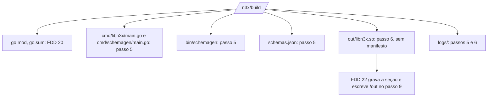

### FDD: Geração de código e compilação reproduzível (BLD-03)

Versão: 1.0
Data: 2026-10-20
Responsável: Guilherme Giusti

---

### 1. Contexto e motivação técnica

**Problema técnico.** O `libn3x.so` e o binário do controller nunca são compilados nos repositórios de runtime: saem sempre do `n3x-plugin build` (ADR-001 do `n3x-sidecar` e do `n3x-controller`). Os passos 5 e 6 do `build` são o ponto em que o runtime (`core/` ou `host/`), o plugin core e os plugins escolhidos se encontram num único `go build`. Hoje faltam quatro coisas para esse ponto ser verificável:

- **Código gerado sem contrato fechado de bytes.** A FDD 17 fixou a entrada do `.so` (`entry.Register` com ID e módulo literais, L-03) e a FDD 09 exige o par (ID, módulo) também no controller, mas o HLD ainda descreve `host.Run(core.Plugin(), <plugins>...)` sem módulo. Falta a forma exata do texto gerado, com aliases, ordem e formatação determinísticas.
- **Schema que exige executar código do plugin.** A FDD 02 decidiu gerar o JSON Schema por um programa auxiliar com reflexão (L-58), mas deixou para cá a execução (prazo, ambiente, limites), a leitura da saída e as regras do `N3X-B014`.
- **"Mesma entrada, mesmo hash" com cgo.** O `.so` usa `-buildmode=c-shared` e cgo. Compilador C, glibc, caminhos, variáveis de ambiente, build ID e a própria máquina de build podem mudar as seções carregáveis; o ADR-007 registra o risco do `zig cc` e o HLD não diz como fixar cada fonte de variação.
- **Arquitetura de destino e QEMU.** O Dockerfile de exemplo do HLD não usa `FROM --platform=$BUILDPLATFORM`; com `docker buildx --platform linux/amd64,linux/arm64`, o estágio de build do arm64 roda emulado, o que contradiz "sem QEMU" (L-59). Nada diz como o `n3x-plugin build` lê `TARGETARCH` nem o que acontece com uma arquitetura fora de `archs` do alvo (pedido da FDD 19).

Além disso, o marco M2 precisa de uma imagem de build antes de existirem imagens publicadas (decisão D-11 do README): o Dockerfile de desenvolvimento fica nesta FDD.

**Encaixe no HLD.** Esta FDD especifica, no repositório `n3x-builder` (HLD, "Componentes e responsabilidades"), o **Gerador** (`internal/generate`, passo 5) e o **Compilador** (`internal/compile`, passo 6), a resolução da plataforma de destino usada desde o passo 1, e o Dockerfile de desenvolvimento das imagens de build (`images/dev/`). Quem consome:

- FDD 17 (SID-03): o `main` gerado do `.so` é o golden compilado na CI do `n3x-sidecar` (`core/entry/testdata`)
- FDD 30 (CTL-01): implementa a API de `host` que o `main` gerado do controller chama (pedido, contrato 2)
- FDD 20 (BLD-02): o passo 1 chama a resolução de plataforma (contrato 4); o relator recebe `N3X-B010` e `N3X-B014`; os passos rodam em `/n3x/build`
- FDD 22 (BLD-04): recebe a lista de plugins com os schemas (`generate.Result`) e o artefato sem manifesto (`compile.Result`)
- FDD 23 (BLD-05): recebe o artefato, a arquitetura e a marca de build nativo
- FDD 24 (BLD-06): usa o ambiente do compilador (`compile.Env`) na carga dos pacotes
- FDD 46 (BLD-07): publica as imagens a partir do Dockerfile de desenvolvimento e aplica o Dockerfile recomendado (L-59)
- FDD 47 (SDK-15): guia do operador com o Dockerfile recomendado

**Atores.** Operador (escreve o Dockerfile e roda `docker buildx build`), autor de plugin (corrige código ou tags a partir de `N3X-B010` e `N3X-B014`), mantenedor do builder (mantém imagens, toolchain e catálogo de regras), BuildKit (passa `TARGETARCH` e monta caches), toolchain da imagem (Go e `zig`), runtimes `core/entry` e `host` (recebem o código gerado), FDDs 22 e 23 (consomem o artefato) e CI do `n3x-builder`.

**Limites.** Só os passos 5 e 6, a plataforma de destino e o Dockerfile de desenvolvimento. Não resolve módulos (FDD 20), não analisa código (FDD 24), não grava manifesto nem escreve em `/out` (FDD 22), não compara símbolos nem carrega o `.so` (FDD 23) e não publica imagens (FDD 46). Não acessa rede de módulos. Executa código de plugin em um único lugar: o programa auxiliar do schema, no passo 5.

**Suposições**
- FDDs 19, 20 e 24 implementadas: `internal/catalog`, `internal/image`, `internal/report`, `internal/resolve` (`BuildDir`, `ModeOffline`, `Request`, `Result`, `BuildContext`), `internal/check` (`Result.Plugins` em ordem de ID, com `Compiled` e `Core`) e `internal/analysis`
- O SDK `v0.1.0` traz `schemagen.Run`, `schemagen.Entry`, `plugin.ParseSchema`, `plugin.MaxSchemaSize`, `plugin.HalfProxy` e `plugin.HalfController` (FDD 02), `proxy.Plugin` (FDD 05) e `ctrl.Plugin` (FDD 08)
- O `n3x-sidecar/core` tem uma pré-release com `core/entry` (`Register`, `Core`, `Plugin`, FDD 17); o plugin core tem a `v0.1.0` com `agent.Plugin()` e `controller.Plugin()` (FDD 36)
- `go build -json` (Go 1.24 ou mais novo) está disponível no Go 1.26 da imagem
- O spike da fase 0 confirma que `go build -buildmode=c-shared` com `zig cc` gera um `.so` que o Envoy 1.40 carrega, em amd64 e arm64 (itens C-01 a C-05 da seção 8) (hipótese)
- O operador usa BuildKit (`# syntax=docker/dockerfile:1`), já exigido pela FDD 20 para cache e cópia de arquivos locais de módulos privados

**Restrições**
- `go build -trimpath -ldflags=-buildid=`; código gerado em ordem fixa e formatado com `go/format`; `built_at` fora do hash (ADR-007 do `n3x-builder`)
- Plugins registrados por função gerada, sem `init()` (HLD do `n3x-sdk`); em `c-shared`, por inicializador de variável de pacote (FDD 17, contrato 1)
- Controller: binário estático com `CGO_ENABLED=0` (HLDs do `n3x-controller` e do `n3x-builder`)
- arm64 compilado a partir de amd64 com `zig cc`, sem QEMU (HLD do `n3x-builder`)
- Um `.so` por commit exato do Envoy e por arquitetura (PRD, "Decisões e trade-offs")
- Schema gerado das structs com as tags `json`, `n3x`, `desc` e `default` (ADR-020 do `n3x-sdk`), pelo `schemagen` da FDD 02; o builder não reimplementa nenhuma regra do SDK
- Falha de compilação é `N3X-B010` e falha do gerador de schema é `N3X-B014`, ambas com exit 5 (ADR-006; FDD 20)
- Depois do passo 2, nenhuma rede de módulos: `GOPROXY=off` e `-mod=readonly` (`ModeOffline` da FDD 20)
- Toda saída passa pelo relator e pelo mascarador da FDD 20
- A tag `n3x_dev` nunca é passada (FDD 17)
- Documentação e mensagens em pt-BR; identificadores, campos e comandos em inglês

**Rastreabilidade**
- PRD 1.5: FR-015 ("gera o registro dos plugins e compila um único `libn3x.so`, de forma reproduzível (mesma entrada, mesmo hash)"; "o controller segue o mesmo fluxo [...] gerando o binário com as metades de controller"; "amd64 e arm64 [...] via `docker buildx`"); FR-011 (a `controller-builder` compila a metade de controller de cada plugin); "Dependências: Toolchain Go e C fixados" (Go 1.26, glibc igual ou anterior à do Envoy, `zig cc` para arm64); critérios de aceite "dois builds do mesmo Dockerfile em máquinas diferentes geram o mesmo hash no manifesto" e "os mesmos plugins geram `.so` para `envoy-1.40` e `istio-1.31`, em amd64 e arm64"; "Testes e validação" (checagem de reprodutibilidade em amd64 e arm64)
- HLD do `n3x-builder`: "Componentes e responsabilidades" (Gerador, Compilador), "Fluxo de requisição" (passos 5 e 6), "Considerações de escalabilidade" (build reproduzível, `zig cc`, cache fora da imagem), "Interfaces públicas" (`TARGETARCH`, `/out/libn3x.so`, `/out/n3x-controller`), riscos "build não reproduzível por causa do cgo e do `zig cc`" e "`.so` arm64 compilado de forma cruzada passa no build e cai no runtime"; HLD do `n3x-controller` ("Entregas": `host.Run`); HLD do `n3x-sidecar` (adaptadores por build tag)
- ADRs do `n3x-builder`: ADR-001 (imagem 1:1 com a versão do runtime), ADR-002 (escopo do hash: seções `SHF_ALLOC`), ADR-004 (build nativo e cruzado), ADR-006 (códigos e exit codes), ADR-007 (build reproduzível); ADR-001 e ADR-008 do `n3x-sidecar` (`.so` só pelo builder; cgo e `c-shared`); ADR-001 do `n3x-controller` (binário só pelo builder); ADRs do `n3x-sdk`: ADR-015 (`Plugin()` sem efeito colateral), ADR-020 (schema da struct), ADR-021 (Go 1.26 e semver)
- Lacunas do README:
  - **L-03 aplicada (definida na FDD 17):** o `main` gerado do `.so` é exatamente o do contrato 1 da FDD 17, com ID e módulo literais e sem a tag `n3x_dev`; aqui ficam só aliases, ordem dos imports e formatação (contrato 1)
  - **L-58 aplicada (fechada na FDD 02) e completada na parte do builder:** programa auxiliar com `schemagen`, executado no passo 5 com ambiente mínimo, prazo de 60 s e limite de saída; o `N3X-B014` tem 16 regras: as 13 do gerador do SDK, repassadas sem mudança, e `helper_crash`, `helper_timeout` e `helper_output` (contratos 3 e 7)
  - **L-59 fechada aqui:** o Dockerfile recomendado usa `FROM --platform=$BUILDPLATFORM` no estágio de build e `ARG TARGETARCH` antes da linha `build`; o estágio de build sempre roda na arquitetura do host e compila de forma cruzada; o `n3x-plugin build` lê `TARGETARCH` do ambiente (contratos 4 e 8). A FDD 46 aplica nas imagens publicadas e no exemplo da documentação
  - **L-21 aplicada (registrada na FDD 19):** a glibc que limita o toolchain C é `envoy.glibc` do alvo, usada como sufixo do alvo do `zig cc` (`aarch64-linux-gnu.<glibc>`); o valor vem do spike da fase 0
- Decisão D-11 do README: Dockerfile de desenvolvimento das imagens de build, usado no M2 sem publicação (contrato 9)
- Pedidos atendidos: FDD 02 (`N3X-B014` e bytes do schema sem reformatar), FDD 09 (módulo de cada plugin no registro do `.so` e do controller), FDD 16 (`go.mod` com `envoy_go_sdk`, conferido no artefato e na imagem), FDD 17 (`main` com ID e módulo, nunca `n3x_dev`), FDD 19 (`BuildTag()`, `envoy_go_sdk`, `TARGETARCH` fora de `archs`, `/etc/n3x/target.yaml` e `/etc/n3x/builder.yaml` no Dockerfile de desenvolvimento), FDD 20 (gerar e compilar em `/n3x/build` com `GOPROXY=off` e `-mod=readonly`, o mesmo `BuildContext` da resolução, regras do `N3X-B014` e `/usr/share/n3x/pinned`), FDD 24 (regra `typecheck` no `N3X-B010`; ambiente do compilador `CC` e `CGO_*`)

---

### 2. Objetivos técnicos

- **Mesma entrada, mesmas seções carregáveis.** Invariante: o mesmo workspace na mesma imagem gera o mesmo conteúdo das seções ELF com `SHF_ALLOC` (escopo do ADR-002), em qualquer máquina e com caches frios ou quentes. Medida: na CI de todo PR, dois builds do mesmo conjunto em containers novos dão o mesmo SHA-256 das seções `SHF_ALLOC` em amd64 (nativo) e arm64 (cruzado), com 0 divergências; o controller dá o mesmo SHA-256 do arquivo inteiro.
- **Hash independente da máquina de build.** Invariante: o artefato de um destino não depende da arquitetura do host, porque o Go e o `zig cc` geram o mesmo código para o mesmo destino (hipótese). Medida: na matriz noturna da FDD 46, hosts amd64 e arm64 compilam os dois destinos e as 4 combinações dão o mesmo hash por destino.
- **Código gerado determinístico.** Invariante: o `main` do artefato e o do auxiliar são função pura da lista checada (ID, módulo, metades, core) e da identidade da imagem. Medida: as 6 permutações das linhas `add` de 3 plugins geram arquivos com o mesmo SHA-256; os 9 golden do contrato 1 a 3 batem byte a byte.
- **Fiel aos contratos dos runtimes.** Medida: o golden do `main` do `.so` é idêntico ao `core/entry/testdata/main_core_example_ratelimit.go` do `n3x-sidecar` e compila com `-buildmode=c-shared -tags n3x_envoy140`; o golden do controller compila contra o `host` da versão fixada (depois da FDD 30).
- **Schemas exatos.** Invariante: os bytes de cada schema entregues à FDD 22 são exatamente os escritos por `schemagen.Run`, que são os de `SchemaOf[C]().MarshalJSON()`. Medida: comparação byte a byte com os golden do SDK para o core e o exemplo, nos dois artefatos.
- **Sem rede e sem QEMU.** Invariante: os passos 5 e 6 rodam com `GOPROXY=off` e `-mod=readonly`; nenhuma linha `RUN` do Dockerfile recomendado executa na arquitetura de destino. Medida: o build multi-plataforma do Dockerfile recomendado termina num host amd64 sem `binfmt` registrado; com a rede cortada depois do passo 2, os passos 5 e 6 terminam.
- **Falha clara e sem caminho absoluto.** Invariante: toda falha de compilação sai como `N3X-B010` e toda falha do gerador de schema como `N3X-B014`, com exit 5, regra estável, plugin atribuído quando houver e caminho relativo ao módulo. Medida: um teste por regra; busca por `/go/pkg/mod/`, `/tmp/go-build` e `/n3x/build/` absolutos na saída de texto e JSON dá 0 ocorrências.
- **Artefato só com o que foi pedido.** Invariante: o `.so` contém o runtime, o core e a metade de proxy só dos plugins que a têm; o controller, a metade de controller. Medida: a build info do artefato lista exatamente esses módulos, nas versões da imagem, com a tag do alvo e sem `n3x_dev`.
- **Passos rápidos com cache.** Medida: com 5 plugins, num runner amd64 da CI, p95 de 5 execuções: passo 5 em até 5 s e passo 6 em até 20 s com cache quente; até 90 s e 120 s com cache frio; arm64 cruzado em até 1,5 vez o tempo do amd64 nativo (hipótese, conferida pela FDD 46 contra a L-29).

---

### 3. Escopo e exclusões

**Incluído**
- Resolução da plataforma de destino: leitura de `TARGETOS` e `TARGETARCH`, regra para valor vazio, fora de `archs` ou não suportado; contexto de compilação e contexto da máquina de build entregues à FDD 20 (contrato 4)
- Gerador do `main.go` do `.so`, aplicando a L-03 da FDD 17 (contrato 1)
- Gerador do `main.go` do controller, com `host.Run` e o módulo de cada plugin (contrato 2, pedido à FDD 30)
- O registro dos plugins é o próprio `main.go`: uma chamada com um item por plugin, em ordem de ID, sem `init()` e sem arquivo separado
- Plugin só de proxy ou só de controller: fora do `main` do artefato sem a metade, presente na lista entregue ao manifesto
- Programa auxiliar do schema com `schemagen` (FDD 02): geração, compilação, execução isolada, leitura da saída e entrega dos bytes sem reformatar (contrato 3)
- Compilação do `.so` (`-buildmode=c-shared`, `zig cc` nas duas arquiteturas, glibc do alvo, build tag do alvo) e do controller (estático, `CGO_ENABLED=0`) (contrato 5)
- Regras de reprodutibilidade: código gerado, caminhos, ambiente, flags, build ID, nível de instrução e caches (contrato 5)
- Pós-condições do artefato: ELF, máquina, build info, versões fixadas e ausência de `n3x_dev` (contrato 5)
- Layout de `/n3x/build`, nomes dos artefatos e tipos entregues às FDDs 22, 23 e 24 (contrato 6)
- Regras do `N3X-B010` e do `N3X-B014`, resumo da saída do compilador e do auxiliar sem caminhos absolutos (contrato 7)
- Dockerfile recomendado ao operador para sidecar e controller, multi-plataforma sem QEMU (contrato 8, L-59)
- Dockerfile de desenvolvimento das duas imagens de build e ferramenta `pin` que cria `/usr/share/n3x/pinned` e `/etc/n3x/builder.yaml` (contrato 9, D-11)

**Excluído**
- Resolução de módulos, checagem de compatibilidade, relator e catálogo de códigos: FDD 20 (BLD-02); aqui só as regras do `N3X-B010` e do `N3X-B014`
- Análise estática e a regra `typecheck` em si: FDD 24 (BLD-06); aqui ela entra só na tabela de regras do `N3X-B010`
- Manifesto embutido, `objcopy`, hash de integridade, escrita em `/out` e `/out/manifest.json`: FDD 22 (BLD-04)
- Comparação de símbolos, teste de carga e qual binário do Envoy a imagem amd64 usa para um `.so` arm64 (L-60): FDD 23 (BLD-05)
- Imagens publicadas, matriz alvo × arquitetura em runners nativos, checagem cruzada de hosts e metas do build inteiro (L-29): FDD 46 (BLD-07)
- API de entrada do `core/` (`entry`): FDD 17 (SID-03); API de `host` (`host.Run`, `host.Core`, `host.Plugin`): FDD 30 (CTL-01)
- `schemagen`, `SchemaOf` e as regras do gerador: FDD 02 (SDK-02)
- Conferência da arquitetura do manifesto contra a do processo na subida: FDD 25 (SID-05)
- Assinatura, SBOM e lockfile: fora da v1 (PRD)

---

### 4. Fluxos detalhados e diagramas

**Fluxo de plataforma (antes do passo 2, chamado pelo passo 1 da FDD 20, sem rede)**
1. `compile.ResolvePlatform(os.Environ(), img, target)` lê `TARGETOS` e `TARGETARCH` (contrato 4).
2. `TARGETARCH` vazio: usa a arquitetura da própria imagem de build (`runtime.GOARCH` do `n3x-plugin`) e devolve o aviso `target_arch_implicit`.
3. `TARGETOS` diferente de vazio e de `linux`, arquitetura diferente de `amd64` e `arm64`, ou arquitetura fora de `archs` do alvo na `sidecar-builder`: erro de uso `platform_unsupported`, exit 1, antes de qualquer processo `go`.
4. `Native` é verdadeiro quando a arquitetura de destino é a da imagem.
5. `compile.Context` monta o contexto de compilação (`GOOS=linux`, `GOARCH`, `CGO_ENABLED=1` e `Tags=[BuildTag()]` no sidecar; `CGO_ENABLED=0` e sem tags no controller); `compile.HostContext` monta o da máquina de build (`GOARCH` da imagem, `CGO_ENABLED=0`, sem tags). Os dois vão em `resolve.Request.Compile` e `resolve.Request.Host` (FDD 20).

**Fluxo principal, passo 5: geração** (`[5/9] gerando registro e schemas`, prazo total de 300 s)
1. `rep.Begin(5, report.StepGenerate, "gerando registro e schemas")`.
2. `generate.InputFrom(img, checked.Plugins)` monta a entrada: tipo do artefato, módulo do runtime e do SDK (`builder.yaml`), e a lista checada no passo 3 em ordem de ID, com módulo (de `plugins.json`; o do core vem de `builder.yaml`), metades e marca de core. Confere: exatamente um core, IDs válidos por `plugin.ParseID`, módulos válidos, aliases únicos, core com a metade deste artefato. Falha: erro de uso `internal`, exit 1 (bug do builder ou imagem defeituosa).
3. Recria `/n3x/build/cmd/`, `/n3x/build/bin/` e `/n3x/build/logs/` e apaga `/n3x/build/schemas.json` (o `go.mod` e o `go.sum` da FDD 20 não mudam).
4. Gera o `main.go` do artefato: `cmd/libn3x/main.go` (contrato 1) na `sidecar-builder` ou `cmd/n3x-controller/main.go` (contrato 2) na `controller-builder`, só com os plugins que têm a metade deste artefato. Texto montado em ordem de ID, formatado com `go/format`, gravado com LF e modo 0644. Guarda a tabela "linha do arquivo para plugin".
5. Gera `cmd/schemagen/main.go` (contrato 3) com todas as metades de todos os plugins da lista, inclusive o core e os plugins sem a metade deste artefato (FDD 02: os dois artefatos recebem os schemas das duas metades).
6. Compila o auxiliar com o ambiente `ModeOffline` da FDD 20 e o contexto da máquina de build: `go build -json -trimpath -buildvcs=false -o bin/schemagen ./cmd/schemagen`. Falha: problemas `N3X-B010` classificados pelo contrato 7 (`compile`, `entrypoint`, `link`, `toolchain` ou `timeout`); a etapa termina.
7. Executa `bin/schemagen` isolado (contrato 3): diretório de trabalho novo e vazio, ambiente mínimo, stdin fechado, grupo de processos próprio, prazo de 60 s, stdout e stderr com limite.
8. Interpreta o resultado: saída 0 lê o stdout; saída 1 converte cada linha do stderr num problema `N3X-B014` com a regra do SDK; panic, sinal ou outra saída é `helper_crash`; prazo estourado é `helper_timeout` (com despejo das goroutines por SIGQUIT para atribuir o plugin).
9. Valida o stdout: objeto JSON; IDs exatamente os da lista; em cada ID, exatamente as metades do manifesto; cada schema aceito por `plugin.ParseSchema` e com até `plugin.MaxSchemaSize`. Divergência: `N3X-B014` `helper_output`.
10. Grava `/n3x/build/schemas.json` com os bytes do stdout, sem mudança, e monta `generate.Result` com os schemas como `json.RawMessage` (cópia exata dos bytes).
11. `st.Note("<n> plugins, <s> schemas")`, `st.Set(...)` com os campos da seção 7 e `st.End()`.

**Fluxo principal, passo 6: compilação** (`[6/9] compilando libn3x.so` ou `compilando n3x-controller`, prazo de 600 s)
1. `rep.Begin(6, report.StepCompile, "compilando libn3x.so")`.
2. Monta o ambiente: `resolve.NewEnv(environ, ModeOffline).Vars()` (FDD 20) mais `compile.Env(req)` (contrato 5: `GOOS`, `GOARCH`, `CGO_*`, `CC` com `zig cc` e a glibc do alvo, nível de instrução base, cache do `zig`).
3. Recria `/n3x/build/out/`.
4. Roda, em `/n3x/build`, o comando do contrato 5 (`-buildmode=c-shared` com a tag do alvo no sidecar; estático no controller), com `-json`, grupo de processos próprio e prazo.
5. Saída 0: confere as pós-condições do artefato (contrato 5: ELF, tipo, máquina, build info, versões fixadas, tag, `n3x_dev` ausente). Falha de pós-condição: erro de uso `internal`, exit 1.
6. Saída diferente de 0: classifica a saída (contrato 7) em problemas `N3X-B010` (`compile`, `entrypoint`, `cgo`, `link`, `toolchain`, `timeout`), atribui cada um a um plugin quando possível, grava o log completo mascarado em `/n3x/build/logs/compile.log` e chama `st.FailAll`.
7. `st.Note("linux/<arch>, nativo|cruzado, zig <versão>, glibc <x.y>")` no sidecar ou `st.Note("linux/<arch>, estático")` no controller; `st.End()`.
8. Sem problema, `compile.Result` segue para os passos 7 (FDD 23), 8 e 9 (FDD 22). Os passos 5 e 6 nunca escrevem em `/out`.

**Fluxos alternativos e exceções**
- **Workspace vazio:** o `main` tem só `entry.Core(...)` (ou `host.Core(...)`); o auxiliar tem as duas metades do core.
- **Plugin só de controller na `sidecar-builder`:** não aparece no `main` do `.so` nem na build info; aparece no auxiliar (metade de controller) e em `generate.Result.Plugins` com `Compiled: false` e `Schemas.Controller` preenchido. Simétrico para plugin só de proxy na `controller-builder`.
- **Build cruzado (destino arm64 num host amd64):** mesmo comando, `CC` com alvo `aarch64-linux-gnu.<glibc>`; `Native: false`; a FDD 23 faz só a comparação de símbolos (ADR-004).
- **Build sem `--platform=$BUILDPLATFORM`:** o estágio arm64 roda emulado pelo QEMU do host, com `TARGETARCH=arm64` igual à arquitetura da imagem. O resultado é o mesmo (mesmo compilador e mesmo alvo, contrato 5), só mais lento; o `n3x-plugin` não detecta emulação. O guia e o exemplo evitam o caso (contrato 8).
- **`TARGETARCH` ausente com `--platform=$BUILDPLATFORM`:** os dois destinos compilam para a arquitetura do host, com o aviso `target_arch_implicit` nos dois; a imagem final do outro destino recebe um `.so` da arquitetura errada, recusado na subida pela conferência de `arch` do manifesto (pedido à FDD 25).
- **Metade sem `Plugin()` com a assinatura do SDK** (função ausente, tipo de retorno errado, pacote `main` ou pacote sem arquivos neste contexto): o erro do compilador cai numa linha do arquivo gerado que pertence ao plugin; vira `N3X-B010` `entrypoint`, normalmente já no passo 5, porque o auxiliar importa todas as metades.
- **Erro de compilação na metade não compilada pelo artefato** (ex.: metade de controller desatualizada num build de sidecar): só o auxiliar compila esse código; vira `N3X-B010` `compile` no passo 5.
- **Erro de tipo na metade compilada:** já sai no passo 4 como `N3X-B010` `typecheck` (FDD 24), no mesmo contexto de build. No passo 6 sobram ligação, código C, assembly de dependência, falta de recurso e prazo.
- **Struct de config com tag ou tipo inválido:** o auxiliar sai com 1 e lista todos os problemas; `N3X-B014` com a regra do SDK, exit 5; o passo 6 não roda.
- **Inicialização de pacote que trava ou entra em panic:** `helper_timeout` ou `helper_crash`, atribuídos ao plugin cujo pacote aparece primeiro na pilha da goroutine principal.
- **Plugin que escreve no stdout na inicialização:** a saída deixa de ser JSON; `helper_output`.
- **Falta de memória no compilador:** o processo filho morre por sinal; `N3X-B010` `toolchain`, com "dê mais memória ao Docker".
- **`build` rodado duas vezes no mesmo estágio:** os diretórios dos passos 5 e 6 são recriados; o resultado é o mesmo.

**Diagramas**

Sequência dos passos 5 e 6:

```mermaid
sequenceDiagram
    participant B as n3x-plugin build
    participant R as report
    participant G as internal/generate
    participant GO as go (processo filho)
    participant H as bin/schemagen (auxiliar)
    participant C as internal/compile
    B->>R: Begin(5, generate)
    B->>G: InputFrom(builder.yaml, check.Result.Plugins)
    G->>G: main do artefato e main do auxiliar (go/format)
    G->>GO: go build -json ./cmd/schemagen (máquina de build, CGO_ENABLED=0, ModeOffline)
    GO-->>G: binário ou erros (B010)
    G->>H: executa (dir vazio, ambiente mínimo, 60 s)
    H-->>G: stdout {id: {proxy, controller}} ou stderr (B014)
    G->>G: valida e guarda os bytes (json.RawMessage)
    B->>R: End
    B->>R: Begin(6, compile)
    B->>C: Run(contexto de compilação, Env com zig cc)
    C->>GO: go build -json -buildmode=c-shared -tags n3x_envoy140 ...
    GO-->>C: out/libn3x.so ou erros (B010)
    C->>C: pós-condições (ELF, build info, versões)
    B->>R: End; segue para os passos 7 a 9 (FDDs 23 e 22)
```

Dockerfile multi-plataforma sem QEMU (contrato 8):

```mermaid
flowchart LR
    D[docker buildx build --platform linux/amd64,linux/arm64] --> P1[estágio build, alvo amd64]
    D --> P2[estágio build, alvo arm64]
    P1 -- FROM --platform=$BUILDPLATFORM --> H1[roda no host amd64, TARGETARCH=amd64]
    P2 -- FROM --platform=$BUILDPLATFORM --> H2[roda no host amd64, TARGETARCH=arm64]
    H1 --> Z1[zig cc -target x86_64-linux-gnu.glibc]
    H2 --> Z2[zig cc -target aarch64-linux-gnu.glibc]
    Z1 --> F1[estágio final amd64: só COPY]
    Z2 --> F2[estágio final arm64: só COPY, sem emulação]
```

Layout de `/n3x/build` ao fim do passo 6 (sidecar):



---

### 5. Contratos públicos (assinaturas, endpoints, headers, exemplos)

**Contrato 1: `main.go` gerado do `.so` (L-03 aplicada, forma da FDD 17)**
- Tipo: código gerado (consumido pelo `core/entry` do `n3x-sidecar`)
- Assinatura/Rota:
  ```go
  package generate // github.com/giustech/n3x-builder/internal/generate

  const (
      Header        = "// Code generated by n3x-plugin build. DO NOT EDIT."
      SidecarPkg    = "cmd/libn3x"         // relativo a resolve.BuildDir
      ControllerPkg = "cmd/n3x-controller"
      HelperPkg     = "cmd/schemagen"
  )

  type Plugin struct {
      ID     plugin.ID
      Module string        // caminho do go.mod do plugin, com /vN se houver
      Halves []plugin.Half
      Core   bool
  }

  type Input struct {
      Kind    image.Kind
      Runtime module.Version // builder.yaml: core/ ou host/
      SDK     module.Version // builder.yaml: sdk
      Plugins []Plugin       // em ordem de ID, com o core
  }

  type Source struct {
      Path  string            // ex.: "cmd/libn3x/main.go"
      Bytes []byte            // saída de go/format, LF, termina com uma quebra de linha
      Lines map[int]plugin.ID // linha (import ou chamada) -> plugin; usada no contrato 7
  }

  func InputFrom(img image.Info, checked []check.Plugin) (Input, error) // ErrInput se a lista violar as pré-condições
  func Alias(id plugin.ID) string                                        // "giustech.ratelimit" -> "giustech_ratelimit"
  func SidecarMain(in Input) (Source, error)

  var ErrInput = errors.New("generate: entrada inválida")
  ```
- Método: n/a (função pura; o passo 5 grava o arquivo)
- Semântica de status/headers:
  - **Forma (FDD 17, contrato 1):** `package main`; um único `var _ = entry.Register(...)`; `entry.Core("<módulo do core>", n3x_core.Plugin())` primeiro; depois `entry.Plugin("<id>", "<módulo>", <alias>.Plugin())` em ordem crescente de ID (bytes); `func main() {}` vazio. Nada mais: sem `init()`, sem `//export`, sem diretiva `//go:`, sem outra declaração
  - **Quem entra:** só plugins com a metade `proxy` (`Compiled: true` na `sidecar-builder`); o core sempre, por `entry.Core`, nunca por `entry.Plugin`
  - **Literais:** ID e módulo vêm da lista checada (módulo do plugin de `plugins.json`; o do core de `builder.yaml`), escritos com `strconv.Quote`; nunca de valor vindo do código do plugin (FDD 09). O módulo é o do `go.mod` (com `/vN`), não o do pacote `agent`
  - **Imports:** três grupos separados por linha em branco: biblioteca padrão (vazio no sidecar), runtime (`<runtime.module>/entry`) e metades dos plugins (`<módulo>/agent`). O `go/format` ordena cada grupo pelo caminho do import, não pelo alias
  - **Alias:** o ID com `.` trocado por `_` (`n3x_core`, `giustech_ratelimit`) (hipótese). É identificador válido porque cada parte do ID começa com letra (FDD 01) e nunca colide com palavra reservada, `entry`, `host`, `os`, `plugin` ou `schemagen`, porque sempre tem `_`. É único porque `n3x_<alias>_` é o prefixo de métrica, que o passo 3 já exige único (`metric_prefix_duplicate`, FDD 20); `InputFrom` confere de novo
  - **Cabeçalho:** a primeira linha é exatamente `Header`, seguida de linha em branco; sem versão do builder, data ou caminho, para os bytes não dependerem da máquina nem do momento
  - **Tag:** o arquivo não tem build constraint; a tag do alvo vem do comando (contrato 5). A tag `n3x_dev` nunca aparece no arquivo nem no comando
  - **Golden:** `internal/generate/testdata/sidecar_core_example_ratelimit.go.golden` é a fonte do `core/entry/testdata/main_core_example_ratelimit.go` do `n3x-sidecar` (FDD 17); a CI do builder confere que os dois são iguais na versão fixada do `core/`

**Exemplo de requisição**
```json
{
  "Kind": "sidecar",
  "Runtime": { "Path": "github.com/giustech/n3x-sidecar/core", "Version": "v1.0.0" },
  "Plugins": [
    { "ID": "giustech.ratelimit", "Module": "github.com/giustech/n3x-plugin-ratelimit", "Halves": ["proxy", "controller"] },
    { "ID": "n3x.core", "Module": "github.com/giustech/n3x-plugin-core", "Halves": ["proxy", "controller"], "Core": true },
    { "ID": "n3x.example", "Module": "github.com/giustech/n3x-example", "Halves": ["proxy", "controller"] }
  ]
}
```

**Exemplo de resposta** (`cmd/libn3x/main.go`, idêntico ao golden)
```go
// Code generated by n3x-plugin build. DO NOT EDIT.

package main

import (
	"github.com/giustech/n3x-sidecar/core/entry"

	n3x_example "github.com/giustech/n3x-example/agent"
	n3x_core "github.com/giustech/n3x-plugin-core/agent"
	giustech_ratelimit "github.com/giustech/n3x-plugin-ratelimit/agent"
)

var _ = entry.Register(
	entry.Core("github.com/giustech/n3x-plugin-core", n3x_core.Plugin()),
	entry.Plugin("giustech.ratelimit", "github.com/giustech/n3x-plugin-ratelimit", giustech_ratelimit.Plugin()),
	entry.Plugin("n3x.example", "github.com/giustech/n3x-example", n3x_example.Plugin()),
)

func main() {}
```

`Lines` deste arquivo: `{8: n3x.example, 9: n3x.core, 10: giustech.ratelimit, 14: n3x.core, 15: giustech.ratelimit, 16: n3x.example}`.

---

**Contrato 2: `main.go` gerado do controller (`host.Run` com módulo, pedido à FDD 30)**
- Tipo: código gerado (consumido pelo `host` do `n3x-controller`)
- Assinatura/Rota:
  ```go
  package generate

  func ControllerMain(in Input) (Source, error)
  ```
  API que o código gerado chama (proposta para a FDD 30, hipótese):
  ```go
  package host // github.com/giustech/n3x-controller/host

  type Item struct{ /* ID, módulo, ctrl.Plugin, marca de core; opaco */ }

  func Core(module string, p ctrl.Plugin) Item          // ID implícito "n3x.core"; obrigatório e único
  func Plugin(id, module string, p ctrl.Plugin) Item    // id e module literais gravados pelo builder
  func Run(core Item, plugins ...Item) int              // lê os.Args e o ambiente; devolve o exit code
  ```
- Método: n/a
- Semântica de status/headers:
  - **Forma:** `package main`; imports em três grupos (`os`; o runtime `<runtime.module>`; `<módulo>/controller` dos plugins); `func main() { os.Exit(host.Run(host.Core(...), host.Plugin(...)...)) }`, com o core primeiro e os demais em ordem de ID. Mantém a forma "core primeiro, depois os plugins" do HLD e do ADR-001 do `n3x-controller` e acrescenta o módulo exigido pela FDD 09 (inconsistência I-01)
  - **Quem entra:** só plugins com a metade `controller`; o core sempre, por `host.Core`
  - **Por que `main` com `os.Exit`:** no binário estático, `main` roda; `host.Run` devolve o exit code em vez de chamar `os.Exit`, o que deixa o `host` testável. O `os.Exit` fica só no código gerado, que não passa pela análise estática (FDD 24)
  - **Sem panic na montagem:** `host.Core` e `host.Plugin` guardam erros (ID inválido, módulo vazio, plugin nulo, `n3x.core` por `Plugin`) para `host.Run` recusar a subida com mensagem, no mesmo modelo de `entry.Register` (pedido à FDD 30)
  - **Golden:** `internal/generate/testdata/controller_core_ratelimit.go.golden`, também copiado para `host/testdata` e compilado na CI do `n3x-controller`; o `cmd/n3x-controller-dev` segue a mesma forma (pedido à FDD 30, ADR-001 do `n3x-controller`)

**Exemplo de requisição**
```json
{
  "Kind": "controller",
  "Runtime": { "Path": "github.com/giustech/n3x-controller/host", "Version": "v1.0.0" },
  "Plugins": [
    { "ID": "acme.tenant", "Module": "github.com/acme/n3x-plugin-tenant", "Halves": ["proxy"] },
    { "ID": "giustech.ratelimit", "Module": "github.com/giustech/n3x-plugin-ratelimit", "Halves": ["proxy", "controller"] },
    { "ID": "n3x.core", "Module": "github.com/giustech/n3x-plugin-core", "Halves": ["proxy", "controller"], "Core": true }
  ]
}
```

**Exemplo de resposta** (`cmd/n3x-controller/main.go`; `acme.tenant`, só de proxy, fica de fora)
```go
// Code generated by n3x-plugin build. DO NOT EDIT.

package main

import (
	"os"

	"github.com/giustech/n3x-controller/host"

	n3x_core "github.com/giustech/n3x-plugin-core/controller"
	giustech_ratelimit "github.com/giustech/n3x-plugin-ratelimit/controller"
)

func main() {
	os.Exit(host.Run(
		host.Core("github.com/giustech/n3x-plugin-core", n3x_core.Plugin()),
		host.Plugin("giustech.ratelimit", "github.com/giustech/n3x-plugin-ratelimit", giustech_ratelimit.Plugin()),
	))
}
```

---

**Contrato 3: programa auxiliar do schema e passo 5 (`generate.Run`, L-58 aplicada)**
- Tipo: código gerado, processo filho e method (API Go interna)
- Assinatura/Rota:
  ```go
  package generate

  const (
      HelperBin       = "bin/schemagen"
      SchemasFile     = "schemas.json"
      StepTimeout     = 300 * time.Second // compilação e execução do auxiliar
      HelperTimeout   = 60 * time.Second  // só a execução (FDD 02)
      HelperQuitGrace = 2 * time.Second   // entre SIGQUIT e SIGKILL
      MaxHelperStderr = 1 << 20
      HelperExtraOut  = 64 << 10          // stdout máximo = entradas × plugin.MaxSchemaSize + HelperExtraOut
  )

  func HelperMain(in Input) (Source, error)

  type Request struct {
      Image   image.Info
      Plugins []check.Plugin      // check.Result.Plugins (FDD 20)
      Build   resolve.Result      // lista de build e grafo, para atribuir erros
      Host    resolve.BuildContext // compile.HostContext()
      Env     resolve.Env         // resolve.NewEnv(environ, resolve.ModeOffline)
      Clock   func() time.Time
  }

  type Schemas struct {
      Proxy      json.RawMessage // bytes exatos do schemagen; nil se o plugin não tem a metade
      Controller json.RawMessage
  }

  type PluginResult struct {
      check.Plugin            // ID, Module, Version, Manifest, JSON, Compiled, Core
      Schemas      Schemas
  }

  type Result struct {
      Plugins []PluginResult // todos os da lista, com o core, em ordem de ID
      Main    Source         // main do artefato (contratos 1 e 2)
      Package string         // "./cmd/libn3x" ou "./cmd/n3x-controller"
  }

  // Run executa o passo 5. error só para falha interna (exit 1).
  func Run(ctx context.Context, req Request, st *report.Step) (Result, error)
  ```
- Método: n/a
- Semântica de status/headers:
  - **Entradas do auxiliar:** uma `schemagen.Entry` por plugin e por metade do manifesto, em ordem de ID (bytes) e, em cada ID, `proxy` antes de `controller` (FDD 02, contrato 9). Os dois artefatos recebem as duas metades de todos os plugins. Alias da metade: `<alias>_agent` e `<alias>_controller`; únicos porque o alias base é único e os sufixos são fixos
  - **Compilação:** `go build -json -trimpath -buildvcs=false -o bin/schemagen ./cmd/schemagen`, em `/n3x/build`, com `ModeOffline` (FDD 20) e o contexto da máquina de build (`GOOS=linux`, `GOARCH` da imagem, `CGO_ENABLED=0`, sem tags). `-trimpath` deixa a pilha de um panic com caminhos de módulo, usados na atribuição
  - **Execução isolada (hipótese):** diretório de trabalho novo e vazio (`os.MkdirTemp` em `/n3x/build`); ambiente só com `PATH=/usr/bin:/bin`, `HOME=/nonexistent` e `TMPDIR=<o mesmo diretório>`, sem variáveis herdadas do `RUN` (nem `GOPROXY`, `GOPRIVATE` ou `GIT_*`); stdin em `/dev/null`; grupo de processos próprio (`Setpgid`); prazo de 60 s. Não é sandbox: o auxiliar executa código dos plugins já fornecidos no workspace, mas não há credencial GitHub disponível no build (decisão aprovada na clarificação da FDD 20).
  - **Prazo:** ao estourar, SIGQUIT no grupo (o runtime do Go despeja as goroutines no stderr), espera de 2 s e SIGKILL. A atribuição usa o primeiro quadro da goroutine principal cujo pacote pertence ao módulo de um plugin
  - **Limites:** stdout até `entradas × plugin.MaxSchemaSize + 64 KiB` (com 256 KiB por schema, o limite que a FDD 02 já impõe a cada um); stderr até 1 MiB; acima disso, o processo é encerrado e o problema é `helper_output` (stdout) ou o stderr é cortado
  - **Saída 0:** o stdout é decodificado com `json.Decoder` em `map[string]map[string]json.RawMessage`; `json.RawMessage` guarda os bytes de cada schema exatamente como o `schemagen` escreveu. Confere: IDs iguais aos da lista, metades iguais às do manifesto, `plugin.ParseSchema` aceita cada schema e o tamanho cabe em `plugin.MaxSchemaSize`. Os mesmos bytes do stdout são gravados em `/n3x/build/schemas.json`
  - **Saída 1:** cada linha do stderr tem a forma `<id> <metade>: <caminho Go>: <detalhe> [<regra>]` (FDD 02). Linha com regra do gerador do SDK vira `report.Problem{Code: B014, Rule: <regra>, Path: "<id> <metade>: <caminho Go>"}` com o plugin do ID; linha com a regra `truncated` do SDK é ignorada (o relator aplica o próprio limite); qualquer outra linha (regra desconhecida, `Plugin()` nulo, forma diferente) vira `helper_output` com o texto no detalhe e a regra original no atributo `sdk_rule`
  - **Outra saída, panic ou sinal:** `helper_crash`, com a primeira linha do panic (`panic: ...`) no detalhe e o quadro do plugin no atributo `frame`
  - **Bytes sem reformatar (pedido da FDD 02):** nenhuma etapa do builder decodifica e recodifica um schema; a FDD 22 recebe `json.RawMessage` e deve gravá-lo sem escape de HTML nem reindentação (pedido à FDD 22)

**Exemplo de requisição** (`cmd/schemagen/main.go` gerado para core, exemplo e rate limit)
```go
// Code generated by n3x-plugin build. DO NOT EDIT.

package main

import (
	"os"

	"github.com/giustech/n3x-sdk/plugin"
	"github.com/giustech/n3x-sdk/schemagen"

	n3x_example_agent "github.com/giustech/n3x-example/agent"
	n3x_example_controller "github.com/giustech/n3x-example/controller"
	n3x_core_agent "github.com/giustech/n3x-plugin-core/agent"
	n3x_core_controller "github.com/giustech/n3x-plugin-core/controller"
	giustech_ratelimit_agent "github.com/giustech/n3x-plugin-ratelimit/agent"
	giustech_ratelimit_controller "github.com/giustech/n3x-plugin-ratelimit/controller"
)

func main() {
	err := schemagen.Run(os.Stdout, []schemagen.Entry{
		{ID: "giustech.ratelimit", Half: plugin.HalfProxy, Plugin: giustech_ratelimit_agent.Plugin()},
		{ID: "giustech.ratelimit", Half: plugin.HalfController, Plugin: giustech_ratelimit_controller.Plugin()},
		{ID: "n3x.core", Half: plugin.HalfProxy, Plugin: n3x_core_agent.Plugin()},
		{ID: "n3x.core", Half: plugin.HalfController, Plugin: n3x_core_controller.Plugin()},
		{ID: "n3x.example", Half: plugin.HalfProxy, Plugin: n3x_example_agent.Plugin()},
		{ID: "n3x.example", Half: plugin.HalfController, Plugin: n3x_example_controller.Plugin()},
	})
	if err != nil {
		os.Stderr.WriteString(err.Error() + "\n")
		os.Exit(1)
	}
}
```

**Exemplo de resposta** (`generate.Result`, schemas encurtados com `...` só aqui; e um caso de falha do gerador)
```json
{
  "Package": "./cmd/libn3x",
  "Plugins": [
    { "ID": "giustech.ratelimit", "Compiled": true, "Core": false,
      "Schemas": { "Proxy": "{\"$schema\":\"https://json-schema.org/draft/2020-12/schema\",\"x-n3x-schema\":1,...}", "Controller": "{...}" } },
    { "ID": "n3x.core", "Compiled": true, "Core": true, "Schemas": { "Proxy": "{...}", "Controller": "{...}" } },
    { "ID": "n3x.example", "Compiled": true, "Core": false, "Schemas": { "Proxy": "{...}", "Controller": "{...}" } }
  ]
}
```
```text
stderr do auxiliar (saída 1):
giustech.ratelimit proxy: types.ProxyConfig.Window: opção desconhecida "mn" na tag n3x [tag_unknown]
giustech.ratelimit controller: types.ControllerConfig.Limit: campo sem desc [desc_missing]
```

---

**Contrato 4: plataforma de destino (`TARGETARCH`, L-59 e pedido da FDD 19)**
- Tipo: Docker BuildKit (`ARG` automático) e method (API Go interna)
- Assinatura/Rota:
  ```go
  package compile // github.com/giustech/n3x-builder/internal/compile

  type Platform struct {
      Arch     catalog.Arch // amd64 ou arm64
      Native   bool         // Arch == runtime.GOARCH (arquitetura da imagem de build)
      Implicit bool         // TARGETARCH ausente
  }

  // Lê TARGETOS e TARGETARCH de environ. Chamada no passo 1 (FDD 20), sem rede.
  func ResolvePlatform(environ []string, img image.Info, t *catalog.Target) (Platform, []report.Warning, *report.Usage)

  func Context(p Platform, img image.Info, t *catalog.Target) resolve.BuildContext // compilação do artefato
  func HostContext() resolve.BuildContext                                         // máquina de build (auxiliar)
  ```
- Método: n/a
- Semântica de status/headers:

| `TARGETOS` | `TARGETARCH` | Imagem | Resultado |
| --- | --- | --- | --- |
| vazio ou `linux` | vazio | qualquer | arquitetura da imagem, aviso `target_arch_implicit`; na `sidecar-builder`, ela também precisa estar em `archs` |
| vazio ou `linux` | `amd64` ou `arm64`, presente em `archs` do alvo | `sidecar-builder` | essa arquitetura |
| vazio ou `linux` | `amd64` ou `arm64` | `controller-builder` | essa arquitetura |
| vazio ou `linux` | `amd64` ou `arm64` fora de `archs` do alvo | `sidecar-builder` | uso `platform_unsupported`, exit 1 |
| vazio ou `linux` | outro (`arm`, `386`, `riscv64`, `ppc64le`, `s390x`) | qualquer | uso `platform_unsupported`, exit 1 |
| outro (`windows`, `darwin`) | qualquer | qualquer | uso `platform_unsupported`, exit 1 |

  - **De onde vem:** o BuildKit define `TARGETOS`, `TARGETARCH` e `TARGETVARIANT` para cada plataforma do `--platform`, mas só os expõe ao `RUN` se o estágio declarar `ARG TARGETARCH` (e `ARG TARGETOS`, opcional). O `n3x-plugin` lê só do ambiente; não há flag (hipótese: um único caminho, o mesmo no `docker build` simples e no multi-plataforma)
  - **`TARGETARCH` ausente vira aviso, não erro (hipótese):** os exemplos das FDDs 19 e 20 e um `docker build` simples continuam funcionando; o caso perigoso (multi-plataforma sem `ARG TARGETARCH`) gera o aviso nos dois destinos e é recusado na subida pela conferência de `arch` (pedido à FDD 25). Tornar o `ARG` obrigatório fica para uma major
  - **`TARGETVARIANT` ignorado:** o artefato usa sempre o nível base (`GOAMD64=v1`, `GOARM64=v8.0`), que roda em todas as variantes
  - **Contextos (entregues à FDD 20 em `resolve.Request`):** `Context` devolve `{GOOS: linux, GOARCH: <arch>, CGO: true, Tags: [t.BuildTag()]}` no sidecar e `{GOOS: linux, GOARCH: <arch>, CGO: false, Tags: nil}` no controller; `HostContext` devolve `{GOOS: linux, GOARCH: runtime.GOARCH, CGO: false, Tags: nil}`. São os mesmos usados nos passos 2, 4, 5 e 6 (pedido da FDD 20)
  - **Mensagem de `platform_unsupported`:** "esta imagem (envoy-1.40) compila para amd64, arm64; TARGETOS=linux TARGETARCH=riscv64", com "use --platform linux/amd64 ou linux/arm64"

**Exemplo de requisição**
```json
{ "environ": ["TARGETOS=linux", "TARGETARCH=arm64", "TARGETVARIANT=v8"], "image": { "Kind": "sidecar", "arch": "amd64" }, "target": { "id": "envoy-1.40", "archs": ["amd64", "arm64"] } }
```

**Exemplo de resposta**
```json
{
  "Platform": { "Arch": "arm64", "Native": false, "Implicit": false },
  "Context": { "GOOS": "linux", "GOARCH": "arm64", "CGO": true, "Tags": ["n3x_envoy140"] },
  "HostContext": { "GOOS": "linux", "GOARCH": "amd64", "CGO": false, "Tags": null },
  "Warnings": [],
  "Usage": null
}
```

---

**Contrato 5: comando e ambiente do compilador (`compile.Env`, `compile.Run`)**
- Tipo: method (API Go interna) e processo filho
- Assinatura/Rota:
  ```go
  package compile

  const (
      OutDir         = "/n3x/build/out"
      LogDir         = "/n3x/build/logs"
      SidecarName    = "libn3x.so"
      ControllerName = "n3x-controller"
      StepTimeout    = 600 * time.Second
      WaitDelay      = 5 * time.Second
      MaxLogBytes    = 4 << 20
      ZigCacheDir    = "/root/.cache/zig"
      BaseAMD64      = "v1"
      BaseARM64      = "v8.0"
  )

  // Variáveis do compilador para o contexto de compilação; usadas pelos passos 4 (FDD 24) e 6.
  func Env(req resolve.Request) []string

  func ArtifactName(k image.Kind) string // "libn3x.so" ou "n3x-controller"

  type Request struct {
      Resolve   resolve.Request  // Image, Target, Compile, Host, Env (FDD 20)
      Generated generate.Result  // passo 5
      Build     resolve.Result   // lista de build e grafo, para atribuir erros
      Platform  Platform
      Clock     func() time.Time
  }

  // Run executa o passo 6. error só para falha interna (exit 1).
  func Run(ctx context.Context, req Request, st *report.Step) (Result, error)
  ```
- Método: n/a
- Semântica de status/headers:

Comando (sempre em `/n3x/build`, com `GOFLAGS=-mod=readonly` e `GOPROXY=off` do `ModeOffline`):

| Artefato | Comando |
| --- | --- |
| `.so` | `go build -json -buildmode=c-shared -trimpath -buildvcs=false -tags=<BuildTag()> -ldflags="-buildid= -extldflags=-Wl,--build-id=none" -o /n3x/build/out/libn3x.so ./cmd/libn3x` |
| controller | `go build -json -trimpath -buildvcs=false -ldflags=-buildid= -o /n3x/build/out/n3x-controller ./cmd/n3x-controller` |

Ambiente de `compile.Env` (somado ao `ModeOffline` da FDD 20; a forma exata das flags de build ID é conferida no spike, item C-03):

| Variável | Sidecar | Controller | Por quê |
| --- | --- | --- | --- |
| `GOOS` | `linux` | `linux` | destino |
| `GOARCH` | `amd64` ou `arm64` | `amd64` ou `arm64` | contrato 4 |
| `CGO_ENABLED` | `1` | `0` | `c-shared` exige cgo; controller estático |
| `CC` | `zig cc -target x86_64-linux-gnu.<glibc>` ou `zig cc -target aarch64-linux-gnu.<glibc>` | (ausente) | mesmo compilador C para os dois destinos e em qualquer host; glibc do alvo (L-21) (hipótese) |
| `CXX` | `zig c++ -target <o mesmo>` | (ausente) | completude; o runtime não tem C++ |
| `CGO_CFLAGS`, `CGO_CXXFLAGS` | `-O2 -g0` | (ausente) | sem informação de depuração do C (caminhos) |
| `CGO_CPPFLAGS`, `CGO_LDFLAGS` | vazio | (ausente) | nada herdado do operador |
| `GOAMD64` ou `GOARM64` | `v1` ou `v8.0` | `v1` ou `v8.0` | nível base, roda em toda variante |
| `GOEXPERIMENT` | vazio | vazio | nada experimental |
| `ZIG_GLOBAL_CACHE_DIR`, `ZIG_LOCAL_CACHE_DIR` | `/root/.cache/zig` | (ausente) | cache do zig num caminho fixo, montável pelo BuildKit |
| `SOURCE_DATE_EPOCH` | `0` | (ausente) | `__DATE__` e `__TIME__` do C fixos |

Fontes de variação e como cada uma é fixada (ADR-007):

| Fonte | Como fica fixa |
| --- | --- |
| Go e biblioteca padrão | toolchain da imagem; `GOTOOLCHAIN=local` (FDD 20) |
| Versões dos módulos | `/n3x/build/go.mod` e `go.sum` (FDD 20); `-mod=readonly`; `GOPROXY=off` |
| Caminhos | `-trimpath`; diretórios fixos `/n3x/build`, `/go/pkg/mod`, `/usr/local/go`, `/root/.cache/zig`; o contexto do Docker é copiado, nunca montado |
| Build ID do Go e do ELF | `-ldflags=-buildid=` (ADR-007) e nenhuma nota `NT_GNU_BUILD_ID` dependente da máquina (`--build-id=none`) |
| VCS | `-buildvcs=false` |
| Compilador C e glibc | `zig cc` com alvo `<arch>-linux-gnu.<envoy.glibc>`, nativo ou cruzado |
| Flags e nível de instrução | tabela acima; `GOFLAGS` do operador substituído (FDD 20) |
| Ambiente do operador | lista de permissão da FDD 20; nada além dela chega ao `go` |
| Ordem e data | plugins por ID; imports pelo `go/format`; nenhum carimbo de tempo no código gerado |
| Máquina de build | Go e `zig` geram o mesmo código para o mesmo destino em qualquer host (hipótese, conferida na matriz da FDD 46) |
| Caches de módulos, de build e do zig | montados pelo BuildKit, fora da imagem; endereçados por conteúdo, não mudam a saída |
| Manifesto e `built_at` | fora do hash: a seção `.n3x_manifest` não tem `SHF_ALLOC` (ADR-002, FDD 22) |

  - **Pós-condições do artefato** (falha é erro interno, exit 1): ELF de 64 bits, little-endian, `EM_X86_64` ou `EM_AARCH64` conforme a arquitetura; `.so` com `ET_DYN`; controller com `ET_EXEC`, sem `PT_INTERP` e sem seção `.dynamic`; build info (`debug/buildinfo`) com `GOOS=linux`, `GOARCH`, `-buildmode=c-shared` ou `exe`, `-trimpath=true`, `CGO_ENABLED=1` ou `0`, `-tags` exatamente igual a `BuildTag()` (sidecar) ou ausente (controller), `GOAMD64` ou `GOARM64` base, `GoVersion` igual ao `go` de `builder.yaml`; dependências do SDK, do runtime, do plugin core e, no sidecar, do SDK Go do Envoy exatamente nas versões de `builder.yaml` e de `envoy_go_sdk` (defesa em profundidade da L-57 e do pedido da FDD 16); nenhuma menção a `n3x_dev`
  - **Prazo:** 600 s para o passo 6, aplicado com `exec.CommandContext`, grupo de processos (o `go` lança `compile`, `link` e o `zig`) e `WaitDelay` de 5 s; ao estourar, SIGKILL no grupo e problema `timeout`
  - **Sem nova tentativa:** compilação offline e determinística; repetir não muda o resultado
  - **Escrita:** só em `/n3x/build/out/` e `/n3x/build/logs/`; nunca em `/out` (FDD 20, contrato 1)

**Exemplo de requisição** (`compile.Env(req)` para `envoy-1.40`, destino arm64, host amd64, `envoy.glibc` ilustrativo `2.35`)
```text
GOOS=linux
GOARCH=arm64
CGO_ENABLED=1
CC=zig cc -target aarch64-linux-gnu.2.35
CXX=zig c++ -target aarch64-linux-gnu.2.35
CGO_CFLAGS=-O2 -g0
CGO_CPPFLAGS=
CGO_CXXFLAGS=-O2 -g0
CGO_LDFLAGS=
GOARM64=v8.0
GOEXPERIMENT=
ZIG_GLOBAL_CACHE_DIR=/root/.cache/zig
ZIG_LOCAL_CACHE_DIR=/root/.cache/zig
SOURCE_DATE_EPOCH=0
```

**Exemplo de resposta** (linha da etapa e build info do artefato, lida com `go version -m`)
```text
[6/9] compilando libn3x.so (linux/arm64, cruzado, zig 0.15.1, glibc 2.35) ... ok 24.9s

/n3x/build/out/libn3x.so: go1.26.1
	path	n3x.local/build/cmd/libn3x
	mod	n3x.local/build	(devel)
	dep	github.com/envoyproxy/envoy/source/extensions/dynamic_modules/sdk/go	v0.0.0-20260115093000-7c1f0e2a9b31
	dep	github.com/giustech/n3x-plugin-core	v1.0.0
	dep	github.com/giustech/n3x-plugin-ratelimit	v1.0.0
	dep	github.com/giustech/n3x-sdk	v1.2.0
	dep	github.com/giustech/n3x-sidecar/core	v1.0.0
	build	-buildmode=c-shared
	build	-compiler=gc
	build	-tags=n3x_envoy140
	build	-trimpath=true
	build	CGO_ENABLED=1
	build	GOARCH=arm64
	build	GOOS=linux
	build	GOARM64=v8.0
```

---

**Contrato 6: artefatos, diretórios e tipos entregues às FDDs 22, 23 e 24**
- Tipo: arquivos e method (API Go interna)
- Assinatura/Rota:
  ```go
  package compile

  type Toolchain struct {
      Go    string // "1.26.1"
      CC    string // "zig cc -target aarch64-linux-gnu.2.35"; vazio no controller
      Zig   string // "0.15.1"; vazio no controller
      GLibc string // "2.35"; vazio no controller
  }

  type Result struct {
      Kind      image.Kind
      Path      string    // /n3x/build/out/libn3x.so ou /n3x/build/out/n3x-controller
      Name      string    // nome final em /out (FDD 22): "libn3x.so" ou "n3x-controller"
      Platform  Platform  // Arch, Native: a FDD 23 decide o teste de carga por Native
      Toolchain Toolchain
      Size      int64
  }
  ```
- Método: n/a
- Semântica de status/headers:

| Caminho | Quem escreve | Conteúdo |
| --- | --- | --- |
| `/n3x/build/go.mod`, `go.sum` | FDD 20 (passo 2) | módulo de build `n3x.local/build` |
| `/n3x/build/cmd/libn3x/main.go` ou `cmd/n3x-controller/main.go` | passo 5 | `main` do artefato (contratos 1 e 2) |
| `/n3x/build/cmd/schemagen/main.go` | passo 5 | `main` do auxiliar (contrato 3) |
| `/n3x/build/bin/schemagen` | passo 5 | binário do auxiliar, da máquina de build |
| `/n3x/build/schemas.json` | passo 5 | stdout do auxiliar, sem mudança |
| `/n3x/build/out/libn3x.so` ou `out/n3x-controller` | passo 6 | artefato sem manifesto |
| `/n3x/build/logs/schemagen-build.log`, `schemagen.stderr`, `compile.log` | passos 5 e 6 | saídas completas, mascaradas pelo relator, até 4 MiB cada |
| `/out/libn3x.so` ou `/out/n3x-controller`, `/out/manifest.json` | FDD 22 (passo 9) | artefato final, único caminho que o estágio final copia |

  - **Nomes fixos:** `libn3x.so` (sidecar) e `n3x-controller` (controller), os do HLD; o `main` do `.so` fica em `cmd/libn3x`, e esse caminho entra na build info (`path n3x.local/build/cmd/libn3x`), por isso é constante
  - **Código gerado fora de `/out` (hipótese):** `/out` é o contrato do artefato; o código gerado é função pura da lista de plugins, que o manifesto embutido registra, e fica em `/n3x/build` para depuração com `docker build --target build` (guia da FDD 47)
  - **FDD 22:** recebe `generate.Result.Plugins` (lista completa, com `Compiled` e os dois schemas) e `compile.Result`; grava a seção no arquivo de `Path` e escreve `/out/<Name>` no passo 9
  - **FDD 23:** recebe `compile.Result`; teste de carga só com `Platform.Native`
  - **FDD 24:** usa `compile.Env(req)` como `CompileEnv` na carga dos pacotes

**Exemplo de requisição**
```go
gen, err := generate.Run(ctx, generate.Request{Image: img, Plugins: checked.Plugins, Build: resolved,
    Host: req.Host, Env: resolve.NewEnv(os.Environ(), resolve.ModeOffline), Clock: time.Now}, st5)
out, err := compile.Run(ctx, compile.Request{Resolve: req, Generated: gen, Build: resolved,
    Platform: plat, Clock: time.Now}, st6)
```

**Exemplo de resposta**
```json
{
  "Kind": "sidecar",
  "Path": "/n3x/build/out/libn3x.so",
  "Name": "libn3x.so",
  "Platform": { "Arch": "arm64", "Native": false, "Implicit": false },
  "Toolchain": { "Go": "1.26.1", "CC": "zig cc -target aarch64-linux-gnu.2.35", "Zig": "0.15.1", "GLibc": "2.35" },
  "Size": 41873408
}
```

---

**Contrato 7: `N3X-B010` e `N3X-B014` (regras, formato e resumo da saída)**
- Tipo: catálogo de erros (entra em `internal/report/catalog.go` da FDD 20) e regra de conversão (função interna `compile.Classify`)
- Assinatura/Rota:
  ```go
  package compile

  // Converte os eventos de go build -json em problemas N3X-B010.
  func Classify(events []BuildEvent, gen generate.Source, build resolve.Result, plugins []check.Plugin, ctx string) []report.Problem

  type BuildEvent struct{ ImportPath, Action, Output string } // formato de `go help buildjson`
  ```
- Método: n/a
- Semântica de status/headers:

Regras do `N3X-B010` (exit 5):

| Regra | Passo | Quando | Como resolver |
| --- | --- | --- | --- |
| `typecheck` | 4 (FDD 24) | erro de tipo no código do plugin, achado na carga | corrija o código nas linhas indicadas |
| `compile` | 5 e 6 | o compilador Go (ou o assembler) recusou um pacote; no passo 5, quase sempre a metade que este artefato não compila | corrija o código nas linhas indicadas; confira se o plugin compila com o SDK e o Go da imagem |
| `entrypoint` | 5 e 6 | o pacote `agent` ou `controller` não exporta `func Plugin() proxy.Plugin` (ou `ctrl.Plugin`) importável: erro numa linha do arquivo gerado que pertence ao plugin | exporte `Plugin()` com a assinatura do SDK no pacote da metade e publique nova tag |
| `cgo` | 6 | o `zig cc` recusou código C do runtime ou de uma dependência | imagem defeituosa ou dependência com C; abra uma issue com `/n3x/build/logs/compile.log` |
| `link` | 5 e 6 | o linker falhou (símbolo ausente ou duplicado, glibc mais nova que a do alvo) | abra uma issue com o log; se a dependência for de um plugin, troque a versão dela |
| `toolchain` | 5 e 6 | `go` ou `zig` ausentes, ou processo morto por sinal (falta de memória) | dê mais memória ao Docker e rode de novo; se persistir, abra uma issue |
| `timeout` | 5 e 6 | compilação passou do prazo (300 s no passo 5, 600 s no passo 6) | dê mais CPU e memória, monte o cache e rode de novo |

Regras do `N3X-B014` (exit 5):

| Regra | Origem | Quando | Como resolver |
| --- | --- | --- | --- |
| `unsupported_type`, `embedded`, `recursive`, `depth`, `json_name`, `json_duplicate`, `tag_syntax`, `tag_unknown`, `tag_conflict`, `tag_value`, `default_invalid`, `desc_missing`, `desc_length` | gerador do SDK (FDD 02, contrato 8), repassadas sem mudança | struct de config com tipo ou tag inválidos | corrija a struct de config e as tags `n3x`; o mesmo erro aparece no `go test` com o `sdktest` |
| `helper_crash` | builder | o auxiliar entrou em panic, morreu por sinal ou saiu com código diferente de 0 e 1 (inicialização de pacote ou `Plugin()` do plugin) | `Plugin()` e a inicialização de pacote não podem ter efeito colateral (ADR-015); corrija e publique nova tag |
| `helper_timeout` | builder | o auxiliar passou de 60 s | tire I/O e laços da inicialização de pacote e de `Plugin()` |
| `helper_output` | builder | stdout que não é o JSON esperado (escrita no stdout na inicialização, `Plugin()` nulo, metade ou ID faltando, schema ilegível ou grande demais) ou linha do stderr fora do formato | não escreva no stdout fora do `main`; confira `Plugin()` e o `n3x-plugin.yaml` |

  - **Saída do compilador em JSON:** o passo 5 e o 6 usam `go build -json`, que entrega cada saída com o `ImportPath` do pacote; a atribuição não depende de ler o texto de cabeçalho `# pacote` (hipótese: formato de `go help buildjson` do Go da imagem, protegido por golden)
  - **Classificação, na ordem:** processo morto por sinal ou executável ausente: `toolchain`; prazo estourado: `timeout`; saída de `link` ou de `ld.lld`: `link`; arquivo `.c`, `.h`, `cgo:` ou `zig: error`: `cgo`; posição `<arquivo>:<linha>:<coluna>` no arquivo gerado, numa linha de `Source.Lines`: `entrypoint` do plugin daquela linha; posição no arquivo gerado fora de `Lines`: `compile` sem plugin (imagem defeituosa); demais posições: `compile`
  - **Atribuição:** `ImportPath` vai ao módulo pelo maior prefixo na lista de build; módulo de um plugin vai a esse plugin; módulo de dependência vai ao primeiro plugin, em ordem de ID, que a exige pelo grafo (`resolve.Graph.Chains`), com a lista completa no atributo `plugins`; runtime e SDK ficam sem plugin
  - **Sem caminhos da máquina (resposta ao ASSUNTO):** o build só enxerga caminhos do container, nunca os do host do operador, porque o contexto do Docker é copiado. Mesmo assim, toda posição é reescrita para ficar curta e estável nos golden:

| Prefixo na saída | Vira |
| --- | --- |
| `/go/pkg/mod/<módulo escapado>@<versão>/` ou `<módulo>@<versão>/` (forma do `-trimpath`) | caminho relativo ao módulo, com `module` e `version` nos atributos |
| `/n3x/build/` ou `./` | caminho relativo a `/n3x/build`, com `generated: true` em `cmd/` |
| `/usr/local/go/` | `$GOROOT/` |
| `/tmp/go-build<n>/` e `$WORK/` | `$WORK/` |
| `/root/.cache/zig/` | `$ZIG_CACHE/` |

  - **Resumo:** cada linha de diagnóstico vira um problema; linhas de continuação (ex.: `have (...)`, `want (...)`) entram no detalhe até 1 KiB; a linha `too many errors` do compilador vira o atributo `omitted`; no máximo 100 problemas por etapa (FDD 20); o texto completo, mascarado, fica em `/n3x/build/logs/`
  - **Campos:** `Path` é `<arquivo>:<linha>:<coluna>` relativo ao módulo (mesmo formato da FDD 24) no `N3X-B010` e `<id> <metade>: <caminho Go>` no `N3X-B014` (forma do stderr do auxiliar, FDD 02); atributos `package`, `module`, `file`, `line`, `column`, `half`, `context` (`target` ou `host`), `tool` (`compile`, `asm`, `cgo`, `link`, `zig`), `generated`, `plugins`, `omitted` no `N3X-B010`; `half`, `go_path`, `sdk_rule`, `exit_code`, `signal` e `frame` no `N3X-B014`

**Exemplo de requisição** (eventos de `go build -json` do auxiliar, num build de sidecar com a metade de controller de `acme.reports` desatualizada)
```json
{"ImportPath":"github.com/acme/n3x-plugin-reports/controller","Action":"build-output","Output":"# github.com/acme/n3x-plugin-reports/controller\n"}
{"ImportPath":"github.com/acme/n3x-plugin-reports/controller","Action":"build-output","Output":"/go/pkg/mod/github.com/acme/n3x-plugin-reports@v1.0.0/controller/cards.go:27:9: undefined: ctrl.CardOld\n"}
{"ImportPath":"github.com/acme/n3x-plugin-reports/controller","Action":"build-fail"}
```

**Exemplo de resposta** (texto no formato da FDD 20 e o evento JSON do problema)
```text
[5/9] gerando registro e schemas (4 plugins) ... falhou 3.4s (1 problema)
erro N3X-B010: controller/cards.go:27:9: undefined: ctrl.CardOld [compile]
  como resolver: corrija o código nas linhas indicadas; confira se o plugin compila com o SDK e o Go da imagem
  doc: https://github.com/giustech/n3x-builder/blob/main/docs/erros.md#n3x-b010

[5/9] gerando registro e schemas (3 plugins) ... falhou 1.2s (2 problemas)
erro N3X-B014: config do plugin sem schema válido em github.com/giustech/n3x-plugin-ratelimit@v1.0.0 (2 problemas)
  giustech.ratelimit proxy: types.ProxyConfig.Window: opção desconhecida "mn" na tag n3x [tag_unknown]
  giustech.ratelimit controller: types.ControllerConfig.Limit: campo sem desc [desc_missing]
  como resolver: corrija a struct de config e as tags n3x; o mesmo erro aparece no go test com o sdktest
  doc: https://github.com/giustech/n3x-builder/blob/main/docs/erros.md#n3x-b014

[6/9] compilando libn3x.so (linux/amd64, nativo, zig 0.15.1, glibc 2.35) ... falhou 48.3s (1 problema)
erro N3X-B010: o compilador foi encerrado por sinal (signal: killed) no pacote github.com/envoyproxy/envoy/source/extensions/dynamic_modules/sdk/go [toolchain]
  como resolver: dê mais memória ao Docker e rode de novo; se persistir, abra uma issue
  doc: https://github.com/giustech/n3x-builder/blob/main/docs/erros.md#n3x-b010
```
```json
{"ts":"2026-10-20T14:00:12.401Z","level":"error","msg":"problem","cmd":"build","step":"generate","code":"N3X-B010","exit_code":5,"rule":"compile","plugin_id":"acme.reports","plugin_module":"github.com/acme/n3x-plugin-reports","plugin_version":"v1.0.0","path":"controller/cards.go:27:9","detail":"undefined: ctrl.CardOld","fix":"corrija o código nas linhas indicadas; confira se o plugin compila com o SDK e o Go da imagem","doc":"https://github.com/giustech/n3x-builder/blob/main/docs/erros.md#n3x-b010","package":"github.com/acme/n3x-plugin-reports/controller","module":"github.com/acme/n3x-plugin-reports","file":"controller/cards.go","line":27,"column":9,"half":"controller","context":"host","tool":"compile","generated":false}
```

---

**Contrato 8: Dockerfile recomendado ao operador (L-59)**
- Tipo: Docker BuildKit (Dockerfile multi-stage e `docker buildx`)
- Assinatura/Rota:
  ```text
  FROM --platform=$BUILDPLATFORM <imagem de build> AS build
  RUN n3x-plugin add ...            (uma linha por plugin, ADR-005)
  ARG TARGETARCH                    (logo antes da linha build)
  RUN n3x-plugin build
  FROM <imagem de runtime>          (sem --platform; sem RUN)
  COPY --from=build /out/<artefato> <destino>
  ```
- Método: n/a
- Semântica de status/headers:
  - **`FROM --platform=$BUILDPLATFORM` só no estágio de build:** o BuildKit roda esse estágio na arquitetura do host para cada plataforma pedida, então nenhum `RUN` do `n3x-plugin` é emulado; o estágio final usa a imagem de runtime da plataforma de destino e só copia o artefato, o que dispensa QEMU (HLD: "sem QEMU")
  - **`ARG TARGETARCH` depois dos `add`:** os `add` não dependem do destino e ficam iguais para as duas plataformas, então o BuildKit os executa uma vez; a partir do `ARG`, os passos divergem por plataforma
  - **Caches:** `--mount=type=cache,target=/go/pkg/mod` (módulos) e `--mount=type=cache,target=/root/.cache` (build do Go e cache do `zig`); compartilhados entre as plataformas, seguros para uso concorrente (hipótese do cache do `zig`, conferida no spike)
  - **Plugins privados:** copiar os ZIPs no formato de módulo Go e eventuais arquivos de proxy local para o contexto do estágio de build; chamar `n3x-plugin add --archive <caminho>` antes do `build`. Nenhum secret ou token é fornecido ao builder (decisão aprovada na clarificação da FDD 20). Tratar contexto, camadas e cache desse estágio como contendo código privado.
  - **Forma antiga ainda aceita:** o Dockerfile do HLD (sem `--platform` e sem `ARG TARGETARCH`) continua compilando; com `--platform linux/arm64` ele roda emulado e mais lento, com o mesmo resultado, e sem `ARG TARGETARCH` gera o aviso `target_arch_implicit`
  - **Controller:** mesma forma, com `controller-builder` e `controller`

**Exemplo de requisição**
```dockerfile
# syntax=docker/dockerfile:1
FROM --platform=$BUILDPLATFORM ghcr.io/giustech/n3x/sidecar-builder:1.0.0-envoy-1.40 AS build
ARG GOPRIVATE=github.com/acme/*
RUN --mount=type=cache,target=/go/pkg/mod \
    n3x-plugin add github.com/giustech/n3x-plugin-ratelimit@v1.0.0
COPY dist/n3x-plugin-tenant-v0.4.2.zip /n3x/private/plugin.zip
COPY private-proxy/ /n3x/private-proxy/
ENV GOPROXY=file:///n3x/private-proxy,https://proxy.golang.org
RUN --mount=type=cache,target=/go/pkg/mod \
    n3x-plugin add --archive /n3x/private/plugin.zip
ARG TARGETARCH
RUN --mount=type=cache,target=/go/pkg/mod \
    --mount=type=cache,target=/root/.cache \
    n3x-plugin build

FROM ghcr.io/giustech/n3x/sidecar:1.0.0-envoy-1.40
COPY --from=build /out/libn3x.so /usr/lib/n3x/libn3x.so
```
```dockerfile
# syntax=docker/dockerfile:1
FROM --platform=$BUILDPLATFORM ghcr.io/giustech/n3x/controller-builder:1.0.0 AS build
RUN --mount=type=cache,target=/go/pkg/mod \
    n3x-plugin add github.com/giustech/n3x-plugin-ratelimit@v1.0.0
ARG TARGETARCH
RUN --mount=type=cache,target=/go/pkg/mod --mount=type=cache,target=/root/.cache \
    n3x-plugin build

FROM ghcr.io/giustech/n3x/controller:1.0.0
COPY --from=build /out/n3x-controller /usr/local/bin/n3x-controller
```
```text
docker buildx build --platform linux/amd64,linux/arm64 \
  -t registry.acme/n3x-sidecar:2026.10 --push .
```

**Exemplo de resposta** (trechos do log do BuildKit num host amd64 sem QEMU)
```text
#12 [linux/amd64->amd64 build 5/5] RUN ... n3x-plugin build
#12 [6/9] compilando libn3x.so (linux/amd64, nativo, zig 0.15.1, glibc 2.35) ... ok 21.7s
#13 [linux/amd64->arm64 build 5/5] RUN ... n3x-plugin build
#13 [6/9] compilando libn3x.so (linux/arm64, cruzado, zig 0.15.1, glibc 2.35) ... ok 24.9s
#13 [7/9] verificando símbolos e carga ... ok 0.8s   (FDD 23: só símbolos no cruzado)
#15 [linux/arm64 stage-1 2/2] COPY --from=build /out/libn3x.so /usr/lib/n3x/libn3x.so
```

---

**Contrato 9: Dockerfile de desenvolvimento das imagens de build (D-11) e ferramenta `pin`**
- Tipo: Dockerfile do repositório `n3x-builder` (`images/dev/Dockerfile`) e programa interno (`images/tools/pin`)
- Assinatura/Rota:
  ```text
  docker buildx build -f images/dev/Dockerfile --target sidecar-builder --load \
    --build-arg TARGET_ID=envoy-1.40 -t n3x-dev/sidecar-builder:dev-envoy-1.40 .
  docker buildx build -f images/dev/Dockerfile --target controller-builder --load \
    -t n3x-dev/controller-builder:dev .

  go run ./images/tools/pin --kind sidecar|controller --runtime <módulo>@<versão> \
    --core <módulo>@<versão> --tool <caminho do n3x-plugin> [--target targets/<alvo>.yaml] \
    --builder <versão> --out <dir>
  ```
- Método: n/a
- Semântica de status/headers:
  - **Para que serve:** gerar o `.so` do M2 (core mais exemplo, `envoy-1.40`, amd64) e o binário do controller do M3 pelo próprio `n3x-plugin build`, antes das imagens publicadas (FDD 46). Nunca é publicado: a tag local `n3x-dev/...` não tem o prefixo `ghcr.io/giustech` (hipótese de nome)
  - **Conteúdo da `sidecar-builder`:** Go 1.26 da imagem oficial `golang` (Debian) fixada por digest; `zig` em `/opt/zig`, baixado por versão e conferido por SHA-256; `n3x-plugin` em `/usr/local/bin/n3x-plugin`; `/etc/n3x/target.yaml` (cópia byte a byte de `targets/<alvo>.yaml`, modo 0444); `/etc/n3x/builder.yaml` (modo 0444, FDD 19); `/usr/share/n3x/pinned/` com `proxy/`, `go.sum` e `modules.txt` (FDD 20); `/n3x/work` e `/out` vazios; `ENV` com `PATH` do zig, `GOTOOLCHAIN=local` e o cache do zig em `/root/.cache/zig`
  - **Conteúdo da `controller-builder`:** o mesmo sem `zig`, sem alvo e com o `pinned` do `host`
  - **Pontos de extensão:** a FDD 22 acrescenta a ferramenta que grava a seção `.n3x_manifest`; a FDD 23 acrescenta o binário do Envoy do alvo. Cada uma edita só a sua linha marcada
  - **Ferramenta `pin` (hipótese de nome e local):** cria o módulo `n3x.local/pinned` com `require` do runtime, do SDK (versão lida da build info do `n3x-plugin`, para valer o invariante da FDD 19: o SDK do `builder.yaml` é o compilado no `n3x-plugin`), do plugin core e, no sidecar, de `envoy_go_sdk` do alvo; um arquivo com imports em branco das raízes (`<runtime>/entry` ou `<runtime>`, `<core>/agent`, `<core>/controller`, `<sdk>/schemagen`); roda `go mod tidy` e `go mod download all`; confere que a versão selecionada de cada módulo fixado é exatamente a pedida e que o `go.mod` do runtime exige o SDK Go do Envoy exatamente em `envoy_go_sdk` (pedido da FDD 16); copia `cache/download` para `<out>/pinned/proxy`, grava `<out>/pinned/go.sum` e `<out>/pinned/modules.txt` (`go list -m all`) e grava `<out>/builder.yaml`. Qualquer divergência sai com código diferente de 0 e falha o build da imagem
  - **Versões padrão (hipótese):** runtime e plugin core `v0.1.0` (a pré-release mínima do core é a da FDD 36); pseudo-versões são aceitas nos `ARG`, para testar um commit sem tag; `builder: 0.0.0-dev`
  - **Build de fumaça:** o último `RUN` de cada alvo roda `n3x-plugin build` com o workspace vazio e `GOPROXY=off`, com os caches montados, e apaga `/n3x/build` e o conteúdo de `/out` na mesma linha. Prova que a imagem compila o core sem rede (critério "offline" da FDD 20) e não deixa camada extra
  - **Uso no M2:** o Dockerfile do contrato 8 com `FROM --platform=$BUILDPLATFORM n3x-dev/sidecar-builder:dev-envoy-1.40 AS build`; com o driver `docker` do buildx, a imagem local é encontrada pelo `FROM`

**Exemplo de requisição** (`images/dev/Dockerfile`; digests e somas entre `<>` são preenchidos no repositório)
```dockerfile
# syntax=docker/dockerfile:1
# Imagens de build de desenvolvimento (FDD 21, D-11). Nunca publicadas; a publicação é da FDD 46.
ARG GO_IMAGE=golang:1.26.1-trixie@sha256:<digest>
ARG ZIG_VERSION=0.15.1
ARG ZIG_SHA256_X86_64=<sha256>
ARG ZIG_SHA256_AARCH64=<sha256>
ARG TARGET_ID=envoy-1.40
ARG SIDECAR_RUNTIME=github.com/giustech/n3x-sidecar/core@v0.1.0
ARG CONTROLLER_RUNTIME=github.com/giustech/n3x-controller/host@v0.1.0
ARG CORE=github.com/giustech/n3x-plugin-core@v0.1.0
ARG BUILDER_VERSION=0.0.0-dev

FROM ${GO_IMAGE} AS tool
WORKDIR /src
COPY . .
RUN --mount=type=cache,target=/go/pkg/mod --mount=type=cache,target=/root/.cache/go-build \
    CGO_ENABLED=0 go build -trimpath -buildvcs=false -ldflags=-buildid= \
      -o /stage/n3x-plugin ./cmd/n3x-plugin

FROM ${GO_IMAGE} AS zig
ARG ZIG_VERSION ZIG_SHA256_X86_64 ZIG_SHA256_AARCH64
RUN set -eu; arch="$(uname -m)"; \
    case "$arch" in x86_64) sum="$ZIG_SHA256_X86_64";; aarch64) sum="$ZIG_SHA256_AARCH64";; *) exit 1;; esac; \
    curl -fsSLo /tmp/zig.tar.xz "https://ziglang.org/download/${ZIG_VERSION}/zig-${arch}-linux-${ZIG_VERSION}.tar.xz"; \
    echo "${sum}  /tmp/zig.tar.xz" | sha256sum -c -; \
    mkdir -p /opt/zig; tar -xJf /tmp/zig.tar.xz -C /opt/zig --strip-components=1

FROM ${GO_IMAGE} AS pin-sidecar
ARG TARGET_ID SIDECAR_RUNTIME CORE BUILDER_VERSION
WORKDIR /src
COPY . .
COPY --from=tool /stage/n3x-plugin /stage/n3x-plugin
RUN go run ./images/tools/pin --kind sidecar --runtime "$SIDECAR_RUNTIME" --core "$CORE" \
      --tool /stage/n3x-plugin --target "targets/${TARGET_ID}.yaml" \
      --builder "$BUILDER_VERSION" --out /stage

FROM ${GO_IMAGE} AS pin-controller
ARG CONTROLLER_RUNTIME CORE BUILDER_VERSION
WORKDIR /src
COPY . .
COPY --from=tool /stage/n3x-plugin /stage/n3x-plugin
RUN go run ./images/tools/pin --kind controller --runtime "$CONTROLLER_RUNTIME" --core "$CORE" \
      --tool /stage/n3x-plugin --builder "$BUILDER_VERSION" --out /stage

FROM ${GO_IMAGE} AS base
ENV GOTOOLCHAIN=local
RUN git --version | awk '{split($3,v,"."); if (v[1]<2 || (v[1]==2 && v[2]<31)) exit 1}' \
 && mkdir -p /n3x/work /out
COPY --from=tool /stage/n3x-plugin /usr/local/bin/n3x-plugin

FROM base AS sidecar-builder
ARG TARGET_ID
COPY --from=zig /opt/zig /opt/zig
COPY --from=pin-sidecar /stage/pinned /usr/share/n3x/pinned
COPY --from=pin-sidecar --chmod=0444 /stage/builder.yaml /etc/n3x/builder.yaml
COPY --chmod=0444 targets/${TARGET_ID}.yaml /etc/n3x/target.yaml
ENV PATH=/opt/zig:$PATH ZIG_GLOBAL_CACHE_DIR=/root/.cache/zig ZIG_LOCAL_CACHE_DIR=/root/.cache/zig
# FDD 22: ferramenta de gravação da seção .n3x_manifest
# FDD 23: binário do Envoy do alvo (símbolos e teste de carga)
ARG TARGETARCH
RUN --mount=type=cache,target=/go/pkg/mod --mount=type=cache,target=/root/.cache \
    GOPROXY=off n3x-plugin build && rm -rf /n3x/build /out/* && mkdir -p /n3x/work

FROM base AS controller-builder
COPY --from=pin-controller /stage/pinned /usr/share/n3x/pinned
COPY --from=pin-controller --chmod=0444 /stage/builder.yaml /etc/n3x/builder.yaml
ARG TARGETARCH
RUN --mount=type=cache,target=/go/pkg/mod --mount=type=cache,target=/root/.cache \
    GOPROXY=off n3x-plugin build && rm -rf /n3x/build /out/* && mkdir -p /n3x/work
```

**Exemplo de resposta** (arquivos na `n3x-dev/sidecar-builder:dev-envoy-1.40` e `n3x-plugin version`)
```text
/etc/n3x/builder.yaml (0444)
  format: 1
  kind: sidecar
  builder: 0.0.0-dev
  go: 1.26.1
  sdk: { module: github.com/giustech/n3x-sdk, version: v0.1.0 }
  runtime: { module: github.com/giustech/n3x-sidecar/core, version: v0.1.0 }
  core: { module: github.com/giustech/n3x-plugin-core, version: v0.1.0 }
/etc/n3x/target.yaml (0444, igual a targets/envoy-1.40.yaml)
/usr/share/n3x/pinned/proxy/...  /usr/share/n3x/pinned/go.sum  /usr/share/n3x/pinned/modules.txt
/usr/local/bin/n3x-plugin   /opt/zig/zig   git version 2.47.x

$ docker run --rm n3x-dev/sidecar-builder:dev-envoy-1.40 n3x-plugin version
builder        0.0.0-dev (sidecar)
go             1.26.1
sdk            github.com/giustech/n3x-sdk v0.1.0
runtime        github.com/giustech/n3x-sidecar/core v0.1.0
core           github.com/giustech/n3x-plugin-core v0.1.0
target         envoy-1.40 (candidate)
```

---

### 6. Erros, exceções e fallback

**Matriz de erros previstos e tratamentos**

| Condição | Código e exit | Regra | Passo | Tratamento |
| --- | --- | --- | --- | --- |
| `TARGETOS` diferente de `linux`; `TARGETARCH` fora de `amd64` e `arm64` ou fora de `archs` do alvo | sem código, 1 | `platform_unsupported` | 1 (FDD 20 chama o contrato 4) | lista as arquiteturas da imagem; nenhum processo `go` roda |
| `TARGETARCH` ausente | aviso | `target_arch_implicit` | 1 | segue com a arquitetura da imagem |
| Lista checada sem core, com dois cores, ID ou módulo inválido, alias repetido, core sem a metade do artefato | sem código, 1 | `internal` | 5 | bug do builder ou imagem defeituosa; "abra uma issue com o log" |
| Erro de gravação em `/n3x/build` (disco cheio, permissão) | sem código, 1 | `internal` | 5 e 6 | nada é escrito em `/out` |
| Erro de compilação no auxiliar (metade que o artefato não compila) | `N3X-B010`, 5 | `compile` | 5 | todos os pacotes com erro numa execução; passo 6 não roda |
| Metade sem `Plugin()` com a assinatura do SDK | `N3X-B010`, 5 | `entrypoint` | 5 (ou 6) | atribuído pela linha do arquivo gerado |
| Auxiliar sai com 1 e lista problemas do gerador | `N3X-B014`, 5 | regra do SDK | 5 | todos os problemas de todos os plugins |
| Auxiliar em panic, morto por sinal ou com saída diferente de 0 e 1 | `N3X-B014`, 5 | `helper_crash` | 5 | atribuído pelo primeiro quadro de plugin na pilha |
| Auxiliar passa de 60 s | `N3X-B014`, 5 | `helper_timeout` | 5 | SIGQUIT, 2 s, SIGKILL no grupo; atribuído pelo despejo |
| Stdout do auxiliar inválido, incompleto, acima do limite ou com schema ilegível | `N3X-B014`, 5 | `helper_output` | 5 | detalhe diz o que faltou ou sobrou |
| Erro do compilador Go ou do assembler | `N3X-B010`, 5 | `compile` | 6 | normalmente já pego no passo 4 (`typecheck`) |
| Erro do `zig cc` em código C | `N3X-B010`, 5 | `cgo` | 6 | sem plugin, se for do runtime |
| Erro do linker | `N3X-B010`, 5 | `link` | 5 e 6 | log completo em `/n3x/build/logs/compile.log` |
| `go` ou `zig` ausentes, ou morte por sinal | `N3X-B010`, 5 | `toolchain` | 5 e 6 | "dê mais memória ao Docker" |
| Prazo do passo estourado durante uma compilação | `N3X-B010`, 5 | `timeout` | 5 e 6 | SIGKILL no grupo |
| Pós-condição do artefato falha (máquina, tipo ELF, tag, versão fixada, `n3x_dev`) | sem código, 1 | `internal` | 6 | o artefato é apagado de `/n3x/build/out` |
| Mais de 100 problemas | o da etapa | `truncated` | 5 e 6 | regra do relator (FDD 20) |

**Estratégias de resiliência**
- **Timeouts:** 300 s para o passo 5 (compilação e execução do auxiliar), 60 s para a execução do auxiliar, 600 s para o passo 6; `exec.CommandContext` com grupo de processos próprio e `WaitDelay` de 5 s (hipótese de valores, conferidos contra as metas da FDD 46)
- **Retries:** nenhum. A compilação é offline e determinística; repetir dá o mesmo resultado. Falta de recurso é tratada pelo operador
- **Backoff e circuit breaker:** não se aplicam a um comando de vida curta, rodado uma vez por linha `RUN`

**Política de fallback**
- Sem fallback silencioso: o builder nunca troca `zig cc` por outro compilador, nunca cai para emulação, nunca omite o schema de uma metade, nunca reformata bytes de schema, nunca compila com `n3x_dev` e nunca entrega artefato parcial
- `TARGETARCH` ausente é o único caso tolerado, com aviso, porque não muda o que é compilado para a arquitetura da imagem e a subida recusa um `.so` de arquitetura errada (FDD 25)

**Invariantes**
- O código gerado é função pura de (tipo do artefato, módulo do runtime, módulo do SDK, lista de (ID, módulo, metades, core))
- O código gerado não tem `init()`, `//export`, diretiva `//go:` nem build constraint; o comando nunca tem `n3x_dev` nem `replace`
- O `main` do artefato importa só o runtime e a metade deste artefato dos plugins que a têm; o core entra sempre e só por `entry.Core` ou `host.Core`
- O ID e o módulo de cada item do registro vêm da lista checada, nunca do código do plugin
- Os bytes de cada schema em `generate.Result` são exatamente os escritos pelo `schemagen`
- Os passos 5 e 6 não acessam rede de módulos e não escrevem em `/out`
- O auxiliar é o único processo que executa código de plugin nos passos 5 e 6, e roda sem o ambiente do `RUN`
- Mesma entrada e mesma imagem dão as mesmas seções `SHF_ALLOC`, em qualquer host
- Todo problema emitido tem código do catálogo e regra declarada (modo estrito do relator nos testes)

---

### 7. Observabilidade

**Métricas**
- O builder não tem serviço nem endpoint de métricas (HLD do `n3x-builder`; FDD 20); não há métricas Prometheus `n3x_*` nesta feature. A medição é o evento JSON de cada etapa
- Campos próprios do evento `step` do passo 5: `plugins` (com o core), `compiled` (itens no `main` do artefato, com o core), `schemas`, `helper_build_ms`, `helper_run_ms`, `helper_exit`
- Campos próprios do evento `step` do passo 6: `artifact` (`libn3x.so` ou `n3x-controller`), `goos`, `goarch`, `native`, `cgo`, `cc`, `zig`, `glibc`, `tags`, `go`, `size_bytes`
- Na CI do `n3x-builder`: `build-events.jsonl` (FDD 20) com a duração dos passos 5 e 6, frio e quente, e o artefato `repro-report.json` (hipótese de nome) com o SHA-256 das seções `SHF_ALLOC` de cada build da checagem dupla, por arquitetura; o resumo do job (`GITHUB_STEP_SUMMARY`) mostra as durações contra as metas da seção 2 e os hashes lado a lado

**Logs**
- Formato e campos do relator (FDD 20): linha da etapa com nota (`[5/9] gerando registro e schemas (3 plugins, 6 schemas) ... ok 0.4s`; `[6/9] compilando libn3x.so (linux/arm64, cruzado, zig 0.15.1, glibc 2.35) ... ok 24.9s`), um evento `problem` por problema com os atributos do contrato 7 e o aviso `target_arch_implicit` no passo 1
- Saídas completas em `/n3x/build/logs/` (`schemagen-build.log`, `schemagen.stderr`, `compile.log`), mascaradas pelo `Masker` da FDD 20 e cortadas em 4 MiB; ficam no estágio de build, nunca na imagem final
- **Proteção de dados:** o auxiliar roda sem o ambiente do `RUN`; o texto do compilador e do auxiliar passa pelo mascarador antes de sair; caminhos absolutos são reescritos (contrato 7). O builder não lê `n3x.yaml`, chave AES nem config de plugin
- **Cardinalidade:** sem agregação; até 100 problemas por etapa e 1 KiB por detalhe

**Tracing**
- Sem tracing (ADR-009 de plataforma). Não há spans

**Dashboards e alertas**
- CI do `n3x-builder`, em todo PR (amd64): checagem de golden do código gerado; checagem dupla de reprodutibilidade em amd64 nativo e arm64 cruzado, bloqueante; build multi-plataforma do Dockerfile recomendado num runner sem `binfmt`, bloqueante; cenários `N3X-B010` e `N3X-B014`
- Noturno (matriz da FDD 46): hosts amd64 e arm64 nativos compilando os dois destinos; hash diferente entre hosts abre uma issue com o rótulo `reproducibility` e o `repro-report.json`
- Para o operador (guia da FDD 47): exit 5 com `N3X-B010` `toolchain` ou `timeout` indica recurso do runner; com `compile`, `entrypoint` ou `N3X-B014`, indica o plugin

---

### 8. Dependências e compatibilidade

| Componente | Versão mínima | Observações |
| --- | --- | --- |
| Go | 1.26 (patch fixado pela imagem) | `-buildmode=c-shared`, `-trimpath`, `-buildvcs`, `go build -json`, `GOARM64`, `debug/buildinfo` (ADR-021 do `n3x-sdk`) |
| `zig` | 0.15.x (hipótese; versão e SHA-256 fixados no Dockerfile, confirmados no spike) | `CC` dos dois destinos com alvo `<arch>-linux-gnu.<glibc>`; precisa suportar a glibc de `envoy-1.40` e de `istio-1.31` |
| glibc alvo | `envoy.glibc` de cada alvo (L-21; valor da fase 0) | sufixo do alvo do `zig cc`; o `.so` não exige símbolo `GLIBC_` mais novo que ele |
| SDK Go do Envoy | `envoy_go_sdk` do alvo (FDD 19) | exigido em `/n3x/build/go.mod` (FDD 20) e conferido na build info do artefato e no `go.mod` do runtime (ferramenta `pin`) |
| `github.com/giustech/n3x-sdk` | `v0.1.0` (marco M1) | `schemagen`, `plugin.ParseSchema`, `plugin.MaxSchemaSize`, `plugin.Half*` (FDD 02), `proxy.Plugin`, `ctrl.Plugin` |
| `github.com/giustech/n3x-sidecar/core` | pré-release com `core/entry` (FDD 17) | `entry.Register`, `entry.Core`, `entry.Plugin`; build tag do adaptador |
| `github.com/giustech/n3x-controller/host` | pré-release da FDD 30 | `host.Run`, `host.Core`, `host.Plugin` (pedido, contrato 2) |
| `github.com/giustech/n3x-plugin-core` | `v0.1.0` (FDD 36) | `agent.Plugin()` e `controller.Plugin()` |
| FDDs 19 e 20 (BLD-01 e BLD-02) | implementadas | `catalog` (`BuildTag`, `GoSDK`, `HasArch`, `Envoy.GLibc`), `image.Info`, `report`, `resolve`, `check` |
| FDD 24 (BLD-06) | implementada | consome `compile.Env`; emite `typecheck` |
| FDDs 22 e 23 | consumidoras | `generate.Result` e `compile.Result` |
| Docker com BuildKit | `# syntax=docker/dockerfile:1` | `FROM --platform=$BUILDPLATFORM`, `ARG TARGETARCH` automático, `--mount=type=cache`, `COPY --chmod` |
| git | 2.31 | na imagem de desenvolvimento (FDD 20, `GIT_CONFIG_COUNT`) |
| `golang.org/x/mod` | a do `go.mod` do `n3x-builder` | `module.UnescapePath` na reescrita de caminhos e `module.Version` |

**Itens do spike da fase 0 para esta FDD** (somados aos S-01 a S-12 da FDD 16; hipótese até rodar):

| Item | O que confirmar | Onde é usado |
| --- | --- | --- |
| C-01 | `go build -buildmode=c-shared` com `CC="zig cc -target x86_64-linux-gnu.<glibc>"` e `aarch64` gera `.so` que o Envoy 1.40 carrega (amd64 nativo; arm64 nativo) | contrato 5 |
| C-02 | Dois builds em diretórios temporários e caches diferentes dão as mesmas seções `SHF_ALLOC` nos dois destinos; quais flags foram necessárias | contrato 5, tabela de fontes de variação |
| C-03 | Forma de desligar a nota `NT_GNU_BUILD_ID` com o linker externo (`-extldflags=-Wl,--build-id=none` ou opção do linker do Go) | contrato 5 |
| C-04 | Maior versão `GLIBC_` exigida pelo `.so` igual ou menor que `envoy.glibc` | critério de aceite |
| C-05 | Versão do `zig` que suporta a glibc dos dois alvos e uso concorrente do cache do `zig` por duas plataformas | Dockerfiles dos contratos 8 e 9 |

**Garantias de compatibilidade**
- A forma do código gerado acompanha a major de `core/entry` (FDD 17) e de `host` (FDD 30); a imagem de build é 1:1 com a versão do runtime (HLD do `n3x-builder`, ADR-001), então uma imagem nunca gera código para um runtime que não conhece
- Regras do `N3X-B010` e do `N3X-B014` estáveis na major do builder; regra nova só por adição (FDD 20). As 13 regras do gerador acompanham a FDD 02, que só cresce por adição em minor do SDK
- Regra de plataforma: arquitetura nova só por adição em `archs` do catálogo e na tabela do contrato 4; `TARGETARCH` ausente continua aviso em toda a major 1
- Dockerfile recomendado estável; o do HLD continua funcionando (com aviso e emulação)
- Nomes dos artefatos (`libn3x.so`, `n3x-controller`) e o caminho `cmd/libn3x` são fixos na major, porque entram no `COPY` do operador e na build info
- Trocar de versão do `zig` ou do Go muda o hash: só numa versão nova da imagem de build, nunca dentro da mesma tag (ADR-009)

---

### 9. Critérios de aceite técnicos

- **Golden do código gerado:** 9 arquivos em `internal/generate/testdata/` batem byte a byte: `sidecar_core`, `sidecar_core_example`, `sidecar_core_example_ratelimit`, `sidecar_controller_only` (core mais um plugin só de controller), `controller_core`, `controller_core_ratelimit`, `controller_proxy_only`, `helper_core` e `helper_core_example_ratelimit`; `gofmt -l` sobre eles não lista nada; busca na CI não acha `func init`, `//export`, `//go:`, `n3x_dev` nem `replace` no código gerado
- **Ordem:** as 6 permutações das linhas `add` de 3 plugins dão o mesmo SHA-256 do `main` do artefato e do `main` do auxiliar; 2 dessas permutações dão o mesmo hash das seções `SHF_ALLOC` do `.so`
- **Contrato com o runtime:** `sidecar_core_example_ratelimit.go.golden` é idêntico a `core/entry/testdata/main_core_example_ratelimit.go` do `n3x-sidecar` na versão fixada e compila com `-buildmode=c-shared -tags n3x_envoy140`; depois da FDD 30, `controller_core_ratelimit.go.golden` compila contra o `host` fixado
- **Metades:** com um plugin só de controller na `sidecar-builder`, o `main` do `.so` não o importa, a build info não lista o módulo dele e `generate.Result` o traz com `Compiled: false` e `Schemas.Controller` preenchido; o caso simétrico vale na `controller-builder`
- **Schemas exatos:** para o core e o exemplo, os bytes de `Schemas.Proxy` e `Schemas.Controller` são iguais aos golden de `SchemaOf[C]().MarshalJSON()` do SDK, nos dois artefatos; `/n3x/build/schemas.json` é igual ao stdout do auxiliar
- **Reprodutibilidade em todo PR:** workspace com core, exemplo e um plugin de `testdata`, compilado duas vezes em containers novos da imagem de desenvolvimento (caches vazios no primeiro e quentes no segundo, contexto do Docker em caminhos diferentes do host): SHA-256 das seções `SHF_ALLOC` igual em amd64 nativo e em arm64 cruzado; SHA-256 do arquivo inteiro do controller igual; 0 divergências. Até a FDD 22, o teste usa um auxiliar de teste com a definição do ADR-002
- **Reprodutibilidade entre hosts (noturno, matriz da FDD 46):** hosts amd64 e arm64 nativos compilam os dois destinos; as 4 combinações dão o mesmo hash por destino
- **Sem QEMU:** `docker buildx build --platform linux/amd64,linux/arm64` do Dockerfile do contrato 8 (com estágio final de teste só com `COPY`) termina num runner amd64 sem `binfmt` registrado; a mesma build com o Dockerfile do HLD falha nesse runner com `exec format error`, o que prova que a diferença é o `--platform=$BUILDPLATFORM`
- **Plataforma:** `TARGETARCH` vazio compila para a arquitetura da imagem e emite `target_arch_implicit`; `riscv64`, `arm`, `TARGETOS=windows` e `arm64` num alvo de teste só com `amd64` saem com exit 1 e `platform_unsupported`, sem nenhum processo `go` iniciado (conferido por um `exec` falso)
- **Artefato:** o `.so` é ELF `ET_DYN` com a máquina certa e build info com `-buildmode=c-shared`, `-tags=n3x_envoy140`, `-trimpath=true`, `CGO_ENABLED=1`, `GOAMD64=v1` ou `GOARM64=v8.0`, e SDK, runtime, core e SDK Go do Envoy nas versões da imagem; o controller é `ET_EXEC`, sem `PT_INTERP`, com `CGO_ENABLED=0`
- **glibc:** a maior versão `GLIBC_` dos símbolos importados do `.so` é igual ou menor que `envoy.glibc`, em amd64 e arm64
- **`N3X-B010`:** um teste por regra, com exit 5, código, regra, plugin e caminho conferidos: `compile` (metade não compilada com erro de tipo, no passo 5), `entrypoint` (`agent` sem `Plugin()`), `link` (fixture com símbolo C ausente, rodando os passos 5 e 6 pela API), `toolchain` (`CC` que morre por sinal) e `timeout` (prazo reduzido no teste); `typecheck` fica nos testes da FDD 24
- **`N3X-B014`:** um fixture por regra do gerador (13) chega com a mesma regra e o caminho Go; `helper_crash` (panic na inicialização de pacote da metade não compilada) e `helper_timeout` (laço infinito, encerrado em até 62 s com o prazo padrão e atribuído ao plugin) saem com o plugin certo; `helper_output` (escrita no stdout na inicialização); o passo 6 não roda depois de um `N3X-B014`
- **Sem caminho absoluto:** em todas as saídas de texto e JSON dos cenários acima, 0 ocorrências de `/go/pkg/mod/`, `/tmp/go-build`, `/root/.cache` e `/n3x/build/` como prefixo absoluto
- **Offline:** com a rede do teste cortada depois do passo 2, os passos 5 e 6 terminam (critério compartilhado com as FDDs 20 e 24)
- **`/out` intocado:** depois de falha no passo 5 ou 6, `/out` fica igual ao anterior; depois de sucesso, os passos 5 e 6 não criaram nada em `/out`
- **Auxiliar isolado:** o ambiente do processo do auxiliar, registrado por um `exec` falso, é exatamente `PATH`, `HOME` e `TMPDIR`; variáveis definidas no `RUN` não aparecem no ambiente do auxiliar nem nas saídas.
- **Dockerfile de desenvolvimento:** os alvos `sidecar-builder` e `controller-builder` constroem em amd64 com o build de fumaça offline; `/etc/n3x/target.yaml` é igual byte a byte a `targets/envoy-1.40.yaml` e tem modo 0444; `/etc/n3x/builder.yaml` tem modo 0444 e `sdk` igual ao SDK da build info do `n3x-plugin`; existem `/usr/share/n3x/pinned/proxy`, `go.sum` e `modules.txt`, `/usr/local/bin/n3x-plugin`; a ferramenta `pin` falha se o `go.mod` do runtime exigir SDK Go do Envoy diferente de `envoy_go_sdk` ou se o MVS subir uma versão fixada
- **M2:** o Dockerfile do contrato 8 com a imagem de desenvolvimento gera o `.so` com core e exemplo em amd64 (critério compartilhado com as FDDs 22, 23 e 29)
- **Desempenho:** com 5 plugins, num runner amd64 da CI, p95 de 5 execuções: passo 5 em até 5 s e passo 6 em até 20 s com cache quente; até 90 s e 120 s com cache frio; arm64 cruzado em até 1,5 vez o amd64 nativo (hipótese)
- **Qualidade:** TDD pelos golden e cenários de falha; `go vet` e `go test -race ./internal/generate/... ./internal/compile/... ./images/tools/...` passam; cobertura de linhas de no mínimo 85% (a mesma meta das FDDs 19 e 20); fuzzing de `compile.Classify` e do leitor do stderr do auxiliar por 5 minutos na CI noturna sem panic; relator em modo estrito em todos os testes

---

### 10. Riscos e mitigação

### Build não reproduzível por causa do cgo e do `zig cc`

- **Probabilidade:** média
- **Impacto:** hashes diferentes para a mesma entrada; a prova de origem do ADR-007 perde valor
- **Mitigação:**
    - Mesmo compilador C (`zig cc`) para os dois destinos e em qualquer host, com glibc do alvo no sufixo
    - Caminhos, ambiente, nível de instrução, VCS e build ID fixados (contrato 5); `-g0` no C
    - Checagem dupla em todo PR (amd64 e arm64 cruzado) e entre hosts à noite (FDD 46); spike C-02 antes da implementação
- **Plano de contingência:** documentar a limitação para arm64 até a correção (HLD); se a variação vier do host, recomendar compilar cada destino num host fixo

### `zig cc` incompatível com o linker externo do Go, o `c-shared` ou o SDK Go do Envoy

- **Probabilidade:** média
- **Impacto:** o `.so` não compila ou não carrega em um dos destinos; o M2 atrasa
- **Mitigação:**
    - Spike C-01 e C-05 na fase 0, antes da FDD 21 ser implementada
    - Versão do `zig` fixada por SHA-256; troca só com a checagem dupla verde
- **Plano de contingência:** `gcc` com sysroot da glibc do alvo (nativo no amd64 e `aarch64-linux-gnu-gcc` para arm64), aceitando que o hash do amd64 dependa do host e documentando "compile cada destino no mesmo tipo de host"

### `.so` arm64 cruzado passa no build e cai no runtime

- **Probabilidade:** média
- **Impacto:** sidecar arm64 não sobe, sem aviso no build do operador
- **Mitigação:**
    - Teste de carga em arm64 nativo na CI do builder para cada imagem (FDDs 23 e 46)
    - glibc do alvo fixada no `zig cc` e conferida nos símbolos (critério de glibc)
- **Plano de contingência:** recomendar o build em runner arm64 nativo; o `n3x run` falha na subida, antes de receber tráfego (HLD)

### Auxiliar executa código dos plugins fornecidos localmente

- **Probabilidade:** baixa
- **Impacto:** a inicialização de pacote da metade que este artefato não compila (não analisada no passo 4) executa código no ambiente do build e pode travar o processo ou produzir saída inesperada
- **Mitigação:**
    - Auxiliar sem o ambiente do `RUN`, em diretório vazio, com prazo e limite de saída (contrato 3)
    - Pedido à FDD 24: aplicar `init_side_effect` e `forbidden_import` também aos pacotes da metade não compilada, porque o passo 5 os executa (I-04)
- O builder não recebe credencial GitHub; o operador trata ZIPs privados, contexto, camadas e cache como conteúdo confidencial (FDDs 20 e 47). O auxiliar continua limitado por ambiente mínimo, prazo e limite de saída.
- **Plano de contingência:** gerar no auxiliar só os schemas da metade deste artefato numa minor do builder, se a execução das duas metades se mostrar incompatível com a análise estática ou com o modelo de confiança dos plugins.

### Operador sem `--platform=$BUILDPLATFORM` ou sem `ARG TARGETARCH`

- **Probabilidade:** alta
- **Impacto:** sem `--platform`, build arm64 emulado e lento (minutos a mais), com o mesmo resultado; sem `ARG TARGETARCH` num build multi-plataforma, imagem final com `.so` da arquitetura errada, recusada na subida
- **Mitigação:**
    - Dockerfile recomendado no guia e no exemplo publicado (FDDs 46 e 47)
    - Aviso `target_arch_implicit` e linha da etapa com a arquitetura e "nativo" ou "cruzado"
    - Conferência de `arch` do manifesto na subida (pedido à FDD 25)
- **Plano de contingência:** tornar `ARG TARGETARCH` obrigatório na próxima major do builder

### Schema do auxiliar diverge do schema calculado pelo `.so`

- **Probabilidade:** baixa
- **Impacto:** o auxiliar roda na máquina de build sem cgo e sem a tag do alvo; uma struct de config com build constraint gera schema diferente do `ConfigSchema()` dentro do `.so`, e o sidecar recusa subir pela comparação byte a byte (FDDs 15 e 17)
- **Mitigação:**
    - Guia do autor: nenhum build constraint em `types/` (FDD 47)
    - Falha explícita na subida, antes de receber tráfego
- **Plano de contingência:** compilar o auxiliar com o contexto do alvo quando o build for nativo, numa minor do builder

### Bytes do schema alterados na gravação do manifesto

- **Probabilidade:** média
- **Impacto:** `json.Marshal` escapa `<`, `>` e `&` de um `json.RawMessage`; o schema embutido deixa de bater com o do `.so` e nenhum sidecar sobe
- **Mitigação:**
    - Pedido à FDD 22: cópia direta dos bytes ou codificador sem escape de HTML, com conferência byte a byte depois de gravar
    - Critério "schemas exatos" e um schema de teste com `<` e `&` na `desc`
- **Plano de contingência:** patch do builder; a imagem anterior continua válida

### Contrato do `main` gerado muda nas FDDs 17 ou 30

- **Probabilidade:** média
- **Impacto:** a imagem de build gera código que não compila contra o runtime
- **Mitigação:**
    - Golden do `.so` compilado na CI do `n3x-sidecar` (FDD 17) e do controller na CI do `n3x-controller` (pedido à FDD 30)
    - Imagem de build 1:1 com a versão do runtime; `entry` e `host` só por adição na major
- **Plano de contingência:** função nova (`RegisterWith`, `RunWith`) mantendo a antiga até a próxima major do runtime

### Build frio lento por compilar dois contextos

- **Probabilidade:** média
- **Impacto:** o auxiliar compila o fecho das duas metades sem cgo e o passo 6 compila de novo com cgo para o alvo; build sem cache passa da meta de 3 min (L-29)
- **Mitigação:**
    - Cache de build e do `zig` montados pelo BuildKit; módulos fixados servidos pela imagem
    - Medição frio e quente na CI (FDD 46)
- **Plano de contingência:** reaproveitar o contexto do alvo para o auxiliar em build nativo, ou rever a meta com a FDD 46

### Saída do compilador muda numa atualização do Go

- **Probabilidade:** média
- **Impacto:** classificação errada (ex.: `link` vira `compile`); o código e o exit code continuam `N3X-B010` e 5
- **Mitigação:**
    - `go build -json` em vez de texto livre; golden da classificação por versão do Go da imagem
    - Regra `compile` como fallback, com o texto mascarado do compilador
- **Plano de contingência:** patch do builder com o padrão novo
