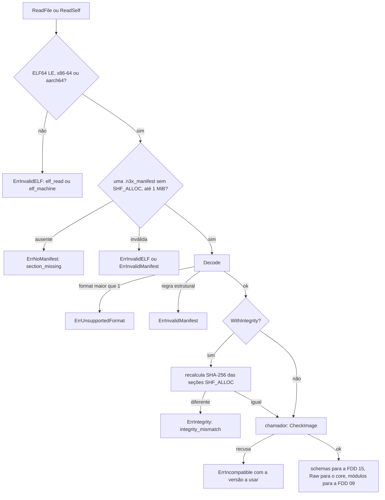
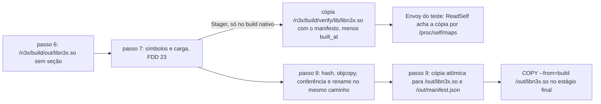

### FDD: Manifesto embutido e hash de integridade (BLD-04)

Versão: 1.0
Data: 2026-10-21
Responsável: Guilherme Giusti

---

### 1. Contexto e motivação técnica

**Problema técnico.** Depois que a imagem sai do `docker build`, o manifesto embutido é o único contrato entre o build e os runtimes. O builder escreve; o entrypoint `n3x run` confere alvo, integridade, `format` e versão do `core/` antes de subir o Envoy; o `.so` lê os schemas para validar a seção `plugins` e conferir o registro compilado (FDDs 15 e 17); o host do controller confere a versão do `host/`; o plugin core envia o manifesto no `Register` e compara as listas de plugins (HLDs do `n3x-builder`, do `n3x-sidecar` e do `n3x-controller`; ADR-003). Os ADRs fixam os campos e o escopo do hash, mas deixam cinco pontos sem comportamento verificável:

- **Onde mora o leitor (L-04).** São quatro leitores (entrypoint, `.so`, host do controller e plugin core) em três repositórios. Com um parser em cada um, a regra de compatibilidade do ADR-001 diverge entre sidecar e controller (o próprio ADR-001 registra esse trade-off), e o plugin core, que só importa o SDK, não tem como ler.
- **Bytes do manifesto.** O hash não cobre a seção, mas a CI compara `/out/manifest.json`, o `.so` compara o schema embutido com o da struct byte a byte (FDDs 02, 15 e 17) e o `encoding/json` escapa `<`, `>` e `&` dentro de um `json.RawMessage` (risco registrado pela FDD 21). Falta a regra exata de serialização.
- **Algoritmo do hash.** "Seções `SHF_ALLOC` concatenadas na ordem do arquivo" (ADR-002) não diz o que fazer com `SHT_NOBITS` (`.bss`), qual ordem vale quando cabeçalho e deslocamento divergem, nem como o builder prova que o `objcopy` não mexeu nas seções carregáveis.
- **Conteúdo de `warnings`.** O ADR-008 só fala do `govulncheck`; a FDD 24 propôs entradas novas (`deprecated_api`, `analysis_exception`, `vuln_scan`) e a FDD 20 pediu a lista exata de avisos que vão para o manifesto.
- **Limites e falhas.** O manifesto cresce com os schemas de todos os plugins (ADR-003) e vai inteiro no `Register`, que tem teto de 1 MiB (FDD 36), dividido com a config efetiva de até 512 KiB (FDD 37); o `N3X-B013` está no catálogo sem regras (FDD 20).
- **Teste de carga antes da gravação.** O `.so` só cria a config do filtro depois de ler o próprio manifesto (FDDs 15 e 17), mas o passo 7 roda antes do passo 8. A FDD 23 resolveu testando uma cópia e pediu aqui a porta `Stager`, que grava nessa cópia o mesmo manifesto do passo 8, e um leitor que acha o próprio arquivo pelo caminho realmente carregado, nunca por caminho fixo.

**Encaixe no HLD.** Esta FDD especifica, no repositório `n3x-builder` (HLD, "Componentes e responsabilidades"), o **Gerador do manifesto** (`internal/manifest`): passos 8 e 9 do `n3x-plugin build`. E especifica o **pacote leitor compartilhado**, que fecha a L-04 fora do builder: `github.com/giustech/n3x-sdk/artifact` (hipótese de nome), usado também pelo próprio builder para serializar e conferir o que gravou. Quem consome:

- FDD 25 (SID-05): pré-voo do `n3x run`, com `artifact.ReadFile` e `Manifest.CheckImage`; implementa os dois adaptadores do sidecar (contrato 8, com o contrato de leitura que ela consome)
- FDD 15 (SID-01): o `n3x validate --so` deixa de ser stub (D-12); a fonte de schemas vem do leitor (contrato 8)
- FDD 17 (SID-03): `entry.SelfSource` lê a seção do próprio `.so` com `artifact.ReadSelf`, sem caminho fixo (contrato 8)
- FDD 30 (CTL-01): conferência do manifesto do binário do controller e rótulos de `n3x_controller_build_info` (contrato 8)
- FDDs 09, 36, 37, 42, 43 e 44: bytes do manifesto na visão `Sidecar`, no `CoreEnv` e no `Register`; decodificação com `artifact.Decode` no controller; teto do manifesto coerente com o da config efetiva
- FDD 23 (BLD-05): chama a porta `Stager` implementada aqui (`manifest.Stager`, contrato 6) para testar uma cópia com o manifesto
- FDDs 46, 47 e 48: imagens publicadas com `objcopy`, guia do operador e testes cruzados

**Atores.** Gerador do manifesto (passos 8 e 9 e a porta `Stager` do passo 7), `objcopy` da imagem de build, relator da FDD 20, entrypoint (`n3x run` e `n3x validate`), `.so` carregado no Envoy, host do controller, plugin core (a metade de proxy envia, a de controller compara), CI do `n3x-builder` (reprodutibilidade e matriz) e CI do operador (lê `/out/manifest.json`).

**Limites.** Esta FDD define formato, hash, leitor, regra de compatibilidade e gravação. Não decide o que cada runtime faz com o resultado na subida (ordem das conferências, código de saída e log de subida: FDDs 25 e 30), não envia o manifesto no `Register` nem compara listas no painel (FDDs 42 e 43), não define o conteúdo dos avisos do `govulncheck` (FDD 24) e não assina o artefato (fora da v1).

**Suposições**
- FDDs 19, 20, 21 e 24 implementadas e a 23 na mesma sessão S16: `image.Info` e `catalog.Target` (FDD 19); `report` com `StepManifest`, `StepOutput`, `ExitManifest`, `Masker`, `Summary.Artifact` e o método novo `Reporter.Emitted()` (FDD 20, pedido); `check.Plugin` com `Module`, `Version`, `Manifest`, `JSON` e `Core` (FDD 20); `generate.Result` com `Plugins` e `Schemas`, e `compile.Result` com `Path`, `Name` e `Platform` (FDD 21); `analysis.Result` com `Warnings` e `Vuln` (FDD 24); `symbols.Request.Stage` do tipo `symbols.Stager` (FDD 23)
- SDK com `plugin.ID`, `plugin.Version`, `plugin.Half`, `plugin.DecodeManifest`, `plugin.ParseSchema`, `plugin.MaxSchemaSize`, `plugin.FieldErrors` e `plugin.PrefixErrors` (FDDs 01 e 02); o pacote `artifact` entra numa pré-release do SDK posterior à `v0.1.0` (hipótese: `v0.2.0`)
- O `.so` e o binário do controller são ELF64 little-endian, `EM_X86_64` ou `EM_AARCH64` (pós-condições da FDD 21)
- A imagem de runtime e o módulo do runtime (`core/` ou `host/`) saem da mesma tag do repositório, então a versão da imagem é a do runtime que ela aceita como seu (exemplo do HLD do builder: "esta imagem (sidecar 1.1.2) aceita core >=1.0 <=1.1") (hipótese)
- `/proc/self/maps` existe no container (kernel Linux), na imagem baseada no Envoy e na distroless do controller

**Restrições**
- Manifesto JSON na seção `.n3x_manifest`, gravado com `objcopy --add-section`, no `.so` e no binário do controller; `plugins` com todos os plugins da lista em ordem de ID, mesmo sem a metade daquele artefato; `format` só cresce por adição; o leitor ignora campo desconhecido e recusa `format` maior (ADR-003)
- SHA-256 sem chave nem assinatura sobre as seções `SHF_ALLOC`; `.n3x_manifest` e `built_at` fora; recalculável com `debug/elf` sem alterar o arquivo (ADR-002)
- Compatibilidade: mesma major e minor da imagem igual ou maior que a do manifesto; fora disso, recusa dizendo qual versão usar (ADR-001)
- `govulncheck` só avisa e grava em `warnings` ID, módulo e se a função é chamada (ADR-008)
- No controller, `kind` é `controller`, `target` é omitido e `runtime.module` é `github.com/giustech/n3x-controller/host` (HLD do builder)
- Pacote do SDK sem cgo, sem o SDK Go do Envoy e sem pacotes do sidecar ou do controller (ADR-011); aqui, só biblioteca padrão e `plugin/`
- O plugin core importa só o SDK (HLD do `n3x-plugin-core`)
- `/out` só é escrito no passo 9 e um build que falha não deixa artefato novo lá; toda saída passa pelo mascarador (FDD 20)
- Documentação e mensagens em pt-BR; identificadores, campos e comandos em inglês

**Rastreabilidade**
- PRD 1.5: FR-015 (manifesto com plugins, versões, alvo, versão do `core/`, avisos e hash SHA-256 das seções carregáveis, numa seção ELF; sidecar aceita mesma major e minor igual ou menor; "imagem de runtime incompatível com a versão do `core/` ou do `host/` do manifesto: o sidecar ou o controller não sobe e diz qual versão usar"; vulnerabilidade gravada no manifesto), FR-001 (`.so` incompatível), FR-006 e FR-016 (manifesto anunciado no registro e alerta de listas diferentes); critérios "dois builds do mesmo Dockerfile em máquinas diferentes geram o mesmo hash no manifesto" e "teste negativo com um `.so` feito para um Envoy mais novo carregado num mais antigo"
- HLD do `n3x-builder`: "Versionamento e compatibilidade", "Modelo de dados" (manifesto e hash), "Componentes" (Gerador do manifesto), "Fluxo de requisição" (passos 8 e 9), "Interfaces públicas" (`.n3x_manifest` e `/out/manifest.json`), "Segurança"; HLDs do `n3x-sidecar` e do `n3x-controller`, "Sequência de subida", passo 2; HLD do `n3x-plugin-core` (`agent/registrar` e deduplicação do manifesto)
- ADRs do `n3x-builder`: ADR-001, ADR-002, ADR-003, ADR-006 (exit 7), ADR-007 (`built_at` fora do hash), ADR-008; ADRs do `n3x-sdk`: ADR-011 (pacotes e dependências) e ADR-021 (semver e `// Deprecated:`)
- Lacunas e decisões do README:
  - **L-04 fechada aqui:** o leitor mora no pacote novo `github.com/giustech/n3x-sdk/artifact` (hipótese de nome), só com a biblioteca padrão e `plugin/`. O SDK é a única dependência comum aos quatro leitores (o entrypoint e o `.so` pelo `core/`, o host do controller e o plugin core, que só importa o SDK); um módulo do builder importado pelos runtimes inverteria a dependência (é a imagem de build que fixa as versões dos runtimes, ADR-001); e um leitor por runtime é justamente o risco do ADR-001. O mesmo pacote tem a regra de compatibilidade (contrato 4), o hash (contrato 2) e o serializador que o builder usa para gravar (contrato 3)
  - **D-12 completada:** o stub `manifest_unavailable` do `n3x validate --so` e da `entry.SelfSource` dá lugar ao leitor (contrato 8; implementação no sidecar pela FDD 25)
  - **L-03 aplicada (FDDs 17 e 21):** `plugins[].id` e `plugins[].module` saem do mesmo `check.Plugin` que vira os literais de `entry.Plugin("<id>", "<módulo>", ...)` no `main` gerado do `.so` (e de `host.Plugin` no controller); por isso o `VerifyRegistry` (FDD 15) e o `CheckPrivileged` (FDD 09) comparam valores idênticos por construção
  - **L-34 aplicada (FDD 01):** caminhos de erro do leitor na convenção `plugins[1].schemas.proxy`
  - **L-46 aplicada (FDD 01):** o manifesto é JSON; nenhum leitor precisa de YAML
  - **L-62 aplicada (FDD 24):** o estado da base de vulnerabilidades vai na entrada `vuln_scan`
- Pedidos atendidos: FDD 02 (`plugins[].schemas.{proxy,controller}`), FDD 09 (módulo de cada plugin em `plugins[].module`), FDD 15 (leitor do ELF, `plugins[].schemas.proxy` e fim do stub do `--so`), FDD 17 (`SelfSource` com schemas, módulos, bytes do manifesto e o caminho do próprio `.so`), FDD 19 (`plugins[].manifest` vindo de `plugins.json`; versões de `builder.yaml`), FDD 20 (avisos que vão para `warnings`; `Summary.Artifact`), FDD 21 (schemas sem escape de HTML; consumo de `generate.Result` e `compile.Result`; `objcopy` no Dockerfile de desenvolvimento), FDD 23 (porta `Stager`; leitor que acha o próprio arquivo pelo caminho realmente carregado; decisão sobre `load_test_skipped` em `warnings`), FDD 24 (entradas `vuln`, `deprecated_api`, `analysis_exception` e `vuln_scan`), FDD 37 (limite do manifesto coerente com os 512 KiB da config efetiva dentro do `Register`)

---

### 2. Objetivos técnicos

- **Ida e volta sem perda.** Invariante: `Decode(Encode(m))` é igual a `m` campo a campo, inclusive os bytes de `plugins[].manifest`, `plugins[].schemas.*` e de cada entrada de `warnings`; `Encode(Decode(b)) == b` para todo `b` produzido por `Encode`. Medida: teste de propriedade sobre 6 fixtures e sobre o corpus do fuzzing.
- **O que foi gravado é o que se lê.** Invariante: depois do passo 8, a seção `.n3x_manifest` do artefato, `/out/manifest.json` e `Encode(m)` são os mesmos bytes. Medida: comparação byte a byte no próprio passo 8 e no teste de ponta a ponta.
- **Hash estável e indiferente ao `objcopy`.** Invariante: `integrity.value` é o mesmo antes e depois do `objcopy` e depende só das seções `SHF_ALLOC`. Medida: o passo 8 recalcula sobre o arquivo final e falha com `N3X-B013` (`integrity_mismatch`) em qualquer diferença; os dois builds da checagem de reprodutibilidade (FDD 21) dão o mesmo `integrity.value` em amd64 e arm64, com 0 divergências na CI.
- **Uma regra de compatibilidade só.** Invariante: sidecar e controller chamam `artifact.CheckVersion` (direto ou por `CheckImage`); nenhum outro código compara versões de runtime. Medida: matriz com no mínimo 17 casos na CI do SDK; busca na CI do sidecar e do controller por comparação própria de major e minor (0 ocorrências).
- **Recusa explícita.** Invariante: artefato sem seção, com seção corrompida, com hash diferente, com `format` maior ou com versão incompatível é recusado com erro tipado, regra estável e texto que diz o que usar; nunca há fallback silencioso.
- **Schemas exatos.** Invariante: os bytes de cada schema na seção são os de `generate.Result`, que são os de `SchemaOf[C]().MarshalJSON()` (FDD 21), sem escape de HTML nem reformatação. Medida: schema de teste com `<`, `>` e `&` na `description` passa no `VerifyRegistry` da FDD 15 dentro do `.so`.
- **Barato na subida.** Medida: num runner amd64 da CI, `.so` de 64 MiB, p95 de 20 execuções: `ReadFile` em até 20 ms; `ReadFile` com integridade em até 150 ms; alocação de no máximo 2 MiB por leitura (seção de até 1 MiB e buffer de 64 KiB) (hipótese).
- **Passos 8 e 9 curtos.** Medida: passo 8 em até 1,5 s e passo 9 em até 0,5 s no p95 de 5 execuções, `.so` de 64 MiB, runner amd64 da CI (hipótese).
- **Manifesto determinístico.** Invariante: com a mesma entrada, o mesmo `SOURCE_DATE_EPOCH` e a mesma base de vulnerabilidades (`N3X_VULNDB=image`), dois builds dão `/out/manifest.json` byte a byte igual.
- **Cópia do teste de carga igual ao artefato final.** Invariante: a seção gravada pelo `Stager` na cópia do passo 7 é igual, byte a byte, à seção gravada no passo 8, a menos do valor de `built_at`; o `integrity.value` das duas é o mesmo; o artefato de origem não muda (SHA-256 do arquivo igual antes e depois). Medida: teste de integração do builder que compara as duas seções depois de trocar `built_at` por um valor fixo.
- **Cabe no `Register`.** Invariante: `MaxManifestSize` (480 KiB) mais o teto da config efetiva (`effconfig.MaxSize`, 512 KiB, FDD 37) mais 32 KiB de reserva para identidade e enquadramento do protobuf é igual a `MaxRegisterBytes` (1 MiB, FDD 36). Medida: teste de igualdade das constantes na CI do plugin core (pedido à FDD 42).

---

### 3. Escopo e exclusões

**Incluído**
- Formato 1 do manifesto: campos, tipos, obrigatoriedade, origem de cada valor no builder, tamanhos esperados e exemplos de sidecar e de controller (contrato 1)
- Algoritmo do hash `alloc-sections`, inclusive `SHT_NOBITS`, ordem das seções e codificação do valor (contrato 2)
- Pacote leitor `artifact` no SDK: leitura com `debug/elf` sem carregar o binário, caminho do próprio ELF, decodificação tolerante, validação estrita, conferência de integridade, serialização determinística sem RFC 8785, `PluginsHash`, erros tipados e limites (contrato 3)
- Regra de compatibilidade como função única, com a conferência de tipo, módulo, alvo e arquitetura, e a mensagem com a versão a usar (contrato 4)
- Campo `warnings`: quais avisos entram, forma de cada entrada, ordem e limite (contrato 5)
- Passos 8 e 9 do `build`: montagem, hash, gravação com `objcopy`, conferência depois de gravar, escrita atômica em `/out` e `Summary.Artifact` (contrato 6)
- Porta `Stager` do passo 7 (pedido da FDD 23): cópia do `.so` com o mesmo manifesto do passo 8, menos `built_at`, sem alterar o artefato (contrato 6)
- Decisão sobre `load_test_skipped` em `warnings` (contrato 5)
- Regras do `N3X-B013` (exit 7) e os avisos `manifest_large` e `source_date_epoch_invalid` (contrato 7)
- Contrato de uso para os consumidores: adaptador do `n3x validate --so`, `entry.SelfSource`, controller e plugin core, com o contrato de leitura e de verificação que as FDDs 25 e 30 consomem (contrato 8)
- `objcopy` no Dockerfile de desenvolvimento das duas imagens de build (contrato 9)

**Excluído**
- O que o entrypoint e o `.so` fazem com o resultado na subida (ordem das conferências, código de saída, log de subida, integridade dentro do `.so` e no `validate`): FDD 25 (SID-05)
- O mesmo no controller, inclusive de onde vem a versão da imagem do controller: FDD 30 (CTL-01)
- Envio do manifesto no `Register` (FDD 42, CORE-06) e comparação de listas e divergência no painel (FDD 43, CORE-07)
- Conteúdo dos avisos do `govulncheck`, da API depreciada e das exceções: FDD 24 (BLD-06); aqui só a forma da entrada
- Teste de carga, bootstrap mínimo e o diretório `/n3x/build/verify`: FDD 23 (BLD-05); aqui só a porta `Stager` que ela chama
- Publicação das imagens com `objcopy` e matriz entre hosts: FDD 46 (BLD-07)
- Versão do Envoy no registro (L-69): FDD 25; o formato 1 não grava a versão do Envoy (ADR-003)
- Assinatura do artefato e SBOM: fora da v1 (ADR-002)
- CLI própria de inspeção do manifesto: fora da v1 (hipótese); `jq` sobre `/out/manifest.json` e `n3x validate --so` cobrem o uso

---

### 4. Fluxos detalhados e diagramas

**Fluxo principal, passo 8: gravação** (`[8/9] gravando manifesto`, prazo de 60 s, sem rede)
1. `st := rep.Begin(8, report.StepManifest, "gravando manifesto")`.
2. **Momento do build.** `built_at` vem de `SOURCE_DATE_EPOCH` quando a variável existe e é um inteiro válido; senão, do relógio. Sempre UTC, truncado no segundo. Valor inválido gera o aviso `source_date_epoch_invalid` e usa o relógio (hipótese).
3. **Montagem** (`manifest.Assemble`, função pura): campos de topo a partir de `image.Info` (`builder.yaml`), do alvo (`target.yaml`, só no sidecar) e de `compile.Result` (`arch`); `plugins` a partir de `generate.Result.Plugins`, que já vem em ordem de ID e com o core; `warnings` a partir dos avisos já emitidos nos passos 1 a 7 (`rep.Emitted()`, pedido à FDD 20) e de `analysis.Result.Vuln` (contrato 5), com todo texto pelo mascarador.
4. **Artefato.** Abre `compile.Result.Path` (`/n3x/build/out/libn3x.so` ou `n3x-controller`) com `debug/elf`. ELF ilegível: `N3X-B013` (`elf_read`). Seção `.n3x_manifest` já presente: `N3X-B013` (`section_exists`).
5. **Hash.** `artifact.ComputeIntegrity` sobre o arquivo (contrato 2); o valor entra em `integrity`.
6. **Validação estrita.** `m.Validate()` (contrato 3): manifesto de cada plugin com `plugin.DecodeManifest`, schemas com `plugin.ParseSchema`, metades e schemas coerentes, `runtime.module` certo para o tipo, `vuln_scan` presente. Falha: `N3X-B013` (`manifest_invalid`), sinal de bug do builder ou imagem defeituosa.
7. **Serialização.** `b := artifact.Encode(m)`. Acima de 480 KiB (`MaxManifestSize`): `N3X-B013` (`manifest_too_large`), com os 5 plugins que mais pesam; acima de 256 KiB: aviso `manifest_large`.
8. **Ida e volta.** `artifact.Decode(b)` precisa devolver `m` campo a campo; senão `manifest_invalid`.
9. Grava `b` em `/n3x/build/manifest.json` (`WorkFile`, modo 0644), que é a entrada do `objcopy` e fica para depuração.
10. **Gravação da seção** (`manifest.Embed`): `objcopy --add-section .n3x_manifest=/n3x/build/manifest.json --set-section-flags .n3x_manifest=contents,readonly <Path> <Path>.n3x-tmp`, com prazo de 30 s, ambiente mínimo e saída mascarada (contrato 6). Binário ausente, saída diferente de 0 ou morte por sinal: `N3X-B013` (`objcopy`).
11. **Conferência depois de gravar** (`manifest.Verify`, a mesma do `Stager`). `artifact.ReadFile("<Path>.n3x-tmp", artifact.WithIntegrity())`: seção única, sem `SHF_ALLOC`, com bytes iguais a `b` (senão `section_check`); hash recalculado igual ao do passo 5 (senão `integrity_mismatch`).
12. `rename` de `<Path>.n3x-tmp` para `<Path>`. As seções carregáveis do artefato final são as mesmas que o passo 7 verificou (o hash igual ao da cópia do `Stager` prova isso).
13. `st.Note("<n> plugins, <k> avisos, <tamanho>, sha256:<12 hex>")`, `st.Set(...)` com os campos da seção 7 e `st.End()`.

**Fluxo da porta `Stager`, chamada dentro do passo 7** (pedido da FDD 23, contrato 7 dela; `manifest.Stager(req)` é montada pelo orquestrador depois do passo 6)
1. A FDD 23 chama `stage(ctx, "/n3x/build/out/libn3x.so", "/n3x/build/verify/lib/libn3x.so")`, com o diretório de destino já criado e o arquivo de destino ausente.
2. **Mesma montagem do passo 8.** `BuiltAt(req.Environ, req.Clock)`, `Assemble(req, builtAt)` com os avisos de `rep.Emitted()` lidos no momento da chamada, `artifact.ComputeIntegrity(src)`, `Validate`, `Encode` e a ida e volta: o mesmo código, na mesma ordem, dos passos 2 a 8 acima. Nenhum aviso é emitido no relator (o `manifest_large` e o `source_date_epoch_invalid` saem só no passo 8, uma vez).
3. **Problema de conteúdo** (`manifest_invalid` ou `manifest_too_large`): nada é escrito e a porta devolve um erro que satisfaz `errors.Is(err, manifest.ErrManifest)`, com a regra do `N3X-B013` no texto. O passo 8 reproduz o mesmo problema com os mesmos dados e emite o `N3X-B013` (pedido à FDD 23: tratar esse erro sem o erro de uso `internal`, ver contrato 6).
4. Grava `b` em `<dst>.manifest.n3x-tmp` (0600) e roda `Embed(ctx, objcopy, src, "<dst>.n3x-tmp", "<dst>.manifest.n3x-tmp")`; `src` só é aberto para leitura.
5. `Verify("<dst>.n3x-tmp", b, integrity)`: seção igual a `b` e hash igual ao de `src`.
6. `chmod 0555`, `rename` para `dst` e remoção de `<dst>.manifest.n3x-tmp`. Qualquer falha apaga os temporários e devolve o erro (E/S ou ferramenta, que a FDD 23 trata como `internal`).
7. **Por que a cópia fica igual ao artefato final, a menos de `built_at`:** os avisos que entram em `warnings` são todos emitidos nos passos 1 a 6, salvo o `load_test_skipped` do passo 7, que só existe no build cruzado, em que o `Stager` não é chamado (contrato 5). `integrity` é o mesmo porque o `objcopy` não muda as seções `SHF_ALLOC` (conferido nos dois lados). Com `SOURCE_DATE_EPOCH` definido, até `built_at` é igual.
8. Dentro do Envoy do teste, o `.so` acha a cópia por `artifact.ReadSelf`, que lê o caminho realmente mapeado em `/proc/self/maps` (`/n3x/build/verify/lib/libn3x.so`), e nunca um caminho fixo (contrato 3).

**Fluxo principal, passo 9: `/out`** (`[9/9] escrevendo /out`, prazo de 30 s)
1. `st := rep.Begin(9, report.StepOutput, "escrevendo /out")`.
2. `/out` precisa ser diretório (a imagem de build o cria vazio, FDD 21). Ausente: criado com 0755. Existe e não é diretório: `N3X-B013` (`output_write`).
3. Copia o artefato para `/out/.<Name>.n3x-tmp` (0644 no `.so`, 0755 no controller) e `b` para `/out/.manifest.json.n3x-tmp` (0644); `fsync` nos dois; data de modificação igual a `built_at` (hipótese: ajuda a camada do `COPY` do operador a ser reproduzível).
4. Confere: SHA-256 do temporário igual ao do artefato de origem e o manifesto temporário igual a `b` (senão `output_check`).
5. `rename` do `manifest.json` e, por último, do artefato; `fsync` do diretório. O artefato é sempre o último arquivo a aparecer em `/out`.
6. Qualquer falha apaga os temporários (e o `manifest.json` recém trocado, se a troca do artefato falhar) e sai com `N3X-B013` (`output_write`, `output_check` ou `timeout`).
7. Devolve `report.Artifact{Path: "/out/<Name>", Manifest: "/out/manifest.json", Integrity: "sha256:<64 hex>"}`, que o `build` põe em `Summary.Artifact` (FDD 20); `st.End()`.

**Fluxo de leitura nos runtimes** (pacote `artifact`, contrato 3)
1. O chamador abre o ELF: o entrypoint e o `validate` por caminho (`/usr/lib/n3x/libn3x.so` ou `--so`) com `artifact.ReadFile`; o `.so` e o controller pelo próprio arquivo, com `artifact.ReadSelf`.
2. `ReadSelf` acha o próprio arquivo em `/proc/self/maps`: a linha executável cujo intervalo contém o endereço de uma função do pacote `artifact`, que está compilada dentro do `.so` (ou do binário do controller); o caminho é o último campo da linha. Sem `/proc`, sem linha ou com o sufixo ` (deleted)`: `ErrSelfNotFound`. No `.so`, esse erro recusa a config do filtro (problema `manifest_read` da FDD 15), sem cair para `/usr/lib/n3x/libn3x.so`: um caminho fixo leria outro arquivo quando o `.so` carregado é a cópia do teste de carga (pedido da FDD 23; ajusta a H-04 da FDD 17). No controller, o código do `artifact` está no próprio executável, e o chamador pode usar `os.Executable()` (que lê `/proc/self/exe`, o arquivo realmente em execução, não um caminho fixo) (pedido à FDD 30).
3. Lê só os cabeçalhos e a seção `.n3x_manifest` (até 1 MiB); confere seção única, sem `SHF_ALLOC`, e `arch` contra a máquina do ELF.
4. `Decode`: recusa `format` maior que 1 antes de qualquer outra regra; ignora campo desconhecido em qualquer nível; aplica as regras estruturais (contrato 3).
5. Com `WithIntegrity()`, recalcula o hash das seções `SHF_ALLOC` lendo em blocos de 64 KiB e compara com `integrity.value`.
6. O chamador aplica `m.CheckImage(img)` (contrato 4) e decide código de saída e log (FDDs 25 e 30).
7. Para a fonte de schemas, cada `plugins[k]` vira `config.NewPluginInfo(p.Manifest, p.Schemas.Proxy)` (FDD 15). O `.so` entrega `File.Raw` à visão `Sidecar` e `plugins[].module` à conferência de origem (FDDs 09 e 17). A metade de controller do core decodifica bytes recebidos com `artifact.Decode`.

**Como o `.so` obtém o próprio manifesto.** Lendo o próprio arquivo, não por ponteiro embutido. A seção não tem `SHF_ALLOC`, então não é mapeada na memória do processo; e ela entra depois da ligação, então nenhum símbolo do código aponta para ela. Tornar a seção carregável a poria dentro do hash e exigiria gravar o manifesto antes da ligação, o que contradiz o ADR-002. O caminho vem de `/proc/self/maps`: confirma a H-04 da FDD 17, com uma função do próprio `artifact` no lugar de uma de `core/entry` (as duas estão no mesmo arquivo), e retira dela a queda para `config.DefaultSO` (pedido da FDD 23).

**Fluxos alternativos e exceções**
- **Plugin sem a metade deste artefato:** aparece em `plugins` com as metades do manifesto dele e os dois schemas; o runtime sabe o que foi compilado pela metade do `kind` (`proxy` no sidecar, `controller` no controller).
- **Workspace vazio:** `plugins` só com `n3x.core`.
- **Build cruzado:** `arch` é o destino (`compile.Result.Platform.Arch`); o `objcopy` da imagem trata os dois tipos de ELF em qualquer host (contrato 9).
- **Passo 7 pulado (controller):** sem efeito no manifesto.
- **Muitos avisos:** acima de 256 entradas, as de menor prioridade saem e uma entrada `truncated` diz quantas (contrato 5).
- **`govulncheck` sem base ou com falha:** a entrada `vuln_scan` registra `status: fallback` ou `failed`; o build segue (ADR-008, FDD 24).
- **Arquivo trocado depois do build:** byte alterado numa seção carregável faz a conferência de integridade falhar no runtime; byte alterado em seção não carregável (`.symtab`, `.debug_*` ou o `built_at` dentro do manifesto) não é detectado, que é o trade-off aceito do ADR-002.
- **`.so` de desenvolvimento (tag `n3x_dev`, L-35):** não tem a seção; `ReadFile` devolve `ErrNoManifest` e o `n3x run` recusa (FDDs 17 e 25).
- **`build` repetido no mesmo estágio:** o passo 6 recria `/n3x/build/out` (FDD 21), então o passo 8 nunca acha uma seção de um build anterior; `/out` é sobrescrito pela troca atômica.
- **Teste de carga do passo 7:** o artefato ainda não tem a seção; o teste roda sobre a cópia gravada pelo `Stager` (fluxo acima), e o artefato só recebe a seção no passo 8.
- **Build cruzado no passo 7:** sem teste de carga e sem `Stager`; o aviso `load_test_skipped` da FDD 23 vira a entrada `load_test_skipped` em `warnings` (contrato 5).
- **Manifesto inválido ou grande demais já no passo 7:** o `Stager` devolve `manifest.ErrManifest` sem escrever nada; o passo 8 emite o `N3X-B013` com a mesma regra (exit 7).

**Diagramas**

Sequência dos passos 8 e 9:

```mermaid
sequenceDiagram
    participant B as n3x-plugin build
    participant R as report
    participant M as internal/manifest
    participant A as artifact (SDK)
    participant O as objcopy
    participant F as /out
    B->>R: Begin(8, manifest)
    B->>M: Run(generate.Result, compile.Result, rep.Emitted(), Vuln)
    M->>M: Assemble (topo, plugins, warnings)
    M->>A: ComputeIntegrity(/n3x/build/out/libn3x.so)
    A-->>M: sha256 das seções SHF_ALLOC
    M->>A: Validate, Encode e Decode (ida e volta)
    M->>O: --add-section .n3x_manifest=/n3x/build/manifest.json
    O-->>M: libn3x.so.n3x-tmp
    M->>A: ReadFile(tmp, WithIntegrity)
    A-->>M: seção igual a b e hash igual
    M->>M: rename tmp para libn3x.so
    B->>R: End; Begin(9, output)
    B->>M: Output(Result)
    M->>F: temporários ocultos, fsync e conferência
    M->>F: rename manifest.json, depois libn3x.so
    B->>R: End; Finish(Summary com Artifact)
```

Leitura e conferência no runtime:



O que cada passo vê do artefato:



---

### 5. Contratos públicos (assinaturas, endpoints, headers, exemplos)

**Contrato 1: manifesto embutido, formato 1**
- Tipo: formato de dados (JSON numa seção ELF e em `/out/manifest.json`)
- Assinatura/Rota: seção `.n3x_manifest` do `libn3x.so` e do `n3x-controller`; cópia em `/out/manifest.json`
- Método: n/a (escrito pelo passo 8; lido pelo pacote `artifact`)
- Semântica de status/headers:

| Campo | Tipo JSON | Obrigatório | Semântica | Origem no builder |
| --- | --- | --- | --- | --- |
| `format` | inteiro | sim | versão do formato; esta FDD define 1 | `artifact.FormatVersion` |
| `kind` | texto | sim | `sidecar` ou `controller` | `builder.yaml`, `kind` |
| `target` | texto | só no sidecar | ID do alvo (`envoy-1.40`); ausente no controller | `/etc/n3x/target.yaml`, `id` |
| `arch` | texto | sim | `amd64` ou `arm64`; igual à máquina do ELF | `compile.Result.Platform.Arch` |
| `builder` | texto, semver sem `v` | sim | versão da imagem de build | `builder.yaml`, `builder` |
| `runtime` | objeto | sim | `module` e `version` (sem `v`) do `core/` ou do `host/` compilado | `builder.yaml`, `runtime` |
| `sdk` | texto, semver sem `v` | sim | SDK compilado, igual ao da imagem (L-57) | `builder.yaml`, `sdk.version` |
| `go` | texto | sim | versão do Go, sem o prefixo `go` | `builder.yaml`, `go` |
| `built_at` | texto RFC 3339, UTC, em segundos | sim | momento do build; fora do hash | `SOURCE_DATE_EPOCH` ou relógio |
| `plugins` | lista | sim, com o core | um item por plugin, ordem crescente de ID em bytes | `generate.Result.Plugins` |
| `plugins[].id` | texto | sim | `plugin.ID` | `check.Plugin.ID` |
| `plugins[].module` | texto | sim | caminho do `go.mod` do plugin, com `/vN` se houver | `check.Plugin.Module` (de `plugins.json`; o do core, de `builder.yaml`) |
| `plugins[].version` | texto, semver sem `v` | sim | versão do módulo do plugin | `check.Plugin.Version` sem o `v` |
| `plugins[].halves` | lista | sim | metades declaradas, na ordem `proxy`, `controller` | `check.Plugin.Manifest.Halves` |
| `plugins[].manifest` | objeto | sim | `n3x-plugin.yaml` inteiro em JSON | `check.Plugin.JSON`, copiado literalmente |
| `plugins[].schemas` | objeto | sim | `proxy` e `controller`: exatamente um schema por metade declarada | `generate.Result.Plugins[].Schemas`, copiados literalmente |
| `warnings` | lista | sim, com uma entrada `vuln_scan` | avisos do build que descrevem o artefato | contrato 5 |
| `integrity` | objeto | sim | `alg` (`sha256`), `scope` (`alloc-sections`) e `value` (64 hex minúsculos) | contrato 2 |

  - **Versões:** as versões do N3X (`builder`, `sdk`, `runtime.version`, `plugins[].version`) usam `plugin.Version`, sem `v`, como no exemplo do HLD; `builder.yaml` e `plugins.json` usam `v` (formato de módulo Go) e o builder tira o `v`. Pseudo-versões viram semver válido (`0.0.0-20261020140000-abcdef123456`). Versões de módulos de terceiros dentro de `warnings` ficam como o Go as escreve, com `v` (contrato 5) (hipótese)
  - **`plugins[].manifest`:** são os bytes de `json.Marshal(plugin.Manifest)` da FDD 01, a mesma forma que o `add` grava em `plugins.json` (FDD 19). Por isso `sdk` aparece com `>` e `<`: é JSON válido, e quem lê obtém o texto original
  - **Os dois artefatos levam os schemas das duas metades** (FDD 21), para o controller validar e rotular configs de plugins que ele não compila (FDDs 43 e 44)
  - **Evolução:** campo novo só por adição, opcional para o leitor, com `format: 1`; mudança que um leitor antigo interpretaria errado sobe para `format: 2`, que todo leitor da major 1 recusa
  - **Tamanhos esperados** (hipótese, conferidos pelo campo `manifest_bytes` da seção 7):

| Conteúdo | Tamanho |
| --- | --- |
| Campos de topo, `integrity` e `vuln_scan` | cerca de 0,6 KiB |
| Plugin core (manifesto e dois schemas) | cerca de 3 KiB |
| Plugin típico de terceiros | 2 a 8 KiB |
| Entrada `vuln` | cerca de 0,2 KiB |
| Imagem do M2 (core e `n3x.example`) | cerca de 6 KiB |
| 10 plugins típicos e 20 avisos | 40 a 90 KiB |
| Aviso `manifest_large` | acima de 256 KiB |
| Limite do builder (`MaxManifestSize`) | 480 KiB: com os 512 KiB da config efetiva (FDD 37) e 32 KiB de reserva, fecha o 1 MiB do `Register` (FDD 36) |
| Limite do leitor (`MaxSectionSize`) | 1 MiB, igual ao teto do `Register` (FDD 36) |

**Exemplo de requisição** (entradas do passo 8 na `sidecar-builder:1.0.0-envoy-1.40`)
```json
{
  "builder.yaml": { "kind": "sidecar", "builder": "1.0.0", "go": "1.26.1", "sdk": "v1.2.0", "runtime": "github.com/giustech/n3x-sidecar/core v1.0.0", "core": "github.com/giustech/n3x-plugin-core v1.0.0" },
  "target.yaml": { "id": "envoy-1.40" },
  "compile.Result": { "Path": "/n3x/build/out/libn3x.so", "Name": "libn3x.so", "Platform": { "Arch": "amd64", "Native": true } },
  "generate.Result.Plugins": ["giustech.ratelimit v1.0.0 (proxy, controller)", "n3x.core v1.0.0 (proxy, controller)"],
  "SOURCE_DATE_EPOCH": "1792504800"
}
```

**Exemplo de resposta** (manifesto do sidecar; formatado aqui só para leitura, o real é compacto numa linha com `\n` final; schemas reais, encurtados para um campo)
```json
{
  "format": 1,
  "kind": "sidecar",
  "target": "envoy-1.40",
  "arch": "amd64",
  "builder": "1.0.0",
  "runtime": { "module": "github.com/giustech/n3x-sidecar/core", "version": "1.0.0" },
  "sdk": "1.2.0",
  "go": "1.26.1",
  "built_at": "2026-10-20T14:00:00Z",
  "plugins": [
    {
      "id": "giustech.ratelimit",
      "module": "github.com/giustech/n3x-plugin-ratelimit",
      "version": "1.0.0",
      "halves": ["proxy", "controller"],
      "manifest": {"id":"giustech.ratelimit","version":"1.0.0","sdk":">=1.0.0 <2.0.0","halves":["proxy","controller"],"proxy":{"phases":["traffic"],"default_phase":"traffic","default_order":100,"default_failure":"open"},"controller":{"required":false,"depends_on":[]}},
      "schemas": {
        "proxy": {"$schema":"https://json-schema.org/draft/2020-12/schema","x-n3x-schema":1,"type":"object","properties":{"limit":{"type":"integer","description":"Requisições por janela (> 0 & <= 100000)","minimum":1,"maximum":100000}},"required":["limit"],"additionalProperties":false},
        "controller": {"$schema":"https://json-schema.org/draft/2020-12/schema","x-n3x-schema":1,"type":"object","properties":{"retention":{"type":"string","description":"Por quanto tempo guardar contadores","x-n3x-format":"duration","x-n3x-minimum":"1m0s","x-n3x-maximum":"168h0m0s","default":"24h0m0s"}},"additionalProperties":false}
      }
    },
    {
      "id": "n3x.core",
      "module": "github.com/giustech/n3x-plugin-core",
      "version": "1.0.0",
      "halves": ["proxy", "controller"],
      "manifest": {"id":"n3x.core","version":"1.0.0","sdk":">=1.0.0 <2.0.0","halves":["proxy","controller"],"proxy":{"phases":[]},"controller":{"required":true,"depends_on":[]}},
      "schemas": {
        "proxy": {"$schema":"https://json-schema.org/draft/2020-12/schema","x-n3x-schema":1,"type":"object","properties":{},"additionalProperties":false},
        "controller": {"$schema":"https://json-schema.org/draft/2020-12/schema","x-n3x-schema":1,"type":"object","properties":{"inventory_retention":{"type":"string","description":"Prazo até ir para o histórico","x-n3x-format":"duration","x-n3x-minimum":"1m0s","x-n3x-maximum":"168h0m0s","default":"24h0m0s"}},"additionalProperties":false}
      }
    }
  ],
  "warnings": [
    { "kind": "vuln_scan", "status": "ok", "source": "network", "modified": "2026-10-20T03:11:42Z" },
    { "kind": "vuln", "id": "GO-2026-1234", "module": "github.com/redis/go-redis/v9", "version": "v9.7.0", "fixed": "v9.7.3", "called": true, "plugins": ["giustech.ratelimit"] }
  ],
  "integrity": { "alg": "sha256", "scope": "alloc-sections", "value": "b9afdfefaab120b846fb41ad60606747503e53b8179b9ff6b88c3c65fe9acf40" }
}
```

Manifesto do controller para a mesma lista mais `acme.tenant` (só de proxy, presente mas não compilado no controller):
```json
{"format":1,"kind":"controller","arch":"arm64","builder":"1.0.0","runtime":{"module":"github.com/giustech/n3x-controller/host","version":"1.0.0"},"sdk":"1.2.0","go":"1.26.1","built_at":"2026-10-20T14:00:00Z","plugins":[{"id":"acme.tenant","module":"github.com/acme/n3x-plugin-tenant","version":"0.4.2","halves":["proxy"],"manifest":{"id":"acme.tenant","version":"0.4.2","sdk":">=1.0.0 <2.0.0","halves":["proxy"],"proxy":{"phases":["authn"],"default_phase":"authn","default_order":10,"default_failure":"closed"}},"schemas":{"proxy":{"$schema":"https://json-schema.org/draft/2020-12/schema","x-n3x-schema":1,"type":"object","properties":{},"additionalProperties":false}}},{"id":"giustech.ratelimit","...":"igual ao do sidecar"},{"id":"n3x.core","...":"igual ao do sidecar"}],"warnings":[{"kind":"vuln_scan","status":"fallback","source":"image","modified":"2026-10-01T02:00:00Z"}],"integrity":{"alg":"sha256","scope":"alloc-sections","value":"c2e7c327f9c3e635cd65c5e821f7cccf99b1cff3d428642b43018d2e1612f8d5"}}
```

---

**Contrato 2: hash de integridade (`alloc-sections`)**
- Tipo: algoritmo (implementado uma vez em `artifact.ComputeIntegrity`, usado pelo builder e por todos os leitores)
- Assinatura/Rota:
  ```go
  package artifact

  const (
      IntegrityAlg   = "sha256"
      IntegrityScope = "alloc-sections"
  )

  type Integrity struct {
      Alg   string `json:"alg"`
      Scope string `json:"scope"`
      Value string `json:"value"` // 64 caracteres hexadecimais minúsculos
  }

  func (i Integrity) String() string // "sha256:<value>"

  type IntegrityStats struct {
      Sections int   // seções que entraram no hash
      Bytes    int64 // bytes lidos
  }

  func ComputeIntegrity(r io.ReaderAt) (Integrity, IntegrityStats, error)
  ```
- Método: n/a
- Semântica de status/headers:
  1. Lê a tabela de seções com `debug/elf` (ELF64 little-endian; senão `elf_read`).
  2. Seleciona as seções com a flag `SHF_ALLOC` e tipo diferente de `SHT_NOBITS`. `SHT_NOBITS` (`.bss`, `.tbss`, `.noptrbss`) não tem bytes no arquivo e contribui com nada (hipótese de leitura do ADR-002: "conteúdo" são os bytes gravados no arquivo).
  3. Ordena por `sh_offset` crescente e, no empate, pelo índice do cabeçalho. É a "ordem do arquivo" do ADR-002, e não muda se uma ferramenta reordenar os cabeçalhos (hipótese).
  4. Para cada seção, lê os bytes crus do arquivo de `sh_offset` até `sh_offset + sh_size` (sem descompactar; seção fora dos limites do arquivo é `elf_read`) e alimenta um único SHA-256, em blocos de 64 KiB.
  5. `value` é o resumo em 64 caracteres hexadecimais minúsculos; a forma de texto é `sha256:<value>`.
  - A seção `.n3x_manifest` não tem `SHF_ALLOC`, então fica de fora por construção; se um arquivo a trouxer com `SHF_ALLOC`, o leitor recusa antes (`section_flags`), em vez de mudar o cálculo
  - O cabeçalho ELF, os cabeçalhos de programa e as seções não carregáveis (`.symtab`, `.strtab`, `.comment`, `.debug_*`) ficam fora (ADR-002). A `.go.buildinfo`, que tem os módulos e as versões compiladas, é carregável e entra
  - O mesmo cálculo vale para `.so` e controller; o valor não depende de `built_at`, do `objcopy` nem da máquina de build (FDD 21)
  - Sem estado global; seguro para uso concorrente; nenhum panic por entrada (o `debug/elf` roda sob `recover`, que vira `elf_read`) (hipótese)

**Exemplo de requisição**
```go
f, _ := os.Open("/n3x/build/out/libn3x.so")
in, st, err := artifact.ComputeIntegrity(f)
```

**Exemplo de resposta** (seções ilustrativas de um `.so`; a lista real depende do linker)
```text
seção            tipo        flags  no hash
.dynsym          DYNSYM      A      sim
.rela.dyn        RELA        A      sim
.text            PROGBITS    AX     sim
.rodata          PROGBITS    A      sim
.gopclntab       PROGBITS    A      sim
.go.buildinfo    PROGBITS    WA     sim
.data            PROGBITS    WA     sim
.bss             NOBITS      WA     não (sem bytes no arquivo)
.symtab          SYMTAB      -      não (sem SHF_ALLOC)
.debug_info      PROGBITS    -      não (sem SHF_ALLOC)
.n3x_manifest    PROGBITS    -      não (sem SHF_ALLOC)

err = nil
in  = {"alg":"sha256","scope":"alloc-sections","value":"b9afdfefaab120b846fb41ad60606747503e53b8179b9ff6b88c3c65fe9acf40"}
st  = {"Sections":27,"Bytes":38811264}
in.String() = "sha256:b9afdfefaab120b846fb41ad60606747503e53b8179b9ff6b88c3c65fe9acf40"
```

---

**Contrato 3: pacote leitor `artifact` do SDK (L-04)**
- Tipo: sdk (API Go, `github.com/giustech/n3x-sdk/artifact`, hipótese de nome)
- Assinatura/Rota:
  ```go
  package artifact // só biblioteca padrão (debug/elf, crypto/sha256, encoding/json, bufio, os) e plugin/

  const (
      SectionName     = ".n3x_manifest"
      FormatVersion   = 1
      MaxSectionSize  = 1 << 20   // leitor: teto contra entrada hostil (igual a MaxRegisterBytes da FDD 36)
      MaxManifestSize = 480 << 10 // escritor: teto do builder (512 KiB da config efetiva e 32 KiB de reserva no Register)
      MaxPlugins      = 256
      MaxWarnings     = 256
      PluginsHashLen  = 12
  )

  type Kind string

  const (
      KindSidecar    Kind = "sidecar"
      KindController Kind = "controller"
  )

  type Module struct {
      Module  string
      Version plugin.Version
  }

  type Schemas struct {
      Proxy      json.RawMessage // nil se o plugin não declara a metade
      Controller json.RawMessage
  }

  type Plugin struct {
      ID       plugin.ID
      Module   string
      Version  plugin.Version
      Halves   []plugin.Half   // ordem proxy, controller
      Manifest json.RawMessage // n3x-plugin.yaml em JSON, bytes exatos
      Schemas  Schemas
  }

  func (p Plugin) Has(h plugin.Half) bool
  func (p Plugin) DecodeManifest() (plugin.Manifest, error) // plugin.DecodeManifest(p.Manifest)

  type Manifest struct {
      Format    int
      Kind      Kind
      Target    string // vazio no controller
      Arch      string // "amd64" ou "arm64"
      Builder   plugin.Version
      Runtime   Module
      SDK       plugin.Version
      Go        string
      BuiltAt   time.Time // UTC, em segundos
      Plugins   []Plugin
      Warnings  []Warning // contrato 5
      Integrity Integrity // contrato 2
  }

  func Decode(data []byte) (Manifest, error)          // tolerante a campo desconhecido; regras estruturais
  func Encode(m Manifest) ([]byte, error)             // determinístico; termina em "\n"
  func (m Manifest) Validate() error                  // regras estritas (usadas pelo builder e pelos testes)
  func (m Manifest) Lookup(id plugin.ID) (Plugin, bool)
  func (m Manifest) PluginsHash() string              // 12 hex
  func (m Manifest) CheckImage(img Image) error       // contrato 4

  type File struct {
      Path     string   // vazio em Read
      Manifest Manifest
      Raw      []byte   // bytes exatos da seção
      Verified bool     // integridade conferida (WithIntegrity)
      Stats    IntegrityStats
  }

  type Option struct{ /* opaco */ }

  func WithIntegrity() Option // também recalcula o hash e compara (ErrIntegrity)

  func Read(r io.ReaderAt, opts ...Option) (*File, error)
  func ReadFile(path string, opts ...Option) (*File, error)
  func ReadSelf(opts ...Option) (*File, error) // o ELF que contém este código, pelo caminho realmente mapeado
  func SelfPath() (string, error)              // por /proc/self/maps; nunca devolve um caminho fixo

  var (
      ErrInvalidELF        = errors.New("artifact: arquivo ELF inválido")
      ErrNoManifest        = errors.New("artifact: sem seção .n3x_manifest")
      ErrInvalidManifest   = errors.New("artifact: manifesto inválido")
      ErrUnsupportedFormat = errors.New("artifact: formato de manifesto não suportado")
      ErrIntegrity         = errors.New("artifact: hash de integridade não confere")
      ErrIncompatible      = errors.New("artifact: artefato incompatível com a imagem")
      ErrSelfNotFound      = errors.New("artifact: arquivo do próprio processo não encontrado")
      ErrWarningKind       = errors.New("artifact: tipo de aviso diferente")
  )
  ```
- Método: n/a (chamada local)
- Semântica de status/headers:
  - **Erros:** no padrão da FDD 01: embrulho não exportado com `Unwrap() []error`, que carrega a sentinela e um `plugin.FieldErrors` com `Path` (convenção L-34, ex.: `plugins[1].schemas.proxy`), `Rule` estável na major do SDK e `Detail` em pt-BR. Todos os problemas estruturais saem numa passada, na ordem da tabela abaixo; um campo inválido não gera erros derivados
  - **`Decode` é tolerante:** ignora campo desconhecido em qualquer nível (ADR-003) e não decodifica `plugins[].manifest` com `plugin.DecodeManifest` nem os schemas com `plugin.ParseSchema`, porque um runtime pode ter SDK mais antigo que o do build; isso fica para quem usa (FDD 15, `NewPluginInfo`) e para `Validate`
  - **`Validate` é estrita:** soma as regras 24 a 27; o builder a roda antes de gravar e os testes sobre todo manifesto produzido
  - **`Encode`:** escreve as chaves na ordem do contrato 1; `plugins` na ordem recebida (precisa estar por ID); copia literalmente os trechos brutos (`plugins[].manifest`, `plugins[].schemas.*` e cada `warnings[j]`) depois de conferir que são JSON válido sem espaço nas pontas; escreve os demais valores com `encoding/json` e `SetEscapeHTML(false)`; `built_at` em `time.RFC3339` UTC; nenhuma indentação; um `\n` no fim. Não é JSON canônico RFC 8785 (hipótese): a ordem fixa já dá bytes estáveis, o hash não cobre a seção, e reescrever os schemas pela RFC 8785 mudaria os bytes que a FDD 15 compara. Recusa (com `ErrInvalidManifest`) entrada que `Validate` recusaria por estrutura ou que passe de `MaxManifestSize`
  - **Ida e volta:** `Decode(Encode(m))` devolve `m` (com `BuiltAt` comparado por `Equal`) e `Encode(Decode(b)) == b` para todo `b` de `Encode`; `Decode` copia cada `json.RawMessage` sem mudar um byte
  - **`Read`, `ReadFile` e `ReadSelf`:** leem cabeçalhos e só a seção do manifesto; nunca carregam nem executam o binário; fecham o arquivo antes de voltar; com `WithIntegrity()`, rodam o contrato 2 no mesmo arquivo aberto
  - **`SelfPath`:** pega o endereço de entrada de uma função não exportada do próprio pacote (`reflect.ValueOf(fn).Pointer()`), lê `/proc/self/maps` linha a linha e devolve o caminho da linha com permissão `x` cujo intervalo contém esse endereço. Caminho relativo, vazio ou terminado em ` (deleted)` dá `ErrSelfNotFound`. Sem cgo e sem `dladdr`. Nem `SelfPath` nem `ReadSelf` têm caminho de reserva: quem quiser um precisa chamar `ReadFile` de propósito (pedido da FDD 23: o `.so` carregado do teste de carga é a cópia em `/n3x/build/verify/lib`, e um caminho fixo leria outro arquivo)
  - **`PluginsHash`:** os 12 primeiros caracteres hexadecimais do SHA-256 das linhas `<id> <module> <version>\n`, uma por plugin, na ordem do manifesto (por ID), com o core. Serve ao rótulo `plugins_hash` (FDD 30) e à comparação rápida de listas (FDD 43); é estável na major do SDK (hipótese)
  - **Limites:** seção de 1 a 1 MiB; até 256 plugins; até 256 entradas em `warnings`; cada schema até `plugin.MaxSchemaSize` (256 KiB, FDD 02)
  - **Uso por plugins:** `Decode`, `Lookup`, `PluginsHash` e os tipos são livres; `Read`, `ReadFile`, `ReadSelf`, `SelfPath` e `ComputeIntegrity` são API de runtime e entram na tabela de APIs proibidas a plugin (regra `runtime_api`), inclusive ao core (pedido à FDD 24): o core recebe bytes prontos pelas capacidades da FDD 09

Regras, na ordem em que são conferidas:

| # | Caminho | Regra (`Rule`) | Condição de erro | Sentinela | Onde |
| --- | --- | --- | --- | --- | --- |
| 0 | (arquivo) | `file_open` | arquivo ausente, sem permissão ou que não é arquivo regular; o erro embrulha o `*fs.PathError`, então `errors.Is(err, fs.ErrNotExist)` vale para o `.so` ausente do FR-001 | nenhuma sentinela do `artifact` | `ReadFile`, `ReadSelf` |
| 1 | (arquivo) | `elf_read` | não é ELF, é ELF32 ou big-endian, cabeçalho ou seção fora do arquivo, erro de leitura | `ErrInvalidELF` | `Read` |
| 2 | (arquivo) | `elf_machine` | máquina diferente de `EM_X86_64` e `EM_AARCH64` | `ErrInvalidELF` | `Read` |
| 3 | (seção) | `section_missing` | nenhuma seção `.n3x_manifest` | `ErrNoManifest` | `Read` |
| 4 | (seção) | `section_duplicate` | mais de uma | `ErrInvalidELF` | `Read` |
| 5 | (seção) | `section_flags` | com `SHF_ALLOC` ou do tipo `SHT_NOBITS` | `ErrInvalidELF` | `Read` |
| 6 | (seção) | `size` | vazia ou maior que `MaxSectionSize` (conferido antes de ler) | `ErrInvalidManifest` | `Read`, `Decode` |
| 7 | (raiz) | `syntax` | JSON inválido ou raiz que não é objeto | `ErrInvalidManifest` | `Decode` |
| 8 | `format` | `required`, `type`, `format_unsupported` | ausente, não inteiro ou menor que 1; maior que `FormatVersion` (nenhuma outra regra roda) | `ErrInvalidManifest`; `ErrUnsupportedFormat` | `Decode` |
| 9 | `kind` | `required`, `enum` | ausente; fora de `sidecar` e `controller` | `ErrInvalidManifest` | `Decode` |
| 10 | `target` | `required`, `target_format`, `target_unexpected` | sidecar sem alvo; fora de `^(envoy\|istio)-[0-9]+\.[0-9]+$`; controller com alvo | `ErrInvalidManifest` | `Decode` |
| 11 | `arch` | `required`, `enum`, `arch_elf` | ausente; fora de `amd64` e `arm64`; diferente da máquina do ELF (só em `Read`) | `ErrInvalidManifest` | `Decode`, `Read` |
| 12 | `builder`, `sdk`, `runtime.version` | `required`, `version_format` | ausente; recusado por `plugin.ParseVersion` | `ErrInvalidManifest` | `Decode` |
| 13 | `runtime.module` | `required`, `module_format` | ausente; vazio, com espaço ou `@`, sem `/`, ou com mais de 300 caracteres (hipótese, sem `golang.org/x/mod`) | `ErrInvalidManifest` | `Decode` |
| 14 | `go` | `required`, `go_format` | fora de `^[1-9][0-9]*\.[0-9]+(\.[0-9]+)?$` | `ErrInvalidManifest` | `Decode` |
| 15 | `built_at` | `required`, `time_format` | fora do RFC 3339 | `ErrInvalidManifest` | `Decode` |
| 16 | `plugins` | `required`, `max_items`, `core_missing` | ausente ou vazio; mais de 256; sem `n3x.core` | `ErrInvalidManifest` | `Decode` |
| 17 | `plugins[i].id` | `required`, `id_format`, `id_part_length`, `id_part_start`, `order`, `duplicate` | regras do `plugin.ParseID`; fora da ordem crescente; repetido | `ErrInvalidManifest` | `Decode` |
| 18 | `plugins[i].module`, `plugins[i].version` | `required`, `module_format`, `version_format` | como 12 e 13 | `ErrInvalidManifest` | `Decode` |
| 19 | `plugins[i].halves` | `required`, `enum`, `duplicate`, `order` | vazio; fora de `proxy` e `controller`; repetido; fora da ordem `proxy`, `controller` | `ErrInvalidManifest` | `Decode` |
| 20 | `plugins[i].manifest` | `required`, `type` | ausente ou não objeto | `ErrInvalidManifest` | `Decode` |
| 21 | `plugins[i].schemas.proxy`, `.controller` | `schema_missing`, `schema_unexpected`, `type`, `size` | metade declarada sem schema; schema sem a metade; não objeto; maior que `plugin.MaxSchemaSize` | `ErrInvalidManifest` | `Decode` |
| 22 | `warnings`, `warnings[j]` | `required`, `type`, `max_items`, `warning_kind` | ausente ou não lista; mais de 256; item sem `kind` de texto | `ErrInvalidManifest` | `Decode` |
| 23 | `integrity` | `required`, `integrity_unsupported`, `integrity_format` | ausente; `alg` diferente de `sha256` ou `scope` diferente de `alloc-sections`; `value` fora de 64 hex minúsculos | `ErrInvalidManifest` | `Decode` |
| 24 | `plugins[i].manifest` | `manifest_invalid`, `manifest_mismatch` | `plugin.DecodeManifest` recusa (as regras da FDD 01 vão no `Detail`); `id`, `version` ou `halves` diferentes do item | `ErrInvalidManifest` | `Validate` |
| 25 | `plugins[i].schemas.*` | `schema_invalid` | `plugin.ParseSchema` recusa | `ErrInvalidManifest` | `Validate` |
| 26 | `runtime.module` | `runtime_module` | diferente de `github.com/giustech/n3x-sidecar/core` (sidecar) ou `github.com/giustech/n3x-controller/host` (controller), com `/vN` aceito | `ErrInvalidManifest` | `Validate` |
| 27 | `warnings[j]` | `warning_invalid`, `vuln_scan_missing` | tipo conhecido com campo faltando ou inválido; nenhum ou mais de um `vuln_scan` | `ErrInvalidManifest` | `Validate` |
| 28 | (arquivo) | `integrity_mismatch` | hash recalculado diferente de `integrity.value` | `ErrIntegrity` | `Read` com `WithIntegrity` |
| 29 | (processo) | `self_not_found` | sem `/proc/self/maps`, sem linha que contém o endereço, ou arquivo apagado | `ErrSelfNotFound` | `ReadSelf`, `SelfPath` |

**Exemplo de requisição**
```go
f, err := artifact.ReadFile("/usr/lib/n3x/libn3x.so", artifact.WithIntegrity())
if err != nil {
    return err
}
p, _ := f.Manifest.Lookup(plugin.MustParseID("n3x.core"))
fmt.Println(f.Manifest.Kind, f.Manifest.Target, f.Manifest.Runtime.Version, len(f.Raw), f.Verified, f.Manifest.PluginsHash(), p.Module)

_, err = artifact.ReadFile("/tmp/libn3x-corrompido.so", artifact.WithIntegrity())
fmt.Println(err)
_, err = artifact.ReadFile("/tmp/libn3x-format2.so")
fmt.Println(err)
```

**Exemplo de resposta**
```text
sidecar envoy-1.40 1.0.0 5873 true 8175a20a2029 github.com/giustech/n3x-plugin-core
integrity: hash calculado sha256:de8ceee1a7d68f272a1e81c5e632ab6daad08bea6605f82f9a2b956d3a6563d6 difere do manifesto sha256:b9afdfefaab120b846fb41ad60606747503e53b8179b9ff6b88c3c65fe9acf40; o arquivo foi alterado ou corrompido depois do build [integrity_mismatch]
format: manifesto no formato 2; este leitor (SDK 1.2.0) lê até o formato 1: use uma imagem de runtime mais nova [format_unsupported]
```

---

**Contrato 4: regra de compatibilidade (`CheckVersion` e `CheckImage`)**
- Tipo: sdk (API Go do pacote `artifact`)
- Assinatura/Rota:
  ```go
  package artifact

  type Image struct {
      Kind    Kind           // KindSidecar ou KindController
      Name    string         // para a mensagem; vazio = "ghcr.io/giustech/n3x/<kind>"
      Module  string         // módulo do runtime que a imagem traz (core/ ou host/)
      Version plugin.Version // versão da imagem = do runtime que ela traz (hipótese do HLD)
      Target  string         // só sidecar: alvo da imagem de runtime
      Arch    string         // runtime.GOARCH do processo
  }

  type VersionError struct {
      Rule    string         // "runtime_major", "runtime_too_new" ou "runtime_unstable"
      Runtime string         // "core" ou "host"
      Built   plugin.Version // runtime.version do manifesto
      Image   plugin.Version
      Accepts string         // ">=1.0 <=1.1"
      Use     string         // preenchido por CheckImage
  }

  func (e *VersionError) Error() string
  func (e *VersionError) Lines() [2]string // forma de duas linhas do HLD
  func (e *VersionError) Unwrap() error    // ErrIncompatible

  // Regra pura do ADR-001. nil ou *VersionError.
  func CheckVersion(built, image plugin.Version) error

  // Tipo, módulo, alvo, arquitetura e versão; todos os problemas, sem derivados.
  func (m Manifest) CheckImage(img Image) error
  ```
- Método: n/a
- Semântica de status/headers:
  - **Regra (ADR-001):** com major da imagem maior ou igual a 1, aceita a mesma major com minor do manifesto menor ou igual à da imagem. Major diferente, em qualquer sentido: `runtime_major`. Mesma major e minor do manifesto maior: `runtime_too_new`. Na série 0, uma minor pode quebrar (ADR-021 do SDK, mesma leitura da faixa `sdk` da FDD 01), então exige minor igual: `runtime_unstable` (hipótese). Patch, pré-release e build não contam (hipótese)
  - **`Accepts`:** `>=M.0 <=M.m`, com `M.m` da imagem (forma do HLD)
  - **`Use`:** a faixa de imagens que aceita o `.so` como ele está: `>= B.b.0` (com `B.b` do manifesto) e, quando a major difere ou é 0, `< (B+1).0.0` ou `< 0.(b+1).0`; no sidecar, com o sufixo `-<alvo>` do manifesto. Mostra a faixa, não uma tag exata, porque o leitor não sabe quais patches existem (resposta ao ASSUNTO; hipótese). Sempre acrescenta a alternativa "ou recompile com uma `<kind>-builder` de `<runtime>` `Accepts`", porque a versão da imagem de build é independente (ADR-001) e o `n3x-plugin version` mostra o runtime dela
  - **`CheckImage`, na ordem:** `kind` (`kind_mismatch`; se falhar, nada mais é conferido), `runtime.module` pela família, sem `/vN` (`runtime_module`), `target` (`target_mismatch`, só sidecar; é o teste negativo do PRD), `arch` (`arch_mismatch`, pedido da FDD 21 à 25) e `runtime.version` (regras acima). Devolve `plugin.FieldErrors` com `ErrIncompatible`; o `*VersionError` fica acessível por `errors.As`
  - **Campo vazio em `Image` não é conferido** (`Target`, `Arch`, `Module` vazios ou `Version` zero); as FDDs 25 e 30 preenchem todos (pedido)
  - **Mensagens** (`Detail`, uma linha; `Lines()` dá as duas do HLD):

| Regra | Texto |
| --- | --- |
| `kind_mismatch` | `o arquivo é um n3x-controller, não um libn3x.so` (ou o inverso) |
| `runtime_module` | `libn3x.so compilado contra github.com/acme/fork-core; esta imagem traz github.com/giustech/n3x-sidecar/core` |
| `target_mismatch` | `libn3x.so feito para envoy-1.41; esta imagem é envoy-1.40; use uma imagem ghcr.io/giustech/n3x/sidecar com sufixo -envoy-1.41, ou recompile com uma sidecar-builder -envoy-1.40` |
| `arch_mismatch` | `libn3x.so é arm64; este processo é amd64; use a imagem da arquitetura certa ou recompile com ARG TARGETARCH` |
| `runtime_too_new` | `libn3x.so feito com core 1.4.0; esta imagem (sidecar 1.3.2) aceita core >=1.0 <=1.3; use ghcr.io/giustech/n3x/sidecar >= 1.4.0-envoy-1.40, ou recompile com uma sidecar-builder de core >=1.0 <=1.3` |
| `runtime_major` | `n3x-controller feito com host 2.0.0; esta imagem (controller 1.3.2) aceita host >=1.0 <=1.3; use ghcr.io/giustech/n3x/controller >= 2.0.0 e < 3.0.0, ou recompile com uma controller-builder de host >=1.0 <=1.3` |
| `runtime_unstable` | `libn3x.so feito com core 0.2.0; esta imagem (sidecar 0.3.1) aceita core >=0.3 <=0.3; use ghcr.io/giustech/n3x/sidecar >= 0.2.0-envoy-1.40 e < 0.3.0-envoy-1.40, ou recompile com uma sidecar-builder de core >=0.3 <=0.3` |

Matriz de referência de `CheckVersion` (teste de tabela na CI do SDK):

| Imagem | Manifesto | Resultado |
| --- | --- | --- |
| 1.3.2 | 1.0.0 | aceita |
| 1.3.2 | 1.2.9 | aceita |
| 1.3.2 | 1.3.0 | aceita |
| 1.3.2 | 1.3.7 | aceita (patch não conta) |
| 1.3.2 | 1.3.0-rc.1 | aceita (pré-release não conta) |
| 1.3.0-rc.2 | 1.3.1 | aceita |
| 1.3.2 | 1.4.0 | `runtime_too_new` |
| 1.3.2 | 2.0.0 | `runtime_major` |
| 1.3.2 | 0.9.0 | `runtime_major` |
| 2.0.0 | 1.9.0 | `runtime_major` |
| 1.0.0 | 0.9.0 | `runtime_major` |
| 0.3.1 | 0.3.0 | aceita |
| 0.3.1 | 0.3.5 | aceita |
| 0.3.1 | 0.2.0 | `runtime_unstable` |
| 0.3.1 | 0.4.0 | `runtime_unstable` |
| 0.3.1 | 1.0.0 | `runtime_major` |
| 0.1.0 | 0.0.0-20261020140000-abcdef123456 | `runtime_unstable` |

**Exemplo de requisição**
```go
err := f.Manifest.CheckImage(artifact.Image{
    Kind: artifact.KindSidecar, Module: "github.com/giustech/n3x-sidecar/core",
    Version: plugin.Version{Major: 1, Minor: 1, Patch: 2}, Target: "envoy-1.40", Arch: "amd64",
})
var ve *artifact.VersionError
if errors.As(err, &ve) {
    fmt.Println(ve.Lines()[0])
    fmt.Println(ve.Lines()[1])
}
```

**Exemplo de resposta** (manifesto com `runtime.version` 1.3.0; a forma de duas linhas é a do HLD, sem o prefixo `erro:`, que é da FDD 25)
```text
libn3x.so feito com core 1.3.0; esta imagem (sidecar 1.1.2) aceita core >=1.0 <=1.1
use ghcr.io/giustech/n3x/sidecar >= 1.3.0-envoy-1.40, ou recompile com uma sidecar-builder de core >=1.0 <=1.1
```

---

**Contrato 5: campo `warnings`**
- Tipo: formato de dados (entradas do manifesto) e sdk (tipos do pacote `artifact`)
- Assinatura/Rota:
  ```go
  package artifact

  type Warning struct {
      Kind string          // "vuln_scan", "vuln", ...
      Raw  json.RawMessage // a entrada inteira, bytes exatos (tipo desconhecido é preservado)
  }

  type WarningEntry interface{ WarningKind() string }

  func NewWarning(e WarningEntry) (Warning, error) // "kind" primeiro e os campos na ordem da struct, sem escape de HTML
  func (w Warning) As(e WarningEntry) error         // ErrWarningKind se o tipo não bate

  type VulnScan struct {
      Status   string    `json:"status"`             // "ok", "fallback" ou "failed"
      Source   string    `json:"source"`             // "network", "mirror" ou "image"
      Modified time.Time `json:"modified,omitzero"`  // data da base; ausente se desconhecida
  }
  type Vuln struct {
      ID      string      `json:"id"`
      Module  string      `json:"module"`            // "stdlib" para a biblioteca padrão
      Version string      `json:"version"`
      Fixed   string      `json:"fixed,omitempty"`   // ausente se não há correção
      Called  bool        `json:"called"`
      Plugins []plugin.ID `json:"plugins"`           // [] se o achado é só do runtime ou do SDK
  }
  type TargetStatus struct {
      Target string `json:"target"`
      Status string `json:"status"` // "candidate" ou "deprecated"
  }
  type FetchUnverified struct {
      Reason string `json:"reason"` // "sumdb_off" ou "insecure_fetch"
  }
  type DependencyUpgraded struct {
      Module       string      `json:"module"`
      Version      string      `json:"version"`
      ImageVersion string      `json:"image_version"`
      Plugins      []plugin.ID `json:"plugins"`
  }
  type DeprecatedAPI struct {
      Plugin plugin.ID `json:"plugin"`
      Symbol string    `json:"symbol"`
      Since  string    `json:"since,omitempty"`
      Uses   int       `json:"uses"`
  }
  type AnalysisException struct {
      Rule   string    `json:"rule"`
      Plugin plugin.ID `json:"plugin"`
      Path   string    `json:"path"`
      Reason string    `json:"reason"`
  }
  type LoadTestSkipped struct {
      Reason   string `json:"reason"`    // "cross_arch" (FDD 23)
      HostArch string `json:"host_arch"` // arquitetura do host do build; a de destino é a de "arch"
  }
  type Truncated struct {
      Omitted int `json:"omitted"`
  }
  ```
- Método: n/a
- Semântica de status/headers:
  - **Princípio de entrada (resposta ao ASSUNTO e ao pedido da FDD 20):** entra em `warnings` o aviso que descreve o artefato (o que tem dentro, como o conteúdo foi conferido, para que alvo foi feito); fica só no log o aviso sobre o ambiente do build que não muda o artefato (hipótese)
  - Mapeamento dos avisos do relator (FDDs 20, 21 e 24), na ordem em que os tipos aparecem na lista:

| Origem | Etapa | Entrada | Campos, nesta ordem | Ordem dentro do tipo |
| --- | --- | --- | --- | --- |
| `analysis.Result.Vuln` (sempre) | 4 | `vuln_scan` | `kind`, `status`, `source`, `modified` | uma só |
| aviso `load_test_skipped` (FDD 23), só no build cruzado | 7 | `load_test_skipped` | `kind`, `reason`, `host_arch` | uma só |
| aviso `vuln` | 4 | `vuln` | `kind`, `id`, `module`, `version`, `fixed`, `called`, `plugins` | `module`, `id` |
| avisos `target_candidate`, `target_deprecated` | 1 | `target_status` | `kind`, `target`, `status` | uma só |
| avisos `sumdb_off`, `insecure_fetch` | 2 | `fetch_unverified` | `kind`, `reason` | `reason` |
| aviso `dependency_upgraded` | 3 | `dependency_upgraded` | `kind`, `module`, `version`, `image_version`, `plugins` | `module` |
| aviso `deprecated_api` | 4 | `deprecated_api` | `kind`, `plugin`, `symbol`, `since`, `uses` | `plugin`, `symbol` |
| aviso `analysis_exception` | 4 | `analysis_exception` | `kind`, `rule`, `plugin`, `path`, `reason` | `plugin`, arquivo, linha e coluna |
| limite (passo 8) | 8 | `truncated` | `kind`, `omitted` | última |

  - **Ficam só no log:** `goflags_ignored` e `pinned_bypass` (o builder substitui ou só muda de onde baixa, com o mesmo `go.sum`), `depends_missing`, `depends_no_controller` e `depends_cycle` na `sidecar-builder` (derivam dos manifestos já gravados), `target_arch_implicit` (a arquitetura está em `arch`), `vuln_db_fallback`, `vuln_db_stale` e `vuln_scan_failed` (resumidos em `vuln_scan`), `analysis_preview`, `manifest_large`, `source_date_epoch_invalid`, `load_test_unsandboxed` (FDD 23: diz como o teste rodou no ambiente do build, não muda o artefato nem o que foi provado sobre ele), e os avisos do `add` (`core_implicit`, `undeclared_half_folder`), que não chegam ao `build`. O passo 7 pulado na `controller-builder` (`skipped`, `reason: controller`) não é aviso e não gera entrada: `kind: controller` já diz que não há Envoy
  - **`load_test_skipped` entra (resposta ao pedido da FDD 23):** diz como o conteúdo foi conferido, pelo mesmo princípio do `vuln_scan`. Um `.so` arm64 feito num host amd64 só passou pela comparação de símbolos; o operador e o painel precisam distinguir isso de um `.so` que carregou num Envoy de verdade. Só aparece no build cruzado, em que o `Stager` não é chamado, então não quebra a igualdade entre a cópia do teste e o artefato final (hipótese)
  - **`deprecated_api`:** uma entrada por par (plugin, símbolo), como o aviso da FDD 24, com `plugin` no singular (ajuste da proposta da FDD 24, que tinha `plugins`; I-04)
  - **`vuln_scan`:** sempre exatamente uma, para um manifesto sem `vuln` nunca ser ambíguo entre "sem vulnerabilidade" e "não conferido" (proposta da FDD 24)
  - **Limite:** até 256 entradas. Com mais, as últimas da ordem acima saem (primeiro `analysis_exception`, depois `deprecated_api` e assim por diante) e a 256ª é `truncated` com a quantidade omitida; `vuln_scan` e `load_test_skipped` nunca saem. Entradas idênticas viram uma
  - **Textos:** todo campo de texto passa pelo mascarador da FDD 20; `reason` até 200 caracteres e `path` e `symbol` até 256 (cortados com `...`) (hipótese)
  - **Leitor:** tipo desconhecido é preservado em `Raw` e regravado igual; `As` só decodifica o tipo pedido. Tipos novos só por adição

**Exemplo de requisição** (avisos coletados até o passo 7 e o estado da análise)
```json
{
  "analysis.Result.Vuln": { "Status": "fallback", "Source": "image", "Modified": "2026-10-01T02:00:00Z" },
  "rep.Emitted()": [
    { "Rule": "target_candidate", "Attrs": { "target": "envoy-1.40" } },
    { "Rule": "goflags_ignored", "Attrs": { "value": "-mod=mod" } },
    { "Rule": "dependency_upgraded", "Plugin": "acme.tenant", "Attrs": { "module": "google.golang.org/grpc", "version": "v1.70.0", "image_version": "v1.68.1", "plugins": ["acme.tenant"] } },
    { "Rule": "vuln", "Plugin": "acme.tenant", "Attrs": { "id": "GO-2026-1234", "module": "github.com/redis/go-redis/v9", "version": "v9.7.0", "fixed": "v9.7.3", "called": true, "plugins": ["acme.tenant"] } },
    { "Rule": "deprecated_api", "Plugin": "acme.tenant", "Attrs": { "symbol": "github.com/giustech/n3x-sdk/proxy.OldThing", "since": "1.1.0", "uses": 3 } },
    { "Rule": "analysis_exception", "Plugin": "acme.tenant", "Attrs": { "rule": "loop_no_ctx", "path": "agent/batch.go:41:5", "reason": "lote local de no máximo 64 itens, sem I/O" } }
  ]
}
```

**Exemplo de resposta**
```json
"warnings": [
  {"kind":"vuln_scan","status":"fallback","source":"image","modified":"2026-10-01T02:00:00Z"},
  {"kind":"vuln","id":"GO-2026-1234","module":"github.com/redis/go-redis/v9","version":"v9.7.0","fixed":"v9.7.3","called":true,"plugins":["acme.tenant"]},
  {"kind":"target_status","target":"envoy-1.40","status":"candidate"},
  {"kind":"dependency_upgraded","module":"google.golang.org/grpc","version":"v1.70.0","image_version":"v1.68.1","plugins":["acme.tenant"]},
  {"kind":"deprecated_api","plugin":"acme.tenant","symbol":"github.com/giustech/n3x-sdk/proxy.OldThing","since":"1.1.0","uses":3},
  {"kind":"analysis_exception","rule":"loop_no_ctx","plugin":"acme.tenant","path":"agent/batch.go:41:5","reason":"lote local de no máximo 64 itens, sem I/O"}
]
```

Mesmo workspace num build cruzado (host amd64, `arch: arm64`), sem os avisos de plugin:
```json
"warnings": [
  {"kind":"vuln_scan","status":"ok","source":"network","modified":"2026-10-20T03:11:42Z"},
  {"kind":"load_test_skipped","reason":"cross_arch","host_arch":"amd64"}
]
```

---

**Contrato 6: passos 8 e 9 do builder (`internal/manifest`)**
- Tipo: method (API Go interna do `n3x-builder`), processo filho (`objcopy`) e arquivos
- Assinatura/Rota:
  ```go
  package manifest // github.com/giustech/n3x-builder/internal/manifest

  const (
      WorkFile       = "/n3x/build/manifest.json"
      TempSuffix     = ".n3x-tmp"
      OutDir         = "/out"
      OutManifest    = "manifest.json"
      Objcopy        = "/usr/bin/objcopy"
      StepTimeout    = 60 * time.Second // passo 8 inteiro
      ObjcopyTimeout = 30 * time.Second
      OutputTimeout  = 30 * time.Second // passo 9
      WaitDelay      = 5 * time.Second
      LargeManifest  = 256 << 10        // aviso manifest_large
      MaxToolOutput  = 64 << 10         // stdout e stderr do objcopy
  )

  type Request struct {
      Image     image.Info        // builder.yaml (FDD 19)
      Target    *catalog.Target   // nil na controller-builder
      Generated generate.Result   // passo 5 (FDD 21): plugins em ordem de ID, com o core e os schemas
      Compiled  compile.Result    // passo 6 (FDD 21): artefato ainda sem a seção
      Vuln      analysis.VulnInfo // passo 4 (FDD 24): estado para vuln_scan
      Warnings  func() []report.Warning // rep.Emitted: avisos já emitidos, lidos na hora da montagem (pedido à FDD 20)
      Environ   []string          // SOURCE_DATE_EPOCH
      Masker    *report.Masker
      Clock     func() time.Time
      Objcopy   string            // "" = Objcopy; os testes trocam
  }

  type Result struct {
      Manifest artifact.Manifest
      Bytes    []byte // Encode(Manifest): igual à seção e a /out/manifest.json
      Path     string // compile.Result.Path, agora com a seção
      Name     string // compile.Result.Name
      Kind     image.Kind
  }

  // ErrManifest marca problema de conteúdo (manifest_invalid, manifest_too_large) devolvido pelo Stager;
  // o passo 8 reproduz o mesmo problema e emite N3X-B013.
  var ErrManifest = errors.New("manifest: manifesto não pode ser montado")

  func BuiltAt(environ []string, clock func() time.Time) (time.Time, *report.Warning)
  func Entries(ws []report.Warning, v analysis.VulnInfo, m *report.Masker) (entries []artifact.Warning, omitted int)
  func Assemble(req Request, builtAt time.Time) (artifact.Manifest, error) // puro; integrity vazio
  func Embed(ctx context.Context, objcopy, src, dst, sectionFile string) error // objcopy --add-section; dst não pode existir
  func Verify(path string, section []byte, want artifact.Integrity) error   // section_check e integrity_mismatch
  func Run(ctx context.Context, req Request, st *report.Step) (Result, error)     // passo 8; error só para falha interna
  func Output(ctx context.Context, res Result, st *report.Step) (*report.Artifact, error) // passo 9

  // Stager devolve a porta symbols.Stager do passo 7 (FDD 23, contrato 7). O tipo de
  // função é o mesmo de symbols.Stager, então internal/manifest não importa internal/symbols.
  func Stager(req Request) func(ctx context.Context, src, dst string) error
  ```
- Método: n/a
- Semântica de status/headers:
  - **Comando do `objcopy`:** `objcopy --add-section .n3x_manifest=<arquivo> --set-section-flags .n3x_manifest=contents,readonly <src> <dst>`; `dst` é sempre um arquivo novo no mesmo diretório; ambiente só com `PATH=/usr/bin:/bin` e `LC_ALL=C`; grupo de processos próprio; prazo de 30 s com `WaitDelay` de 5 s; stdout e stderr até 64 KiB, mascarados, cortados em 1 KiB no `Detail`. A flag `contents,readonly` sem `alloc` garante a seção sem `SHF_ALLOC`; a conferência do passo 8 prova
  - **`Embed` e `Verify` são os mesmos no passo 8 e no `Stager`**, para a cópia do teste e o artefato final saírem do mesmo código e da mesma ferramenta (exigência do contrato 7 da FDD 23)
  - **Porta `Stager` (pedido da FDD 23):**
    - Pré-condições: `dst` não existe e o diretório dele existe (a FDD 23 recria `/n3x/build/verify/lib`); `src` é o artefato do passo 6
    - Faz a montagem completa do passo 8 (`BuiltAt`, `Assemble` com `req.Warnings()` na hora da chamada, `ComputeIntegrity(src)`, `Validate`, `Encode`, ida e volta) e grava em `dst` uma cópia de `src` com a seção; modo 0555; `src` nunca é aberto para escrita, e o SHA-256 do arquivo `src` é o mesmo antes e depois
    - Seção da cópia igual à do passo 8, a menos do valor de `built_at` (igual também com `SOURCE_DATE_EPOCH`); mesmo `integrity.value` (ADR-002)
    - Não escreve no relator: os avisos `manifest_large` e `source_date_epoch_invalid` saem só no passo 8
    - Erros: problema de conteúdo devolve um erro com `errors.Is(err, ErrManifest)` e a regra do `N3X-B013` no texto, sem escrever nada; falha de E/S, do `objcopy`, de `Verify` ou do `ctx` devolve o erro embrulhado, sem `ErrManifest` (a FDD 23 trata como `internal`, exit 1); temporários `<dst>.n3x-tmp` e `<dst>.manifest.n3x-tmp` sempre removidos
    - Prazo: o do `ctx` recebido, e dentro dele o `ObjcopyTimeout` de 30 s
    - Pedido à FDD 23: com `errors.Is(err, manifest.ErrManifest)`, o passo 7 não emite o erro de uso `internal`; registra a carga como não executada (`load_test: "not_run"`, nota "carga adiada: manifesto inválido") e termina `ok`, porque o passo 8 vai falhar com o `N3X-B013` certo e exit 7 (hipótese)
  - **Escrita:** só em `/n3x/build/manifest.json`, `<Path>.n3x-tmp` (trocado por `<Path>`), `/out` e, pelo `Stager`, no `dst` recebido e nos temporários dele. Em `/out`, só `<Name>` e `manifest.json`, com temporários ocultos `.<nome>.n3x-tmp`; modos 0644 (`libn3x.so`, `manifest.json`) e 0755 (`n3x-controller`); data de modificação igual a `built_at` (hipótese)
  - **Sem nova tentativa:** gravação local e determinística; repetir não muda o resultado
  - **`Summary.Artifact` (pedido da FDD 20):** `Output` devolve `&report.Artifact{Path: "/out/libn3x.so", Manifest: "/out/manifest.json", Integrity: "sha256:<64 hex>"}`; o `build` só o põe no resumo depois do passo 9 sem problema; em qualquer falha anterior, `artifact` é `null`
  - **Ordem no `build`:** o passo 8 recebe o `analysis.Result` do passo 4, o `generate.Result` do 5, o `compile.Result` do 6 e os avisos do relator; o passo 9 só roda se o 8 terminou sem problema

**Exemplo de requisição**
```go
mreq := manifest.Request{
    Image: img, Target: tgt, Generated: gen, Compiled: out, Vuln: an.Vuln,
    Warnings: rep.Emitted, Environ: os.Environ(), Masker: masker, Clock: time.Now,
}
// passo 7 (FDD 23): a porta grava a cópia do teste de carga
vres, err := symbols.Run(ctx, symbols.Request{Image: img, Target: tgt, Artifact: out,
    Stage: manifest.Stager(mreq), Clock: time.Now}, rep.Begin(7, report.StepVerify, "verificando símbolos e carga"))
// dentro do passo 7: err = stage(ctx, "/n3x/build/out/libn3x.so", "/n3x/build/verify/lib/libn3x.so")

res, err := manifest.Run(ctx, mreq, rep.Begin(8, report.StepManifest, "gravando manifesto"))
art, err := manifest.Output(ctx, res, rep.Begin(9, report.StepOutput, "escrevendo /out"))
sum.Artifact = art
```

**Exemplo de resposta** (stderr em texto, evento JSON do passo 8 e `/out`)
```text
[8/9] gravando manifesto (2 plugins, 2 avisos, 5.7 KiB, sha256:b9afdfefaab1) ... ok 0.3s
[9/9] escrevendo /out (libn3x.so 37.0 MiB, manifest.json 5.7 KiB) ... ok 0.1s
resumo: build ok (exit 0) em 41.2s
  artefato  /out/libn3x.so e /out/manifest.json (sidecar, envoy-1.40, amd64)
  hash      sha256:b9afdfefaab120b846fb41ad60606747503e53b8179b9ff6b88c3c65fe9acf40 (alloc-sections)

$ ls -l /out
-rw-r--r-- 1 root root 38811521 Oct 20 14:00 libn3x.so
-rw-r--r-- 1 root root     5873 Oct 20 14:00 manifest.json

$ ls -l /n3x/build/verify/lib        # cópia do Stager, durante o passo 7
-r-xr-xr-x 1 root root 38811521 Oct 20 14:00 libn3x.so
```
Resposta da porta `Stager` (forma da FDD 23) e o caso de conteúdo inválido:
```json
{ "err": null, "dst_has_section": ".n3x_manifest", "src_sha256_unchanged": true, "alloc_sections_sha256_equal": true, "section_equal_to_step8_except_built_at": true }
{ "err": "manifest: manifesto não pode ser montado: manifesto com 588.0 KiB passa do limite de 480 KiB [manifest_too_large]", "errors_is_ErrManifest": true, "dst_exists": false }
```
```json
{"ts":"2026-10-20T14:00:41.102Z","level":"info","msg":"step","cmd":"build","step":"manifest","code":"","step_index":8,"step_total":9,"status":"ok","duration_ms":312,"codes":[],"problems":0,"warnings":0,"plugins":2,"manifest_bytes":5873,"warnings_entries":2,"warnings_omitted":0,"integrity":"sha256:b9afdfefaab120b846fb41ad60606747503e53b8179b9ff6b88c3c65fe9acf40","alloc_sections":27,"alloc_bytes":38811264,"hash_ms":41,"objcopy_ms":188,"objcopy_version":"GNU objcopy (GNU Binutils for Debian) 2.44","built_at":"2026-10-20T14:00:00Z","built_at_source":"source_date_epoch"}
```

---

**Contrato 7: `N3X-B013` (exit 7) e avisos novos**
- Tipo: catálogo de erros (entra em `internal/report/catalog.go` da FDD 20)
- Assinatura/Rota: código `N3X-B013`, "Falha ao gravar o manifesto", exit 7 (`ExitManifest`), emissores `build:manifest` e `build:output`, âncora `#n3x-b013`
- Método: n/a
- Semântica de status/headers:

| Regra | Passo | Quando | Como resolver |
| --- | --- | --- | --- |
| `elf_read` | 8 | o artefato do passo 6 não é ELF legível | imagem de build defeituosa; abra uma issue com o log |
| `section_exists` | 8 | o artefato já tem uma seção `.n3x_manifest` (código C de dependência, por exemplo) | abra uma issue com o log e a lista de dependências do plugin |
| `manifest_invalid` | 8 | o manifesto montado não passa em `Validate` ou na ida e volta | bug do builder ou imagem defeituosa; abra uma issue com o log |
| `manifest_too_large` | 8 | `Encode` passa de 480 KiB (`MaxManifestSize`) | tire plugins da lista ou reduza as configs (descrições longas aumentam o schema); o detalhe lista os 5 plugins que mais pesam |
| `objcopy` | 8 | `objcopy` ausente, saída diferente de 0 ou morte por sinal | imagem de build defeituosa; abra uma issue com o log |
| `section_check` | 8 | depois do `objcopy`, a seção falta, aparece duas vezes, tem `SHF_ALLOC` ou tem bytes diferentes | abra uma issue com o log e a versão do `objcopy` |
| `integrity_mismatch` | 8 | o hash recalculado depois do `objcopy` difere do anterior | o `objcopy` alterou seções carregáveis; abra uma issue com o log |
| `output_write` | 9 | `/out` não é diretório, falta espaço, falta permissão ou a troca falhou | confira o espaço do Docker e não monte `/out` como somente leitura |
| `output_check` | 9 | a cópia em `/out` não confere com a origem | disco com problema; rode de novo |
| `timeout` | 8 e 9 | prazo do passo ou do `objcopy` estourado | dê mais CPU e disco ao Docker e rode de novo |

Avisos novos (nunca mudam o exit code; âncora `#aviso-<regra>`):

| Regra | Passo | Quando |
| --- | --- | --- |
| `manifest_large` | 8 | manifesto acima de 256 KiB; mostra o tamanho e os 5 plugins que mais pesam |
| `source_date_epoch_invalid` | 8 | `SOURCE_DATE_EPOCH` presente e fora de um inteiro de 0 a 253402300799; `built_at` vem do relógio |

  - Atributos dos problemas: `artifact`, `section`, `bytes`, `limit`, `contributors` (lista `id:bytes`), `objcopy_exit`, `signal`, `expected`, `actual`, `path`
  - Os problemas do `N3X-B013` não têm plugin, salvo `manifest_too_large` (sem plugin, com a lista nos atributos) e `manifest_invalid` causado por um item (com o plugin do item)

**Exemplo de requisição** (workspace de teste com schemas grandes)
```json
{ "plugins": 3, "manifest_bytes": 602112, "limit": 491520 }
```

**Exemplo de resposta**
```text
[8/9] gravando manifesto (3 plugins) ... falhou 0.2s (1 problema)
erro N3X-B013: manifesto com 588.0 KiB passa do limite de 480 KiB [manifest_too_large]
  como resolver: tire plugins da lista ou reduza as configs (descrições longas aumentam o schema); maiores: acme.reports 402.1 KiB, acme.tenant 160.3 KiB, n3x.core 3.1 KiB
  doc: https://github.com/giustech/n3x-builder/blob/main/docs/erros.md#n3x-b013
resumo: build falhou na etapa 8/9 (gravando manifesto) com 1 problema (N3X-B013); exit 7 em 39.8s
  artefato  nenhum (/out não foi escrito)
```
```json
{"ts":"2026-10-20T14:00:40.871Z","level":"error","msg":"problem","cmd":"build","step":"manifest","code":"N3X-B013","exit_code":7,"rule":"manifest_too_large","plugin_id":"","plugin_module":"","plugin_version":"","path":"","detail":"manifesto com 588.0 KiB passa do limite de 480 KiB","fix":"tire plugins da lista ou reduza as configs (descrições longas aumentam o schema)","doc":"https://github.com/giustech/n3x-builder/blob/main/docs/erros.md#n3x-b013","bytes":602112,"limit":491520,"contributors":["acme.reports:411750","acme.tenant:164147","n3x.core:3174"]}
```

---

**Contrato 8: uso pelos consumidores (sidecar, controller e plugin core)**
- Tipo: sdk (chamadas ao pacote `artifact`; o código dos adaptadores mora nos repositórios consumidores)
- Assinatura/Rota:

| Consumidor | Repositório | Chamada | O que usa | Quem implementa |
| --- | --- | --- | --- | --- |
| `n3x run` (pré-voo) | `n3x-sidecar` | `artifact.ReadFile("/usr/lib/n3x/libn3x.so", artifact.WithIntegrity())` e `m.CheckImage(img)` | tudo | FDD 25 |
| `n3x validate --so` | `n3x-sidecar` | `artifact.ReadFile(so)` e `config.NewPluginInfo` por plugin | `plugins` | FDD 25 (regras da FDD 15) |
| `.so` (`entry.SelfSource`) | `n3x-sidecar` | `artifact.ReadSelf()`, sem caminho de reserva; `ErrSelfNotFound` vira `manifest_read` | `Raw`, `plugins[].module`, schemas de proxy | FDD 25 (contrato 4 da FDD 17) |
| Host do controller | `n3x-controller` | `artifact.ReadSelf(artifact.WithIntegrity())` (com `ErrSelfNotFound`, `artifact.ReadFile(os.Executable())`), `m.CheckImage(img)`, `m.PluginsHash()` | tudo | FDD 30 |
| Plugin core, metade de proxy | `n3x-plugin-core` | `Sidecar.Manifest()` (bytes, FDD 09) | `Raw` | FDDs 09 e 42 |
| Plugin core, metade de controller | `n3x-plugin-core` | `artifact.Decode(bytes)` do `Register` e de `CoreEnv.ControllerManifest()`; `Lookup`; `PluginsHash` | lista, versões e schemas | FDDs 43 e 44 |

- Método: n/a
- Semântica de status/headers:
  - **Adaptador da fonte de schemas** (substitui o stub `manifest_unavailable` da FDD 15; mesma lógica na `entry.SelfSource`): para cada `plugins[k]`, `config.NewPluginInfo(p.Manifest, p.Schemas.Proxy)` (plugins sem metade de proxy passam `nil`), erros prefixados com `plugins[k]` por `plugin.PrefixErrors`, e `config.NewStaticSource(infos...)`. Arquivo de outro tipo (`kind: controller`) ou erro do leitor vira o problema `manifest_read` da FDD 15 (linha 35), com a regra do `artifact` no detalhe
  - **`entry.SelfSource`:** devolve `chain.Source{Schemas: <fonte acima>, Modules: <ID para plugins[].module de todos os plugins>, Manifest: f.Raw}` (FDD 17, contrato 4). Confere `kind: sidecar` e alvo igual a `h.Target.Name()`, que são baratos; não recalcula o hash, porque o entrypoint já conferiu o mesmo arquivo (hipótese; decisão final da FDD 25, que tem o ponto em aberto)
  - **`n3x validate --so`:** lê e decodifica, sem integridade, alvo nem versão (hipótese; a FDD 25 decide se o `validate` também faz o pré-voo)
  - **Rótulos de métrica:** `n3x_build_info{version, target}` do sidecar vem da build info (FDD 16) e precisa ser igual a `runtime.version` e `target` do manifesto; `n3x_controller_build_info{version, plugins_hash}` usa `runtime.version` e `PluginsHash()` (pedido à FDD 30)
  - **Bytes no `Register`:** o manifesto tem no máximo 480 KiB (`artifact.MaxManifestSize`), a config efetiva no máximo 512 KiB (`effconfig.MaxSize`, FDD 37) e sobram 32 KiB para os outros campos e o enquadramento, dentro de `MaxRegisterBytes` (FDD 36). Pedido à FDD 42: teste na CI do core que confere `effconfig.MaxSize + artifact.MaxManifestSize + 32<<10 <= corev1.MaxRegisterBytes` e conferência do tamanho antes do envio (`register_too_large`)
  - **Contrato de leitura e de verificação para as FDDs 25 e 30** (o que elas podem supor e o que precisam fazer):
    1. **Abrir:** sidecar com `artifact.ReadFile("/usr/lib/n3x/libn3x.so", artifact.WithIntegrity())`; controller com `artifact.ReadSelf(artifact.WithIntegrity())` e, só com `ErrSelfNotFound`, `artifact.ReadFile(os.Executable())`. `WithIntegrity` é obrigatório nos dois pré-voos (FR-015; HLDs do sidecar e do controller, passo 2)
    2. **Garantias do leitor quando `err == nil`:** ELF64 little-endian de `EM_X86_64` ou `EM_AARCH64`; uma seção `.n3x_manifest` sem `SHF_ALLOC`, de 1 byte a 1 MiB; `format` igual a 1; regras estruturais 7 a 23 do contrato 3 aprovadas (inclusive `n3x.core` presente, IDs únicos e em ordem, um schema por metade); `arch` igual à máquina do ELF; `File.Verified` verdadeiro e `integrity.value` igual ao recalculado; `File.Raw` com os bytes exatos da seção. O leitor não confere versão, alvo nem tipo: isso é `CheckImage`
    3. **Erros, nesta precedência** (o leitor para no primeiro grupo que falha): `file_open` (`.so` ausente, FR-001), `ErrInvalidELF`, `ErrNoManifest`, `ErrInvalidManifest` de `size` ou `syntax`, `ErrUnsupportedFormat` (sozinho, antes de qualquer regra estrutural), `ErrInvalidManifest` estrutural (todos os problemas numa passada), `ErrIntegrity` (só depois de o manifesto decodificar). Cada erro tem `plugin.FieldErrors` com `Path` e `Rule` estáveis, que viram os campos `rule` e `field` do log de subida
    4. **Conferir a imagem:** `m.CheckImage(artifact.Image{Kind, Name, Module, Version, Target, Arch})` com todos os campos preenchidos pelo runtime (sidecar: `Target` de `/etc/n3x/target`, `Module` e `Version` do `core/` compilado no entrypoint, `Arch` de `runtime.GOARCH`; controller: os mesmos sem `Target`, com o `host/`); `ErrIncompatible` com `*VersionError` por `errors.As` para a forma de duas linhas do HLD
    5. **Fica com elas:** ordem final das conferências na subida, código de saída por sentinela, texto com o prefixo `erro:`, o evento `manifest_loaded` ou `manifest_rejected` (campos propostos na seção 7), e o que fazer com `warnings` (o leitor não recusa artefato por aviso). No controller, também `depends_on` faltando ou em ciclo (HLD do controller, passo 2), lendo `p.DecodeManifest()` de cada plugin, e o binário de desenvolvimento sem seção (`ErrNoManifest`, ponto em aberto da FDD 30)
    6. **Estabilidade:** sentinelas, `Rule` e campos de `VersionError` estáveis na major do SDK; o texto de `Detail` pode melhorar em patch; os testes das FDDs 25 e 30 conferem `errors.Is` e `Rule`, nunca o texto

**Exemplo de requisição** (`entry.SelfSource` no `n3x-sidecar`, forma de referência)
```go
func SelfSource(h adapter.Host, reg *chain.Registry) (chain.Source, error) {
    f, err := artifact.ReadSelf() // caminho realmente mapeado; nunca config.DefaultSO (pedido da FDD 23)
    if err != nil {
        return chain.Source{}, manifestRead(err) // problema manifest_read (FDD 15), inclusive ErrSelfNotFound
    }
    m := f.Manifest
    if m.Kind != artifact.KindSidecar || m.Target != h.Target.Name() {
        return chain.Source{}, manifestRead(fmt.Errorf("manifesto de %s %s; esperado sidecar %s", m.Kind, m.Target, h.Target.Name()))
    }
    infos := make([]config.PluginInfo, 0, len(m.Plugins))
    mods := make(map[plugin.ID]string, len(m.Plugins))
    for k, p := range m.Plugins {
        info, err := config.NewPluginInfo(p.Manifest, p.Schemas.Proxy)
        if err != nil {
            return chain.Source{}, plugin.PrefixErrors(fmt.Sprintf("plugins[%d]", k), err)
        }
        infos = append(infos, info)
        mods[p.ID] = p.Module
    }
    src, err := config.NewStaticSource(infos...)
    return chain.Source{Schemas: src, Modules: mods, Manifest: f.Raw}, err
}
```

**Exemplo de resposta**
```json
{
  "Schemas.IDs()": ["giustech.ratelimit", "n3x.core"],
  "Modules": { "giustech.ratelimit": "github.com/giustech/n3x-plugin-ratelimit", "n3x.core": "github.com/giustech/n3x-plugin-core" },
  "len(Manifest)": 5873,
  "SelfPath()": "/usr/lib/n3x/libn3x.so",
  "SelfPath() no teste de carga do builder": "/n3x/build/verify/lib/libn3x.so"
}
```

---

**Contrato 9: `objcopy` no Dockerfile de desenvolvimento (pedido da FDD 21)**
- Tipo: Dockerfile do repositório `n3x-builder` (`images/dev/Dockerfile`, contrato 9 da FDD 21)
- Assinatura/Rota: estágio `base`, compartilhado pela `sidecar-builder` e pela `controller-builder`
- Método: n/a
- Semântica de status/headers:
  - **Um `objcopy` da imagem, não o do toolchain C do alvo** (resposta ao ASSUNTO): o pacote Debian `binutils-multiarch`, fixado por versão, em `/usr/bin/objcopy`, que trata ELF `x86-64` e `aarch64` em qualquer host (hipótese, confirmada no spike M-01). O `zig cc` não entra nisso, e a `controller-builder` não tem `zig`
  - O próprio Dockerfile confere com `objcopy --info` que os dois formatos existem; sem isso, o build da imagem falha
  - A linha marcada da FDD 21 (`# FDD 22: ferramenta de gravação da seção .n3x_manifest`) vira esta instalação no estágio `base`, para as duas imagens; o build de fumaça da FDD 21 passa a exercitar os passos 8 e 9
  - A FDD 46 repete a instalação nas imagens publicadas (pedido)

**Exemplo de requisição**
```dockerfile
FROM ${GO_IMAGE} AS base
# FDD 22: ferramenta de gravação da seção .n3x_manifest (as duas imagens)
ARG BINUTILS_VERSION=<versão do Debian trixie, fixada no repositório>
ENV GOTOOLCHAIN=local
RUN apt-get update \
 && apt-get install -y --no-install-recommends "binutils-multiarch=${BINUTILS_VERSION}" \
 && rm -rf /var/lib/apt/lists/* \
 && objcopy --info | grep -q 'elf64-x86-64' \
 && objcopy --info | grep -q 'elf64-littleaarch64' \
 && git --version | awk '{split($3,v,"."); if (v[1]<2 || (v[1]==2 && v[2]<31)) exit 1}' \
 && mkdir -p /n3x/work /out
COPY --from=tool /stage/n3x-plugin /usr/local/bin/n3x-plugin
```

**Exemplo de resposta**
```text
$ docker run --rm n3x-dev/controller-builder:dev objcopy --version | head -1
GNU objcopy (GNU Binutils for Debian) 2.44
$ docker run --rm n3x-dev/sidecar-builder:dev-envoy-1.40 sh -c 'objcopy --info | grep -c -E "elf64-(x86-64|littleaarch64)"'
2
```

---

### 6. Erros, exceções e fallback

**Matriz de erros previstos e tratamentos**

| Condição | Onde | Código, regra e saída | Tratamento |
| --- | --- | --- | --- |
| Artefato do passo 6 ilegível | passo 8 | `N3X-B013` `elf_read`, exit 7 | nada vai para `/out` |
| Seção `.n3x_manifest` já existe no artefato | passo 8 | `N3X-B013` `section_exists`, exit 7 | não sobrescreve; investigação manual |
| Manifesto montado inválido ou ida e volta diferente | passo 8 | `N3X-B013` `manifest_invalid`, exit 7 | bug; o detalhe traz o `Path` e a `Rule` do `artifact` |
| Manifesto acima de 480 KiB | passo 8 | `N3X-B013` `manifest_too_large`, exit 7 | lista os 5 plugins que mais pesam |
| Manifesto entre 256 KiB e 480 KiB | passo 8 | aviso `manifest_large` | build segue |
| `SOURCE_DATE_EPOCH` inválido | passo 8 | aviso `source_date_epoch_invalid` | `built_at` do relógio |
| `objcopy` ausente, com erro ou morto | passo 8 | `N3X-B013` `objcopy`, exit 7 | saída mascarada no detalhe |
| Seção errada depois do `objcopy` | passo 8 | `N3X-B013` `section_check`, exit 7 | temporário apagado |
| Hash muda depois do `objcopy` | passo 8 | `N3X-B013` `integrity_mismatch`, exit 7 | temporário apagado |
| `/out` não gravável ou troca falha | passo 9 | `N3X-B013` `output_write`, exit 7 | temporários apagados; artefato nunca parcial |
| Cópia em `/out` diferente da origem | passo 9 | `N3X-B013` `output_check`, exit 7 | idem |
| Prazo estourado | passos 8 e 9 | `N3X-B013` `timeout`, exit 7 | SIGKILL no grupo do `objcopy` |
| Mais avisos que o limite | passo 8 | entrada `truncated` | build segue |
| Arquivo sem seção (inclusive `.so` de desenvolvimento) | leitor | `ErrNoManifest` `section_missing` | o chamador recusa a subida (FDDs 25 e 30) |
| ELF inválido, máquina errada, seção duplicada ou com `SHF_ALLOC` | leitor | `ErrInvalidELF` | idem |
| Seção vazia ou acima de 1 MiB | leitor | `ErrInvalidManifest` `size` | não lê a seção |
| `format` maior que 1 | leitor | `ErrUnsupportedFormat` `format_unsupported` | "use uma imagem de runtime mais nova" |
| Campo desconhecido | leitor | nenhum | ignorado (ADR-003) |
| Regras estruturais | leitor | `ErrInvalidManifest` | todos os problemas numa passada |
| Hash diferente | leitor com `WithIntegrity` | `ErrIntegrity` `integrity_mismatch` | mostra o esperado e o calculado |
| Tipo, módulo, alvo, arquitetura ou versão incompatíveis | `CheckImage` | `ErrIncompatible` com a regra | texto com a versão a usar (contrato 4) |
| Caminho do próprio arquivo não encontrado | `ReadSelf` | `ErrSelfNotFound` | no `.so`, `manifest_read` e a config do filtro é recusada, sem caminho fixo; no controller, `ReadFile(os.Executable())` |
| Arquivo ausente ou sem permissão | `ReadFile` | `file_open`, com `fs.ErrNotExist` ou `fs.ErrPermission` | o chamador recusa a subida (`.so` ausente do FR-001, FDD 25) |
| Conteúdo do manifesto inválido ou grande demais no passo 7 | `Stager` | erro com `manifest.ErrManifest`, nada escrito | o passo 7 não emite `internal` (pedido à FDD 23); o passo 8 emite o `N3X-B013` |
| `objcopy`, E/S ou conferência falham no passo 7 | `Stager` | erro sem `ErrManifest` | erro de uso `internal`, exit 1 (FDD 23) |
| Panic dentro do `debug/elf` com arquivo hostil | leitor | `ErrInvalidELF` `elf_read` | `recover` (hipótese) |

**Limite de tamanho (resposta ao ASSUNTO e ao pedido da FDD 37):** 480 KiB no builder, com aviso a partir de 256 KiB, e 1 MiB no leitor. Passou do limite, o build falha com `manifest_too_large` e não grava nada; o leitor recusa seção maior que 1 MiB sem lê-la. Os dois tetos são diferentes de propósito: o do builder fecha a conta do `Register` (`MaxRegisterBytes` de 1 MiB, FDD 36 = config efetiva até 512 KiB, FDD 37 + manifesto até 480 KiB + 32 KiB para `identity`, `target`, `envoy_version`, `config_hash`, `proto_version`, `heartbeat_interval` e o enquadramento do protobuf, que somam menos de 2 KiB), e o do leitor protege a memória contra arquivo hostil e dá folga para subir o limite do builder numa minor (hipótese). Um manifesto que passa no builder nunca é o motivo de um `register_too_large` (FDD 42).

**Estratégias de resiliência**
- **Timeouts:** passo 8 com 60 s; `objcopy` com 30 s e `WaitDelay` de 5 s; passo 9 com 30 s (hipótese de valores, conferidos contra as metas da FDD 46). O leitor não tem prazo próprio: lê arquivo local, e o chamador põe o prazo da subida
- **Retries:** nenhum. Gravação e leitura locais e determinísticas; repetir dá o mesmo resultado
- **Backoff e circuit breaker:** não se aplicam a um comando de vida curta nem a uma leitura local

**Política de fallback**
- Sem fallback silencioso: o builder nunca grava o manifesto sem conferir depois, nunca escreve artefato em `/out` sem manifesto, nunca reformata schema e nunca corta `plugins`
- O leitor nunca aceita `format` maior, hash diferente ou versão fora da regra; não existe "modo permissivo"
- `ReadSelf` sem resultado não é tolerado em silêncio nem trocado por caminho fixo no `.so`: a config do filtro é recusada com `manifest_read`. Só o controller tem reserva, `os.Executable()`, que aponta para o arquivo realmente em execução, e loga a origem (`path_source`, FDD 30)
- O `Stager` nunca devolve uma cópia sem manifesto nem com manifesto diferente do passo 8: ou grava a cópia conferida, ou devolve erro sem deixar `dst`
- O único corte aceito é o de `warnings` acima de 256 entradas, sempre marcado com `truncated`

**Invariantes**
- A seção `.n3x_manifest` existe uma vez, sem `SHF_ALLOC`, e seus bytes são iguais a `/out/manifest.json` e a `Encode(m)`
- `integrity.value` é o mesmo antes e depois do `objcopy` e não depende de `built_at`
- `plugins` tem todos os plugins da lista, com o core, em ordem crescente de ID, cada um com exatamente um schema por metade declarada
- Os bytes de cada schema e de cada `plugins[].manifest` são exatamente os recebidos das FDDs 20 e 21
- `warnings` tem exatamente uma entrada `vuln_scan` e nunca mais que 256 entradas
- Nenhum valor do secret `git_auth` aparece no manifesto (mascarador da FDD 20)
- `/out/<Name>` só aparece depois de `/out/manifest.json` correspondente e só em build com exit 0
- O pacote `artifact` não tem estado global, não executa o binário lido e não entra em panic por entrada
- O `Stager` não altera o artefato de origem, e a seção da cópia só difere da do passo 8 no valor de `built_at`
- `MaxManifestSize` + `effconfig.MaxSize` + 32 KiB <= `MaxRegisterBytes`
- Uma única implementação de hash e de regra de compatibilidade na plataforma: a do pacote `artifact`

---

### 7. Observabilidade

**Métricas**
- O builder não tem endpoint de métricas (HLD e FDD 20); a medição é o evento JSON das etapas
- Campos próprios do evento `step` do passo 8: `plugins`, `manifest_bytes`, `warnings_entries`, `warnings_omitted`, `integrity` (forma `sha256:<64 hex>`), `alloc_sections`, `alloc_bytes`, `hash_ms`, `objcopy_ms`, `objcopy_version`, `built_at`, `built_at_source` (`source_date_epoch` ou `clock`)
- Campos próprios do evento `step` do passo 9: `artifact` (caminho), `artifact_bytes`, `manifest` (caminho), `mode`
- Porta `Stager`: não escreve no relator; o passo 7 (FDD 23) é dono da linha e do evento. Proposta para a FDD 23 incluir no evento `step` do passo 7 o campo `stage_ms` (duração do `Stager`) e, quando o `Stager` devolve `ErrManifest`, `load_test: "not_run"` com `stage_rule` (regra do `N3X-B013`) (pedido)
- Entrada `load_test_skipped` em `warnings`: contada em `warnings_entries` do passo 8, como as demais
- Resumo (FDD 20): `artifact` com `path`, `manifest` e `integrity` completo; o texto mostra o hash inteiro, não abreviado (pedido à FDD 20)
- Nos runtimes, rótulos que dependem do manifesto: `n3x_build_info{version, target}` (sidecar, FDD 16; `version` igual a `runtime.version` e `target` igual a `target`) e `n3x_controller_build_info{version, plugins_hash}` (controller, FDD 30; `version` igual a `runtime.version` e `plugins_hash` igual a `PluginsHash()`). Cardinalidade: uma série por processo
- Na CI do `n3x-builder`: o `repro-report.json` da FDD 21 passa a usar o `integrity.value` gravado em cada build; o resumo do job mostra `manifest_bytes` e os tempos dos passos 8 e 9 contra as metas da seção 2

**Logs**
- Builder: linha de etapa com nota (`[8/9] gravando manifesto (2 plugins, 2 avisos, 5.7 KiB, sha256:b9afdfefaab1) ... ok 0.3s`), evento `problem` por regra do `N3X-B013` com os atributos do contrato 7, eventos `warning` para `manifest_large` e `source_date_epoch_invalid`
- Pacote `artifact`: não loga. A superfície observável são os erros (`Path`, `Rule`, `Detail`) e os campos de `VersionError` e do erro de integridade
- Nos runtimes (proposta de campos para as FDDs 25 e 30, que são donas do log de subida): evento `manifest_loaded` (`info`) com `path`, `path_source` (`image` para o caminho da imagem lido pelo `n3x run`, `self_maps` para `ReadSelf`, `executable` para a reserva do controller, `flag` para `--so`), `format`, `kind`, `target`, `arch`, `runtime_module`, `runtime_version`, `sdk`, `builder`, `built_at`, `plugins`, `plugins_hash`, `integrity`, `integrity_verified`, `warnings`, `vuln_called` (quantas `vuln` com `called: true`); evento `manifest_rejected` (`error`) com `rule`, `field`, `detail`, `built_version`, `image_version`, `accepts`, `use`, `expected`, `actual`
- **Proteção de dados:** o manifesto não tem segredo nem PII; o builder mascara todo texto de aviso antes de gravar; o detalhe de erro do leitor cita só caminho de campo, versões e hashes

**Tracing**
- Sem tracing (ADR-009 de plataforma). Não há spans

**Dashboards e alertas**
- CI do `n3x-builder`, em todo PR: ida e volta, matriz de compatibilidade, cenários do `N3X-B013` e checagem de reprodutibilidade com o `integrity.value` gravado (bloqueantes); `section_check` ou `integrity_mismatch` em qualquer job abre uma issue com o rótulo `objcopy`
- Noturno (matriz da FDD 46): `objcopy` nas 4 combinações de host e destino com o hash igual antes e depois
- Para o operador (guia da FDD 47): na própria CI, `jq -e '[.warnings[] | select(.kind=="vuln" and .called)] | length == 0' /out/manifest.json` como alerta de vulnerabilidade chamada, e `jq '.warnings[] | select(.kind=="vuln_scan")'` para ver se a base estava atualizada; em produção, o container que não sobe com `manifest_rejected` aparece como reinício em laço no orquestrador

---

### 8. Dependências e compatibilidade

| Componente | Versão mínima | Observações |
| --- | --- | --- |
| Go | 1.26 | `debug/elf`, `crypto/sha256`, `encoding/json` com `omitzero` (Go 1.24 ou mais novo) |
| `github.com/giustech/n3x-sdk` | pré-release com `artifact` (hipótese: `v0.2.0`) | pacote novo; `plugin.Version`, `plugin.ID`, `plugin.DecodeManifest`, `plugin.ParseSchema`, `plugin.FieldErrors`, `plugin.PrefixErrors` (FDDs 01 e 02) |
| GNU `objcopy` (`binutils-multiarch`, Debian trixie) | 2.44 (hipótese; fixada no Dockerfile e confirmada no spike M-01) | `--add-section`, `--set-section-flags`; ELF `x86-64` e `aarch64` no mesmo binário |
| FDDs 19, 20, 21 e 24 (BLD-01, 02, 03 e 06) | implementadas | `image.Info`, `catalog.Target`, `report` (com `Warnings()` pedido), `check.Plugin`, `generate.Result`, `compile.Result`, `analysis.Result` |
| FDD 23 (BLD-05) | gerada; mesma sessão S16 | passo 7 antes do 8; chama `manifest.Stager` (`symbols.Stager`) no build nativo; emite `load_test_skipped` no cruzado |
| FDDs 15, 17 e 25 (`n3x-sidecar`) | consumidoras | fonte de schemas, `SelfSource`, pré-voo |
| FDD 30 (`n3x-controller`) | consumidora | pré-voo do controller e `plugins_hash` |
| FDDs 09, 36, 42, 43 e 44 (`n3x-plugin-core`) | consumidoras | bytes do manifesto e `artifact.Decode` |
| FDD 46 (BLD-07) | consumidora | `objcopy` nas imagens publicadas |

**Itens do spike da fase 0 para esta FDD** (somados aos C-01 a C-05 da FDD 21; hipótese até rodar):

| Item | O que confirmar | Onde é usado |
| --- | --- | --- |
| M-01 | O `objcopy` do `binutils-multiarch` acrescenta a seção ao `.so` e ao controller de amd64 e arm64, num host amd64 e num arm64, sem `SHF_ALLOC` e com o hash das seções `SHF_ALLOC` igual antes e depois | contratos 6 e 9 |
| M-02 | O `.so` com a seção carrega no Envoy 1.40 igual ao sem a seção (o `dlopen` ignora seção não carregável) | passo 8 e cópia do `Stager` |
| M-03 | `ComputeIntegrity` num `.so` de 64 MiB em até 150 ms no runner amd64 da CI | metas da seção 2 |
| M-04 | Dentro do Envoy 1.40, `/proc/self/maps` mostra o caminho de onde o `.so` foi carregado (`/usr/lib/n3x/libn3x.so` na imagem de runtime e `/n3x/build/verify/lib/libn3x.so` no teste de carga) na linha executável que contém o código Go do `.so`, em amd64 e arm64 | `SelfPath`, contrato 8, `Stager` |

**Garantias de compatibilidade**
- `format: 1` só cresce por adição de campos que o leitor antigo pode ignorar; mudança de significado sobe o `format`, e todo leitor da major 1 do SDK recusa `format` maior (ADR-003)
- Tipos novos de `warnings` só por adição; o leitor preserva tipo desconhecido
- O algoritmo de hash e o escopo `alloc-sections` são fixos no formato 1; outro algoritmo ou escopo só com `format` novo
- `Encode` dá os mesmos bytes para a mesma entrada em qualquer versão da major 1 do SDK (exigência do build reproduzível, ADR-007)
- `CheckVersion` e as mensagens de regra (`Rule`) ficam estáveis na major do SDK; o texto pode melhorar em patch
- `MaxSectionSize` nunca diminui na major; `MaxManifestSize` só sobe, e nunca acima de `MaxSectionSize`
- `PluginsHash` estável na major do SDK, para a série de `n3x_controller_build_info` não mudar sem motivo
- Regras do `N3X-B013` estáveis na major do builder; regra nova só por adição (FDD 20)
- Um runtime lê manifestos de builders mais novos da mesma major de formato; um builder mais novo nunca grava `format` maior sem um runtime que o leia publicado antes (tabela de pares no README do builder, ADR-001)

---

### 9. Critérios de aceite técnicos

- **Ida e volta:** para 6 fixtures (sidecar só com o core; sidecar com core, exemplo e rate limit; controller; plugin só de controller na `sidecar-builder`; plugin só de proxy na `controller-builder`; manifesto com todos os tipos de `warnings`), `Decode(Encode(m))` é igual a `m` campo a campo e `Encode(Decode(b)) == b`; teste de propriedade sobre o corpus do fuzzing
- **Gravado é lido:** no teste de ponta a ponta com a imagem de desenvolvimento, `artifact.ReadFile("/out/libn3x.so", artifact.WithIntegrity())` devolve `Verified: true`, `Raw` igual aos bytes de `/out/manifest.json` e o manifesto igual ao montado; o mesmo vale para `/out/n3x-controller`
- **Hash:** o `integrity.value` gravado é igual ao `ComputeIntegrity` do artefato antes do `objcopy` e do arquivo final; um byte alterado em `.text` ou `.rodata` dá `ErrIntegrity`; um byte alterado em `.symtab`, em `.comment` e um dígito de `built_at` dentro da seção não dão; uma seção `.n3x_manifest` com `SHF_ALLOC` num arquivo de teste dá `section_flags`
- **Schemas sem escape:** um plugin de teste com `<`, `>` e `&` na `description` gera uma seção que contém esses caracteres literais (0 ocorrências de `<`, `>` e `&` dentro de `schemas`), e o `VerifyRegistry` da FDD 15 passa com o `.so` gerado
- **Formato:** `format: 2` dá `ErrUnsupportedFormat` com `format_unsupported` e nenhum outro problema; campo desconhecido na raiz, num item de `plugins`, em `integrity` e numa entrada de `warnings` é ignorado; tipo de aviso desconhecido sai igual em `Encode(Decode(b))`
- **Regras do leitor:** cada uma das 30 linhas da tabela do contrato 3 (0 a 29) tem pelo menos um teste que produz exatamente aquele `Path` e aquela `Rule`, com a sentinela certa por `errors.Is`
- **Compatibilidade:** os 17 casos da matriz do contrato 4 dão o resultado esperado; cada regra de `CheckImage` tem um teste com o texto golden; o teste negativo do PRD (manifesto com `target: envoy-1.41` contra imagem `envoy-1.40`) dá `target_mismatch`
- **Avisos:** um build de teste com `vuln` (chamada e não chamada), `deprecated_api`, `analysis_exception`, `dependency_upgraded`, alvo `candidate`, `GOSUMDB=off` e `goflags_ignored` gera as entradas do contrato 5 na ordem e com os campos exatos, sem `goflags_ignored`; `vuln_scan` aparece exatamente uma vez com a base de rede, a cópia da imagem e o `govulncheck` falhando; 300 entradas candidatas (com a `vuln_scan`) geram 256, a última `truncated` com `omitted: 45`, e a `vuln_scan` e a `load_test_skipped` continuam presentes; um build cruzado (host amd64, destino arm64) tem exatamente uma entrada `load_test_skipped` com `reason: cross_arch` e `host_arch: amd64`, e um build nativo nenhuma; `load_test_unsandboxed` nunca aparece em `warnings`; o canário `n3x-canary-git-auth-<aleatório>` dá 0 ocorrências no manifesto
- **Tamanho:** fixture com schemas grandes acima de 480 KiB sai com exit 7 e `manifest_too_large`, com `/out` igual ao anterior; entre 256 KiB e 480 KiB, aviso `manifest_large` e exit 0; o leitor recusa seção de 1 MiB mais 1 byte com `size` sem alocar a seção
- **`N3X-B013`:** um teste por regra (10), com exit 7, regra e atributos conferidos; `objcopy` falso que sai com 1, que dorme 40 s (prazo estourado em até 36 s), que acrescenta a seção com `SHF_ALLOC` e que muda um byte de `.text`; depois de qualquer falha, `/out` fica igual ao anterior
- **Determinismo:** dois builds do mesmo workspace em containers novos, com `SOURCE_DATE_EPOCH` igual e `N3X_VULNDB=image`, dão `/out/manifest.json` byte a byte igual e o mesmo `integrity.value` em amd64 nativo e arm64 cruzado; no controller, `/out/n3x-controller` também fica byte a byte igual
- **Escrita atômica:** um teste que falha a troca do artefato depois de trocar o `manifest.json` termina sem `/out/manifest.json` novo e sem `/out/libn3x.so` novo; modos 0644 e 0755 e data de modificação igual a `built_at`
- **`SelfPath`:** num binário estático de teste, `SelfPath()` é igual a `os.Executable()`; num `.so` de teste (`-buildmode=c-shared`) carregado de dois diretórios diferentes por um programa de teste, `SelfPath()` devolve cada caminho de carga, nunca `/usr/lib/n3x/libn3x.so`; o leitor de `/proc/self/maps` passa nos casos de tabela (endereço no meio, na borda, linha sem caminho, caminho com espaço, ` (deleted)`); dentro do Envoy, coberto pelo spike M-04, pelo teste de carga da FDD 23 (o `.so` carregado de `/n3x/build/verify/lib` lê a própria cópia) e pelo teste de ponta a ponta da FDD 25
- **Sem caminho fixo:** busca no `n3x-sidecar` (CI da FDD 25) por `config.DefaultSO` usado como reserva de `ReadSelf` dá 0 ocorrências; `ReadSelf` com `/proc/self/maps` indisponível (teste com leitor falso) devolve `ErrSelfNotFound` e nenhum arquivo é aberto
- **`Stager`:** num build nativo de teste, a cópia em `/n3x/build/verify/lib/libn3x.so` tem modo 0555, uma seção `.n3x_manifest` que, com `built_at` trocado por um valor fixo, é byte a byte igual à seção de `/out/libn3x.so` com a mesma troca, e o mesmo `integrity.value`; com `SOURCE_DATE_EPOCH` definido, as duas seções são iguais sem troca; o SHA-256 do arquivo `/n3x/build/out/libn3x.so` é o mesmo antes e depois da chamada; com um `objcopy` falso que sai com 1, o erro não satisfaz `errors.Is(err, manifest.ErrManifest)` e não sobra nenhum arquivo em `/n3x/build/verify/lib`; com um manifesto acima de 480 KiB, o erro satisfaz `errors.Is(err, manifest.ErrManifest)`, `dst` não existe e o build termina com exit 7 e `N3X-B013` `manifest_too_large` no passo 8 (depende do pedido à FDD 23); o `Stager` não escreve nenhum evento no relator (modo estrito)
- **Teto do `Register`:** teste de constantes na CI do plugin core (FDD 42) com `effconfig.MaxSize + artifact.MaxManifestSize + 32<<10 <= corev1.MaxRegisterBytes`; um `Register` montado com config de 512 KiB, manifesto de 480 KiB e identidade com todos os campos no tamanho máximo serializa em no máximo 1 MiB
- **Robustez:** fuzzing de `Decode`, `Read` (ELF de corpus com bytes mutados) e do leitor de `/proc/self/maps` por 5 minutos cada na CI noturna, sem panic (hipótese de duração)
- **Desempenho:** benchmark com `.so` de 64 MiB num runner amd64: `ReadFile` p95 até 20 ms; com `WithIntegrity` p95 até 150 ms; alocação até 2 MiB por leitura (`-benchmem`); passo 8 p95 até 1,5 s e passo 9 p95 até 0,5 s em 5 execuções (hipótese)
- **Dependências:** `go list -deps ./artifact` só lista biblioteca padrão e `github.com/giustech/n3x-sdk/plugin`; sem cgo
- **`PluginsHash`:** golden para 3 listas (o valor `8175a20a2029` dos exemplos, para `giustech.ratelimit` 1.0.0 e `n3x.core` 1.0.0, é ilustrativo e fica fixado no golden da implementação); muda quando muda a versão de um plugin; igual entre o `.so` e o controller do mesmo Dockerfile quando as imagens fixam o mesmo core
- **Imagens de desenvolvimento:** as duas imagens têm `/usr/bin/objcopy` com os dois formatos; o build de fumaça da FDD 21 termina com `/out` vazio e passou pelos passos 8 e 9
- **M2:** o `.so` com core e exemplo gerado pelo Dockerfile do contrato 8 da FDD 21 tem a seção, é aceito pelo pré-voo da FDD 25 e carrega no Envoy 1.40 (critério compartilhado com as FDDs 21, 23, 25 e 29)
- **Qualidade:** TDD; `go vet` e `go test -race` passam no `artifact` e em `internal/manifest`; cobertura de linhas de no mínimo 90% no `artifact` e 85% no `internal/manifest` (hipótese); relator em modo estrito em todos os testes do builder

---

### 10. Riscos e mitigação

### `objcopy` altera seções carregáveis ou se comporta diferente entre arquiteturas

- **Probabilidade:** média
- **Impacto:** hash gravado diferente do arquivo final, ou artefato arm64 gravado errado num host amd64; nenhum sidecar sobe com ele
- **Mitigação:**
    - O passo 8 recalcula o hash e relê a seção depois do `objcopy` e falha com `integrity_mismatch` ou `section_check` antes de chegar a `/out`
    - `binutils-multiarch` fixado por versão e conferido com `objcopy --info` no build da imagem
    - Spike M-01 e matriz da FDD 46 nas 4 combinações
- **Plano de contingência:** trocar por `llvm-objcopy` atrás da mesma `manifest.Embed`; em último caso, escrever a seção em Go sem ferramenta externa, o que exige revisar o ADR-003

### Manifesto grande demais para o `Register`

- **Probabilidade:** baixa
- **Impacto:** o sidecar não se registra e some do painel (FDD 36, risco 5)
- **Mitigação:**
    - Limite de 480 KiB no build, aviso em 256 KiB e campo `manifest_bytes` em todo build
    - Conta fechada com a FDD 37: 480 KiB de manifesto, 512 KiB de config efetiva e 32 KiB de reserva somam `MaxRegisterBytes`; pedido à FDD 42 para o teste das constantes e a conferência antes do envio
- **Plano de contingência:** subir o teto do `Register` numa minor do core, dentro dos 4 MiB do host, e o `MaxManifestSize` junto, sem passar de `MaxSectionSize`

### Integridade não protege contra alteração intencional

- **Probabilidade:** baixa
- **Impacto:** quem altera o `.so` e recalcula o hash passa pela conferência
- **Mitigação:**
    - Aceito na v1 (ADR-002); o hash protege contra corrupção e troca por engano
    - Build reproduzível (FDD 21) permite recompilar e comparar o `integrity.value`
- **Plano de contingência:** assinatura e SBOM numa versão futura, com campo novo no manifesto por adição

### Operador combina imagem de runtime e artefato de versões incompatíveis

- **Probabilidade:** média
- **Impacto:** sidecar ou controller não sobe
- **Mitigação:**
    - Regra única no SDK com texto que diz a faixa de imagens a usar e a alternativa de recompilar
    - Tabela de pares testados no README do builder (ADR-001) e guia da FDD 47
- **Plano de contingência:** o runtime recusa antes de receber tráfego; o operador ajusta a tag

### Cópia do teste de carga diferente do artefato final

- **Probabilidade:** baixa
- **Impacto:** o passo 7 aprova um `.so` com manifesto diferente do que vai para produção, ou falha por um manifesto que o passo 8 aceitaria
- **Mitigação:**
    - `Stager` e passo 8 usam as mesmas funções (`Assemble`, `Encode`, `Embed`, `Verify`) sobre o mesmo `Request`; a única entrada de `warnings` do passo 7 (`load_test_skipped`) só existe quando o `Stager` não roda
    - Critério de aceite que compara as duas seções com `built_at` fixado e o mesmo `integrity.value`
    - O hash igual prova que o artefato final tem as mesmas seções carregáveis que o passo 7 testou
- **Plano de contingência:** mover a gravação da seção para antes do passo 7 e deixar no passo 8 só a regravação com os avisos finais, mantendo os números das etapas da FDD 20

### Problema de manifesto aparece primeiro como erro interno do passo 7

- **Probabilidade:** média, até a FDD 23 aplicar o pedido
- **Impacto:** um manifesto grande demais sai como erro de uso `internal` (exit 1) em vez de `N3X-B013` (exit 7), com a mensagem errada para o operador
- **Mitigação:**
    - `Stager` marca esse caso com `manifest.ErrManifest`, e o passo 8 reproduz o problema com os mesmos dados
    - Pedido à FDD 23 (pendente na consolidação): tratar `ErrManifest` como carga não executada, sem `internal`
- **Plano de contingência:** o orquestrador do `build` chama `manifest.Assemble`, `Validate` e `Encode` antes do passo 7 e, se falharem, pula o 7 e deixa o 8 emitir o `N3X-B013`

### Leitor duplicado ou regra divergente entre sidecar e controller

- **Probabilidade:** baixa
- **Impacto:** um par de versões aceito num runtime e recusado no outro
- **Mitigação:**
    - Pacote único `artifact` no SDK, usado pelo builder, pelo sidecar, pelo controller e pelo plugin core
    - Busca na CI do sidecar e do controller por comparação própria de versão de runtime
- **Plano de contingência:** corrigir o repositório divergente para chamar o SDK e publicar patch

### Bytes do schema alterados entre o gerador e a seção

- **Probabilidade:** média
- **Impacto:** o schema embutido deixa de bater com o do `.so` e nenhum sidecar sobe (FDDs 15 e 17)
- **Mitigação:**
    - `Encode` copia os trechos brutos literalmente e escreve o resto sem escape de HTML
    - Critério com `<`, `>` e `&` na `description` e ida e volta byte a byte
- **Plano de contingência:** patch do SDK e do builder; a imagem anterior continua válida

### Runtime com SDK mais antigo lê manifesto de plugin com campo novo

- **Probabilidade:** baixa
- **Impacto:** o `plugin.DecodeManifest` estrito do entrypoint recusa um `plugins[].manifest` gravado por uma imagem de build com SDK mais novo
- **Mitigação:**
    - `Decode` não decodifica `plugins[].manifest`; só quem precisa o faz
    - Campo novo do manifesto de plugin só em minor do SDK, com a faixa `sdk` subindo junto (FDD 01)
- **Plano de contingência:** leitura tolerante do manifesto de plugin no runtime numa minor do SDK (ponto para as FDDs 15 e 25)

### `/proc/self/maps` indisponível ou com caminho inesperado

- **Probabilidade:** baixa
- **Impacto:** o `.so` não acha o próprio arquivo e o Envoy recusa a config do filtro (o sidecar não sobe); o controller cai em `os.Executable()`
- **Mitigação:**
    - `/proc` existe em todo container Linux suportado; o pré-voo do `n3x run` já leu o mesmo `.so` antes, então a falha aparece na subida, antes do tráfego, com `manifest_read`
    - Nenhum caminho fixo no `.so`, para nunca ler um arquivo diferente do carregado (pedido da FDD 23)
    - Spike M-04 dentro do Envoy 1.40, teste de carga da FDD 23 e teste de ponta a ponta da FDD 25
- **Plano de contingência:** passar o caminho do `.so` pela config do filtro (FDD 26), com o mesmo leitor; o bootstrap mínimo do builder (FDD 23) passaria o caminho da cópia
