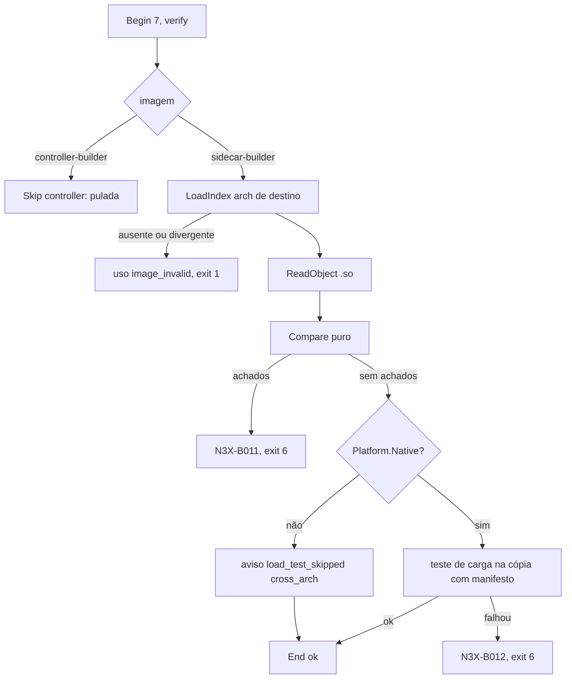
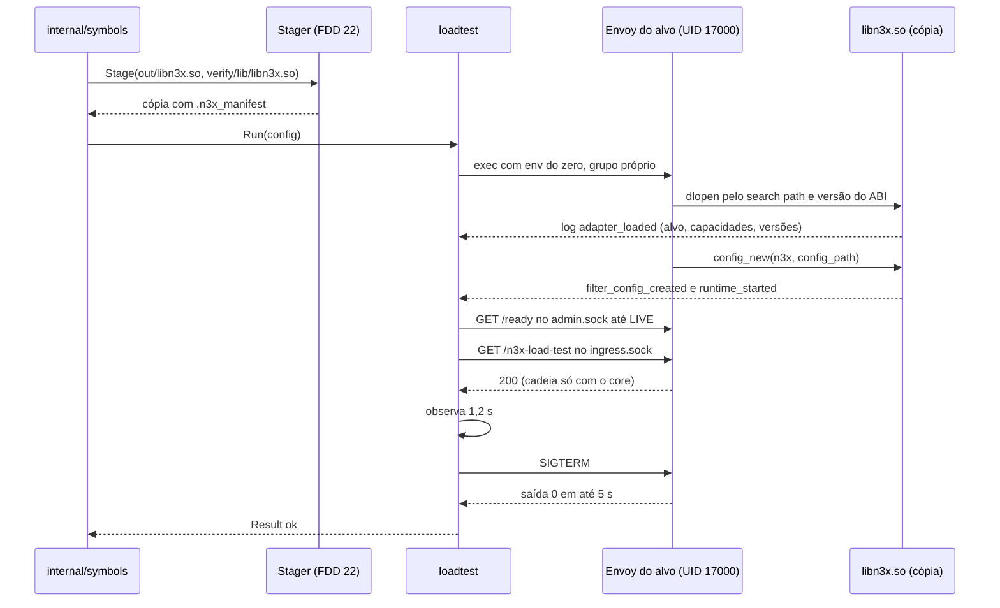
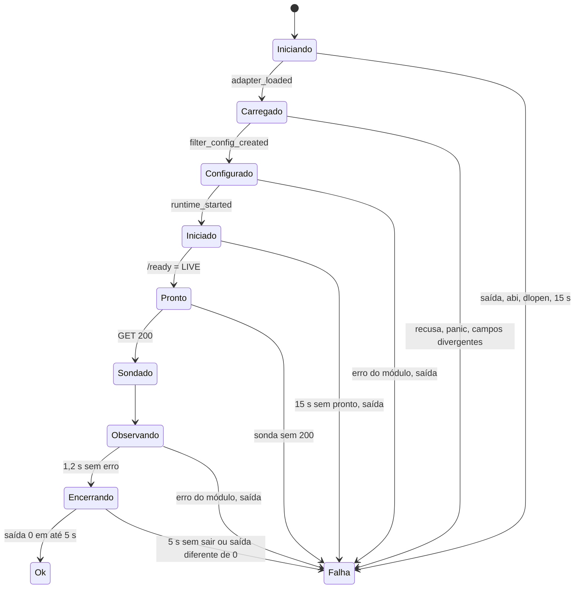

### FDD: Verificação de símbolos e teste de carga do `.so` (BLD-05)

Versão: 1.0
Data: 2026-10-20
Responsável: Guilherme Giusti

---

### 1. Contexto e motivação técnica

**Problema técnico.** O `libn3x.so` sai do passo 6 do `n3x-plugin build` (FDD 21) como um ELF válido, mas nada garante ainda que ele funcione no Envoy do alvo. Dois tipos de defeito só apareceriam na subida ou na primeira requisição:

- **Símbolo que o Envoy do alvo não oferece, ou gancho que o `.so` não exporta.** O istio-proxy 1.31 resolve símbolos de forma tardia e não tem barreira de panic: um `.so` que importa uma callback inexistente carrega e só cai na primeira chamada, em produção (PRD, "Decisões e trade-offs"; ADR-004 do `n3x-builder`). O mesmo vale para uma glibc mais nova que a da imagem do Envoy.
- **Versão de ABI diferente.** O Envoy confere a versão do ABI de dynamic modules ao carregar o módulo; a comparação de símbolos não enxerga isso (ADR-004). Só subir o Envoy de verdade com o `.so` mostra o defeito.

Faltavam decisões para tornar o passo 7 verificável: a regra exata de comparação (glibc versionada, símbolos fracos, o que é exigido), o que o teste de carga sobe e o que conta como sucesso, o que fazer no build cruzado, de onde vêm os símbolos de um Envoy de outra arquitetura (L-60), se o mesmo bootstrap mínimo serve a todos os alvos (L-30), as regras e mensagens do `N3X-B011` e do `N3X-B012`, prazos e o ambiente em que o Envoy roda.

Na entrevista apareceu um ponto que nenhuma fonte tratava: o `.so` só cria a config do filtro depois de ler o próprio manifesto embutido (FDDs 15 e 17), e o manifesto é gravado no passo 8 (FDD 22), depois deste passo. Sem tratamento, todo teste de carga falharia com `manifest_unavailable`. A solução desta FDD é testar uma cópia do artefato com o manifesto, feita por uma porta implementada pela FDD 22 (contrato 7; I-01).

**Encaixe no HLD.** Esta FDD especifica o componente "Verificador de símbolos e carga" do HLD do `n3x-builder` ("Componentes e responsabilidades"; "Fluxo de requisição", passo 7), no pacote `internal/symbols` (comparação, índice e o passo) com o subpacote `internal/symbols/loadtest` (bootstrap mínimo, processo do Envoy e leitura do log), e a ferramenta de imagem `images/tools/symindex`. Quem se relaciona:

- FDD 21 (BLD-03): entrega `compile.Result` (`Path`, `Platform.Arch`, `Platform.Native`) e o Dockerfile de desenvolvimento, onde esta FDD acrescenta o binário do Envoy e o índice de símbolos
- FDD 20 (BLD-02): relator (`report.StepVerify`, `Skip`, `Warn`, `FailAll`, `Masker`), catálogo de códigos e exit code 6
- FDD 22 (BLD-04): implementa a porta `Stager` (cópia do artefato com o manifesto) e grava o manifesto real no passo 8
- FDD 16 (SID-02): logs do `.so` usados como sinais de sucesso (`adapter_loaded`, `filter_config_created`, `runtime_started`) e de falha (`filter_config_rejected`, `adapter_panic`)
- FDDs 17 e 26 (SID-03 e SID-06): `Build` em `ModeServe` e contrato do filtro `n3x` no bootstrap
- FDD 19 (BLD-01): catálogo de alvos (`envoy.image`, `envoy.glibc`, `envoy_go_sdk`, `capabilities`, `archs`)
- FDD 46 (BLD-07): aplica a L-60 nas imagens publicadas e roda a matriz nativa e o teste de carga por patch
- FDD 49 (SID-11): confirma a L-30 no `istio-1.31`

**Atores.** Operador (roda `docker buildx build` e lê `N3X-B011` e `N3X-B012`), `n3x-plugin build` (orquestra o passo 7), binário do Envoy do alvo dentro da `sidecar-builder`, `libn3x.so` (core, plugin core e plugins), ferramenta `symindex` (gera o índice no build da imagem), CI nativa do `n3x-builder` (teste de carga por patch e por arquitetura) e mantenedor do builder (catálogo e imagens).

**Limites.** Só o passo 7 e o que ele precisa na imagem. O passo lê o artefato e nunca o altera: o teste de carga usa uma cópia. Não compila (FDD 21), não grava o manifesto real nem escreve em `/out` (FDD 22), não roda a matriz da CI (FDD 46), não lê o `n3x.yaml` do operador nem chave AES (gera um `n3x.yaml` sintético sem segredos) e não abre porta TCP.

**Suposições**
- FDDs 16, 17, 18, 19, 20, 21 e 22 implementadas antes desta (a 22 vem antes na mesma sessão S16); um `.so` de produção só sobe em `ModeServe` depois da FDD 18 (H-07 da FDD 17)
- O spike da fase 0 confirma os itens V-01 a V-09 da seção 8; o que depende do comportamento real do Envoy está marcado com "(hipótese; V-xx)"
- O binário oficial do Envoy é ligado dinamicamente à glibc e exporta as callbacks `envoy_dynamic_module_callback_*` na tabela dinâmica (hipótese; V-02)
- A glibc da imagem de build (`golang:1.26.1-trixie`, FDD 21) é maior ou igual à `envoy.glibc` dos alvos, então o binário do Envoy roda nela (hipótese; V-07)
- A imagem de runtime do sidecar tem a mesma glibc da imagem do Envoy do alvo (pedido à FDD 28)

**Restrições**
- Comparar sempre os símbolos importados e exportados do `.so` com os do Envoy do alvo da imagem (ADR-004)
- Na arquitetura nativa, subir o Envoy do alvo por cerca de 2 s com bootstrap mínimo que carrega o `.so` e encerrar; no build cruzado, só símbolos (ADR-004)
- `N3X-B011` e `N3X-B012` com exit code 6 (ADR-006; FDD 20)
- Etapa só na `sidecar-builder`; na `controller-builder` ela é pulada (FDD 20)
- Sem QEMU (HLD do `n3x-builder`); sem rede de módulos depois do passo 2 (FDD 20)
- Toda saída pelo relator e pelo mascarador da FDD 20; nenhum caminho absoluto de `/n3x/build` nas mensagens (padrão da FDD 21)
- Um `.so` por commit exato do Envoy e por arquitetura (PRD)
- Documentação e mensagens em pt-BR; identificadores, campos e comandos em inglês

**Rastreabilidade**
- PRD 1.5: FR-015 ("verifica os símbolos do `.so` contra o Envoy do alvo [...] faz um teste de carga do `.so` nesse Envoy quando o build roda na arquitetura nativa"; erros "símbolo ausente no Envoy do alvo" e "`.so` que não carrega no Envoy do alvo"); FR-003 (citado pelo ADR-004); "Decisões e trade-offs" ("um `.so` por commit exato do Envoy e por arquitetura, com verificação de símbolos"); "Dependências" (istio-proxy 1.31 validado num teste de carga); "Testes e validação" (carga do `.so` em cada imagem e teste negativo com `.so` de um Envoy mais novo carregado num mais antigo); critério de aceite "o build falha [...] nos casos de símbolo ausente no Envoy do alvo, `.so` que não carrega"
- HLD do `n3x-builder`: "Componentes e responsabilidades" (Verificador de símbolos e carga), "Fluxo de requisição" (passo 7), imagens (`binário do Envoy do alvo`), "Observabilidade" (resultado do teste de carga por patch), riscos "patch do Istio quebra o carregamento do `.so`", "SDK Go do Envoy, sem tag, muda e quebra o adaptador" e "`.so` arm64 compilado de forma cruzada passa no build e cai no runtime", "Decisões pendentes" (bootstrap mínimo igual em todos os alvos)
- ADRs do `n3x-builder`: ADR-004 (símbolos e teste de carga nativo), ADR-006 (códigos e exit codes), ADR-001 (imagem 1:1 com a versão do `core/`), ADR-002 (hash das seções carregáveis, que o passo não altera) e ADR-007 (build reproduzível)
- Lacunas do README:
  - **L-30 fechada aqui:** um único bootstrap mínimo para todos os alvos da v1, só com campos estáveis da API v3 (contrato 4); confirmação no `istio-1.31` pela FDD 49 (hipótese)
  - **L-60 fechada aqui:** cada `sidecar-builder` carrega o índice de símbolos do Envoy e da glibc do alvo para as duas arquiteturas (`/usr/share/n3x/symbols/<arch>.json`), extraído no build da imagem sem QEMU; o binário do Envoy vem só na arquitetura da própria imagem, para o teste de carga (contratos 2 e 8). A FDD 46 aplica nas imagens publicadas
  - **L-21 aplicada (FDD 19):** `envoy.glibc` do catálogo é o teto da regra `glibc_too_new`
  - **L-20 aplicada (FDDs 05, 16 e 19):** as capacidades do `adapter_loaded` são comparadas com `capabilities` do catálogo em todo build nativo
  - **L-16 aplicada (FDD 26):** admin do Envoy em socket Unix também no teste de carga
- Pedidos atendidos: FDD 16 (`adapter_loaded` como sinal de sucesso, contrato 4), FDD 20 (etapa 7 `skipped` na `controller-builder` e aviso `load_test_skipped`, contrato 6), FDD 21 (teste de carga decidido por `Platform.Native`; binário do Envoy no Dockerfile de desenvolvimento, contrato 8), FDD 26 (gerador de bootstrap é `internal/` do sidecar: o builder mantém um bootstrap mínimo próprio, contrato 4)

---

### 2. Objetivos técnicos

- **Nenhum `.so` com símbolo não resolvível sai do build.** Invariante: todo import não fraco do `.so` resolve no Envoy do alvo ou na glibc da imagem do Envoy do alvo, e todo gancho que o Envoy do alvo procura está exportado; senão o build sai com `N3X-B011` e exit 6 antes do passo 8. Medida: um teste por regra do contrato 3, com fixtures reais e sintéticas; 0 falsos negativos no corpus de fixtures.
- **Nenhum `.so` que não carrega sai de um build nativo.** Invariante: na arquitetura nativa, o build só passa se o Envoy do alvo carregou o módulo, criou a config do filtro, iniciou o runtime, ficou pronto, respondeu uma requisição pelo filtro e encerrou limpo no SIGTERM. Medida: um teste por regra do `N3X-B012` (contrato 5).
- **Cerca de 2 s no build nativo.** Medida: no runner amd64 da CI (4 vCPU), com o plugin core mais o exemplo, p95 de 20 execuções: comparação de símbolos em até 0,5 s e teste de carga em até 3 s (mediana perto de 2 s); passo 7 inteiro em até 3,5 s. No build cruzado, passo 7 em até 0,5 s (hipótese, conferida pela FDD 46 contra a L-29).
- **Prazo duro.** Invariante: o teste de carga nunca passa de 24,2 s (15 s até ficar pronto, 2 s de sonda, 1,2 s de observação, 5 s para encerrar e 1 s de espera depois do SIGKILL); estourado, o grupo de processos recebe SIGKILL e o build falha com regra estável.
- **Determinismo.** Invariante: a comparação é função pura do `.so` e do índice; mesma entrada, mesmos achados na mesma ordem e o mesmo `verify-symbols.json` byte a byte (100 execuções).
- **Artefato intocado.** Invariante: o SHA-256 do arquivo `/n3x/build/out/libn3x.so` antes e depois do passo 7 é o mesmo (o teste de carga roda numa cópia).
- **Mesmo comportamento em todos os alvos.** Invariante: o mesmo bootstrap mínimo, as mesmas regras e os mesmos sinais em `envoy-1.40` e `istio-1.31`, em amd64 e arm64; variante por alvo só por adição (L-30).
- **Isolamento do teste de carga.** Invariante: o processo do Envoy roda com ambiente montado do zero (sem `N3X_ENVOY_VALIDATE`, sem variáveis do `RUN`, sem o secret), como usuário sem privilégio (UID 17000) quando o ambiente permite, e sem porta TCP. Medida: Envoy falso que despeja ambiente, UID e tentativa de ler `/run/secrets/git_auth`.

---

### 3. Escopo e exclusões

**Incluído**
- Passo 7 do `n3x-plugin build` na `sidecar-builder`: ordem, prazos, linha da etapa, eventos, avisos e campos próprios (contratos 1 e 6)
- Etapa pulada na `controller-builder` (`status: skipped`, `reason: controller`), pedido da FDD 20
- Leitura dos símbolos importados e exportados, das versões exigidas e das bibliotecas do `.so` com `debug/elf` (contrato 3)
- Índice de símbolos por alvo e arquitetura: formato, local na imagem, carga e conferência contra o catálogo (contrato 2)
- Regra de comparação: resolução de imports, glibc versionada, `GLIBC_PRIVATE`, símbolos fracos, bibliotecas exigidas e ganchos exportados (contrato 3)
- Relação com `capabilities` do catálogo: fora da comparação de símbolos; conferida no teste de carga pelo `adapter_loaded` (contratos 3 e 4)
- Teste de carga na arquitetura nativa: bootstrap mínimo, `n3x.yaml` mínimo, cópia do `.so` com manifesto, ambiente, usuário, prazos, sonda, sinais de sucesso e encerramento (contrato 4)
- Detecção da arquitetura nativa por `compile.Result.Platform.Native` e comportamento no build cruzado (só símbolos, aviso `load_test_skipped`)
- Regras, mensagens e "como resolver" do `N3X-B011` e do `N3X-B012`, captura e resumo do log do Envoy (contrato 5)
- Porta `Stager` que a FDD 22 implementa (contrato 7)
- Acréscimos ao Dockerfile de desenvolvimento da FDD 21 e ferramenta `symindex` (contrato 8, L-60)
- Fixtures de teste em `testdata/verify/` e Envoy falso para os cenários de processo

**Excluído**
- Compilação do `.so`, plataforma de destino e pós-condições do artefato: FDD 21 (BLD-03)
- Montagem e gravação do manifesto real (passo 8), hash de integridade e escrita em `/out` (passo 9): FDD 22 (BLD-04); aqui só a porta `Stager` para a cópia do teste
- Matriz alvo × arquitetura em runners nativos, teste de carga por patch do Envoy 1.40.x e do Istio 1.31.x, job do próximo candidato, promoção `candidate` para `supported`, publicação e tamanho das imagens: FDD 46 (BLD-07)
- Adaptador por alvo e lista de capacidades: FDD 16 (SID-02) e FDD 49 (SID-11)
- Testes de conformidade do SDK em proxies reais: FDDs 16, 17 e 48
- `envoy --mode validate` com o bootstrap real no `n3x run`: FDD 26 (SID-06)
- Conferência de alvo, integridade e arquitetura na subida: FDD 25 (SID-05)
- Checagem estática da versão do ABI no build cruzado: fora da v1 (trade-off aceito no ADR-004: o erro de ABI aparece no `n3x run`, antes do tráfego)
- Opção para o operador pular o teste de carga num build nativo: fora da v1 (hipótese)
- Assinatura e SBOM: fora da v1 (PRD)

---

### 4. Fluxos detalhados e diagramas

**Fluxo principal: passo 7 na `sidecar-builder`, arquitetura nativa** (`[7/9] verificando símbolos e carga`)
1. `rep.Begin(7, report.StepVerify, "verificando símbolos e carga")`.
2. `symbols.LoadIndex(IndexDir, target, plat.Arch)` lê `/usr/share/n3x/symbols/<arch>.json` (contrato 2) e confere `format`, `target`, `arch`, `envoy.image` e `glibc` contra o catálogo embutido em `/etc/n3x/target.yaml`. Divergência ou arquivo ausente: erro de uso `image_invalid`, exit 1 (imagem defeituosa).
3. `symbols.ReadObject(res.Path)` lê o `.so` com `debug/elf`: máquina, `DT_NEEDED`, versões exigidas (`.gnu.version_r`), imports e exports da tabela dinâmica com versão e biblioteca. Máquina diferente de `plat.Arch` ou ELF ilegível: erro de uso `internal`, exit 1.
4. `symbols.Compare(obj, idx, target.Envoy.GLibc)` (contrato 3, função pura) devolve a contagem e os achados em ordem. Grava `/n3x/build/logs/verify-symbols.json` com tudo.
5. Achados: um problema `N3X-B011` por achado (até 100, regra do relator), `st.FailAll`, `st.End()` e o build termina com exit 6. O teste de carga não roda, porque o `dlopen` falharia pelo mesmo motivo.
6. Sem achados e `plat.Native` verdadeiro: teste de carga (contrato 4):
   1. recria `/n3x/build/verify/` (`0755`) com `lib/`, `run/` (`0700`, dono UID 17000) e grava `bootstrap.yaml` e `n3x.yaml` (`0444`)
   2. chama `req.Stage(ctx, res.Path, "/n3x/build/verify/lib/libn3x.so")` (porta da FDD 22, contrato 7): a cópia recebe o mesmo manifesto do passo 8, menos `built_at`; modo `0555`
   3. sobe `/opt/n3x/envoy/envoy -c bootstrap.yaml --mode serve --concurrency 1 --disable-hot-restart --log-level info` com ambiente do zero, UID e GID 17000, grupo de processos próprio e stdout e stderr num leitor de linhas
   4. o leitor guarda as últimas 64 KiB, grava o log mascarado em `/n3x/build/logs/verify-envoy.log` (até 4 MiB) e marca os sinais: `adapter_loaded` (com conferência de `target`, `capabilities`, `envoy_go_sdk`, `core_version` e `go_version`), `filter_config_created`, `runtime_started`, erros do módulo e erros fatais do Go
   5. a cada 50 ms, `GET /ready` no admin (`run/admin.sock`) até 200 com corpo `LIVE`, com prazo de 15 s a partir do início do processo
   6. sonda: `GET /n3x-load-test` em HTTP/1.1 pelo listener em socket Unix (`run/ingress.sock`), prazo de 2 s; espera 200 (a cadeia só tem o core, que segue, e a rota responde direto)
   7. observação até 1,2 s depois do pronto (cobre a primeira publicação de métricas, que acontece 1 s depois do `Start`, FDD 16); qualquer erro do módulo ou saída do processo nesse intervalo é falha
   8. SIGTERM no Envoy; espera até 5 s pela saída com código 0 (ou término pelo próprio SIGTERM); senão SIGKILL no grupo e espera de até 1 s
   9. classifica (contrato 5): sucesso exige todos os sinais e nenhuma marca de falha
7. Falha do teste: um problema `N3X-B012` com a regra da classificação, o resumo e as últimas linhas relevantes do log; exit 6.
8. Sucesso: `st.Note("<i> importados, <e> exportados; carga ok em <d>s")`, `st.Set(...)` com os campos da seção 7 e `st.End()`. O artefato segue para os passos 8 e 9 (FDD 22) sem nenhuma mudança.

**Fluxos alternativos e exceções**
- **Build cruzado (`plat.Native` falso, por exemplo amd64 compilando arm64):** passos 1 a 5 com o índice da arquitetura de destino (L-60); depois `st.Warn(load_test_skipped)` com `reason: cross_arch`, nota `linux/<arch>, cruzado: só símbolos` e `End`. O teste de carga em arm64 roda na CI nativa do builder para cada imagem, e um erro de ABI aparece no `n3x run`, antes do tráfego (trade-off aceito no ADR-004).
- **`controller-builder`:** `st.Skip("controller")` logo depois do `Begin`; texto `[7/9] verificando símbolos e carga (controller-builder: sem Envoy) ... pulada`; nenhum arquivo lido (pedido da FDD 20).
- **`TARGETARCH` ausente:** a FDD 21 usa a arquitetura da imagem (`Implicit: true`, `Native: true`); o teste de carga roda normalmente.
- **Build emulado (Dockerfile sem `--platform=$BUILDPLATFORM`, estágio arm64 sob QEMU):** `Native` é verdadeiro porque o `n3x-plugin` não detecta emulação (FDD 21); o Envoy roda emulado e mais lento. O prazo de 15 s até o pronto foi escolhido com folga para isso; estourado, `not_ready` traz a dica "use `FROM --platform=$BUILDPLATFORM`" (hipótese).
- **Troca de UID indisponível** (`setuid` recusado, por exemplo BuildKit sem usuário 17000 mapeado): o teste roda como o usuário atual, com o aviso `load_test_unsandboxed`; o resultado do teste não muda (hipótese).
- **`.so` sem manifesto na cópia** (porta `Stager` falhou, por exemplo `objcopy` ausente): erro de uso `internal`, exit 1, porque é defeito da imagem; o problema real do manifesto sai no passo 8 como `N3X-B013`.
- **Envoy ausente ou não executável, ou de outra arquitetura (ENOEXEC):** erro de uso `image_invalid`, exit 1.
- **Cancelamento** (`ctx` do comando terminado, por exemplo build interrompido): SIGKILL no grupo, espera de até 1 s e o erro do `ctx` volta ao orquestrador, sem problema `N3X-B012`.
- **Saída do Envoy antes do pronto, recusa do módulo, panic, prazo:** classificação do contrato 5; um único problema `N3X-B012` com a causa.
- **`.so` feito para um Envoy mais novo carregado num mais antigo** (teste negativo do PRD): se o SDK novo importa callbacks que o Envoy antigo não exporta, o passo para em `N3X-B011` `symbol_missing`; senão o Envoy recusa a versão do ABI e sai `N3X-B012` `abi_mismatch`. Os dois são exit 6 antes do passo 8 (I-04).

**O que o teste de carga exercita** (resposta ao ponto em aberto do ASSUNTO): o Envoy só carrega um dynamic module quando cria a config de um filtro que o usa, então "só carregar o módulo" não existe. O teste cria a config do filtro em `ModeServe` (sem o marcador `N3X_ENVOY_VALIDATE`), com um `n3x.yaml` mínimo gerado pelo builder: sem `plugins`, sem `controller` e sem `keys`. O `Build` do executor (FDD 17) roda inteiro: registro, fonte do manifesto, `VerifyRegistry`, origem, `config.Load`, instância do core (inativa no standalone, FDD 09), contenção (FDD 18), compilação da cadeia e `Start`. Nenhum `New` de plugin de terceiro roda (não há instância), mas a inicialização de pacotes de todos os plugins roda no `dlopen`, como em produção. Não há chave AES de teste, porque o arquivo não tem `ENC[...]` (bloco `keys` opcional, FDD 15).

**Diagramas**

Decisão do passo 7:



Sequência do teste de carga:



Estados do teste de carga:



---

### 5. Contratos públicos (assinaturas, endpoints, headers, exemplos)

**Contrato 1: passo 7 (`symbols.Run`)**
- Tipo: method (API Go interna do `n3x-builder`, chamada pelo orquestrador do `n3x-plugin build`)
- Assinatura/Rota:
  ```go
  package symbols // github.com/giustech/n3x-builder/internal/symbols

  const (
      IndexDir       = "/usr/share/n3x/symbols"            // <arch>.json, contrato 2
      EnvoyPath      = "/opt/n3x/envoy/envoy"              // binário nativo, contrato 8
      ReportFile     = "/n3x/build/logs/verify-symbols.json"
      ABIPrefix      = "envoy_dynamic_module_"
      HookPrefix     = "envoy_dynamic_module_on_"
      CallbackPrefix = "envoy_dynamic_module_callback_"
      SymbolsTimeout = 30 * time.Second                    // leitura e comparação (defensivo)
  )

  // Porta implementada pela FDD 22 (contrato 7).
  type Stager func(ctx context.Context, src, dst string) error

  type Request struct {
      Image    image.Info       // FDD 19: Kind, versões de builder.yaml
      Target   *catalog.Target  // nil na controller-builder
      Artifact compile.Result   // FDD 21: Path, Platform{Arch, Native, Implicit}
      Stage    Stager           // obrigatório quando Artifact.Platform.Native
      Clock    func() time.Time
  }

  type Result struct {
      Skipped    bool             // controller-builder
      Comparison Comparison       // contrato 3
      LoadTest   loadtest.Result  // Outcome OutcomeSkipped no cruzado
  }

  // Run executa o passo 7. error só para falha interna ou cancelamento (exit 1);
  // N3X-B011 e N3X-B012 vão para st e o orquestrador encerra com exit 6.
  func Run(ctx context.Context, req Request, st *report.Step) (Result, error)
  ```
- Método: n/a (chamada local)
- Semântica de status/headers:
  - **Entrada:** o artefato do passo 6, sem manifesto; o passo nunca escreve nele
  - **Saída:** `Result` e, no relator, uma linha de etapa com `ok`, `falhou` ou `pulada`; exit 6 só por `N3X-B011` ou `N3X-B012`
  - **Ordem:** símbolos antes da carga; com qualquer `N3X-B011`, a carga não roda (a etapa lista todos os achados de símbolos)
  - **Escrita:** só em `/n3x/build/verify/` e `/n3x/build/logs/`; nunca em `/out` nem em `/n3x/build/out/`
  - **Sem nova tentativa:** comparação determinística; o teste de carga também não repete (hipótese; contingência na seção 10)
- Limites: passo inteiro até 30 s na comparação mais 24,2 s no teste de carga

**Exemplo de requisição**
```go
st := rep.Begin(7, report.StepVerify, "verificando símbolos e carga")
res, err := symbols.Run(ctx, symbols.Request{
    Image: img, Target: target, Artifact: out,
    Stage: manifest.Stager(mreq), // FDD 22
    Clock: time.Now,
}, st)
if err != nil { // falha interna: erro de uso internal, exit 1 (FDD 20)
    rep.Usage(report.Usage{Rule: "internal", Detail: err.Error(), Fix: "abra uma issue com o log"})
    return rep.Finish(sum)
}
if st.End() {
    return rep.Finish(sum) // exit 6
}
```

**Exemplo de resposta**
```json
{
  "Skipped": false,
  "Comparison": { "Imports": 187, "Exports": 31, "Needed": 1, "WeakIgnored": 2, "Findings": [] },
  "LoadTest": {
    "Outcome": "ok", "Rule": "", "Duration": "1.84s", "ReadyAfter": "311ms",
    "Signals": ["adapter_loaded", "filter_config_created", "runtime_started", "ready", "probe"],
    "EnvoyExit": 0, "Signal": "", "Sandbox": "uid", "Tail": []
  }
}
```

---

**Contrato 2: índice de símbolos do alvo (`/usr/share/n3x/symbols/<arch>.json`, L-60)**
- Tipo: arquivo JSON na imagem `sidecar-builder` e method (`LoadIndex`, `Extract`)
- Assinatura/Rota:
  ```go
  package symbols

  const (
      IndexFormat  = 1
      MaxIndexSize = 4 << 20
  )

  type Def struct {
      Name    string
      Version string // "" sem versão
      Default bool   // "@@" (versão padrão) contra "@" (versão escondida)
  }

  type Library struct {
      Soname   string   // ex.: "libc.so.6"
      Versions []string // versões definidas (Verdef), em ordem
      Defs     []Def    // símbolos definidos e exportados
  }

  type Index struct {
      Format          int
      Target          string
      Arch            catalog.Arch
      Envoy           IndexEnvoy
      GLibc           string    // "2.35", igual a envoy.glibc do catálogo
      Libraries       []Library // glibc da imagem do Envoy e fecho de DT_NEEDED do binário
      RequiredExports []string  // ganchos envoy_dynamic_module_on_* que o Envoy procura
      ABIHeaderSHA256 string    // abi.h do envoy_go_sdk fixado
      Generator       string    // "symindex <versão do builder>"
  }

  type IndexEnvoy struct {
      Image        string // envoy.image do catálogo (com digest)
      Commit       string // envoy.commit
      BinarySHA256 string // do binário daquela arquitetura
      ExportsTotal int    // todos os símbolos exportados do binário
      Exports      []Def  // só os com prefixo ABIPrefix
  }

  func LoadIndex(dir string, t *catalog.Target, a catalog.Arch) (*Index, error)

  // Usada só por images/tools/symindex, no build da imagem.
  type ExtractInput struct {
      Target    *catalog.Target
      Arch      catalog.Arch
      Image     string // ARG ENVOY_IMAGE; precisa ser igual a Target.Envoy.Image
      RootFS    string // cópia de /usr/local/bin/envoy e de /usr/lib da imagem do Envoy
      ABIHeader []byte // abi.h lido do zip do envoy_go_sdk em /usr/share/n3x/pinned
      Optional  []string
      Generator string
  }

  func Extract(in ExtractInput) (*Index, error)
  func (ix *Index) MarshalJSON() ([]byte, error) // determinístico, listas ordenadas
  ```
- Método: n/a
- Semântica de status/headers:
  - **Por que índice e não binário (L-60):** uma `sidecar-builder` amd64 que compila arm64 precisa dos símbolos do Envoy arm64 e da glibc arm64 (os nomes são os mesmos, mas as versões de símbolo da glibc mudam por arquitetura: o mínimo do aarch64 é `GLIBC_2.17`, o do x86_64 é `GLIBC_2.2.5`). Carregar o binário do Envoy das duas arquiteturas dobraria o peso da imagem com cerca de 100 MiB só para ler a tabela dinâmica (hipótese de tamanho). O índice tem as duas arquiteturas em menos de 1 MiB cada (hipótese). Não há imagem por arquitetura de destino: o Dockerfile recomendado (FDD 21, contrato 8) continua com uma só imagem de build e `--platform=$BUILDPLATFORM`
  - **De onde vem:** no build da imagem, um estágio `FROM --platform=linux/<arch> <envoy.image>` por arquitetura, sem `RUN`, entrega o binário e `/usr/lib` daquela arquitetura sem QEMU; o `symindex` lê os ELF de qualquer arquitetura com `debug/elf` (contrato 8)
  - **`Envoy.Exports`:** só os símbolos definidos, globais ou fracos, de visibilidade padrão, com prefixo `envoy_dynamic_module_`. O `.so` só pode depender do Envoy pelo ABI de dynamic modules (hipótese): import sem esse prefixo precisa vir da glibc
  - **`Libraries`:** as bibliotecas do fecho de `DT_NEEDED` do binário do Envoy, resolvidas por soname dentro do `RootFS` (inclui o carregador do `PT_INTERP`), mais as da glibc presentes na imagem (`libc.so.6`, `libm.so.6`, `libpthread.so.0`, `libdl.so.2`, `librt.so.1`, `libresolv.so.2`, `libutil.so.1`); para cada uma, as versões do `Verdef` e os símbolos exportados com versão e marca de padrão
  - **`RequiredExports` (hipótese; V-03):** os nomes `envoy_dynamic_module_on_*` que aparecem como texto nas seções de dados somente leitura do binário do Envoy (os nomes que ele procura com `dlsym`), menos os listados em `Optional` (arquivo `images/tools/symindex/optional/<alvo>.txt`, vazio por padrão). Um nome do Envoy que não está declarado no `abi.h` do `envoy_go_sdk` fixado falha o build da imagem: Envoy e SDK de commits diferentes
  - **Conferência na carga (`LoadIndex`):** arquivo até 4 MiB; `format` maior que 1, `target`, `arch`, `envoy.image` ou `glibc` diferentes do catálogo embutido: erro de uso `image_invalid` (exit 1). O índice é interno da imagem; não há compatibilidade entre versões do builder
  - **Garantia da imagem:** o build de fumaça da imagem (FDD 21, contrato 9) roda o passo 7 inteiro na arquitetura nativa, então um índice que não serve ao próprio core nunca é publicado; a FDD 46 confere que `BinarySHA256` do índice nativo é o do binário em `EnvoyPath`

**Exemplo de requisição**
```text
go run ./images/tools/symindex --target targets/envoy-1.40.yaml \
  --image envoyproxy/envoy:v1.40.2@sha256:<digest> --arch arm64 \
  --rootfs /rootfs/arm64 --pinned /stage/pinned --out /stage/symbols
```

**Exemplo de resposta** (`/usr/share/n3x/symbols/arm64.json`, resumido; valores ilustrativos até a fase 0)
```json
{
  "format": 1,
  "target": "envoy-1.40",
  "arch": "arm64",
  "envoy": {
    "image": "envoyproxy/envoy:v1.40.2@sha256:<digest>",
    "commit": "7c1f0e2a9b31...",
    "binary_sha256": "4be19d0c...",
    "exports_total": 412,
    "exports": ["envoy_dynamic_module_callback_http_get_request_header", "envoy_dynamic_module_callback_http_send_response", "..."]
  },
  "glibc": "2.35",
  "libraries": [
    { "soname": "ld-linux-aarch64.so.1", "versions": ["GLIBC_2.17", "GLIBC_PRIVATE"], "defs": ["__tls_get_addr@@GLIBC_2.17", "..."] },
    { "soname": "libc.so.6", "versions": ["GLIBC_2.17", "...", "GLIBC_2.34", "GLIBC_2.35", "GLIBC_PRIVATE"], "defs": ["__errno_location@@GLIBC_2.17", "pthread_create@GLIBC_2.17", "pthread_create@@GLIBC_2.34", "..."] }
  ],
  "required_exports": ["envoy_dynamic_module_on_http_filter_config_destroy", "envoy_dynamic_module_on_http_filter_config_new", "envoy_dynamic_module_on_program_init", "..."],
  "abi_header_sha256": "e3b9a1...",
  "generator": "symindex 1.0.0"
}
```

---

**Contrato 3: regra de comparação (`ReadObject` e `Compare`)**
- Tipo: method (API Go interna, função pura)
- Assinatura/Rota:
  ```go
  package symbols

  type Ref struct {
      Name, Version, Library string // Library: arquivo do Verneed; "" sem versão
      Weak                   bool
      Type                   string // func, object, tls, notype
  }

  type Need struct {
      File     string   // soname exigido (DT_NEEDED)
      Versions []string // versões exigidas no Verneed (sem as marcadas VER_FLG_WEAK)
  }

  type Object struct {
      Machine string // EM_X86_64 ou EM_AARCH64
      Needed  []Need
      Imports []Ref
      Exports []Def
  }

  // debug/elf: DynamicSymbols, DynamicVersionNeeds, ImportedLibraries (Go 1.24 ou mais novo).
  func ReadObject(path string) (*Object, error)

  type Finding struct {
      Rule      string // tabela abaixo
      Path      string // convenção L-34: imports["nome@VERSAO"], exports["nome"], needed["lib"]...
      Direction string // import, export, needed
      Symbol, Version, Library string
      Detail    string // pt-BR
  }

  type Comparison struct {
      Imports, Exports, Needed, WeakIgnored int
      Findings []Finding // ordenados por Path
  }

  func Compare(obj *Object, idx *Index, glibc string) Comparison
  ```
- Método: n/a
- Semântica de status/headers:
  - **Import:** símbolo da tabela dinâmica com seção `SHN_UNDEF`, ligação global ou fraca e nome não vazio. **Export:** definido, ligação global ou fraca, visibilidade padrão ou protegida
  - **Escopo de resolução** (o mesmo do `dlopen` no Envoy: o executável, as bibliotecas dele e as do `.so`): `Envoy.Exports` mais todas as `Libraries` do índice
  - **Ordem das checagens, sem erros derivados:**
    1. cada `DT_NEEDED` do `.so` precisa ser uma `Library` do índice; senão `library_missing`, e os imports e versões daquela biblioteca não são conferidos de novo
    2. cada versão exigida no `Verneed` (o carregador confere por biblioteca, mesmo sem símbolo usado) precisa estar no `Verdef` da biblioteca; senão `glibc_too_new` (versão `GLIBC_X.Y` maior que `envoy.glibc`) ou `version_missing`, e os imports daquela versão não são conferidos de novo
    3. import com versão `GLIBC_PRIVATE`: `glibc_private` (ABI privada, muda a cada build da glibc)
    4. import com versão: resolvido se a biblioteca do `Verneed` define o nome naquela versão, padrão ou escondida
    5. import sem versão: resolvido se `Envoy.Exports` tem o nome, ou se alguma biblioteca define o nome sem versão ou na versão padrão
    6. import não resolvido e fraco: ignorado e contado em `WeakIgnored` (o carregador resolve para zero, por exemplo `__cxa_finalize`, `__gmon_start__` e `_ITM_*`)
    7. import não resolvido e não fraco: `symbol_missing` (biblioteca `(envoy)` quando o nome tem o prefixo `envoy_dynamic_module_`)
    8. cada nome de `RequiredExports` precisa estar entre os exports do `.so`; senão `export_missing`
  - **Glibc versionada e fraca** (resposta ao ASSUNTO): versão é parte do símbolo (`pthread_create@GLIBC_2.34` não é resolvido por `pthread_create@GLIBC_2.17`); o teto é `envoy.glibc` do catálogo (L-21); `GLIBC_PRIVATE` é sempre erro; import fraco ausente é ignorado; versão marcada `VER_FLG_WEAK` no `Verneed` não é exigida
  - **Capacidades** (resposta ao ASSUNTO): a comparação não lê `capabilities`. O adaptador do alvo é compilado com a tag e o SDK Go do commit do alvo; se ele usasse uma callback que o Envoy não tem, o import faltaria e o build pararia em `symbol_missing`, com ou sem capacidade declarada. A coerência entre adaptador e catálogo é conferida no teste de carga pelo `adapter_loaded` (contrato 4, regra `adapter_mismatch`)
  - **Origem dos achados:** os plugins não introduzem imports, porque código C é proibido no fecho deles (FDD 24, regra `cgo`); todo achado aponta para a imagem, o runtime ou o SDK do Envoy, e o problema sai sem plugin
  - **Desempenho:** só lê `.dynsym`, `.dynstr`, `.gnu.version`, `.gnu.version_r` e `.dynamic`; até 0,5 s e 150 MiB para um `.so` de 60 MiB (hipótese)

Regras do `N3X-B011` (exit 6):

| Regra | Caminho | Quando | Como resolver |
| --- | --- | --- | --- |
| `library_missing` | `needed["<soname>"]` | o `.so` exige uma biblioteca que a imagem do Envoy do alvo não tem | imagem de build defeituosa ou de outro alvo; use a imagem de build do mesmo alvo e versão da imagem de runtime; se já usa, abra uma issue |
| `glibc_too_new` | `needed["<soname>"].versions["GLIBC_X.Y"]` | versão da glibc exigida maior que `envoy.glibc` do alvo | o toolchain C gerou símbolo mais novo que a glibc do alvo; abra uma issue com o resumo (imagem defeituosa) |
| `version_missing` | `needed["<soname>"].versions["<versão>"]` ou `imports["nome@versão"]` | versão exigida ausente da biblioteca, ou nome que existe só em outra versão | use a imagem de build do mesmo alvo; se já usa, abra uma issue |
| `glibc_private` | `imports["nome@GLIBC_PRIVATE"]` | o `.so` usa a ABI privada da glibc | abra uma issue: o runtime ou uma dependência usa ABI privada |
| `symbol_missing` | `imports["nome"]` ou `imports["nome@versão"]` | import não fraco sem definição no escopo | o Envoy do alvo não oferece a callback que o SDK Go do Envoy usa: use a imagem do alvo certo; no mantenedor, alvo ou patch incompatível com a pseudo-versão do SDK |
| `export_missing` | `exports["nome"]` | gancho que o Envoy do alvo procura e o `.so` não exporta | `.so` feito com outro runtime ou SDK; use a imagem do alvo certo; se já usa, abra uma issue |

**Exemplo de requisição** (`Object` resumido de um `.so` arm64 e índice com `glibc: 2.31`)
```json
{
  "machine": "EM_AARCH64",
  "needed": [{ "file": "libc.so.6", "versions": ["GLIBC_2.17", "GLIBC_2.34"] }],
  "imports": [
    { "name": "envoy_dynamic_module_callback_http_clear_route_cache", "weak": false },
    { "name": "pthread_create", "version": "GLIBC_2.34", "library": "libc.so.6" },
    { "name": "__cxa_finalize", "version": "GLIBC_2.17", "library": "libc.so.6", "weak": true }
  ],
  "exports": ["envoy_dynamic_module_on_program_init", "envoy_dynamic_module_on_http_filter_config_new", "..."]
}
```

**Exemplo de resposta**
```json
{
  "Imports": 187, "Exports": 31, "Needed": 1, "WeakIgnored": 2,
  "Findings": [
    { "Rule": "symbol_missing", "Path": "imports[\"envoy_dynamic_module_callback_http_clear_route_cache\"]", "Direction": "import", "Symbol": "envoy_dynamic_module_callback_http_clear_route_cache", "Version": "", "Library": "(envoy)", "Detail": "o Envoy de envoy-1.40 (arm64) não exporta esta callback" },
    { "Rule": "glibc_too_new", "Path": "needed[\"libc.so.6\"].versions[\"GLIBC_2.34\"]", "Direction": "needed", "Symbol": "", "Version": "GLIBC_2.34", "Library": "libc.so.6", "Detail": "o .so exige GLIBC_2.34; a imagem do Envoy de envoy-1.40 (arm64) tem glibc 2.31" }
  ]
}
```

---

**Contrato 4: teste de carga (`loadtest`): bootstrap mínimo, `n3x.yaml` mínimo, processo e sinais (L-30)**
- Tipo: method (API Go interna) e arquivos gerados lidos pelo Envoy
- Assinatura/Rota:
  ```go
  package loadtest // github.com/giustech/n3x-builder/internal/symbols/loadtest

  const (
      Dir           = "/n3x/build/verify"
      ModuleDir     = Dir + "/lib"            // ENVOY_DYNAMIC_MODULES_SEARCH_PATH
      ModuleFile    = ModuleDir + "/libn3x.so"
      BootstrapFile = Dir + "/bootstrap.yaml"
      ConfigFile    = Dir + "/n3x.yaml"
      RunDir        = Dir + "/run"            // 0700, dono UID 17000; HOME e TMPDIR
      AdminSocket   = RunDir + "/admin.sock"
      IngressSocket = RunDir + "/ingress.sock"
      LogFile       = "/n3x/build/logs/verify-envoy.log"
      ServiceName   = "n3x-load-test"
      ProbePath     = "/n3x-load-test"
      UID, GID      = 17000, 17000           // usuário da imagem de runtime (FDD 28)
      StartTimeout  = 15 * time.Second         // do exec até /ready = LIVE
      ProbeTimeout  = 2 * time.Second
      Hold          = 1200 * time.Millisecond  // depois do pronto
      StopTimeout   = 5 * time.Second          // depois do SIGTERM
      KillWait      = 1 * time.Second          // depois do SIGKILL no grupo
      PollInterval  = 50 * time.Millisecond
      MaxTail       = 64 << 10
      MaxLogFile    = 4 << 20
      MaxTailLines  = 20
      MaxLineBytes  = 256                      // por linha do resumo
  )

  type Outcome string

  const (
      OutcomeOK      Outcome = "ok"
      OutcomeFailed  Outcome = "failed"
      OutcomeSkipped Outcome = "skipped"
  )

  type Expect struct { // do catálogo e de builder.yaml
      Target, EnvoyGoSDK, CoreVersion, GoVersion string
      Capabilities []string
  }

  type Config struct {
      EnvoyPath string
      Expect    Expect
      Masker    *report.Masker
      Clock     func() time.Time
  }

  type Result struct {
      Outcome    Outcome
      Rule       string        // regra do N3X-B012 quando falha
      Detail     string
      Duration   time.Duration // do exec à saída
      ReadyAfter time.Duration
      Signals    []string      // adapter_loaded, filter_config_created, runtime_started, ready, probe
      EnvoyExit  int           // -1 se morto por sinal
      Signal     string        // ex.: SIGSEGV
      Sandbox    string        // uid ou root
      Tail       []string      // até MaxTailLines linhas relevantes, mascaradas
      Attrs      []report.Attr // campos da regra (module_rule, field, expected, got...)
  }

  // O que o leitor do log e o supervisor do processo observaram (entrada de Classify).
  type Events struct {
      Loaded                                 map[string]string // campos do adapter_loaded; nil se ausente
      Created, Started, Ready                bool
      ProbeStatus                            int               // 0 se a sonda não respondeu
      Rejected                               map[string]string // path, rule e detail do filter_config_rejected
      Panicked, ModuleError                  bool
      ABIMismatch, DlopenFailed              bool              // padrões de texto do Envoy (V-04)
      ExitedEarly, StopTimedOut              bool
      ExitCode                               int
      Signal                                 string
      Expect                                 Expect
  }

  func Bootstrap() []byte  // pura; golden testdata/bootstrap.golden.yaml
  func NodeConfig() []byte // pura; golden testdata/n3x.golden.yaml
  func Run(ctx context.Context, cfg Config) (Result, error) // error só interno ou ctx
  func Classify(ev Events) (rule string, attrs []report.Attr) // pura; contrato 5
  ```
- Método: n/a
- Semântica de status/headers:
  - **Bootstrap mínimo próprio** (resposta ao pedido da FDD 26): o builder não reaproveita o gerador `internal/bootstrap` do sidecar. Motivos: o pacote é `internal/` do módulo do sidecar e o `n3x-plugin` não deve depender do módulo do sidecar (o binário do builder não é recompilado a cada versão do `core/`); o bootstrap real deriva do `n3x.yaml` do operador, que o builder não lê; e ele traz monitores de memória do cgroup e portas TCP que podem falhar dentro do container de build sem relação com o `.so`. O que importa para a carga é o bloco do filtro, e esse é igual ao do contrato 1 da FDD 26: `DynamicModuleFilter` com `dynamic_module_config: {name: n3x, do_not_close: true}`, `filter_name: n3x` e `filter_config` `StringValue` com `{"config_path": ...}`. A igualdade do bloco é conferida por golden aqui e contra o `bootstrap.HTTPFilter` do sidecar na CI cruzada (pedido à FDD 48)
  - **Igual em todos os alvos (L-30, hipótese; V-06 e V-09):** um único arquivo, sem nada do Istio (sem pilot-agent, sem xDS) e só com campos estáveis da API v3 presentes no Envoy 1.40 e no Envoy do istio-proxy 1.31: admin e listener em `pipe`, HCM, `DynamicModuleFilter`, router com `direct_response` e `application_log_config`. Não usa overload manager, monitores, clusters nem porta TCP. O binário do `istio/proxyv2` roda com bootstrap estático, sem o pilot-agent. Se um alvo exigir diferença, a variante entra por adição, escolhida pelo ID do alvo, sem mudar este contrato (FDD 49 confirma)
  - **`n3x.yaml` mínimo:** `version: 1`, `service: n3x-load-test`, `app.address: 127.0.0.1:9` (nunca contatado: a rota responde direto) e `runtime.log_level: info`; sem `plugins`, `controller` e `keys`, portanto sem segredo e sem chave AES (FDD 15)
  - **Processo:** `EnvoyPath -c bootstrap.yaml --mode serve --concurrency 1 --disable-hot-restart --log-level info`, sem `--log-format` (FDD 26). Ambiente montado do zero: `PATH=/usr/bin:/bin`, `HOME` e `TMPDIR` em `RunDir`, `ENVOY_DYNAMIC_MODULES_SEARCH_PATH=ModuleDir`, `GODEBUG=cgocheck=0` (FDD 26), `GOMAXPROCS=2` e `GOMEMLIMIT=128MiB` (fixos, para o resultado não depender da máquina; hipótese). Nunca `N3X_ENVOY_VALIDATE` (o teste é em `ModeServe`), nunca variáveis do `RUN` (`GOPROXY`, `GIT_*`, `GOPRIVATE`)
  - **Usuário e sistema de arquivos** (resposta ao ASSUNTO): roda como UID e GID 17000, o usuário da imagem de runtime `-envoy-1.40` (FDD 28; o `-istio-1.31` usa 1337, e o que importa para a carga é não ser root). Esse usuário não lê `/run/secrets/git_auth` (modo `0400`, dono root, padrão do BuildKit) e só escreve em `RunDir` e em `/tmp`, como a imagem de runtime com raiz somente leitura e `/tmp` em tmpfs. Montar a raiz somente leitura exige privilégio que o `RUN` não tem; a imitação é pelo usuário e pelas permissões (`0444` e `0555` nos arquivos, `0755` dono root nos diretórios). Sem `setuid` disponível: roda como o usuário atual e avisa `load_test_unsandboxed`
  - **Sem porta TCP:** admin e entrada em socket Unix; builds paralelos e `RUN --network=none` não interferem
  - **Leitor do log:** linhas de stdout e stderr (até 64 KiB por linha; maiores são cortadas); linha JSON com `component: core` é do `.so` (FDD 16, contrato 10), com `component: envoy` é do Envoy (`application_log_config`); linha que não é JSON é do Envoy antes de ler o bootstrap ou do runtime Go (erros fatais). Toda linha passa pelo `Masker` (FDD 20) e tem `/n3x/build/` trocado por caminho relativo e `/opt/n3x/envoy/` por `$ENVOY_DIR/` antes de ir para o arquivo ou para a mensagem
  - **Sinais de sucesso** (pedido da FDD 16): todos, na ordem do diagrama de estados:
    1. `adapter_loaded` com `target` igual ao `id` do alvo, `capabilities` igual a `capabilities` do catálogo (como conjunto), `envoy_go_sdk` igual a `envoy_go_sdk`, `core_version` igual à versão do runtime em `builder.yaml` (sem `v`) e `go_version` igual a `go` mais a versão do Go de `builder.yaml`
    2. `filter_config_created` com `mode: serve`
    3. `runtime_started`
    4. `GET /ready` no admin com 200 e corpo `LIVE` em até 15 s
    5. sonda `GET /n3x-load-test` com 200 em até 2 s
    6. nenhuma linha `component: core` com `level: error`, nenhum erro fatal do Go e nenhuma saída do processo até o SIGTERM
    7. saída em até 5 s depois do SIGTERM, com código 0 ou pelo próprio SIGTERM
  - **Por que não basta o `adapter_loaded`** (I-03): no ABI de dynamic modules, o Envoy compara a versão do ABI depois que a inicialização do módulo devolve; o log pode sair antes da recusa (hipótese; V-05). Por isso ele é o primeiro sinal, e a carga só conta com a config criada e o runtime iniciado
- Limites: até 24,2 s por execução; log em arquivo até 4 MiB; resumo até 20 linhas de 256 bytes

**Exemplo de requisição** (`/n3x/build/verify/bootstrap.yaml`, golden `testdata/bootstrap.golden.yaml`, e `n3x.yaml`)
```yaml
# Gerado por n3x-plugin build (teste de carga). Não usar em produção.
admin:
  address:
    pipe:
      path: /n3x/build/verify/run/admin.sock
      mode: 384
application_log_config:
  log_format:
    json_format:
      ts: '%Y-%m-%dT%T.%eZ'
      level: '%l'
      component: envoy
      logger: '%n'
      msg: '%j'
static_resources:
  listeners:
    - name: n3x_load_test
      address:
        pipe:
          path: /n3x/build/verify/run/ingress.sock
          mode: 384
      filter_chains:
        - filters:
            - name: envoy.filters.network.http_connection_manager
              typed_config:
                '@type': type.googleapis.com/envoy.extensions.filters.network.http_connection_manager.v3.HttpConnectionManager
                stat_prefix: n3x_load_test
                codec_type: AUTO
                route_config:
                  name: n3x_load_test
                  virtual_hosts:
                    - name: load_test
                      domains: ['*']
                      routes:
                        - match:
                            prefix: /
                          direct_response:
                            status: 200
                http_filters:
                  - name: n3x
                    typed_config:
                      '@type': type.googleapis.com/envoy.extensions.filters.http.dynamic_modules.v3.DynamicModuleFilter
                      dynamic_module_config:
                        name: n3x
                        do_not_close: true
                      filter_name: n3x
                      filter_config:
                        '@type': type.googleapis.com/google.protobuf.StringValue
                        value: '{"config_path":"/n3x/build/verify/n3x.yaml"}'
                  - name: envoy.filters.http.router
                    typed_config:
                      '@type': type.googleapis.com/envoy.extensions.filters.http.router.v3.Router
```
```yaml
# Gerado por n3x-plugin build (teste de carga). Sem plugins, sem controller, sem segredos.
version: 1
service: n3x-load-test
app:
  address: 127.0.0.1:9
runtime:
  log_level: info
```

**Exemplo de resposta** (linhas do log que o leitor usa, mascaradas e com caminhos relativos; formato da FDD 16, valores ilustrativos)
```text
{"ts":"2026-10-20T14:00:30.101Z","level":"info","component":"core","msg":"adapter_loaded","target":"envoy-1.40","capabilities":"request_body,route_change","envoy_go_sdk":"github.com/envoyproxy/envoy/source/extensions/dynamic_modules/sdk/go v0.0.0-20260115093000-7c1f0e2a9b31","core_version":"1.0.0","go_version":"go1.26.1"}
{"ts":"2026-10-20T14:00:30.148Z","level":"info","component":"core","service":"n3x-load-test","msg":"filter_config_created","config_path":"verify/n3x.yaml","mode":"serve","refs":1,"duration_ms":41}
{"ts":"2026-10-20T14:00:30.150Z","level":"info","component":"core","service":"n3x-load-test","msg":"runtime_started","duration_ms":49}
```
```json
{ "Outcome": "ok", "Duration": "1.84s", "ReadyAfter": "311ms", "Signals": ["adapter_loaded", "filter_config_created", "runtime_started", "ready", "probe"], "EnvoyExit": 0, "Sandbox": "uid" }
```

---

**Contrato 5: `N3X-B011` e `N3X-B012` (regras, classificação e mensagens)**
- Tipo: catálogo de erros (entra em `internal/report/catalog.go` da FDD 20) e função pura `loadtest.Classify`
- Assinatura/Rota: código, regra (`rule`), detalhe, "como resolver" e atributos; ambos com exit 6
- Método: n/a
- Semântica de status/headers:
  - **`N3X-B011`:** as 6 regras do contrato 3. Um problema por achado, sem plugin, até 100 por etapa (o 101º vira `truncated`, FDD 20), ordenados pelo caminho. O motivo do bloco é "símbolo ausente no Envoy do alvo (`<k>` problemas)"; cada achado vira um subproblema `caminho: detalhe [regra]`. A lista completa, sem corte, fica em `/n3x/build/logs/verify-symbols.json` (resposta ao ASSUNTO: lista completa até o limite do relator, nunca "só os primeiros N" escolhidos à mão)
  - **Atributos do `N3X-B011`:** `direction`, `symbol`, `version`, `library`, `arch`, `target`, `glibc` (do alvo) e `index_sha256`
  - **`N3X-B012`:** um único problema por teste, com a primeira regra que casa na ordem abaixo (a causa; o resto vai nos atributos). Detalhe: resumo em uma linha, código de saída ou sinal, duração e até 3 linhas relevantes do log, cortado em 1 KiB (FDD 20). Atributo `log_tail` com até 20 linhas relevantes de 256 bytes (níveis `critical`, `error` e `warning` do Envoy, `error` e `warn` do `.so` e as primeiras linhas de um erro fatal do Go), em ordem. O log inteiro, mascarado, fica em `/n3x/build/logs/verify-envoy.log` (resposta ao ASSUNTO: trecho do log, código de saída e sinal)
  - **Atributos do `N3X-B012`:** `phase` (`load`, `config`, `start`, `ready`, `probe`, `hold`, `stop`), `envoy_exit`, `envoy_signal`, `duration_ms`, `signals` (lista dos sinais vistos), `sandbox`, `log_tail` e os da regra (`module_path`, `module_rule`, `module_detail` em `module_rejected`; `field`, `expected`, `got` em `adapter_mismatch`; `status` em `probe_failed`)
  - **Padrões de texto do Envoy** (`abi_mismatch`, `dlopen_failed`): tabela em `loadtest/classify.go`, protegida por golden das mensagens reais coletadas no spike (V-04); mensagem que não casa cai em `exited` ou `not_ready`, que também falham (hipótese)

Regras do `N3X-B012` (exit 6), na ordem de classificação:

| # | Regra | Quando | Como resolver |
| --- | --- | --- | --- |
| 1 | `abi_mismatch` | o Envoy recusou o módulo pela versão do ABI | o `.so` foi feito para outro commit do Envoy; use a imagem de build do mesmo alvo e versão da imagem de runtime; se já usa, abra uma issue |
| 2 | `dlopen_failed` | o Envoy não conseguiu carregar o arquivo (símbolo ou biblioteca não resolvidos na carga, ELF inválido) | imagem de build defeituosa; abra uma issue com o resumo |
| 3 | `module_rejected` | o `.so` recusou a config do filtro (`filter_config_rejected`) | defeito da imagem ou do runtime (o `n3x.yaml` do teste é fixo); abra uma issue com `module_rule` e `module_detail` |
| 4 | `module_panic` | `adapter_panic` do `.so`, ou erro fatal ou panic do runtime Go na saída | se a pilha cita um pacote de plugin, o problema é a inicialização de pacote dele (FDD 24, `init_side_effect`); senão abra uma issue |
| 5 | `adapter_mismatch` | `adapter_loaded` com `target`, `capabilities`, `envoy_go_sdk`, `core_version` ou `go_version` diferente do esperado | imagem de build defeituosa: catálogo e adaptador divergem; use a versão anterior da imagem e abra uma issue |
| 6 | `module_error` | outra linha `level: error` do `.so` (ex.: `stats_define_failed`) | abra uma issue com o resumo |
| 7 | `exited` | o Envoy saiu antes do SIGTERM, sem causa mais específica | veja `log_tail`; se cita campo do bootstrap, a imagem é de outro alvo; senão abra uma issue |
| 8 | `not_ready` | 15 s sem `/ready` igual a `LIVE`, com o processo vivo | dê mais CPU ao build; se o estágio roda emulado (QEMU), use `FROM --platform=$BUILDPLATFORM` (FDD 21) |
| 9 | `signal_missing` | pronto, mas sem `adapter_loaded`, `filter_config_created` ou `runtime_started` no log | imagem defeituosa: o `.so` não emite os eventos da FDD 16; abra uma issue |
| 10 | `probe_failed` | a sonda não recebeu 200 em 2 s | o `.so` falha no caminho da requisição; abra uma issue com o resumo |
| 11 | `stop_timeout` | o Envoy não saiu 5 s depois do SIGTERM | o desligamento do `.so` trava (tarefa de fundo do core sem prazo); abra uma issue |
| 12 | `stop_failed` | saída depois do SIGTERM com código diferente de 0 ou outro sinal | abra uma issue com o resumo |

Erros de uso do passo 7 (sem código, exit 1, regras da FDD 20): `image_invalid` (índice ausente, de outro alvo ou de formato maior; Envoy ausente, não executável ou de outra arquitetura) e `internal` (ELF do `.so` ilegível, máquina errada, `Stager` com erro, escrita em `/n3x/build/verify` falhou).

**Exemplo de requisição** (build nativo amd64 com um `.so` feito para outro commit do Envoy; fixture `testdata/verify/abi-mismatch`)
```text
n3x-plugin build
```

**Exemplo de resposta** (texto e evento JSON; mensagem do Envoy ilustrativa até o spike, V-04)
```text
[7/9] verificando símbolos e carga (linux/amd64, nativo) ... falhou 0.7s (1 problema)
erro N3X-B012: o Envoy recusou o módulo n3x pela versão do ABI (saída 1 em 0.4s); log: [critical] main: error initializing configuration 'verify/bootstrap.yaml': Failed to load dynamic module: ABI version mismatch [abi_mismatch]
  como resolver: o .so foi feito para outro commit do Envoy; use a imagem de build do mesmo alvo e versão da imagem de runtime; se já usa, abra uma issue
  doc: https://github.com/giustech/n3x-builder/blob/main/docs/erros.md#n3x-b012

[7/9] verificando símbolos e carga (linux/arm64, cruzado) ... falhou 0.2s (2 problemas)
erro N3X-B011: símbolo ausente no Envoy do alvo (2 problemas)
  imports["envoy_dynamic_module_callback_http_clear_route_cache"]: o Envoy de envoy-1.40 (arm64) não exporta esta callback [symbol_missing]
  needed["libc.so.6"].versions["GLIBC_2.34"]: o .so exige GLIBC_2.34; a imagem do Envoy de envoy-1.40 (arm64) tem glibc 2.31 [glibc_too_new]
  como resolver: use a imagem de build do mesmo alvo e versão da imagem de runtime; se já usa, abra uma issue
  doc: https://github.com/giustech/n3x-builder/blob/main/docs/erros.md#n3x-b011
```
```json
{"ts":"2026-10-20T14:00:31.210Z","level":"error","msg":"problem","cmd":"build","step":"verify","code":"N3X-B012","exit_code":6,"rule":"abi_mismatch","plugin_id":"","plugin_module":"","plugin_version":"","path":"","detail":"o Envoy recusou o módulo n3x pela versão do ABI (saída 1 em 0.4s)","fix":"o .so foi feito para outro commit do Envoy; use a imagem de build do mesmo alvo e versão da imagem de runtime; se já usa, abra uma issue","doc":"https://github.com/giustech/n3x-builder/blob/main/docs/erros.md#n3x-b012","phase":"load","envoy_exit":1,"envoy_signal":"","duration_ms":412,"signals":[],"sandbox":"uid","log_tail":["[critical] main: error initializing configuration 'verify/bootstrap.yaml': Failed to load dynamic module: ABI version mismatch"]}
```

---

**Contrato 6: eventos, avisos e campos do passo 7** (pedido da FDD 20)
- Tipo: stream (linha de etapa em texto e evento JSON da FDD 20)
- Assinatura/Rota: `step` com `step: "verify"`, `step_index: 7`; avisos `warning`; problemas `problem`
- Método: n/a
- Semântica de status/headers:
  - **`status`:** `ok`; `failed` (pelo menos um `N3X-B011` ou `N3X-B012`); `skipped` só na `controller-builder`, com `reason: controller`. No build cruzado o passo é `ok` com o aviso, porque a comparação rodou
  - **Avisos novos** (declarados em `report.Warnings()`, nunca mudam o exit code):

| Regra | Quando | Atributos |
| --- | --- | --- |
| `load_test_skipped` | build cruzado: só a comparação de símbolos | `reason` (`cross_arch`), `host_arch`, `arch` |
| `load_test_unsandboxed` | troca para o UID 17000 recusada; o teste rodou como o usuário atual | `errno` |

  - **Campos próprios do evento `step`:** `arch`, `native`, `imports`, `exports`, `needed`, `weak_ignored`, `index_sha256` (12 hex), `envoy_image`, `load_test` (`ok`, `failed`, `skipped`), `load_ms`, `ready_ms`, `envoy_exit`, `sandbox` (`uid`, `root` ou vazio)
  - **Nota da linha:** nativo `<i> importados, <e> exportados; carga ok em <d>s`; cruzado `linux/<arch>, cruzado: só símbolos`; falha `linux/<arch>, nativo|cruzado`; pulada `controller-builder: sem Envoy`
  - **Manifesto:** se `load_test_skipped` entra no campo `warnings` do manifesto é decisão da FDD 22 (pedido; P-06)

**Exemplo de requisição**
```text
docker buildx build --platform linux/amd64,linux/arm64 .   (host amd64; e a mesma lista na controller-builder)
```

**Exemplo de resposta**
```text
[7/9] verificando símbolos e carga (187 importados, 31 exportados; carga ok em 1.8s) ... ok 2.0s
[7/9] verificando símbolos e carga (linux/arm64, cruzado: só símbolos) ... ok 0.2s
aviso load_test_skipped: build cruzado (linux/amd64 para linux/arm64): só a comparação de símbolos; o teste de carga em arm64 roda na CI nativa do builder e o n3x run confere a carga antes do tráfego
[7/9] verificando símbolos e carga (controller-builder: sem Envoy) ... pulada
```
```json
{"ts":"2026-10-20T14:00:33.050Z","level":"info","msg":"step","cmd":"build","step":"verify","code":"","step_index":7,"step_total":9,"status":"ok","duration_ms":2034,"codes":[],"problems":0,"warnings":0,"arch":"amd64","native":true,"imports":187,"exports":31,"needed":1,"weak_ignored":2,"index_sha256":"5e0c1a9b2f47","envoy_image":"envoyproxy/envoy:v1.40.2@sha256:<digest>","load_test":"ok","load_ms":1842,"ready_ms":311,"envoy_exit":0,"sandbox":"uid"}
{"ts":"2026-10-20T14:00:12.001Z","level":"warn","msg":"warning","cmd":"build","step":"verify","code":"","rule":"load_test_skipped","plugin_id":"","plugin_module":"","plugin_version":"","detail":"build cruzado (linux/amd64 para linux/arm64): só a comparação de símbolos","doc":"https://github.com/giustech/n3x-builder/blob/main/docs/erros.md#aviso-load_test_skipped","reason":"cross_arch","host_arch":"amd64","arch":"arm64"}
{"ts":"2026-10-20T14:00:05.002Z","level":"info","msg":"step","cmd":"build","step":"verify","code":"","step_index":7,"step_total":9,"status":"skipped","duration_ms":0,"codes":[],"problems":0,"warnings":0,"reason":"controller"}
```

---

**Contrato 7: porta `Stager` (implementada pela FDD 22)**
- Tipo: method (função injetada pelo orquestrador; implementação em `internal/manifest`)
- Assinatura/Rota: `type Stager func(ctx context.Context, src, dst string) error` (contrato 1)
- Método: n/a
- Semântica de status/headers:
  - **Por que existe (I-01):** em qualquer modo, o `Build` do `.so` lê o próprio manifesto embutido antes de criar a config do filtro (FDD 17, contrato 3, linha 8; FDD 15, `SelfSource`). O manifesto real só é gravado no passo 8 (HLD; FDD 20, `StepManifest`), e trocar a ordem mudaria os índices e os exit codes já fixados. O teste de carga roda numa cópia com o manifesto, e o passo 8 continua sendo o dono da gravação no artefato
  - **Contrato para a FDD 22:** grava em `dst` (arquivo novo, diretório já existe) uma cópia de `src` com a seção `.n3x_manifest` igual à que o passo 8 vai gravar, a menos de `built_at`; não altera `src`; usa o mesmo código e a mesma ferramenta do passo 8; prazo do `ctx`; erro só por falha de E/S ou da ferramenta (o passo 7 trata como `internal`, exit 1). Como as seções `SHF_ALLOC` não mudam, a integridade da cópia é a mesma do artefato (ADR-002)
  - **Leitor do `.so`:** o leitor da FDD 22 acha o próprio arquivo pelo caminho realmente carregado (por exemplo `dladdr` ou `/proc/self/maps`), nunca por um caminho fixo como `/usr/lib/n3x/libn3x.so`, porque o teste carrega a cópia de `/n3x/build/verify/lib` (pedido à FDD 22)
  - **Sem `Stager`** (valor nulo) num build nativo: erro de uso `internal`

**Exemplo de requisição**
```go
err := stage(ctx, "/n3x/build/out/libn3x.so", "/n3x/build/verify/lib/libn3x.so")
```

**Exemplo de resposta**
```json
{ "err": null, "dst_has_section": ".n3x_manifest", "src_sha256_unchanged": true, "alloc_sections_sha256_equal": true }
```

---

**Contrato 8: imagem `sidecar-builder`: binário do Envoy, índice e ferramenta `symindex`** (pedido da FDD 21, L-60)
- Tipo: Dockerfile (`images/dev/Dockerfile`, linha marcada da FDD 21; a FDD 46 aplica nas imagens publicadas) e programa interno (`images/tools/symindex`)
- Assinatura/Rota:
  ```text
  docker buildx build -f images/dev/Dockerfile --target sidecar-builder --load \
    --build-arg TARGET_ID=envoy-1.40 \
    --build-arg ENVOY_IMAGE=<envoy.image de targets/envoy-1.40.yaml> \
    -t n3x-dev/sidecar-builder:dev-envoy-1.40 .

  go run ./images/tools/symindex --target targets/<alvo>.yaml --image <ENVOY_IMAGE> \
    --arch amd64|arm64 --rootfs <dir> --pinned <dir> [--optional <arquivo>] --out <dir>
  ```
- Método: n/a
- Semântica de status/headers:
  - **Na imagem:** `/usr/share/n3x/symbols/amd64.json` e `/usr/share/n3x/symbols/arm64.json` (modo `0444`; só as arquiteturas de `archs` do alvo) e `/opt/n3x/envoy/envoy` (modo `0555`), o binário do Envoy da arquitetura da própria imagem, copiado de `envoy.image` por digest
  - **`ARG ENVOY_IMAGE` obrigatório e global** (o Dockerfile não lê YAML): o `symindex` recusa valor diferente de `envoy.image` do catálogo, e o build da imagem falha; um script `images/dev/build.sh` lê o valor do catálogo (hipótese)
  - **Sem QEMU:** os estágios `envoy-amd64` e `envoy-arm64` usam `FROM --platform=linux/<arch>` e não têm `RUN`; o `symindex` roda em `--platform=$BUILDPLATFORM`; o binário nativo vem de `FROM <envoy.image>` sem `--platform`, que segue a plataforma da imagem sendo construída
  - **`symindex`:** confere `--image` contra o catálogo e a máquina de cada binário contra `--arch`; resolve `PT_INTERP` e `DT_NEEDED` por soname dentro de `--rootfs` (imagens do Envoy com `/usr` unificado; conferir no spike); lê o `abi.h` do zip do `envoy_go_sdk` em `--pinned`; grava o índice com `MarshalJSON`; qualquer divergência sai com código diferente de 0
  - **Garantia:** o build de fumaça que já fecha o estágio (FDD 21, contrato 9) roda o passo 7 completo com o core na arquitetura nativa; se o binário não roda na glibc da imagem de build, se o índice não serve ou se o teste de carga falha, a imagem não é gerada
  - **`controller-builder`:** sem Envoy e sem índice

**Exemplo de requisição** (acréscimo à linha marcada `# FDD 23` do contrato 9 da FDD 21; caminhos do `/usr/lib` conferidos no spike)
```dockerfile
# no topo, junto dos outros ARG globais
ARG ENVOY_IMAGE

FROM --platform=linux/amd64 ${ENVOY_IMAGE} AS envoy-amd64
FROM --platform=linux/arm64 ${ENVOY_IMAGE} AS envoy-arm64
FROM ${ENVOY_IMAGE} AS envoy-native

FROM --platform=$BUILDPLATFORM ${GO_IMAGE} AS symindex
ARG TARGET_ID ENVOY_IMAGE BUILDER_VERSION
WORKDIR /src
COPY . .
COPY --from=pin-sidecar /stage/pinned /stage/pinned
COPY --from=envoy-amd64 /usr/local/bin/envoy /rootfs/amd64/usr/local/bin/envoy
COPY --from=envoy-amd64 /usr/lib/ /rootfs/amd64/usr/lib/
COPY --from=envoy-arm64 /usr/local/bin/envoy /rootfs/arm64/usr/local/bin/envoy
COPY --from=envoy-arm64 /usr/lib/ /rootfs/arm64/usr/lib/
RUN for a in amd64 arm64; do \
      go run ./images/tools/symindex --target "targets/${TARGET_ID}.yaml" --image "${ENVOY_IMAGE}" \
        --arch "$a" --rootfs "/rootfs/$a" --pinned /stage/pinned \
        --optional "images/tools/symindex/optional/${TARGET_ID}.txt" --out /stage/symbols || exit 1; \
    done

FROM base AS sidecar-builder
# ... linhas da FDD 21 ...
# FDD 23: binário do Envoy do alvo (símbolos e teste de carga)
COPY --from=symindex --chmod=0444 /stage/symbols/ /usr/share/n3x/symbols/
COPY --from=envoy-native --chmod=0555 /usr/local/bin/envoy /opt/n3x/envoy/envoy
```

**Exemplo de resposta** (arquivos na `n3x-dev/sidecar-builder:dev-envoy-1.40` amd64)
```text
/opt/n3x/envoy/envoy                      (0555, ELF x86-64, sha256 = envoy.binary_sha256 de amd64.json)
/usr/share/n3x/symbols/amd64.json         (0444, cerca de 200 KiB)
/usr/share/n3x/symbols/arm64.json         (0444, cerca de 200 KiB)
build de fumaça: [7/9] verificando símbolos e carga (152 importados, 31 exportados; carga ok em 1.7s) ... ok 1.9s
```

---

### 6. Erros, exceções e fallback

**Matriz de erros previstos e tratamentos**

| Condição | Código e exit | Regra | Tratamento |
| --- | --- | --- | --- |
| `controller-builder` | nenhum | (`skipped`, `reason: controller`) | etapa pulada; nada lido |
| Índice ausente, de formato maior, de outro alvo, arquitetura, imagem ou glibc | sem código, 1 | `image_invalid` | imagem defeituosa; nada mais roda |
| ELF do `.so` ilegível ou máquina diferente de `Platform.Arch` | sem código, 1 | `internal` | contradiz as pós-condições da FDD 21; "abra uma issue" |
| Biblioteca exigida ausente | `N3X-B011`, 6 | `library_missing` | imports dela não conferidos de novo |
| Versão da glibc acima de `envoy.glibc` | `N3X-B011`, 6 | `glibc_too_new` | imports daquela versão não conferidos de novo |
| Versão ou nome ausente na biblioteca | `N3X-B011`, 6 | `version_missing`, `symbol_missing` | um problema por achado |
| `GLIBC_PRIVATE` | `N3X-B011`, 6 | `glibc_private` | sempre erro |
| Gancho exigido não exportado | `N3X-B011`, 6 | `export_missing` | um por nome |
| Import fraco não resolvido | nenhum | (contado em `weak_ignored`) | ignorado |
| Mais de 100 achados | `N3X-B011`, 6 | `truncated` | regra do relator; lista completa no `verify-symbols.json` |
| Build cruzado | aviso | `load_test_skipped` | passo `ok`; sem teste de carga |
| `Stager` nulo ou com erro | sem código, 1 | `internal` | o manifesto real falharia no passo 8 com `N3X-B013` |
| Envoy ausente, não executável ou de outra arquitetura | sem código, 1 | `image_invalid` | imagem defeituosa |
| `setuid` para 17000 recusado | aviso | `load_test_unsandboxed` | roda como o usuário atual |
| Falhas do teste de carga | `N3X-B012`, 6 | as 12 do contrato 5 | um problema com a primeira regra que casa |
| Escrita em `/n3x/build/verify` ou `/n3x/build/logs` falha | sem código, 1 | `internal` | disco cheio ou permissão |
| Cancelamento do `ctx` | sem código | (erro do `ctx`) | SIGKILL no grupo; o orquestrador decide a saída |

**Estratégias de resiliência**
- **Timeouts** (resposta ao ASSUNTO): 30 s para ler e comparar (defensivo; o normal é menos de 0,5 s); no teste de carga, 15 s do `exec` até o pronto, 2 s para a sonda, 1,2 s de observação, 5 s do SIGTERM até a saída e 1 s depois do SIGKILL; máximo de 24,2 s. Todos com `exec.CommandContext`, grupo de processos próprio (`Setpgid`) e `WaitDelay` (hipótese de valores; conferidos contra as metas da FDD 46)
- **Envoy que não encerra** (resposta ao ASSUNTO): SIGTERM no Envoy; sem saída em 5 s, SIGKILL no grupo inteiro (o Envoy e qualquer filho), espera de até 1 s e o build falha com `stop_timeout`, porque um `.so` que trava o desligamento quebraria a drenagem em produção (FDDs 16 e 29). Se nem o SIGKILL fizer o processo sair em 1 s (processo zumbi do kernel), o passo devolve `internal` e o `RUN` termina; o BuildKit limpa o container
- **Retries:** nenhum. A comparação é determinística; o teste de carga é curto e sem rede, e uma nova tentativa esconderia um `.so` instável (hipótese; contingência na seção 10)
- **Backoff e circuit breaker:** não se aplicam a um passo de vida curta, rodado uma vez por `RUN`
- **Limpeza:** em toda saída do teste, o grupo de processos recebe SIGKILL se ainda existir; os sockets ficam em `RunDir`, recriado no próximo build; `/n3x/build/verify` fica para depuração (`docker build --target build`, guia da FDD 47) e nunca vai para a imagem final

**Política de fallback**
- Sem fallback silencioso: o passo nunca troca o índice pelo binário de outra arquitetura, nunca pula a comparação, nunca aceita `GLIBC_PRIVATE`, nunca roda o teste em `ModeValidate` no lugar de `ModeServe`, nunca reaproveita um resultado anterior e nunca altera o artefato
- Os dois únicos casos tolerados, sempre com aviso: build cruzado (`load_test_skipped`, decisão do ADR-004) e `setuid` indisponível (`load_test_unsandboxed`)

**Invariantes**
- `Compare` é pura: mesma entrada, mesmos achados na mesma ordem
- O artefato de `compile.Result.Path` tem o mesmo SHA-256 antes e depois do passo
- Com algum `N3X-B011`, o Envoy não é executado
- O processo do Envoy nunca recebe `N3X_ENVOY_VALIDATE`, variáveis do `RUN` ou o secret, e nunca abre porta TCP
- Um teste de carga com `Outcome: ok` viu os 7 sinais do contrato 4, na ordem
- Nenhum processo do teste sobrevive ao fim do passo
- Um problema `N3X-B012` por teste; nenhum problema `N3X-B012` num build cruzado

---

### 7. Observabilidade

**Métricas**
- O builder não tem serviço nem endpoint de métricas (HLD do `n3x-builder`; FDDs 20 e 21); não há métricas Prometheus `n3x_*` nesta feature. A medição é o evento JSON do passo 7, com os campos do contrato 6 (`load_ms`, `ready_ms`, `imports`, `exports`, `weak_ignored`, `load_test`)
- Na CI do `n3x-builder` (a FDD 46 implementa): cada job da matriz alvo × patch × arquitetura extrai do `build-events.jsonl` (FDD 20) um artefato `verify-report.json` (hipótese de nome) com `target`, `envoy_image`, `arch`, `native`, `index_sha256`, `imports`, `exports`, `findings` (regras), `load_test`, `rule`, `load_ms` e `ready_ms`

**Logs**
- Linha da etapa e eventos no formato da FDD 20 (contrato 6); problemas com os atributos do contrato 5; avisos `load_test_skipped` e `load_test_unsandboxed`
- `/n3x/build/logs/verify-symbols.json`: `Object` resumido, contagens e todos os achados, sem corte
- `/n3x/build/logs/verify-envoy.log`: saída inteira do Envoy, até 4 MiB, mascarada
- **Proteção de dados:** o Envoy roda sem o ambiente do `RUN` e, quando possível, sem acesso ao secret; toda linha passa pelo `Masker` (o token e as formas base64 e URL dele viram `***`) antes de ir para arquivo ou mensagem; caminhos de `/n3x/build/` saem relativos. O `n3x.yaml` do teste não tem segredo, e o builder não lê o `n3x.yaml` do operador nem chave AES
- **Cardinalidade:** até 100 problemas por etapa, 1 KiB por detalhe, 20 linhas de 256 bytes no `log_tail`

**Tracing**
- Sem tracing (ADR-009 de plataforma). Não há spans

**Dashboards e alertas**
- CI do `n3x-builder` em todo PR (amd64 nativo): testes de `Compare` com fixtures, Envoy falso e o build de fumaça da imagem de desenvolvimento com o teste de carga real
- Matriz noturna e por patch (FDD 46): tabela no `GITHUB_STEP_SUMMARY` com alvo × patch × arquitetura, `load_test`, `load_ms` contra a meta de 3 s e regra em caso de falha; falha de `N3X-B011` ou `N3X-B012` num patch do Envoy 1.40.x ou do Istio 1.31.x marca o job vermelho e abre uma issue com o rótulo `load-test` e o `verify-report.json` (HLD, "Dashboards e alertas")
- Para o operador (guia da FDD 47): exit 6 com `N3X-B011` ou `N3X-B012` indica imagem de build de outro alvo ou defeituosa, nunca o código do plugin (a exceção é `module_panic` com pilha em pacote de plugin); aviso `load_test_skipped` recomenda um runner arm64 nativo quando a carga em arm64 precisa ser provada no build

---

### 8. Dependências e compatibilidade

| Componente | Versão mínima | Observações |
| --- | --- | --- |
| Go | 1.26 (o da imagem) | `debug/elf`: `DynamicSymbols` com `Version` e `Library`, `DynamicVersionNeeds`, `DynamicVersions` e `ImportedLibraries` (Go 1.24 ou mais novo) |
| Envoy | 1.40.x, por digest (`envoy.image`) | `DynamicModuleFilter` com `do_not_close`, admin e listener em `pipe`, `application_log_config`, `/ready`; binário dinâmico na glibc; exporta as callbacks (V-02) |
| `istio/proxyv2` | 1.31.x (FDD 49) | o mesmo, com bootstrap estático e sem pilot-agent (V-09) |
| FDD 16 (SID-02) | implementada | eventos `adapter_loaded` (campos `target`, `capabilities`, `envoy_go_sdk`, `core_version`, `go_version`), `filter_config_created` (`mode`), `runtime_started`, `filter_config_rejected` (`path`, `rule`, `detail`), `adapter_panic`; `ModeServe` sem o marcador |
| FDD 17 (SID-03) | implementada | `Build` em `ModeServe` com `n3x.yaml` sem plugins e sem controller |
| FDD 18 (SID-04) | implementada | contenção obrigatória em `ModeServe` (`containment_missing` sem ela) |
| FDD 19 (BLD-01) | implementada | `catalog.Target`: `ID`, `Archs`, `Capabilities`, `Envoy.Image`, `Envoy.Commit`, `Envoy.GLibc`, `EnvoyGoSDK`; `image.Info` com versões de `builder.yaml` |
| FDD 20 (BLD-02) | implementada | `report.StepVerify`, `Begin`, `Skip`, `Warn`, `FailAll`, `Note`, `Set`, `End`, `Masker`; catálogo com as regras do `N3X-B011` e do `N3X-B012` e os avisos novos |
| FDD 21 (BLD-03) | implementada | `compile.Result` (`Path`, `Platform.Arch`, `Platform.Native`), Dockerfile de desenvolvimento e build de fumaça |
| FDD 22 (BLD-04) | implementada (antes desta, na S16) | `Stager`; leitor que acha o próprio arquivo pelo caminho carregado |
| FDD 26 (SID-06) | contrato | bloco do filtro `n3x`, `GODEBUG=cgocheck=0` no ambiente, sem `--log-format`, marcador `N3X_ENVOY_VALIDATE` só na validação |
| FDD 15 (SID-01) | contrato | campos do `n3x.yaml` mínimo (`version`, `service`, `app.address`, `runtime.log_level`) |
| `zig` | o da imagem (FDD 21) | só para compilar as fixtures C dos testes |
| Docker BuildKit | o exigido pela FDD 20 | `FROM --platform=linux/<arch>` em estágio sem `RUN` para o índice das duas arquiteturas |

**Itens a confirmar no spike da fase 0**

| # | Item | Onde afeta |
| --- | --- | --- |
| V-01 | Imports, exports e `Verneed` do `.so` só com o core, em amd64 e arm64 (lista real de callbacks e versões da glibc) | Contrato 3; golden |
| V-02 | O binário do Envoy 1.40 exporta as callbacks `envoy_dynamic_module_callback_*` na `.dynsym` | Contrato 2 |
| V-03 | Os nomes `envoy_dynamic_module_on_*` aparecem como texto no binário; quais ganchos o Envoy exige e quais são opcionais; caminho do `abi.h` dentro do módulo do `envoy_go_sdk` | `RequiredExports`, `Optional` |
| V-04 | Texto e nível das mensagens do Envoy para versão de ABI diferente e para falha do `dlopen`, com `application_log_config` | `Classify`; golden |
| V-05 | Ordem do `adapter_loaded` em relação à conferência da versão do ABI | Sinais (I-03) |
| V-06 | Admin e listener em `pipe`, `direct_response` com o filtro `n3x`, subida como UID 17000 no container de build, saída 0 em até 5 s no SIGTERM e destruição da config no SIGTERM (S-09 da FDD 16) | Contrato 4 |
| V-07 | O binário do Envoy do alvo roda na glibc da imagem de build (`trixie`) | Contrato 8 |
| V-08 | Duração do teste de carga (p50 e p95) no runner amd64 e arm64 da CI | Metas da seção 2 |
| V-09 | Itens V-02 a V-06 no `istio/proxyv2:1.31.x` | L-30; FDD 49 |

**Garantias de compatibilidade**
- O passo não muda o artefato: o hash das seções `SHF_ALLOC` e o arquivo inteiro são os mesmos antes e depois (ADR-002 e ADR-007 preservados)
- Índices e exit codes da FDD 20 mantidos: passo 7, `verify`, exit 6; o passo 8 continua sendo o dono do manifesto
- Regras do `N3X-B011` e do `N3X-B012` estáveis na major do builder; regra nova só por adição, em minor (FDD 20)
- Campos do evento `step` e atributos dos problemas só por adição
- O índice é interno da imagem (`format: 1`); o `n3x-plugin` recusa formato maior com `image_invalid`
- O bootstrap e o `n3x.yaml` mínimos não são contrato público; mudam em patch, com golden revisto
- O contrato com a FDD 16 são os nomes e campos dos eventos usados como sinais; renomear qualquer um deles exige mudar esta FDD na mesma versão do `core/` (a imagem é 1:1 com o `core/`, ADR-001)
- Mesmo comportamento em `envoy-1.40` e `istio-1.31`; variante por alvo só por adição (L-30)

---

### 9. Critérios de aceite técnicos

- **Pulado no controller:** na `controller-builder`, o passo 7 sai com `status: skipped`, `reason: controller`, texto `... pulada` e nenhum arquivo aberto (conferido por sistema de arquivos falso)
- **Comparação por regra:** `Compare` com `Object` e `Index` sintéticos gera exatamente o caminho e a regra esperados para cada uma das 6 regras do `N3X-B011`; versão ausente não gera `symbol_missing` derivado; biblioteca ausente não gera achados derivados
- **Fixtures reais** (C compilado com `zig` no teste, em `testdata/verify/`): `missing-callback.so` dá `symbol_missing` com biblioteca `(envoy)`; `glibc-new.so` (alvo `x86_64-linux-gnu.2.39`, usando `strlcpy@GLIBC_2.38`) contra índice com `glibc: 2.35` dá `glibc_too_new`; `weak-only.so` passa com `weak_ignored` igual a 1; `needs-lib.so` dá `library_missing`; `no-hooks.so` dá um `export_missing` por gancho exigido
- **Exit 6:** um build com o `.so` de `missing-callback` (injetado pelo teste de integração no lugar do artefato) termina com `N3X-B011`, exit 6 e `/out` vazio; com a fixture `abi-mismatch.so` (exporta `envoy_dynamic_module_on_program_init` com versão de ABI errada) num Envoy 1.40 real, `N3X-B012` `abi_mismatch` e exit 6
- **Teste negativo do PRD:** um `.so` gerado pela imagem do próximo candidato do SDK, testado na imagem atual com `go test -tags image ./internal/symbols/...`, falha com `N3X-B011` ou `N3X-B012` e exit 6 (job da FDD 46)
- **Caminho feliz real:** plugin core mais `n3x.example` passam na comparação e no teste de carga em `envoy-1.40`, em amd64 e arm64 nativos; em `istio-1.31`, o mesmo assim que o alvo existir (FDDs 46 e 49); o `adapter_loaded` traz as capacidades iguais às do catálogo
- **Cruzado:** num host amd64, o destino arm64 roda só a comparação com `arm64.json`, emite `load_test_skipped` com `reason: cross_arch` e termina `ok` em até 0,5 s
- **Classificação:** `Classify` tem um golden por regra do `N3X-B012`, com as mensagens reais do spike (V-04) e com Envoy falso (programa Go em `testdata/fakeenvoy`) para `exited`, `not_ready`, `signal_missing`, `probe_failed`, `stop_timeout` e `stop_failed`; Envoy falso que ignora SIGTERM é morto em 5 s mais 1 s, mais ou menos 0,5 s
- **Sinais:** Envoy falso que imprime `adapter_loaded` com `capabilities` diferente do catálogo dá `adapter_mismatch` com `field: capabilities`; sem `runtime_started` e com pronto, `signal_missing`
- **Isolamento:** o Envoy falso despeja ambiente, UID e o resultado de abrir `/run/secrets/git_auth` montado pelo BuildKit: ambiente exatamente o do contrato 4 (sem `N3X_ENVOY_VALIDATE`, `GOPROXY`, `GIT_*`), UID 17000 e `EACCES` no secret; sem `setuid`, aviso `load_test_unsandboxed` e o teste ainda roda
- **Sem TCP:** durante o teste de carga real, `/proc/net/tcp` e `/proc/net/tcp6` do container não ganham nenhum socket em escuta
- **Artefato intocado:** SHA-256 de `/n3x/build/out/libn3x.so` igual antes e depois do passo, em 20 execuções
- **Determinismo:** `verify-symbols.json` byte a byte igual em 100 execuções com a mesma entrada
- **Desempenho:** no runner amd64 da CI, com core mais exemplo, p95 de 20 execuções: comparação até 0,5 s, teste de carga até 3 s, passo 7 até 3,5 s; cruzado até 0,5 s (hipótese; V-08)
- **Mensagens:** em todas as saídas de texto e JSON dos cenários acima, 0 ocorrências de `/n3x/build/` ou `/opt/n3x/` como prefixo absoluto e 0 ocorrências do canário do secret (`secrettest.Leaks`, FDD 03)
- **Bootstrap:** `Bootstrap()` e `NodeConfig()` batem com os golden byte a byte; o bloco do filtro é igual ao do golden `minimal` do sidecar na versão fixada (FDD 48)
- **Imagem:** o build da `n3x-dev/sidecar-builder:dev-envoy-1.40` gera os dois índices, falha com `ENVOY_IMAGE` diferente do catálogo e passa no build de fumaça com o teste de carga real
- **Qualidade:** `go vet` e `go test -race ./internal/symbols/...` passam; cobertura de linhas de `internal/symbols` e `internal/symbols/loadtest` de no mínimo 90% (hipótese, igual às FDDs anteriores); fuzzing de `ReadObject` (ELF malformado) e do leitor de linhas por 5 minutos na CI noturna, sem panic

---

### 10. Riscos e mitigação

### Comportamento do Envoy diferente do assumido (spike pendente)

- **Probabilidade:** alta
- **Impacto:** classificação errada (`exited` no lugar de `abi_mismatch`), sinal fora de ordem ou teste que não sobe no container de build
- **Mitigação:**
    - Itens V-01 a V-09 ligados a cada contrato; golden com as mensagens reais
    - Toda mensagem desconhecida ainda falha o build (`exited` ou `not_ready`); só a regra fica menos específica
    - Build de fumaça da imagem roda o teste real a cada versão do `core/`
- **Plano de contingência:** ajustar padrões e sinais em patch do builder; se o `pipe` não servir, listener em `127.0.0.1` com porta 0 (efêmera)

### Teste de carga instável em runner lento ou emulado

- **Probabilidade:** média
- **Impacto:** `not_ready` ou `stop_timeout` falsos, build do operador vermelho sem defeito real
- **Mitigação:**
    - Prazo de 15 s até o pronto, mais de 10 vezes a subida esperada; observação curta (1,2 s)
    - Sem porta TCP, sem rede, `--concurrency 1`, `GOMAXPROCS` e `GOMEMLIMIT` fixos
    - Dica de `--platform=$BUILDPLATFORM` na regra `not_ready`; matriz da FDD 46 mede p95 e falsos positivos
- **Plano de contingência:** uma nova tentativa só para `not_ready`, numa minor do builder, se a matriz mostrar instabilidade (hipótese)

### Bootstrap mínimo diferente do bootstrap real deixa passar um `.so` que falha com a config completa

- **Probabilidade:** média
- **Impacto:** build verde e `n3x run` recusando o `.so`
- **Mitigação:**
    - Mesmo bloco do filtro, conferido por golden e pela CI cruzada (FDD 48)
    - `ModeServe` com `Build` inteiro, `Start`, pronto e uma requisição pelo filtro
    - O `n3x run` valida o bootstrap real com `--mode validate` antes do tráfego (FDD 26)
- **Plano de contingência:** acrescentar ao bootstrap mínimo o campo que faltou, por patch

### Índice de símbolos errado ou desatualizado

- **Probabilidade:** baixa
- **Impacto:** falso `N3X-B011` em todos os builds de um alvo, ou falso verde no cruzado
- **Mitigação:**
    - Índice gerado da imagem por digest, com `binary_sha256` e `image` conferidos contra o catálogo
    - Build de fumaça nativo com o índice; matriz nativa nas duas arquiteturas (FDD 46)
    - Pedido à FDD 28: imagem de runtime com a mesma glibc da imagem do Envoy; a FDD 46 confere
- **Plano de contingência:** patch da imagem de build com o índice refeito; tags antigas continuam válidas

### Ganchos opcionais tratados como obrigatórios

- **Probabilidade:** média (V-03)
- **Impacto:** `export_missing` em todo build, se o Envoy procurar um gancho opcional que o SDK não implementa
- **Mitigação:**
    - O build de fumaça da própria imagem pega o caso antes da publicação
    - Lista `Optional` por alvo no repositório do builder
- **Plano de contingência:** derivar `RequiredExports` só do `abi.h`, sem as strings do binário

### Código de plugin lê o secret durante o teste de carga

- **Probabilidade:** baixa
- **Impacto:** token do operador exfiltrado pela inicialização de pacote de um plugin malicioso
- **Mitigação:**
    - Envoy como UID 17000, sem acesso ao arquivo do secret (`0400`, dono root), e sem variáveis do `RUN`
    - Análise estática recusa inicialização de pacote com efeito colateral (FDD 24, `init_side_effect`)
    - Pedido à FDD 21: o auxiliar do schema (passo 5) roda com o mesmo UID (I-05)
- **Plano de contingência:** dividir o build em duas linhas `RUN` (contingência da FDD 20)

### Dependência da porta `Stager` da FDD 22

- **Probabilidade:** baixa
- **Impacto:** sem a cópia com manifesto, todo teste de carga falha com `manifest_unavailable`
- **Mitigação:**
    - Porta definida aqui e pedida à FDD 22, que vem antes na mesma sessão S16
    - Erro claro (`internal`) quando a porta falta
- **Plano de contingência:** o passo 7 grava a seção na cópia com a mesma ferramenta, a partir dos bytes do manifesto que a FDD 22 expuser

### `istio-proxy` 1.31 sem dynamic modules ou sem as callbacks exportadas

- **Probabilidade:** alta (PRD)
- **Impacto:** todo build `istio-1.31` sai com `N3X-B011` ou `N3X-B012`
- **Mitigação:**
    - É exatamente o sinal que o alvo precisa: ele fica `candidate` até passar na matriz nativa (FDD 19 e 46)
    - Spike recomendado da fase 0 e item V-09
- **Plano de contingência:** adiar o alvo `istio-1.31` (PRD) sem mudar este passo

### Imagem de build mais pesada pelo binário do Envoy

- **Probabilidade:** alta
- **Impacto:** primeiro download do operador mais lento (cerca de 100 MiB a mais, hipótese)
- **Mitigação:**
    - Só o binário nativo; a outra arquitetura vira um índice pequeno (L-60)
    - Tamanho medido junto com as metas (FDD 46)
- **Plano de contingência:** binário sem informação de depuração (`strip`) na imagem, conferido pelo índice
