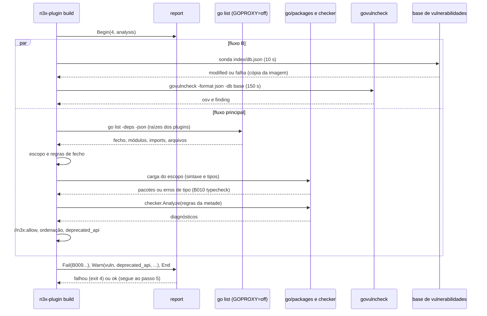
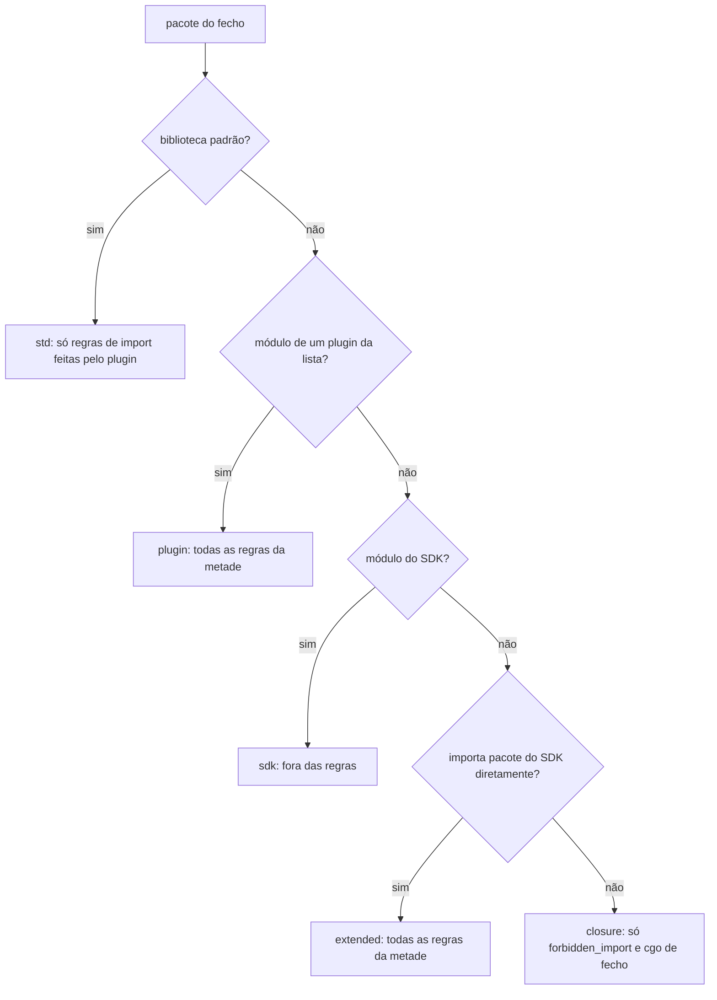
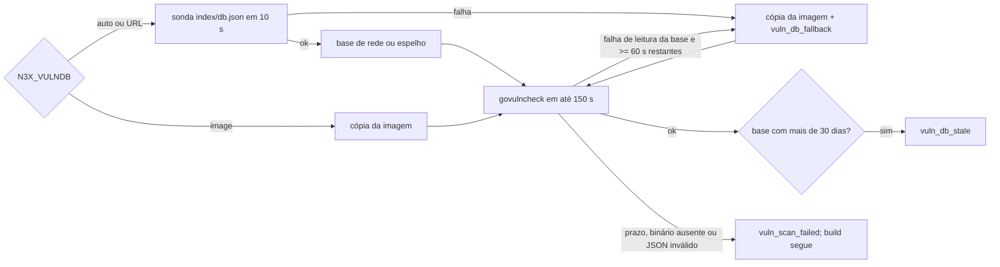

### FDD: Análise estática dos plugins (BLD-06)

Versão: 1.0
Data: 2026-10-20
Responsável: Guilherme Giusti

---

### 1. Contexto e motivação técnica

**Problema técnico.** Todos os plugins rodam no mesmo processo: a metade de proxy dentro do Envoy (`libn3x.so`) e a metade de controller dentro do binário do controller. Go não isola memória entre pacotes, não mata goroutine por fora e não protege o processo de um `os.Exit`. Por isso várias garantias da plataforma dependem de o código do plugin não fazer certas coisas:

- o `recover` do executor (FDDs 17 e 18) não cobre goroutine aberta com `go` cru, erro fatal do runtime, `os.Exit`, `log.Fatal` nem código C
- o isolamento de memória (FDD 04), do token do core (ADR-019) e dos segredos (FDD 03) é por API, não por hardware: `unsafe`, `reflect` sobre tipos do SDK ou escrita em variáveis do SDK contornam o contrato (ADR-005, trade-off)
- o risco mais crítico do sidecar é o plugin que ignora o `ctx` e deixa goroutines vivas depois do prazo (HLD do `n3x-sidecar`, riscos); a primeira barreira é recusar no build o código bloqueante sem contexto (ADR-006 do `n3x-sidecar`)
- os passos 5 (programa auxiliar do schema, FDD 02) e 7 (teste de carga, FDD 23) executam a inicialização dos pacotes do plugin no ambiente do build; o builder não recebe credenciais (decisão aprovada na clarificação da FDD 20), mas o estágio contém ZIPs e fontes privadas copiados pelo operador

O HLD do `n3x-sdk` define as regras numa tabela de oito linhas, e o HLD do `n3x-builder` diz que elas são aplicadas com `go/analysis`. Nenhum documento define: o algoritmo de cada regra, quais pacotes são analisados, o formato da violação dentro do `N3X-B009`, como o `govulncheck` obtém a base de vulnerabilidades e o que acontece quando ela não responde (L-62), como tratar código gerado pelo `protoc-gen-go` (que usa `unsafe` e `init()`), se existe exceção para falso positivo e como uma regra nova chega aos operadores. Cinco FDDs anteriores (03, 04, 05, 06 e 20) deixaram pedidos de regra para esta.

**Encaixe no HLD.** Esta FDD especifica o componente "Analisador estático" do `n3x-builder` (HLD, "Componentes e responsabilidades"), que é o passo 4 do `n3x-plugin build` (`[4/9] análise estática`). Pacotes:

- `internal/analysis`: orquestra a etapa (fecho de pacotes, escopo, carga, regras, exceções, `govulncheck`) e devolve problemas e avisos ao relator da FDD 20
- `internal/analysis/rules`: um analisador `go/analysis` por regra, com nome estável
- `internal/analysis/vuln`: escolha da base, execução do `govulncheck` e leitura do JSON
- `internal/analysis/deprecated`: índice das APIs do SDK marcadas `// Deprecated:`
- `internal/analysis/allow`: leitura do comentário de exceção `//n3x:allow`
- `testdata/analysis/` e `testdata/corpus/`: casos por regra e corpus de plugins "maliciosos" e legítimos

Quem consome:

- FDD 20 (BLD-02): o relator recebe `N3X-B009`, os avisos `vuln` e `deprecated_api` e os avisos novos desta FDD; o catálogo de `docs/erros.md` lista as regras
- FDDs 21 (BLD-03) e 23 (BLD-05): os passos 5 e 7 executam a inicialização dos pacotes do plugin e dependem da recusa feita aqui
- FDD 22 (BLD-04): grava os avisos no campo `warnings` do manifesto
- FDD 46 (BLD-07): põe o `govulncheck` e a cópia da base de vulnerabilidades na imagem e mede a duração da etapa
- FDD 47 (SDK-15): guia do autor com o catálogo de regras e a exceção por linha
- FDD 18 (SID-04): defesas de runtime que completam as regras de `ctx` (zumbis e disjuntor)

**Atores.** Autor de plugin (recebe a lista de violações com arquivo e linha), operador e a CI dele (veem falha com exit 4 ou avisos), mantenedor do `n3x-builder` (mantém regras, tabelas de símbolos e corpus), FDD 22 (grava os avisos no manifesto) e o painel do controller (mostra os avisos do manifesto, FR-006).

**Limites.**
- A análise só lê código: nunca compila nem executa código de plugin. Ela roda antes do passo 5, que é o primeiro a executar inicialização de pacote do plugin
- Não baixa módulo: usa o módulo de build `/n3x/build` e o cache de módulos preenchidos no passo 2 (FDD 20), com `GOPROXY=off`. A única rede da etapa é a base de vulnerabilidades
- **Não é sandbox** (hipótese de modelo de ameaça): o isolamento entre plugins é por API (ADR-005). A análise barra erros de boa-fé e obriga qualquer contorno a ser explícito e visível em revisão de código. Código de dependências de terceiros não passa pelas regras de código, e um plugin malicioso continua podendo ler arquivos do container. A decisão de confiar num plugin continua sendo do operador, que escolhe a lista no Dockerfile

**Suposições**
- As FDDs 19 e 20 estão implementadas: workspace, imagem, alvo, módulo de build `/n3x/build`, `resolve.Result` com a lista de build, `check.Result` com os plugins checados e o relator `internal/report`
- O SDK `v0.1.0` traz os nomes que as regras reconhecem: `proxy.Stream.Go`, `proxy.StreamActions.Go`, `proxy.Env.Background`, `proxy.Env.Dial`, `proxy.Env.HTTPClient`, `proxy.Sleep`, `proxy.Fail`, `proxy.FailResult`, respostas prontas de negação (FDDs 05 e 06), `plugin.Secret.Reveal` (FDD 03), `memory.NewRuntime` (FDD 04) e `telemetry.NewRegistry`, `NewLogHandler` e `PluginLogger` (FDD 06)
- A imagem de build traz o binário `govulncheck` e uma cópia da base de vulnerabilidades do Go no formato v1 (pedido à FDD 46)
- Os pacotes do plugin compilam: erro de tipo é detectado aqui e informado como erro de compilação (seção 6)

**Restrições**
- As regras são definidas no HLD do `n3x-sdk` e implementadas com `go/analysis` (decisão do ASSUNTO); esta FDD detalha o algoritmo de cada linha da tabela do HLD e acrescenta as regras pedidas pelas FDDs 03 a 06 e 20
- `govulncheck` roda em todo build e só avisa (ADR-008 do `n3x-builder`)
- API `// Deprecated:` gera só aviso (ADR-021 do `n3x-sdk`)
- `N3X-B009` lista todas as violações da etapa com regra, arquivo e linha; exit code 4 (ADR-006 do `n3x-builder`)
- Toda saída passa pelo relator e pelo mascarador da FDD 20; a etapa usa o ambiente `ModeOffline` da FDD 20 (contrato 10)
- O builder não importa `secret/`: a regra só compara caminhos de import (FDD 03, I-01)
- Documentação e mensagens em pt-BR; nomes de regra, campos e comandos em inglês

**Rastreabilidade**
- PRD 1.5: FR-012 (`go` cru, `os.Exit`, `log.Fatal`, `init()` com efeito colateral; `unsafe` ou `reflect` sobre tipos do SDK; SDK do Envoy ou cgo; pacote `secret` ou `context.Background()`); FR-013 (pacotes internos do controller); FR-015 (análise estática e `govulncheck` só aviso; "plugin reprovado na análise estática: o build falha e lista as regras violadas"; "vulnerabilidade encontrada pelo `govulncheck`: o build passa, mostra o aviso e grava no manifesto"); requisitos de segurança ("análise estática e `govulncheck` em todo build"); "Testes de build" (corpus de plugins "maliciosos") e "Testes de segurança" (`govulncheck` e `gosec`); critério de aceite "o `n3x-plugin build` falha, com o código do cenário, [...] análise estática reprovada"
- HLD do `n3x-sdk`: "Segurança", tabela "Análise estática"; "Padrões adotados" (registro por função gerada); HLD do `n3x-sidecar`: risco "Plugin ignora o `ctx`" e risco "Erro fatal do Go ou crash em C"; HLD do `n3x-builder`: "Componentes" (Analisador estático), "Estrutura do repositório" (`testdata/`), "Segurança" e risco "Análise estática deixa passar um contorno do isolamento"; HLD do `n3x-controller`: risco "Plugin acessa o que não deve"
- ADRs do `n3x-builder`: ADR-006 (códigos e exit codes) e ADR-008 (`govulncheck` só avisa); ADRs do `n3x-sdk`: ADR-005 (isolamento de memória), ADR-011 (regras de dependência), ADR-014 (`secret/` proibido), ADR-016 (sem `go` cru; controller só em segundo plano), ADR-020 (`.Reveal()` em log) e ADR-021 (depreciação); ADR-006 do `n3x-sidecar` (prazo obrigatório)
- FDDs anteriores: 02 (passo 5 executa o programa auxiliar depois da análise), 03 (pedido: `secret/` e `secret/secrettest`; `.Reveal()` em `fmt.Errorf` e `errors.New`), 04 (pedido: `unsafe` só em código de plugin; `memory.NewRuntime`), 05 (pedido: atribuição a variáveis exportadas do SDK), 06 (pedido: `ctx` em campo de struct e em variável de pacote; uso de `telemetry.NewRegistry` e `NewLogHandler` por plugin), 20 (relator, módulo de build, `ModeOffline`, pedido de recusar inicializadores com efeito colateral e de avaliar duas linhas `RUN`), 26 (destinos reservados barrados também pela análise)
- Lacunas do README:
  - **L-62 fechada:** a base de vulnerabilidades vem da rede (`https://vuln.go.dev`, ou espelho do operador por `ARG N3X_VULNDB`) depois de uma sonda de 10 s; se a sonda ou a leitura falhar, o build usa a cópia da imagem (`/usr/share/n3x/vulndb`) e emite o aviso `vuln_db_fallback` com a data da cópia; base com mais de 30 dias gera `vuln_db_stale`; falha do `govulncheck` gera `vuln_scan_failed`. O build nunca falha por causa da base, e nunca fica em silêncio: o passo 4 e o resumo sempre dizem qual base foi usada e de quando (hipótese; contrato 7)
  - **L-23 aplicada** (decidida na FDD 06): sem regra de build para bibliotecas de connector na v1
  - **L-14 aplicada** (FDD 06): a correção sugerida para `time.Sleep` é `proxy.Sleep(ctx, d)`

---

### 2. Objetivos técnicos

- **Toda regra provada nos dois sentidos.** Medida: cada uma das 18 regras do `N3X-B009` tem pelo menos um caso que dispara e um que não dispara em `testdata/analysis/src/<regra>` (convenção `analysistest`), e pelo menos um plugin completo no corpus `testdata/corpus/malicious/`. A CI falha se uma regra registrada não tiver os três.
- **Sem falso positivo no código legítimo.** Medida: o corpus `testdata/corpus/legit/` (plugin core na versão da imagem, `n3x.example`, stubs reais do `protoc-gen-go` e do `protoc-gen-go-grpc`, connectors com go-redis, pgx e `env.HTTPClient`) termina com 0 violações e 0 exceções `//n3x:allow`.
- **Todas as violações numa execução, com arquivo e linha.** Invariante: a etapa roda todas as regras sobre todos os pacotes do escopo antes de terminar; cada violação sai com regra, plugin, arquivo relativo ao módulo, linha e coluna. Medida: um plugin com três violações em três arquivos recebe as três numa execução, exit 4.
- **Veredito determinístico.** Invariante: o mesmo workspace na mesma imagem dá os mesmos problemas, na mesma ordem. Os avisos de vulnerabilidade só mudam se a base mudar. Medida: 20 execuções seguidas com a base de teste em arquivo dão stderr idêntico (texto e JSON), com `ts` e durações normalizados.
- **A análise nunca executa código do plugin.** Invariante: o passo 4 só lê fontes, tipos e metadados do `go list`; nenhum `init()` de plugin roda antes do passo 5. Conferido por um caso do corpus cujo `init()` grava um arquivo-sentinela: depois da etapa 4 com falha, o arquivo não existe.
- **`govulncheck` sempre visível e nunca bloqueante.** Invariante: vulnerabilidade, base indisponível, base velha ou falha do `govulncheck` só geram aviso, e o build segue (ADR-008); a linha do passo 4 e o evento `step` sempre dizem a origem e a data da base.
- **Sem rede de módulos.** Invariante: o passo 4 roda o `go` com `GOPROXY=off` e `-mod=readonly` (`ModeOffline` da FDD 20); só a sonda e o `govulncheck` acessam a rede, e só a base de vulnerabilidades.
- **Dentro do orçamento do build.** Medida (hipótese, meta final da FDD 46): passo 4 em até 20 s no p95 de 10 execuções com 5 plugins mais o core, cache aquecido e base em rede, num runner amd64 da CI; carga e regras sozinhas em até 10 s no p95.

---

### 3. Escopo e exclusões

**Incluído**
- Passo 4 do `n3x-plugin build`: fecho de pacotes no contexto de compilação, classificação do escopo, carga com tipos, execução das regras, exceções por linha, conversão em problemas e avisos, linha da etapa e campos do evento `step`
- Catálogo das 18 regras do `N3X-B009`, com nome estável, metades em que valem, escopo, símbolos reconhecidos, motivo, exemplo e correção
- Algoritmos das regras heurísticas de `ctx` (`loop_no_ctx` e `chan_no_ctx`) e o que é aceito como falso positivo
- Tratamento de arquivos gerados pelo `protoc-gen-go` (exceção estreita na regra `unsafe`; `init()` de registro de descritores aceito pela regra `init_side_effect`)
- Exceção por linha `//n3x:allow`, só para as regras heurísticas, com motivo obrigatório e aviso
- Aviso `deprecated_api` para uso de API do SDK marcada `// Deprecated:`
- `govulncheck` em todo build: base (L-62), modo, alcance, prazos, leitura do JSON, atribuição ao plugin e avisos `vuln`, `vuln_db_fallback`, `vuln_db_stale` e `vuln_scan_failed`
- `ARG N3X_VULNDB` para escolher a base (rede, espelho ou só a cópia da imagem)
- Erro de tipo encontrado na carga, informado como `N3X-B010` com a regra `typecheck` (pedido à FDD 21)
- Proposta do formato das entradas `vuln`, `deprecated_api`, `analysis_exception` e `vuln_scan` no campo `warnings` (decisão final da FDD 22)
- Corpus `testdata/` (casos por regra, plugins "maliciosos", plugins legítimos, contornos conhecidos e base de vulnerabilidades de teste) e a regra de crescimento a cada contorno descoberto
- Política de evolução das regras entre versões do builder
- `gosec` e `govulncheck` sobre o próprio código do `n3x-builder` na CI dele

**Excluído**
- Proibições que dependem de runtime (prazo do `Go()`, `max_inflight`, detecção de zumbis e disjuntor): FDD 18 (SID-04)
- Bloqueio de `env.Controller()` durante a requisição (`ErrRequestPath`), que é erro em runtime: FDD 06 (SDK-06)
- Checagem de namespace `n3x`, de IDs e de namespaces de métrica reservados: FDD 20 (BLD-02)
- Gravação de `warnings` no manifesto e o formato final das entradas: FDD 22 (BLD-04)
- Lista de bibliotecas aprovadas para connectors: FDD 06 (L-23, sem regra de build na v1)
- Arquivos da imagem (binário `govulncheck`, cópia da base, versões fixadas) e meta de duração do build inteiro: FDD 46 (BLD-07)
- Regras de código sobre dependências de terceiros: fora da v1; só as regras de import e de código nativo valem para o fecho inteiro (seção 5, contrato 3)
- Proibição de acesso a arquivos do container pelo plugin (ex.: ler o arquivo da chave AES): fora da v1; registrada como risco residual e pedido ao guia (FDD 47)
- Divisão do `build` em duas linhas `RUN` (secret só na resolução): obsoleta, porque não há secret no builder (decisão aprovada na clarificação da FDD 20)
- Um subcomando para o autor rodar a análise fora do build: fora da v1; o autor roda o `docker build` de teste na CI do plugin (guia, FDD 47)

---

### 4. Fluxos detalhados e diagramas

**Fluxo principal: passo 4 do `RUN n3x-plugin build`** (`[4/9] análise estática`)

Entradas, todas da FDD 20: plugins checados no passo 3 (`check.Result.Plugins`, em ordem de ID, com o core e o campo `Compiled`), lista de build e grafo (`resolve.Result`), contexto de compilação (`resolve.Request.Compile`), raízes de compilação (`resolve.Roots(req)["compile"]`) e ambiente `resolve.NewEnv(environ, ModeOffline)`. O valor de `N3X_VULNDB` já foi lido e validado antes do passo 1, junto com `--log-format` (erro de uso, exit 1, se inválido).

1. `rep.Begin(4, report.StepAnalysis, "análise estática")`.
2. **Tarefa paralela do `govulncheck`** (fluxo B) começa agora e corre junto com os itens 3 a 9.
3. **Fecho.** Em `/n3x/build`, um `go list -e -deps -json=<campos>` com as raízes da metade compilada de cada plugin (`<módulo>/agent/...` na `sidecar-builder`, `<módulo>/controller/...` na `controller-builder`), no contexto de compilação (`GOOS`, `GOARCH`, `CGO_ENABLED` e a tag do alvo), com `GOFLAGS=-mod=readonly` e `GOPROXY=off`. Campos: `ImportPath`, `Module`, `Standard`, `Imports`, `GoFiles`, `CgoFiles`, `CFiles`, `CXXFiles`, `MFiles`, `FFiles`, `SFiles`, `SwigFiles`, `SwigCXXFiles`, `SysoFiles`, `Error`, `DepsErrors`. Plugin sem a metade deste artefato (`Compiled: false`) não entra: o código dele não é compilado aqui.
4. **Escopo** (contrato 3). Cada pacote do fecho recebe uma classe: `plugin` (módulo de um plugin da lista, inclusive o core), `extended` (pacote de outro módulo, fora da biblioteca padrão e do SDK, que importa diretamente um pacote do SDK) (decisão aprovada na clarificação), `sdk`, `std` ou `closure` (demais dependências). Para cada pacote, guarda a lista de plugins em cujo fecho ele está.
5. **Regras de fecho** (sem carregar sintaxe): `forbidden_import` sobre os imports de todo pacote fora do SDK e da biblioteca padrão, e `cgo` sobre os arquivos nativos. A posição é a do `import` no arquivo do pacote que importa (lido com `parser.ImportsOnly`) ou a do primeiro arquivo nativo.
6. **Carga** dos pacotes `plugin` e `extended` com `golang.org/x/tools/go/packages`: sintaxe e `types.Info` desses pacotes; tipos das dependências por dados de exportação compilados no contexto de compilação, com o ambiente de compilador da FDD 21 (inclusive o `CC` do `zig cc` no arm64) e o cache de build do BuildKit (hipótese de modo de carga; contrato 8). Só os `CompiledGoFiles` entram: arquivos `_test.go` e arquivos excluídos por build tag neste contexto não são analisados neste artefato.
7. **Erro de tipo** num pacote do escopo: cada erro vira `N3X-B010` com a regra `typecheck` e a posição; as regras não rodam naquele pacote, mas rodam nos outros (seção 6).
8. **Índice de depreciação**: lê os fontes do SDK no diretório do módulo da lista de build (`go/parser` com comentários, sem `_test.go`) e indexa todo objeto cuja documentação tem um parágrafo que começa com `Deprecated:`.
9. **Regras de código**: roda os analisadores da metade deste artefato (contrato 2) com o driver `golang.org/x/tools/go/analysis/checker` sobre os pacotes do escopo, em paralelo. Nenhum analisador usa fatos entre pacotes, então as dependências não precisam de sintaxe.
10. **Exceções**: lê os comentários `//n3x:allow` dos arquivos do escopo (contrato 5). Exceção válida retira a violação da regra heurística daquela linha e gera o aviso `analysis_exception`. Exceção inválida ou que não cobre nenhuma violação vira `allow_invalid`.
11. **Problemas**: converte cada diagnóstico em `report.Problem` (`Code: B009`, regra, plugin, `Path` = `<arquivo>:<linha>:<coluna>`, detalhe, correção e atributos, contrato 4), remove duplicatas (mesma regra e mesma posição) e emite na ordem: ID do plugin, arquivo, linha, coluna, regra.
12. **Depreciação**: agrega os usos de API depreciada em um aviso `deprecated_api` por par (plugin, símbolo), com contagem e primeira posição.
13. **Vulnerabilidades**: espera o fluxo B e emite os avisos dele.
14. `st.Note("<n> plugins, <p> pacotes; base <origem> de <data>")`, `st.Set(...)` com os campos do contrato 1 e `st.End()`. Com problema, o relator encerra o build (FDD 20): exit 4 se houver `N3X-B009`, exit 5 se só houver `N3X-B010` `typecheck`. Sem problema, `analysis.Result` segue para o passo 8 (avisos para o manifesto, FDD 22).

**Fluxo B: `govulncheck`** (em paralelo, prazo total de 150 s)
1. Escolha da base por `N3X_VULNDB` (contrato 7): `auto` (padrão) sonda `https://vuln.go.dev/index/db.json` com prazo de 10 s; URL de espelho sonda `<url>/index/db.json`; `image` usa a cópia da imagem sem sonda. Sonda com falha (rede, HTTP diferente de 200, JSON inválido): usa a cópia da imagem e emite `vuln_db_fallback`.
2. Roda o processo `govulncheck -mode source -scan symbol -format json -db <base> -C /n3x/build -tags <tag> <raízes de compilação>` com o ambiente `ModeOffline` mais o contexto de compilação. As raízes incluem o runtime (`core/` ou `host/`), porque ele também vai no artefato.
3. Se a execução com base de rede falhar por erro de leitura da base e ainda restarem pelo menos 60 s, repete uma vez com a cópia da imagem e emite `vuln_db_fallback`. Outras falhas não são repetidas.
4. Lê o fluxo JSON (`config`, `osv`, `finding`) e agrega por (ID, módulo): `called` é verdadeiro se existe achado no nível de símbolo; achado só de pacote importado sai com `called: false`; achado só de módulo exigido e não importado não é informado, porque o código não está no artefato (hipótese).
5. Atribui cada achado aos plugins: pelo último quadro do `trace` (ponto de entrada no código analisado) ou, sem `trace` de símbolo, pelos plugins em cujo fecho o pacote vulnerável está. Achado só no runtime ou no SDK fica sem plugin (`plugins: []`, componente "imagem").
6. Base com `modified` mais antiga que 30 dias em relação ao relógio do build: aviso `vuln_db_stale`.
7. Prazo estourado, saída diferente de 0 sem JSON válido, binário ausente ou JSON ilegível: aviso `vuln_scan_failed` com o motivo; nenhum aviso `vuln` é inventado e o build segue.

**Fluxos alternativos e exceções**
- **Plugin com violações:** todas as violações da etapa saem num bloco por plugin (FDD 20, contrato 2), exit 4; os passos 5 a 9 não rodam, então nenhum código do plugin é executado e `/out` não é escrito.
- **Violação em pacote `extended`** (ex.: `github.com/acme/n3x-common`, usado por dois plugins do mesmo autor): o problema é atribuído ao primeiro plugin em ordem de ID em cujo fecho o pacote está, com o atributo `plugins` listando todos; o `path` traz o módulo e a versão (`github.com/acme/n3x-common@v0.2.0/helpers/tick.go:10:2`).
- **Dependência de terceiro que importa pacote proibido** (ex.: um módulo que importa `github.com/giustech/n3x-sdk/secret`): `forbidden_import` com a posição do `import` no arquivo do terceiro e o atributo `chain` do pacote do plugin até o import proibido.
- **Stubs gerados no `proto/`:** arquivos com o cabeçalho exato `// Code generated by protoc-gen-go. DO NOT EDIT.` podem usar as três formas de `unsafe` que o gerador emite (contrato 2, regra `unsafe`); qualquer outro uso de `unsafe` no mesmo arquivo é violação. O `func init()` gerado passa pela `init_side_effect` porque só chama funções do runtime do protobuf (lista de permissão). Arquivo gerado não ganha isenção geral de nenhuma regra.
- **Exceção por linha** num laço legítimo sem `ctx`: o laço passa, o aviso `analysis_exception` aparece no log, no resumo e no manifesto.
- **Erro de tipo** no plugin: `N3X-B010` `typecheck` no passo 4, com arquivo, linha e a mensagem do `go/types`; exit 5 se não houver `N3X-B009` na etapa.
- **Workspace vazio:** só o core é analisado; a nota diz `(0 plugins + core, <p> pacotes)`.
- **Plugin só de controller na `sidecar-builder`** (ou só de proxy na `controller-builder`): não é analisado neste artefato; a nota diz `(1 só no manifesto, não analisado)`. Ele é analisado no build da outra imagem.
- **Base de vulnerabilidades fora do ar ou build sem rede:** `vuln_db_fallback` e, se a cópia da imagem passar de 30 dias, também `vuln_db_stale`. O build segue.
- **`N3X_VULNDB=image`** (ambiente isolado): nenhuma sonda de rede; `vuln_db_stale` vale do mesmo jeito.
- **`govulncheck` lento:** o processo é encerrado em 150 s (`exec.CommandContext` com `WaitDelay` de 5 s); aviso `vuln_scan_failed`; a análise de código não espera por ele além disso.
- **Pacote que não carrega por módulo ausente** (não deveria acontecer depois do passo 2): erro interno, exit 1, regra `internal` (FDD 20: "um módulo que faltar é bug do resolvedor").
- **Panic de um analisador:** recuperado pelo driver e informado como erro interno, exit 1; o build nunca passa com análise parcial.

**Diagramas**

Sequência do passo 4:



Classificação do escopo de cada pacote do fecho:



Escolha da base de vulnerabilidades (L-62):



---

### 5. Contratos públicos (assinaturas, endpoints, headers, exemplos)

**Contrato 1: passo 4 do `n3x-plugin build` e `ARG N3X_VULNDB`**
- Tipo: sdk (CLI externa; etapa do comando da FDD 20)
- Assinatura/Rota:
  ```text
  n3x-plugin build [--log-format text|json]       (contrato 1 da FDD 20; sem flag nova)
  N3X_VULNDB = auto | image | https://<espelho>    (ARG ou ENV; vazio = auto)
  ```
- Método: n/a
- Semântica de status/headers:
  - `N3X_VULNDB` é lido antes do passo 1, como `N3X_LOG_FORMAT`. Valor fora de `auto`, `image` ou URL `https://` com host: erro de uso, exit 1, regra `usage`, link `#erros-de-uso` (hipótese)
  - A etapa usa o nome `analysis` no evento (`report.StepAnalysis`) e o título `análise estática`
  - Status da etapa: `ok` (sem problema, com ou sem aviso) ou `failed`. A etapa nunca é `skipped`: as duas imagens analisam
  - Exit codes que a etapa pode causar: 4 (`N3X-B009`), 5 (só `N3X-B010` `typecheck`) e 1 (erro interno). Avisos nunca mudam o exit code
  - Campos próprios do evento `step` (FDD 20, contrato 3, por adição):

| Campo | Tipo | Significado |
| --- | --- | --- |
| `plugins` | inteiro | plugins com a metade deste artefato analisados (com o core) |
| `manifest_only` | inteiro | plugins sem a metade, não analisados aqui |
| `packages` | inteiro | pacotes das classes `plugin` e `extended` analisados |
| `closure_packages` | inteiro | pacotes do fecho verificados pelas regras de fecho |
| `rules` | inteiro | regras ativas nesta metade |
| `exceptions` | inteiro | exceções `//n3x:allow` aceitas |
| `analysis_ms` | inteiro | duração de carga e regras |
| `vuln_status` | texto | `ok`, `fallback` ou `failed` |
| `vuln_source` | texto | `network`, `mirror` ou `image` |
| `vuln_db_modified` | texto | `modified` da base em RFC 3339, ou vazio |
| `vuln_findings` | inteiro | avisos `vuln` emitidos |
| `govulncheck_ms` | inteiro | duração do fluxo B |
| `govulncheck_version` | texto | versão do binário |

**Exemplo de requisição**
```dockerfile
FROM ghcr.io/giustech/n3x/sidecar-builder:1.0.0-envoy-1.40 AS build
ARG N3X_VULNDB=https://vulndb.acme.interno
RUN n3x-plugin add github.com/acme/n3x-plugin-tenant@v0.4.2
RUN --mount=type=cache,target=/go/pkg/mod \
    --mount=type=cache,target=/root/.cache/go-build \
    n3x-plugin build --log-format json
```

**Exemplo de resposta** (evento `step` do passo 4, uma linha)
```json
{"ts":"2026-10-20T14:00:16.380Z","level":"info","msg":"step","cmd":"build","step":"analysis","code":"","step_index":4,"step_total":9,"status":"ok","duration_ms":7412,"codes":[],"problems":0,"warnings":1,"plugins":2,"manifest_only":0,"packages":23,"closure_packages":187,"rules":18,"exceptions":0,"analysis_ms":5120,"vuln_status":"ok","vuln_source":"mirror","vuln_db_modified":"2026-10-20T03:11:42Z","vuln_findings":1,"govulncheck_ms":7398,"govulncheck_version":"v1.1.4"}
```

---

**Contrato 2: catálogo de regras do `N3X-B009`**
- Tipo: catálogo (fonte em `internal/analysis/rules`; documentação gerada na seção `## N3X-B009` de `docs/erros.md`, com uma subseção `### Regra <nome>` por regra)
- Assinatura/Rota: nome da regra em snake_case, igual ao `Analyzer.Name` e ao campo `rule` do evento
- Método: n/a
- Semântica de status/headers: nome estável na major do builder, nunca reaproveitado (contrato 10). "Metades" diz em qual imagem a regra roda; "Escopo" diz sobre quais classes de pacote (contrato 3). Linha da tabela do HLD do `n3x-sdk` entre parênteses no motivo.

| # | Regra | Metades | Escopo | O que recusa | Motivo | Correção |
| --- | --- | --- | --- | --- | --- | --- |
| 1 | `raw_go` | proxy e controller (hipótese) | plugin, extended | instrução `go` | Goroutine sem `recover` derruba o processo (HLD, linha 1; ADR-016) | `s.Go(fn)` na requisição ou `env.Background(nome, fn)` no `New`; na metade de controller, a API de tarefa de fundo da FDD 08 |
| 2 | `process_exit` | proxy e controller | plugin, extended | encerrar o processo ou a goroutine do worker (tabela A) | Derruba o Envoy ou o controller (HLD, linha 1) | devolva erro: `proxy.Fail(err)`, erro do `New` ou do handler |
| 3 | `process_global` | proxy e controller | plugin, extended | mexer em estado global do processo (tabela B) (hipótese) | Sinais, runtime Go, ambiente e logger padrão são do Envoy, do runtime e dos outros plugins (`GOMEMLIMIT` da FDD 27, drenagem da FDD 29) | remova; o runtime do N3X já configura o processo |
| 4 | `init_side_effect` | proxy e controller | plugin, extended | inicializador de pacote com efeito colateral (algoritmo C) | Roda no `dlopen` do Envoy, sem `recover`, e nos passos 5 e 7 no ambiente do build, com ZIPs e fontes privadas acessíveis (HLD, linha 1; FDD 20) | mova o trabalho para o `New` |
| 5 | `unsafe` | proxy e controller | plugin, extended | import de `unsafe`, conversão de ou para tipo com tipo subjacente `unsafe.Pointer`, diretiva `//go:linkname` (algoritmo D) | Fura o isolamento de memória, do token e dos segredos (HLD, linha 2; ADR-005; FDD 04) | use só a API do SDK |
| 6 | `reflect_sdk` | proxy e controller | plugin, extended | reflexão sobre valor cujo tipo estático alcança tipo do SDK, interface ou parâmetro de tipo (algoritmo E) | `reflect` lê campo não exportado, inclusive o valor de `plugin.Secret` (HLD, linha 2) | use a API pública do tipo; reflexão só sobre tipos próprios concretos |
| 7 | `cgo` | proxy e controller | plugin (todo arquivo nativo); closure e extended (código C) | `import "C"` e arquivos `.c`, `.cc`, `.cpp`, `.cxx`, `.m`, `.f`, `.F`, `.for`, `.f90`, `.s`, `.S`, `.sx`, `.swig`, `.swigcxx`, `.syso`; no fecho fora da biblioteca padrão, pacote com cgo, C, C++, Objective-C, Fortran, SWIG ou `.syso` (assembly Go de terceiros é aceito) | Crash em C derruba o Envoy; assembly no plugin contorna o sistema de tipos (HLD, linha 3) | remova o código nativo ou troque a dependência por uma em Go puro |
| 8 | `forbidden_import` | proxy e controller | fecho fora do SDK (lista F1); plugin e extended (lista F2) | imports da tabela F | Chave, internals do runtime e SDK do Envoy fora do alcance do plugin (HLD, linhas 3 e 4; ADR-011; ADR-014; FR-013) | remova o import; o plugin recebe tudo pelo `Env` e pela config tipada |
| 9 | `ctx_root` | proxy e controller | plugin, extended | `context.Background`, `context.TODO`, `context.WithoutCancel` | Operação sem prazo (HLD, linha 5; ADR-006 do `n3x-sidecar`) | use o `ctx` recebido de `s.Go`, `env.Background` ou do handler |
| 10 | `blocking_call` | proxy e controller | plugin, extended | chamada bloqueante sem `ctx` (tabela G) | Chamada sem prazo segura goroutine e memória (HLD, linha 6) | a variante com `ctx` da tabela G |
| 11 | `raw_network` | proxy (hipótese) | plugin, extended | conexão ou servidor fora de `env.Dial` e `env.HTTPClient` (tabela H) | Fura o limite de conexões, o prazo de transporte e os destinos reservados do sidecar (HLD, linha 6; ADR-016; FDDs 06 e 26) | `env.Dial(ctx, rede, endereço)` ou o cliente de `env.HTTPClient()` |
| 12 | `chan_no_ctx` | proxy | plugin, extended, dentro de função de `s.Go` ou `env.Background` (hipótese) | operação de canal que pode bloquear sem `select` com `ctx.Done()` (algoritmo I) | Goroutine presa depois do prazo (HLD do `n3x-sidecar`, risco do `ctx`) | `select` com `case <-ctx.Done():`; para esperar, `proxy.Sleep(ctx, d)` |
| 13 | `loop_no_ctx` | proxy | idem | laço sem condição ou só com condição, sem checagem do `ctx` (algoritmo J) | Laço que ignora o prazo vira zumbi (HLD do `n3x-sidecar`) | cheque `ctx.Err()` ou passe o `ctx` a uma chamada dentro do laço |
| 14 | `reveal_in_log` | proxy e controller | plugin, extended | resultado de `plugin.Secret.Reveal()` chegando a log, erro, panic ou resposta de negação (algoritmo K) | Vazamento de segredo (HLD, linha 7; ADR-020; FDD 03) | não registre o valor; use o `Secret` direto, que sai como `***` |
| 15 | `foreign_var_write` | proxy e controller | plugin, extended | escrita em variável de pacote de outro módulo: SDK, biblioteca padrão ou terceiros (algoritmo L) | Variáveis do SDK (ex.: `proxy.Continue` e sentinelas) e globais do processo (ex.: `http.DefaultTransport`, `crypto/rand.Reader`) são compartilhadas (FDD 05) | crie o seu próprio valor; nunca altere global de outro pacote |
| 16 | `ctx_field` | proxy e controller | plugin, extended | campo de struct ou variável de pacote cujo tipo contém `context.Context` | `ctx` de tarefa de fundo guardado e usado no hook passaria a marca de segundo plano (FDD 06) | passe o `ctx` como parâmetro |
| 17 | `runtime_api` | proxy e controller | plugin, extended | API exportada só para o runtime (tabela M) | Cria registros paralelos de memória, métricas ou logs fora da cota e dos rótulos (FDDs 04 e 06) | use `env.Memory()`, `env.Metrics()` e `env.Log()` |
| 18 | `allow_invalid` | proxy e controller | plugin, extended | `//n3x:allow` inválido, para regra não heurística, sem motivo ou que não cobre nenhuma violação (contrato 5) | Exceção só para falso positivo de regra heurística, sempre visível | corrija o comentário ou o código |

Tabela A, `process_exit`: `os.Exit`; `syscall.Exit`; `golang.org/x/sys/unix.Exit`; `log.Fatal`, `log.Fatalf`, `log.Fatalln`; métodos `Fatal`, `Fatalf`, `Fatalln` de `*log.Logger`; `runtime.Goexit`; `syscall.Kill`; `unix.Kill`; `unix.Tgkill`; métodos `Kill` e `Signal` de `*os.Process`.

Tabela B, `process_global` (hipótese): import de `os/signal`; `runtime.GOMAXPROCS`, `runtime.LockOSThread`, `runtime.UnlockOSThread`; `runtime/debug.SetGCPercent`, `SetMemoryLimit`, `SetMaxStack`, `SetMaxThreads`, `SetPanicOnFault`, `SetTraceback`; `os.Setenv`, `os.Unsetenv`, `os.Clearenv`, `os.Chdir`; `syscall.Setenv`, `syscall.Unsetenv`, `syscall.Clearenv`; `log.SetOutput`, `log.SetFlags`, `log.SetPrefix`; `log/slog.SetDefault`, `slog.SetLogLoggerLevel`; `syscall.Syscall`, `Syscall6`, `RawSyscall`, `RawSyscall6` e as mesmas de `golang.org/x/sys/unix`.

Algoritmo C, `init_side_effect` (hipótese; atende o FR-012 e o pedido da FDD 20):
- "Código de inicialização" é: corpo de toda `func init()`, expressão de inicialização de toda variável de pacote, e, de forma transitiva, o corpo de função ou método do mesmo pacote chamado por eles (com proteção contra ciclo), inclusive literal de função passado como argumento. Literal de função só atribuído (não chamado) não é código de inicialização
- Dentro do código de inicialização é permitido: constantes, literais compostos, conversões, aritmética, índices, seletores, laços, atribuição a variáveis do próprio pacote, `defer`, builtins `len`, `cap`, `make`, `new`, `append`, `copy`, `clear`, `delete`, `min`, `max`, `complex`, `real`, `imag`, e chamadas da lista de permissão abaixo
- É violação: instrução `go`, envio ou recebimento em canal, `select`, builtins `panic`, `print` e `println`, chamada de função ou método fora do pacote que não está na lista, chamada por valor de função (variável) ou por método de interface (alvo desconhecido), e argumento de `fmt` cujo tipo tem `String`, `Error`, `Format` ou `GoString` declarado fora do pacote e fora da lista (os do próprio pacote são analisados como chamada)
- Lista de permissão, versionada com a imagem em `internal/analysis/rules/initpolicy.go` (cresce por patch quando aparece falso positivo):

| Pacote | Permitido |
| --- | --- |
| `errors` | `New`, `Join` |
| `fmt` | `Errorf`, `Sprint`, `Sprintf`, `Sprintln`, `Append`, `Appendf`, `Appendln` |
| `strings`, `bytes`, `strconv`, `unicode`, `unicode/utf8`, `unicode/utf16`, `math`, `math/bits`, `cmp`, `slices`, `maps`, `sort`, `encoding/hex`, `encoding/base64`, `net/netip` | todas as funções de pacote e métodos dos tipos do pacote |
| `regexp` | `Compile`, `CompilePOSIX`, `MustCompile`, `MustCompilePOSIX`, `QuoteMeta` e métodos de `*Regexp` |
| `time` | `Date`, `Unix`, `UnixMilli`, `UnixMicro`, `Parse`, `ParseDuration`, `FixedZone`, `Now`, métodos de `Time` e `Duration` |
| `net` | `ParseIP`, `ParseCIDR`, `IPv4`, `IPv4Mask`, `CIDRMask` |
| `net/url` | `Parse`, `ParseRequestURI`, `PathEscape`, `QueryEscape` |
| `sync` | `OnceFunc`, `OnceValue`, `OnceValues` (só criam a função) |
| `reflect` | `TypeOf` e métodos de `reflect.Type` (o argumento ainda passa pela `reflect_sdk`) |
| `unsafe` | `Slice` e `StringData` (o uso ainda passa pela regra `unsafe`) |
| `google.golang.org/protobuf/runtime/protoimpl`, `google.golang.org/protobuf/reflect/protoreflect` | todas as funções e métodos (registro de descritores do código gerado) |
| `google.golang.org/grpc/codes`, `google.golang.org/grpc/status` | todas as funções de pacote |
| SDK: `plugin`, `proxy`, `controller`, `controller/ui` | todas as funções e métodos exportados, exceto `proxy.Sleep` e a tabela M (pedido às FDDs 08, 10 e 11: manter essas funções sem I/O, sem goroutine e sem panic para entrada constante válida) |

Algoritmo D, `unsafe`:
- Violação: qualquer import de `unsafe` (com nome, `_` ou `.`); qualquer conversão em que o operando ou o tipo de destino tenha tipo subjacente `unsafe.Pointer` (pega tipos definidos como `protoimpl.Pointer`, que permitem converter ponteiro sem importar `unsafe`); qualquer comentário `//go:linkname`
- Exceção estreita (hipótese), só em arquivo cuja primeira linha de comentário é exatamente `// Code generated by protoc-gen-go. DO NOT EDIT.`:
  1. o import de `unsafe`
  2. `unsafe.Slice(unsafe.StringData(X), len(X))` em que `X` é identificador de pacote declarado no mesmo arquivo e casa com `^file_[A-Za-z0-9_]+_rawDesc$`
  3. `protoimpl.Pointer(x)` como argumento direto de `protoimpl.X.MessageStateOf`, em que `x` é o receptor de um método de tipo declarado no mesmo arquivo
- Os padrões reconhecidos são conferidos por golden com arquivos reais do `protoc-gen-go` (versões no corpus legítimo, pedido à FDD 46)

Algoritmo E, `reflect_sdk` (hipótese; responde ao ponto em aberto "reflect em geral ou só sobre tipos do SDK"):
- Pontos de entrada, os únicos que criam reflexão a partir de um valor sem `unsafe`: `reflect.ValueOf(x)`, `reflect.TypeOf(x)`, `reflect.TypeFor[T]()`, `reflect.DeepEqual(x, y)` e `reflect.Swapper(x)`
- O tipo estático de cada argumento (ou o `T`) é "suspeito" se alcança, por campos de struct (exportados ou não), elementos de ponteiro, array, slice, map e canal, e pelo tipo subjacente de tipos nomeados: um tipo nomeado declarado em pacote do SDK, um tipo interface (inclusive `any` e `error`) ou um parâmetro de tipo. Tipo de função não é percorrido
- Argumento suspeito: violação. Tipo concreto próprio sem nada disso (ex.: `[]string`, struct de `types/` sem `plugin.Secret`): permitido
- Falso positivo aceito: `reflect.TypeOf(err)` e reflexão sobre `any` em código genérico do plugin

Tabela F, `forbidden_import`:

| Lista | Caminho de import (com subpacotes) | Onde vale |
| --- | --- | --- |
| F1 | `github.com/giustech/n3x-sdk/secret` (inclui `secret/secrettest`) | todo pacote do fecho fora do SDK |
| F1 | `github.com/envoyproxy/envoy` | todo pacote do fecho fora do SDK |
| F1 | `github.com/giustech/n3x-sidecar` | todo pacote do fecho fora do SDK |
| F1 | `github.com/giustech/n3x-controller` | todo pacote do fecho fora do SDK |
| F2 | `github.com/giustech/n3x-sdk/sdktest` (kit de testes fora de `_test.go`) (hipótese) | plugin e extended |
| F2 | `runtime/cgo`, `plugin` (biblioteca padrão) (hipótese) | plugin e extended |

O import de `unsafe` é da regra 5, o de `C` é da regra 7 e o de `os/signal` é da regra 3.

Tabela G, `blocking_call` (hipótese; responde ao ponto em aberto "lista exata"):

| Símbolo | Correção |
| --- | --- |
| `time.Sleep` | `proxy.Sleep(ctx, d)` |
| `net/http.Get`, `Head`, `Post`, `PostForm` e os métodos de mesmo nome de `*http.Client` | `http.NewRequestWithContext` e `Do` do cliente de `env.HTTPClient()` |
| `net/http.NewRequest` | `http.NewRequestWithContext` |
| `database/sql`: `Query`, `QueryRow`, `Exec`, `Prepare`, `Begin`, `Ping` de `*sql.DB`; `Query`, `QueryRow`, `Exec`, `Prepare`, `Stmt` de `*sql.Tx`; `Query`, `QueryRow`, `Exec` de `*sql.Stmt` | a variante `...Context` |
| `os/exec.Command` | `exec.CommandContext` |
| `net.LookupAddr`, `LookupCNAME`, `LookupHost`, `LookupIP`, `LookupMX`, `LookupNS`, `LookupPort`, `LookupSRV`, `LookupTXT` | métodos de `net.DefaultResolver` com `ctx` |
| método `Handshake` de `*tls.Conn` | `HandshakeContext` |

APIs de bibliotecas de terceiros sem `ctx` não são conhecidas pela regra (limite documentado; as bibliotecas recomendadas pela FDD 06 recebem `ctx` em toda chamada).

Tabela H, `raw_network` (hipótese; só metade de proxy, porque a metade de controller ainda não tem `Dial`, FDD 08):
- `net`: `Dial`, `DialTimeout`, `DialTCP`, `DialUDP`, `DialIP`, `DialUnix`, `Listen`, `ListenPacket`, `ListenTCP`, `ListenUDP`, `ListenIP`, `ListenUnix`, `ListenUnixgram`, `ListenMulticastUDP`, `FileConn`, `FileListener`, `FilePacketConn`, e todo método de `*net.Dialer` e de `*net.ListenConfig`
- `crypto/tls`: `Dial`, `DialWithDialer`, `Listen` e os métodos `Dial` e `DialContext` de `*tls.Dialer`
- `net/http`: referência a `http.DefaultClient` ou `http.DefaultTransport`; literal composto ou `new` de `http.Transport`; literal composto de `http.Client` sem o campo `Transport` ou com `Transport: nil`; `ListenAndServe`, `ListenAndServeTLS`, `Serve`, `ServeTLS` e os métodos de mesmo nome de `*http.Server`
- `net/rpc`: `Dial`, `DialHTTP`, `DialHTTPPath`; `net/smtp`: `Dial`, `SendMail`
- `syscall` e `golang.org/x/sys/unix`: `Socket`, `Connect`, `Bind`, `Listen`

Algoritmo I, `chan_no_ctx` (hipótese; responde ao ponto em aberto do algoritmo):
- Alvo: função passada como argumento a um método `Go` declarado no pacote `proxy` do SDK (`Stream.Go` e `StreamActions.Go`) ou como segundo argumento de `proxy.Env.Background`, quando é literal de função ou valor de função ou método declarado no mesmo pacote (o corpo é analisado). Literais de função aninhados contam como parte do alvo. Chamadas a outras funções não são seguidas (limite documentado)
- "Checagem de `ctx`" é um `case` de `select` que recebe de `X.Done()`, com `X` de tipo `context.Context`
- Violação: recebimento `<-ch` fora de `select`, exceto `<-X.Done()` de um `context.Context`; envio `ch <- v` fora de `select`; `for ... range ch` sobre canal; `select` sem `default` e sem caso de `ctx.Done()`; `select {}`. O envio também conta porque bloqueia do mesmo jeito (hipótese; o HLD do `n3x-sidecar` cita só o recebimento)
- `<-time.After(d)` sozinho é violação; a correção é `proxy.Sleep(ctx, d)`
- Exceção por linha aceita (contrato 5)

Algoritmo J, `loop_no_ctx` (hipótese):
- Alvo: o mesmo do algoritmo I
- Laços avaliados: `for { }` (sem condição) e `for cond { }` (só condição). Laços de três cláusulas e `for range` sobre slice, array, map, string, inteiro ou função iteradora são tratados como limitados e não são avaliados; `for range` sobre canal é do algoritmo I
- Laço só com condição cuja condição e corpo não têm nenhuma chamada de função (aritmética pura, ex.: `for n > 0 { n >>= 1 }`) não é avaliado
- Violação: laço avaliado cujo corpo direto ou condição não tem checagem de `ctx`. Conta como checagem: chamada `X.Err()` ou `X.Done()` com `X` de tipo `context.Context`; chamada que recebe argumento de tipo `context.Context` (ex.: `proxy.Sleep(ctx, d)`, `env.Dial(ctx, ...)`, `rdb.Get(ctx, k)`); `select` com caso de `X.Done()`. Checagem dentro de literal de função aninhado não conta
- Falso positivo aceito: laço só com condição que chama funções mas é limitado pelos dados (ex.: `for it.Next() { }` sobre dados locais). A correção é acrescentar `if ctx.Err() != nil { break }` ou usar a exceção por linha
- Exceção por linha aceita (contrato 5)

Algoritmo K, `reveal_in_log` (hipótese; atende o pedido da FDD 03):
- Fonte: chamada do método `Reveal` de `plugin.Secret` (valor ou ponteiro)
- Marca local: variável local de tipo `string`, `[]byte` ou `error` que recebe, em qualquer atribuição da mesma função, expressão que contém uma fonte ou outra variável marcada fica marcada (análise sem ordem, dentro da função). Campos de struct e valores passados a outras funções não são seguidos
- Destinos (violação se algum argumento contém fonte ou variável marcada, fora de literal de função):
  - `log/slog`: `Debug`, `Info`, `Warn`, `Error`, `Log`, `LogAttrs` e as variantes `...Context`, os mesmos métodos de `*slog.Logger` e `With`; construtores `slog.String`, `slog.Any`, `slog.Group`, `slog.StringValue`, `slog.AnyValue`
  - `log`: `Print`, `Printf`, `Println`, `Panic`, `Panicf`, `Panicln` e os métodos de `*log.Logger`, inclusive `Output`
  - `fmt`: `Print`, `Printf`, `Println`, `Errorf`; `Fprint`, `Fprintf`, `Fprintln` só quando o primeiro argumento é `os.Stdout` ou `os.Stderr` (escrever num `net.Conn` é uso legítimo, ex.: `AUTH` do Redis)
  - `errors.New`; builtins `panic`, `print` e `println`
  - `proxy.Fail`, `proxy.FailResult` (o erro vai para o log do executor)
  - `google.golang.org/grpc/status`: `New`, `Newf`, `Error`, `Errorf` (a mensagem vai ao cliente e ao log)
  - `proxy.NewDeny` e as nove respostas prontas de negação (a mensagem vai ao cliente)
- Não é destino: `fmt.Sprintf`, `s.Headers().Set` e campos de requisição de cliente (ex.: header `Authorization` para o upstream), que são uso legítimo do segredo

Algoritmo L, `foreign_var_write` (hipótese; generaliza o pedido da FDD 05):
- Alvo: variável de escopo de pacote declarada em pacote de outro módulo (SDK, biblioteca padrão ou terceiro). Ler é permitido
- Escrita: atribuição (`=` e `op=`) ou `++`/`--` cujo operando, depois de tirar seletores de campo, índices e `*`, tem raiz na variável; `&V` (ou `&V.campo`, `&V[i]`); chamada de método com receptor ponteiro sobre `V` endereçável (o `&V` implícito); builtins `copy`, `clear` e `delete` com o primeiro argumento enraizado em `V`
- Exemplos: `proxy.Continue = proxy.Fail(err)`, `proxy.ErrRequestPath = nil`, `http.DefaultClient.Timeout = 0`, `rand.Reader = r`, `time.Local = loc`

Tabela M, `runtime_api` (versionada com o SDK da imagem): `memory.NewRuntime` (FDD 04), `telemetry.NewRegistry`, `telemetry.NewLogHandler` e `telemetry.PluginLogger` (FDD 06). APIs só do runtime criadas por FDDs futuras do SDK (08, 09 e 12) entram por adição (pedido a elas).

Aviso `deprecated_api` (não é regra do `N3X-B009`): uso, em pacote `plugin` ou `extended`, de objeto declarado em pacote do SDK (função, método, tipo, variável, constante ou campo) cuja documentação tem um parágrafo que começa com `Deprecated:` (ADR-021). Só o SDK, não a biblioteca padrão nem terceiros (hipótese: o aviso existe para a política de depreciação do SDK). Se o parágrafo contém `desde vX.Y.Z` ou `since vX.Y.Z`, a versão vai no atributo `since`.

**Exemplo de requisição** (`agent/hooks.go` de um plugin de teste)
```go
package agent

func (t *Tenant) OnRequestHeaders(s proxy.Stream) proxy.Action {
    go t.refresh()                                   // linha 57
    key := strings.Clone(s.Path())
    return s.Go(func(ctx context.Context) proxy.Result {
        for {                                        // linha 60
            if _, ok := t.cache.Get(key); ok {
                break
            }
        }
        t.log.Info("auth", "token", t.cfg.Token.Reveal()) // linha 65
        return proxy.ContinueResult()
    })
}
```

**Exemplo de resposta** (problemas emitidos, em ordem)
```json
[
  { "rule": "raw_go", "path": "agent/hooks.go:57:5", "detail": "go cru; trabalho assíncrono só por s.Go ou env.Background" },
  { "rule": "loop_no_ctx", "path": "agent/hooks.go:60:9", "detail": "laço sem checagem do ctx dentro da função de s.Go" },
  { "rule": "reveal_in_log", "path": "agent/hooks.go:65:9", "detail": "valor de plugin.Secret.Reveal() chega a (*slog.Logger).Info" }
]
```

---

**Contrato 3: escopo da análise**
- Tipo: regra de seleção (função interna `analysis.Classify`, contrato 8)
- Assinatura/Rota: classes `plugin`, `extended`, `closure`, `sdk` e `std`, calculadas sobre o fecho de compilação de cada plugin com `Compiled: true`
- Método: n/a
- Semântica de status/headers:

| Classe | Quem | Regras de código (1 a 6, 9 a 18) | Regras de fecho (`forbidden_import` F1, `cgo` de C) |
| --- | --- | --- | --- |
| `plugin` | pacotes cujo módulo é o de um plugin da lista, inclusive o core e as pastas `agent/`, `controller/`, `types/`, `proto/` e `connectors/` | sim | sim (e `cgo` também para assembly) |
| `extended` (hipótese) | pacote de outro módulo, fora do SDK e da biblioteca padrão, que importa diretamente um pacote do SDK (ex.: biblioteca comum de plugins do mesmo autor) | sim | sim |
| `closure` | demais dependências de terceiros | não | sim |
| `sdk` | pacotes do módulo `github.com/giustech/n3x-sdk` | não | não |
| `std` | biblioteca padrão | não | não |

  - O runtime (`core/` ou `host/`) não está no fecho dos plugins, porque só o `main` gerado o importa (FDD 21); ele não é analisado
  - O plugin core segue as mesmas regras, sem exceção por ID (hipótese; ADR-005: "igual para todos os plugins, inclusive o core"). O que o core precisar e as regras proibirem vira API do SDK, não exceção
  - Só `CompiledGoFiles` do contexto de compilação deste artefato; `_test.go` nunca. Um arquivo só da outra metade (por build tag) é analisado no build da outra imagem
  - A análise usa o código na versão exata que a FDD 20 resolveu: os diretórios dos módulos vêm da lista de build de `/n3x/build`, inclusive módulos privados de `GOPRIVATE`, já conferidos no passo 2. A etapa não acessa repositório nem proxy
  - Um pacote em vários fechos é analisado uma vez; o problema vai para o primeiro plugin em ordem de ID e o atributo `plugins` lista todos

**Exemplo de requisição**
```json
{
  "kind": "sidecar",
  "plugins": [{ "id": "acme.reports", "module": "github.com/acme/n3x-plugin-reports" }, { "id": "acme.tenant", "module": "github.com/acme/n3x-plugin-tenant" }, { "id": "n3x.core", "module": "github.com/giustech/n3x-plugin-core" }],
  "closure_sample": ["github.com/acme/n3x-plugin-tenant/agent", "github.com/acme/n3x-plugin-tenant/types", "github.com/acme/n3x-common/helpers", "github.com/redis/go-redis/v9", "github.com/giustech/n3x-sdk/proxy", "net/http"]
}
```

**Exemplo de resposta**
```json
{
  "github.com/acme/n3x-plugin-tenant/agent": { "class": "plugin", "plugins": ["acme.tenant"] },
  "github.com/acme/n3x-plugin-tenant/types": { "class": "plugin", "plugins": ["acme.tenant"] },
  "github.com/acme/n3x-common/helpers": { "class": "extended", "plugins": ["acme.reports", "acme.tenant"] },
  "github.com/redis/go-redis/v9": { "class": "closure", "plugins": ["acme.tenant"] },
  "github.com/giustech/n3x-sdk/proxy": { "class": "sdk", "plugins": ["acme.reports", "acme.tenant", "n3x.core"] },
  "net/http": { "class": "std", "plugins": ["acme.tenant"] }
}
```

---

**Contrato 4: formato da violação dentro do `N3X-B009`**
- Tipo: stream (evento `problem` e bloco de texto da FDD 20, contratos 2 e 3)
- Assinatura/Rota: `report.Problem{Code: report.B009, Rule, Plugin, Path, Detail, Fix, Attrs}`
- Método: n/a
- Semântica de status/headers:
  - `rule`: nome do contrato 2
  - `plugin_id`, `plugin_module`, `plugin_version`: o plugin dono do pacote (ou o primeiro, em pacote `extended` ou `closure` compartilhado)
  - `path`: `<arquivo>:<linha>:<coluna>`, arquivo relativo à raiz do módulo do plugin, com `/`; para pacote de outro módulo, `<módulo>@<versão>/<arquivo>:<linha>:<coluna>`. Linha e coluna começam em 1; para arquivo nativo sem posição, `:1:1`
  - `detail`: texto em pt-BR com o símbolo e o contexto, nunca com trecho de código-fonte além de nomes de identificadores
  - `fix`: a correção da regra (contrato 2); `doc`: `https://github.com/giustech/n3x-builder/blob/main/docs/erros.md#n3x-b009` (a subseção da regra tem a âncora `#regra-<nome>`)
  - Atributos (por adição, FDD 20): `package` (caminho de import), `file`, `line`, `column`, `half` (`proxy` ou `controller`), `scope` (`plugin`, `extended` ou `closure`), `symbol` (ex.: `time.Sleep`, `go`, `//go:linkname`), `chain` (só nas regras de fecho: do pacote do plugin até o import ou pacote proibido), `plugins` (todos os plugins afetados)
  - Ordem de emissão: ID do plugin, `path` (arquivo, linha, coluna) e regra. O relator mantém essa ordem dentro de cada par (código, plugin)
  - Texto: com um problema, o bloco tem o detalhe como motivo; com vários, um subproblema por linha (`<path>: <detalhe> [<regra>]`), como no contrato 2 da FDD 20. Limite de 100 problemas por etapa e 1 KiB por detalhe (FDD 20)
  - Erro de tipo: mesmo formato, com `code` `N3X-B010`, `rule` `typecheck` e o texto do `go/types` no `detail` (pedido à FDD 21)

**Exemplo de requisição** (plugin com três violações em três arquivos)
```text
github.com/acme/n3x-plugin-tenant@v0.4.2
  agent/hooks.go:57:5         go t.refresh()
  connectors/redis.go:21:9    net.Dial("tcp", addr)
  types/job.go:12:2           Ctx context.Context (campo)
```

**Exemplo de resposta** (stderr em texto; exit 4)
```text
[4/9] análise estática (1 plugin + core, 19 pacotes; base vuln.go.dev de 2026-10-20) ... falhou 6.8s (3 problemas)
erro N3X-B009: análise estática reprovada em github.com/acme/n3x-plugin-tenant@v0.4.2 (3 problemas)
  agent/hooks.go:57:5: go cru; trabalho assíncrono só por s.Go ou env.Background [raw_go]
  connectors/redis.go:21:9: net.Dial abre conexão fora do env.Dial [raw_network]
  types/job.go:12:2: campo Ctx do tipo context.Context em struct [ctx_field]
  como resolver: corrija o código nas linhas indicadas; a correção de cada regra está em docs/erros.md
  doc: https://github.com/giustech/n3x-builder/blob/main/docs/erros.md#n3x-b009

resumo: build falhou na etapa 4/9 (análise estática) com 3 problemas (N3X-B009); exit 4 em 18.6s
```

O mesmo primeiro problema em JSON (evento `problem`, uma linha):
```json
{"ts":"2026-10-20T14:00:16.101Z","level":"error","msg":"problem","cmd":"build","step":"analysis","code":"N3X-B009","exit_code":4,"rule":"raw_go","plugin_id":"acme.tenant","plugin_module":"github.com/acme/n3x-plugin-tenant","plugin_version":"v0.4.2","path":"agent/hooks.go:57:5","detail":"go cru; trabalho assíncrono só por s.Go ou env.Background","fix":"troque por s.Go(fn) na requisição ou por env.Background(nome, fn) registrado no New","doc":"https://github.com/giustech/n3x-builder/blob/main/docs/erros.md#n3x-b009","package":"github.com/acme/n3x-plugin-tenant/agent","file":"agent/hooks.go","line":57,"column":5,"half":"proxy","scope":"plugin","symbol":"go","chain":[],"plugins":["acme.tenant"]}
```

Violação de fecho (dependência de terceiro que importa `secret/`):
```json
{"level":"error","msg":"problem","step":"analysis","code":"N3X-B009","rule":"forbidden_import","plugin_id":"acme.tenant","path":"github.com/evil/helpers@v1.0.0/keys/keys.go:5:2","detail":"github.com/evil/helpers/keys importa github.com/giustech/n3x-sdk/secret, proibido a código de plugin e às dependências dele","scope":"closure","symbol":"github.com/giustech/n3x-sdk/secret","chain":["github.com/acme/n3x-plugin-tenant/agent","github.com/evil/helpers/keys","github.com/giustech/n3x-sdk/secret"]}
```

---

**Contrato 5: exceção por linha `//n3x:allow`**
- Tipo: diretiva em comentário no código do plugin
- Assinatura/Rota:
  ```text
  //n3x:allow <regra> <motivo>
  ```
- Método: n/a
- Semântica de status/headers (decisão aprovada na clarificação; amplia o FR-012 do PRD, que só diz que o build recusa, e deve ser refletida nele no WORKFLOW 3; responde ao ponto em aberto "exceção por linha"):
  - Sem espaço depois de `//`, como as diretivas `//go:`. Vale para a linha em que está (comentário no fim da linha) ou para a linha seguinte (comentário sozinho na linha)
  - `<regra>` só pode ser `loop_no_ctx` ou `chan_no_ctx`, as duas regras heurísticas. As outras 16 regras não aceitam exceção: isolamento, segredo e queda do processo não têm falso positivo que justifique
  - `<motivo>`: texto livre de 10 a 200 caracteres, obrigatório
  - Cada exceção aceita retira as violações daquela regra naquela linha e gera um aviso `analysis_exception` (log, resumo e `warnings` do manifesto), para o operador ver
  - Viram `allow_invalid` (erro): regra desconhecida, regra não heurística, motivo ausente ou fora do tamanho, e exceção que não cobre nenhuma violação (exceção esquecida depois de o código mudar). `allow_invalid` não aceita exceção
  - Não existe exceção por arquivo, por pacote, por plugin nem por flag do operador

**Exemplo de requisição**
```go
return s.Go(func(ctx context.Context) proxy.Result {
    //n3x:allow loop_no_ctx lote local de no máximo 64 itens, sem I/O
    for it.Next() {
        sum += it.Value()
    }
    return proxy.ContinueResult()
})
```

**Exemplo de resposta** (texto)
```text
aviso analysis_exception: agent/batch.go:41:5 loop_no_ctx aceito por //n3x:allow: lote local de no máximo 64 itens, sem I/O (acme.tenant)
```

---

**Contrato 6: avisos da etapa 4**
- Tipo: stream (evento `warning` e linha `aviso <regra>:` da FDD 20) e proposta de entradas do campo `warnings` do manifesto (decisão final da FDD 22)
- Assinatura/Rota: `report.Warning{Rule, Plugin, Detail, Attrs}`; âncora `docs/erros.md#aviso-<regra>`
- Método: n/a
- Semântica de status/headers (os dois primeiros já reservados pela FDD 20; os outros por adição, hipótese):

| Regra | Quando | Atributos | Vai para `warnings` do manifesto (proposta) |
| --- | --- | --- | --- |
| `vuln` | um por (ID, módulo) achado pelo `govulncheck` | `id`, `aliases`, `module`, `version`, `fixed`, `called`, `symbols` (até 5), `plugins`, `summary` (até 200 caracteres) | sim: `{kind, id, module, version, fixed, called, plugins}` |
| `deprecated_api` | um por (plugin, símbolo do SDK) | `symbol`, `since`, `uses`, `first` (posição) | sim: `{kind, symbol, since, plugins, uses}` |
| `analysis_exception` | uma por exceção aceita | `rule`, `path`, `reason` | sim: `{kind, rule, plugin, path, reason}` |
| `vuln_db_fallback` | sonda ou leitura da base de rede falhou | `wanted`, `error`, `used`, `modified` | não; o estado vai na entrada `vuln_scan` |
| `vuln_db_stale` | base usada com mais de 30 dias | `source`, `modified`, `age_days` | não; idem |
| `vuln_scan_failed` | `govulncheck` não terminou, saiu com erro ou JSON ilegível | `reason` (`timeout`, `exit`, `parse`, `missing`), `detail` | não; idem |
| `analysis_preview` | regra em período de aviso (contrato 10) | `future_rule`, `path`, `error_since` | não |

  - Entrada de estado proposta à FDD 22, sempre presente: `{"kind": "vuln_scan", "status": "ok|fallback|failed", "source": "network|mirror|image", "modified": "<RFC 3339>"}`. Assim um manifesto sem `vuln` nunca é ambíguo entre "sem vulnerabilidade" e "não conferido" (risco do ASSUNTO)
  - Ordem: `vuln` por módulo e ID; `deprecated_api` por plugin e símbolo; `analysis_exception` por plugin e posição
  - Achado na biblioteca padrão: `module` é `stdlib` e a correção é usar uma imagem de build com Go corrigido; achado só no runtime ou no SDK sai com `plugins: []`

**Exemplo de requisição** (achado do `govulncheck`, encurtado)
```json
{"finding":{"osv":"GO-2026-1234","fixed_version":"v9.7.3","trace":[{"module":"github.com/redis/go-redis/v9","version":"v9.7.0","package":"github.com/redis/go-redis/v9","function":"Conn.Process"},{"module":"github.com/acme/n3x-plugin-tenant","version":"v0.4.2","package":"github.com/acme/n3x-plugin-tenant/connectors","function":"Store.Get"}]}}
```

**Exemplo de resposta** (texto, JSON do evento e entradas propostas para o manifesto)
```text
aviso vuln: GO-2026-1234 em github.com/redis/go-redis/v9@v9.7.0 (corrigido em v9.7.3); função vulnerável chamada por acme.tenant
aviso deprecated_api: proxy.OldThing está depreciado desde v1.1.0: use proxy.NewThing; 3 usos em acme.tenant, o primeiro em agent/hooks.go:12:9
aviso vuln_db_fallback: base https://vuln.go.dev indisponível (dial tcp: i/o timeout em 10 s); usada a cópia da imagem de 2026-10-01
```
```json
{"level":"warn","msg":"warning","cmd":"build","step":"analysis","code":"","rule":"vuln","plugin_id":"acme.tenant","plugin_module":"github.com/acme/n3x-plugin-tenant","plugin_version":"v0.4.2","detail":"GO-2026-1234 em github.com/redis/go-redis/v9@v9.7.0 (corrigido em v9.7.3); função vulnerável chamada por acme.tenant","doc":"https://github.com/giustech/n3x-builder/blob/main/docs/erros.md#aviso-vuln","id":"GO-2026-1234","aliases":["CVE-2026-40001"],"module":"github.com/redis/go-redis/v9","version":"v9.7.0","fixed":"v9.7.3","called":true,"symbols":["Conn.Process"],"plugins":["acme.tenant"]}
```
```json
"warnings": [
  { "kind": "vuln", "id": "GO-2026-1234", "module": "github.com/redis/go-redis/v9", "version": "v9.7.0", "fixed": "v9.7.3", "called": true, "plugins": ["acme.tenant"] },
  { "kind": "deprecated_api", "symbol": "github.com/giustech/n3x-sdk/proxy.OldThing", "since": "1.1.0", "plugins": ["acme.tenant"], "uses": 3 },
  { "kind": "vuln_scan", "status": "fallback", "source": "image", "modified": "2026-10-01T02:00:00Z" }
]
```

---

**Contrato 7: `govulncheck` e base de vulnerabilidades (L-62)**
- Tipo: processo filho e acesso HTTPS à base
- Assinatura/Rota:
  ```text
  GET <base>/index/db.json                                   (sonda, prazo de 10 s)
  /usr/local/bin/govulncheck -mode source -scan symbol -format json \
      -db <https://vuln.go.dev | https://espelho | file:///usr/share/n3x/vulndb> \
      -C /n3x/build -tags <tag do alvo> <raízes de compilação>
  ```
- Método: GET (sonda); processo com `exec.CommandContext`
- Semântica de status/headers (hipótese):
  - **Base:** `auto` usa `https://vuln.go.dev`; URL usa o espelho do operador (mesmo formato v1: `index/db.json`, `index/modules.json`, `ID/<id>.json`); `image` usa `file:///usr/share/n3x/vulndb`, cópia gravada na imagem pela FDD 46, imutável com a tag
  - **Sonda:** HTTP 200 com JSON que tem `modified` é sucesso; qualquer outra coisa (DNS, TCP, TLS, prazo, status, corpo) é falha e leva à cópia da imagem com `vuln_db_fallback`
  - **Ambiente:** o de `ModeOffline` da FDD 20 (`GOPROXY=off`, `GOFLAGS=-mod=readonly`, sem helper de credencial) mais `GOOS`, `GOARCH` e `CGO_ENABLED` do contexto de compilação. `HTTPS_PROXY`, `NO_PROXY`, `SSL_CERT_FILE` e `SSL_CERT_DIR` passam pela lista de permissão da FDD 20, para o espelho corporativo
  - **Privacidade:** o protocolo da base baixa o índice inteiro e só pede entradas por ID; nomes de módulos privados (`GOPRIVATE`) não saem do build
  - **Alcance:** as raízes de compilação da FDD 20 (metade compilada de cada plugin e runtime), no contexto de compilação; `-scan symbol` para saber se a função vulnerável é chamada (ADR-008)
  - **Prazos:** 150 s para o fluxo B inteiro, sonda incluída; troca para a cópia da imagem só uma vez e só com pelo menos 60 s restantes; `WaitDelay` de 5 s
  - **Atribuição:** contrato 6 e fluxo B, item 5
  - **Nunca falha o build** (ADR-008); a FDD 20 continua sem código de erro para vulnerabilidade

**Exemplo de requisição**
```text
N3X_VULNDB=auto  (padrão)
sonda: GET https://vuln.go.dev/index/db.json
```

**Exemplo de resposta**
```json
{ "modified": "2026-10-20T03:11:42Z" }
```

---

**Contrato 8: API interna `internal/analysis`**
- Tipo: method (API Go interna do `n3x-builder`)
- Assinatura/Rota:
  ```go
  package analysis // github.com/giustech/n3x-builder/internal/analysis

  const (
      StepTimeout      = 300 * time.Second // fecho, carga e regras
      VulnTimeout      = 150 * time.Second // fluxo B inteiro
      VulnProbeTimeout = 10 * time.Second
      VulnFallbackMin  = 60 * time.Second
      VulnStaleAfter   = 30 * 24 * time.Hour
      DefaultVulnDB    = "https://vuln.go.dev"
      ImageVulnDB      = "/usr/share/n3x/vulndb"
      GovulncheckPath  = "/usr/local/bin/govulncheck"
  )

  type VulnDBMode int

  const (
      VulnDBAuto   VulnDBMode = iota + 1 // rede; cópia da imagem se falhar
      VulnDBMirror                       // espelho do operador; cópia da imagem se falhar
      VulnDBImage                        // só a cópia da imagem
  )

  type VulnDB struct {
      Mode VulnDBMode
      URL  string // vazio em VulnDBImage
  }

  func ParseVulnDB(value string) (VulnDB, error) // N3X_VULNDB; "" = auto

  type Class int

  const (
      ClassPlugin Class = iota + 1
      ClassExtended
      ClassClosure
      ClassSDK
      ClassStd
  )

  type Package struct {
      Path, Module, Version string
      Class                 Class
      Plugins               []plugin.ID // fechos em que o pacote aparece, em ordem
  }

  func Classify(list []GoListPackage, plugins []check.Plugin, sdkModule string) map[string]Package

  type Request struct {
      Kind       image.Kind
      Image      image.Info
      Plugins    []check.Plugin       // passo 3 (FDD 20)
      Build      resolve.Result       // passo 2 (FDD 20)
      Compile    resolve.BuildContext // o mesmo da compilação
      Roots      []string             // resolve.Roots(req)["compile"]
      Env        resolve.Env          // ModeOffline
      CompileEnv []string             // ambiente do compilador da FDD 21 (CC e CGO_*)
      VulnDB     VulnDB
      Clock      func() time.Time
  }

  type VulnInfo struct {
      Status   string // "ok", "fallback", "failed"
      Source   string // "network", "mirror", "image"
      DB       string
      Modified time.Time
      Findings int
      Version  string // do govulncheck
  }

  type Result struct {
      Plugins, ManifestOnly, Packages, ClosurePackages, Rules, Exceptions int
      Problems []report.Problem // já entregues ao Step; aqui para testes
      Warnings []report.Warning // vuln, deprecated_api e analysis_exception vão ao passo 8
      Vuln     VulnInfo
  }

  // Run executa o passo 4. error só para falha interna (exit 1).
  func Run(ctx context.Context, req Request, st *report.Step) (Result, error)
  ```
  ```go
  package rules // github.com/giustech/n3x-builder/internal/analysis/rules

  type Config struct {
      Half          plugin.Half
      SDKModule     string                // "github.com/giustech/n3x-sdk"
      PluginModules map[string]plugin.ID
      Classes       map[string]analysis.Class
  }

  type Rule struct {
      Name      string
      Halves    []plugin.Half
      Heuristic bool   // aceita //n3x:allow
      Since     string // versão do builder que introduziu a regra
      Reason    string
      Fix       string
      Analyzer  *goanalysis.Analyzer // golang.org/x/tools/go/analysis; Name == Name
  }

  func All(cfg Config) []Rule          // só as da metade, em ordem de nome
  func Catalog() []report.RuleInfo     // as 18 regras para o N3X-B009 (FDD 20)
  ```
  ```go
  package vuln // internal/analysis/vuln

  type Finding struct {
      ID, Module, Version, Fixed, Summary string
      Aliases, Symbols, Packages          []string
      Called                              bool
      EntryModules                        []string // módulos do último quadro de cada trace
  }

  func Probe(ctx context.Context, base string, env []string) (modified time.Time, err error)
  func Scan(ctx context.Context, db string, req ScanRequest) (findings []Finding, version string, err error)
  ```
  ```go
  package deprecated // internal/analysis/deprecated

  type Entry struct{ Symbol, Text, Since string }

  func Build(sdkDir, sdkModule string) (*Index, error)
  func (ix *Index) Lookup(obj types.Object) (Entry, bool)
  ```
  ```go
  package allow // internal/analysis/allow

  type Directive struct {
      Rule, Reason string
      Pos          token.Position
      Line         int // linha coberta
  }

  func Parse(fset *token.FileSet, c *ast.Comment) (d Directive, ok bool, err error)
  ```
- Método: n/a (chamada local)
- Semântica:
  - `Run` usa só o relator para saída (FDD 20); `Fail` e `Warn` são chamados em ordem determinística depois que as regras terminam, mesmo com os analisadores rodando em paralelo
  - Os analisadores não usam fatos entre pacotes (`FactTypes` vazio), o que permite carregar dependências só com tipos
  - O modo estrito do relator nos testes (FDD 20) causa panic se uma regra emitir um nome fora de `Catalog()` ou um aviso fora de `report.Warnings()`
  - `rules.Catalog()` alimenta o catálogo do `N3X-B009` na FDD 20 e o gerador de `docs/erros.md`

**Exemplo de requisição**
```go
st := rep.Begin(4, report.StepAnalysis, "análise estática")
res, err := analysis.Run(ctx, analysis.Request{
    Kind: img.Kind, Image: img, Plugins: checked.Plugins, Build: resolved,
    Compile: req.Compile, Roots: resolve.Roots(req)["compile"],
    Env: resolve.NewEnv(os.Environ(), resolve.ModeOffline), CompileEnv: compile.Env(req),
    VulnDB: vdb, Clock: time.Now,
}, st)
if err != nil {
    rep.Usage(report.Usage{Rule: "internal", Detail: err.Error()}) // erro interno, exit 1
    return rep.Finish(sum)
}
if st.End() {
    return rep.Finish(sum)
}
```

**Exemplo de resposta**
```json
{ "Plugins": 2, "ManifestOnly": 0, "Packages": 23, "ClosurePackages": 187, "Rules": 18, "Exceptions": 0, "Problems": [], "Warnings": [{ "Rule": "vuln", "Detail": "GO-2026-1234 em github.com/redis/go-redis/v9@v9.7.0 ..." }], "Vuln": { "Status": "ok", "Source": "network", "DB": "https://vuln.go.dev", "Modified": "2026-10-20T03:11:42Z", "Findings": 1, "Version": "v1.1.4" } }
```

---

**Contrato 9: corpus `testdata/`**
- Tipo: estrutura de arquivos do repositório `n3x-builder` (contrato para quem acrescenta casos)
- Assinatura/Rota:
  ```text
  testdata/
  ├── analysis/src/<regra>/...         pacotes para analysistest; violação esperada marcada com // want "<regex>"
  ├── corpus/
  │   ├── malicious/NNN-<slug>/        módulo de plugin completo (go.mod, n3x-plugin.yaml, agent/ ou controller/) + expected.json
  │   ├── legit/<slug>/                módulo de plugin completo; expected.json com problems e warnings vazios
  │   └── known-gaps/NNN-<slug>/       contorno conhecido que a v1 não pega; README.md com o motivo e expected.json vazio
  └── vulndb/                          base de teste no formato v1, com OSV falsos para módulos de teste
  ```
- Método: n/a
- Semântica de status/headers:
  - Os módulos do corpus são servidos por um `GOPROXY=file://` de teste e passam pelos passos 1 a 4 numa imagem falsa (mesma técnica da FDD 20); o teste compara os eventos `problem` e `warning` com o `expected.json` por igualdade de conjunto de (código, regra, plugin, `path`) e de ordem
  - **Crescimento:** cada contorno descoberto vira um caso novo em `malicious/` com o número seguinte e o link da issue, no mesmo PR da correção da regra; casos nunca são removidos. Um contorno aceito como risco residual vai para `known-gaps/` com o motivo, e o teste garante que ele continua sem violação (a mudança de comportamento fica visível)
  - **Mínimo da v1:** pelo menos um caso `malicious/` por regra do contrato 2 e os casos cruzados: três violações em três arquivos; `forbidden_import` em dependência de terceiro; violação em pacote `extended`; arquivo com cabeçalho falso do `protoc-gen-go` usando `unsafe`; `protoimpl.Pointer` fora do padrão gerado; `//go:linkname`; reflexão via `any`; `init()` que lê um arquivo do estágio de build (ex.: `/n3x/private/plugin.zip`); `init()` que grava um arquivo-sentinela (prova de que a análise não executa código)
  - **Mínimo legítimo da v1:** plugin core na versão da imagem; `n3x.example`; stubs reais do `protoc-gen-go` (v1.31, v1.34 e v1.36) e do `protoc-gen-go-grpc` (v1.5) (hipótese de versões, pedido à FDD 46); connector go-redis com `Dialer: env.Dial`; connector pgx na metade de proxy com `DialFunc: env.Dial`; cliente HTTP de `env.HTTPClient()`; tarefa de fundo com `proxy.Sleep`; `select` com `ctx.Done()`; respostas de negação e tabelas `regexp.MustCompile` em variável de pacote
  - **Contornos conhecidos da v1 (`known-gaps/`):** dependência de terceiro (classe `closure`) com `unsafe`, `go` cru ou leitura de arquivo; leitura do arquivo da chave AES por `os.ReadFile`; chamada bloqueante de biblioteca de terceiro sem `ctx`; segredo que passa por campo de struct antes do log

**Exemplo de requisição** (`testdata/corpus/malicious/007-protoimpl-pointer/expected.json`)
```json
{
  "case": "007-protoimpl-pointer",
  "kind": "sidecar",
  "issue": "",
  "problems": [
    { "code": "N3X-B009", "rule": "unsafe", "plugin_id": "evil.peek", "path": "agent/peek.go:14:9" }
  ],
  "warnings": []
}
```

**Exemplo de resposta** (saída do teste do corpus na CI)
```json
{ "malicious": { "cases": 27, "passed": 27 }, "legit": { "cases": 12, "violations": 0, "exceptions": 0 }, "known_gaps": { "cases": 4, "unchanged": 4 }, "rules_with_positive_and_negative": 18 }
```

---

**Contrato 10: política de evolução das regras**
- Tipo: regra de versionamento do `n3x-builder` (ADR-001 do `n3x-builder`, semver por imagem; ADR-021 do `n3x-sdk` para depreciação)
- Assinatura/Rota: `docs/erros.md#n3x-b009`, coluna "desde" por regra, e notas de versão do builder
- Método: n/a
- Semântica de status/headers (hipótese):
  - **Regras valem por imagem:** um plugin que passa numa tag de imagem continua passando nela (tags imutáveis). Regra nova só afeta quem troca de imagem
  - **Trilho de segurança:** regra nova ou ampliada que fecha contorno de isolamento, vazamento de segredo ou queda do processo entra direto como erro, em patch ou minor do builder, com caso no corpus e destaque nas notas de versão (HLD do `n3x-builder`, contingência "versão nova do builder com a regra e recompilação")
  - **Trilho de qualidade:** regra nova heurística ou de estilo de prazo entra primeiro como aviso `analysis_preview` (atributo `future_rule`) numa minor e vira erro numa minor seguinte, publicada pelo menos 90 dias depois
  - **Afrouxar** (menos falso positivo, símbolo novo na lista de permissão do `init`) é patch
  - **Nome de regra** nunca muda nem é reaproveitado; regra nunca é removida na major (vira "não emitida mais"), como os códigos da FDD 20
  - **Tabelas versionadas com o SDK da imagem** (símbolos do SDK nas tabelas M e na lista do `init`): mudam junto com o SDK fixado pela imagem
  - Cada regra tem `Since` (versão do builder); pedido à FDD 20 de aceitar o campo opcional `Since` em `report.RuleInfo` (adição)

**Exemplo de requisição**
```text
builder 1.3.0 acrescenta a regra heurística select_busy (exemplo hipotético)
```

**Exemplo de resposta**
```text
1.3.0: aviso analysis_preview: agent/poll.go:30:3 select com default dentro de laço sem espera; vira erro select_busy a partir da 1.4.0 (acme.tenant)
1.4.0 (>= 90 dias depois): erro N3X-B009 ... [select_busy]
```

---

### 6. Erros, exceções e fallback

**Matriz de erros previstos e tratamentos**

| Condição | Código e exit | Regra | Tratamento |
| --- | --- | --- | --- |
| Violação de qualquer regra do contrato 2 | `N3X-B009`, 4 | a da regra | todas as violações da etapa, ordenadas; passos 5 a 9 não rodam |
| `//n3x:allow` inválido ou sem uso | `N3X-B009`, 4 | `allow_invalid` | não aceita exceção |
| Erro de tipo num pacote do escopo | `N3X-B010`, 5 (4 se houver `N3X-B009` na etapa) | `typecheck` | regras rodam nos outros pacotes; pedido à FDD 21 |
| `N3X_VULNDB` inválido | sem código, 1 | `usage` | antes do passo 1, com `#erros-de-uso` |
| `go list` ou carga falham por módulo ausente, erro de I/O ou prazo de 300 s | sem código, 1 | `internal` | "erro interno do n3x-plugin; abra uma issue com o log" |
| Panic de analisador | sem código, 1 | `internal` | recuperado e mascarado; nunca passa com análise parcial |
| Mais de 100 problemas | o da etapa | `truncated` | os 100 primeiros e a contagem do resto (FDD 20) |
| Vulnerabilidade achada | aviso | `vuln` | build segue (ADR-008) |
| Uso de API depreciada do SDK | aviso | `deprecated_api` | build segue (ADR-021) |
| Sonda da base falhou ou leitura da base de rede falhou | aviso | `vuln_db_fallback` | cópia da imagem |
| Base com mais de 30 dias | aviso | `vuln_db_stale` | build segue |
| `govulncheck` passou de 150 s, saiu com erro, JSON ilegível ou binário ausente | aviso | `vuln_scan_failed` | build segue; entrada `vuln_scan` com `status: failed` |

Exemplos de mensagem:
```text
erro N3X-B009: connectors/redis.go:21:9: net.Dial abre conexão fora do env.Dial [raw_network]
  como resolver: use env.Dial(ctx, rede, endereço) ou o cliente de env.HTTPClient()
  doc: https://github.com/giustech/n3x-builder/blob/main/docs/erros.md#n3x-b009

erro N3X-B010: agent/hooks.go:30:14: undefined: proxy.Stream.Gox [typecheck]
  como resolver: corrija o erro de compilação; rode go build ./... no repositório do plugin
  doc: https://github.com/giustech/n3x-builder/blob/main/docs/erros.md#n3x-b010

aviso vuln_scan_failed: govulncheck não terminou em 150 s; nenhuma vulnerabilidade foi conferida neste build
```

**Estratégias de resiliência**
- **Timeouts:** 300 s para fecho, carga e regras (hipótese, igual ao passo 2 da FDD 20), com `exec.CommandContext` e `WaitDelay` de 5 s nos processos `go`; 150 s para o fluxo B; 10 s para a sonda
- **Retry:** nenhum na análise de código (é determinística); uma troca única para a cópia da imagem no fluxo B
- **Backoff e circuit breaker:** não se aplicam a um comando de vida curta
- **Paralelismo:** o fluxo B corre junto com a análise de código; o atraso do `govulncheck` nunca atrasa o veredito das regras além do prazo de 150 s

**Política de fallback**
- Regra nunca é pulada: se um pacote do escopo não carrega, a etapa falha (`typecheck` ou `internal`); o build nunca segue com análise parcial
- A única degradação aceita é a do `govulncheck`, que só avisa (ADR-008), e mesmo ela é sempre visível (aviso, campo do evento e entrada `vuln_scan`)
- Exceção só por `//n3x:allow` nas duas regras heurísticas, com motivo e aviso; não há flag do operador para desligar regra

**Invariantes**
- Nenhum código de plugin é executado no passo 4
- O passo 4 não baixa módulo; a única rede é a sonda e a leitura da base de vulnerabilidades
- Todo arquivo Go compilado no passo 6 a partir de um pacote `plugin` ou `extended` foi analisado no passo 4 (mesmo contexto de build e mesma lista de build)
- Mesma entrada e mesma base: mesmos problemas e avisos, na mesma ordem
- Regra não heurística nunca é suprimida
- Aviso nunca muda o exit code; o exit code da etapa é 4, 5 ou 1
- `detail` nunca contém trecho de código além de nomes de identificadores, e passa pelo mascarador da FDD 20

---

### 7. Observabilidade

**Métricas**
- O builder não tem endpoint de métricas (HLD do `n3x-builder`); a medição é o evento JSON: `duration_ms` da etapa, `analysis_ms`, `govulncheck_ms`, `packages`, `closure_packages`, `rules`, `exceptions`, `vuln_findings`, `vuln_status` e `vuln_source` (contrato 1), mais a contagem de avisos por regra no `summary` (`warning_rules`, FDD 20)
- Na CI do `n3x-builder`: o job `analysis-corpus` grava `analysis-corpus.json` (contrato 9) como artefato e mostra no `GITHUB_STEP_SUMMARY` uma tabela por regra (casos positivos que dispararam, negativos que ficaram em silêncio), o total de falsos positivos no corpus legítimo (meta 0) e de contornos não pegos no corpus malicioso (meta 0) (hipótese de nomes)
- O job `analysis-perf` mede o passo 4 em 10 execuções com 5 plugins mais o core e publica p50 e p95 de `duration_ms`, `analysis_ms` e `govulncheck_ms` contra as metas da seção 2; a comparação com o build inteiro é da FDD 46

**Logs**
- Texto e JSON da FDD 20 (contratos 2 e 3), no stderr
- Linha da etapa: `[4/9] análise estática (<n> plugins + core, <p> pacotes; base <origem> de <AAAA-MM-DD>) ... ok|falhou <d>s`
- Um evento `problem` por violação (contrato 4) e um `warning` por aviso (contrato 6), com os campos de base `ts`, `level`, `msg`, `cmd`, `step`, `code`
- Resumo: pedido à FDD 20 para listar no bloco `avisos` do resumo em texto cada aviso `vuln` (ID, módulo, `called`) e a origem e a data da base, como o ADR-008 exige ("os avisos aparecem [...] no resumo final")
- **Proteção de dados:** o `detail` cita símbolos e posições, nunca linhas de código; o mascarador da FDD 20 troca o caminho absoluto do cache de módulos por `$GOMODCACHE`; o `govulncheck` roda sem o helper de credencial
- **Cardinalidade:** limitada pelo relator (100 problemas por etapa, 1 KiB por detalhe); `deprecated_api` agregado por (plugin, símbolo); `vuln` agregado por (ID, módulo)

**Tracing**
- Sem tracing (ADR-009 de plataforma)

**Dashboards e alertas**
- Na CI do `n3x-builder` (bloqueantes em todo PR): `analysis-corpus` com qualquer falso positivo no corpus legítimo, qualquer contorno não pego em `malicious/`, regra sem caso positivo e negativo, ou mudança de comportamento em `known-gaps/`; `gosec` e `govulncheck` sobre o código do próprio `n3x-builder` (PRD, "Testes de segurança")
- CI noturna do `n3x-builder`: análise das últimas tags do plugin core e do `n3x.example` com a imagem em desenvolvimento, para pegar falso positivo trazido por atualização do Go ou do `golang.org/x/tools` (hipótese)
- Para o operador (guia, FDD 47): tratar `vuln` com `called: true` como alerta na própria CI; tratar `vuln_db_fallback`, `vuln_db_stale` e `vuln_scan_failed` como "vulnerabilidades não conferidas por completo"; o painel mostra os avisos do manifesto (FR-006)

---

### 8. Dependências e compatibilidade

| Componente | Versão mínima | Observações |
| --- | --- | --- |
| Go | 1.26 | toolchain das imagens (ADR-021 do `n3x-sdk`); `go/ast`, `go/types`, `go/parser`, `ast.IsGenerated` |
| `golang.org/x/tools` | a fixada no `go.mod` do `n3x-builder`, com o pacote `go/analysis/checker` e suporte ao Go 1.26 (hipótese: v0.30.0 ou superior) | `go/analysis`, `go/analysis/checker`, `go/analysis/analysistest`, `go/packages`, `go/ast/inspector` |
| `govulncheck` (`golang.org/x/vuln`) | v1.1.4 (hipótese) | binário em `/usr/local/bin/govulncheck` na imagem (pedido à FDD 46); saída `-format json` |
| Base de vulnerabilidades do Go | formato v1 | `https://vuln.go.dev` ou espelho; cópia em `/usr/share/n3x/vulndb` com `index/db.json` (pedido à FDD 46) |
| `github.com/giustech/n3x-sdk` | v0.1.0 (marco M1) | nomes reconhecidos pelas regras (seção 1, "Suposições"); fontes do SDK lidas para o índice de depreciação |
| FDD 20 (BLD-02) | implementada | `internal/report` (`B009`, `B010`, `StepAnalysis`, `Warn`, modo estrito), `internal/resolve` (`Result`, `Roots`, `BuildContext`, `NewEnv(ModeOffline)`), `internal/check` (`Plugin`) |
| FDD 21 (BLD-03) | interface | ambiente do compilador (`CC` e `CGO_*`) para a carga; regra `typecheck` em `N3X-B010` (pedidos) |
| FDD 22 (BLD-04) | consumidora | entradas de `warnings` (contrato 6) |
| FDD 46 (BLD-07) | imagem | `govulncheck`, cópia da base, versões do `protoc-gen-go` do corpus, meta do build |
| Docker com BuildKit | `# syntax=docker/dockerfile:1` | cache de build em `/root/.cache/go-build` acelera a carga por dados de exportação |

**Garantias de compatibilidade**
- `N3X-B009` mantém o significado e o exit 4 (ADR-006); as 18 regras são nomes estáveis na major do builder; regra nova segue o contrato 10
- A sintaxe `//n3x:allow <regra> <motivo>` e o conjunto de regras que a aceitam só crescem
- Campos do evento `step`, dos `problem` e dos `warning` desta etapa só crescem por adição (FDD 20)
- As regras valem por tag de imagem: a mesma imagem dá o mesmo veredito para o mesmo código, para sempre (exceto avisos de vulnerabilidade, que dependem da base)
- Tabelas que citam símbolos do SDK acompanham o SDK fixado pela imagem; um plugin compilado na imagem que traz o SDK `1.x` é analisado com as tabelas do SDK `1.x`
- `ARG N3X_VULNDB` aceita valores novos só por adição

---

### 9. Critérios de aceite técnicos

- **Cada regra nos dois sentidos:** `analysistest.Run` para cada uma das 18 regras com pelo menos um caso que dispara (`// want`) e um que não dispara; um teste falha se `rules.Catalog()` tiver regra sem pacote em `testdata/analysis/src/<regra>`
- **Corpus malicioso:** pelo menos 27 casos (um por regra mais os 9 casos cruzados do contrato 9); para cada um, o conjunto de (código, regra, plugin, `path`) emitido é igual ao `expected.json`, na mesma ordem
- **Corpus legítimo:** os 12 plugins do mínimo do contrato 9 terminam o passo 4 com exit 0, 0 problemas e 0 avisos `analysis_exception`; o plugin core na versão fixada pela imagem e o `n3x.example` estão entre eles
- **Contornos conhecidos:** os casos de `known-gaps/` continuam com 0 violações e cada um tem `README.md` com o motivo
- **Três arquivos:** um plugin com violações em `agent/hooks.go`, `connectors/redis.go` e `types/job.go` recebe as três numa execução, exit 4, na ordem do golden do contrato 4, em texto e em JSON
- **Formato:** todo evento `problem` desta etapa tem `rule`, `path` no formato `<arquivo>:<linha>:<coluna>`, `file`, `line`, `column`, `half` e `scope`, e valida contra `docs/build-events.schema.json` (FDD 20)
- **Fecho:** dependência de terceiro que importa `github.com/giustech/n3x-sdk/secret` dá `forbidden_import` com `chain` completo; dependência de terceiro com arquivo `.c` dá `cgo`; dependência de terceiro com `unsafe` não dá violação (caso `known-gaps`)
- **Sem execução:** o caso cujo `init()` grava um arquivo-sentinela falha na etapa 4 com `init_side_effect` e o arquivo não existe depois do build
- **Código gerado:** stubs reais do `protoc-gen-go` v1.31, v1.34 e v1.36 e do `protoc-gen-go-grpc` v1.5 passam sem violação; um arquivo com o cabeçalho do `protoc-gen-go` e `(*T)(unsafe.Pointer(p))` fora do padrão dá `unsafe`
- **Exceção:** `//n3x:allow loop_no_ctx <motivo>` suprime a violação da linha e gera `analysis_exception`; `//n3x:allow unsafe ...`, motivo com 9 caracteres e exceção sem violação dão `allow_invalid`
- **Erro de tipo:** um plugin com identificador indefinido dá `N3X-B010` `typecheck` no passo 4 com exit 5; com uma violação `N3X-B009` junto, exit 4
- **Vulnerabilidade:** com a base de teste `testdata/vulndb` (OSV falso para um módulo de teste chamado pelo plugin e outro só importado), o build termina com exit 0, um `vuln` com `called: true` e outro com `called: false`, e `analysis.Result.Warnings` leva os dois ao passo 8
- **Base (L-62):** com a base de rede inacessível (servidor de teste que não responde), a sonda desiste em até 10 s e o build usa a cópia com `vuln_db_fallback`; com a cópia de teste datada de 31 dias antes do relógio do teste, `vuln_db_stale`; com um `govulncheck` falso que dorme 200 s, `vuln_scan_failed` em até 155 s e exit 0; com `N3X_VULNDB=image`, nenhuma conexão de rede é aberta; com `N3X_VULNDB=ftp://x`, exit 1 e `#erros-de-uso`
- **Sem rede de módulos:** com `GOPROXY` apontando para um servidor que falha toda requisição depois do passo 2, o passo 4 termina sem erro
- **Depreciação:** um SDK de teste com `// Deprecated: desde v1.1.0, use NewThing.` em `proxy.OldThing` e três usos no plugin dá um único `deprecated_api` com `uses: 3` e `since: 1.1.0`
- **Pedidos das FDDs anteriores**, um teste cada: import de `secret/` e de `secret/secrettest` (FDD 03); `.Reveal()` em `slog`, `fmt.Errorf`, `errors.New`, `proxy.Fail` e `proxy.Forbidden` (FDD 03); `unsafe` no plugin dá violação e `unsafe` dentro do SDK não (FDD 04); `memory.NewRuntime` e `telemetry.NewRegistry` em plugin (FDDs 04 e 06); `proxy.Continue = ...` e `&proxy.ErrRequestPath` (FDD 05); campo `context.Context` e variável de pacote `context.Context` (FDD 06); `var zipData, _ = os.ReadFile("/n3x/private/plugin.zip")` (FDD 20)
- **Determinismo:** 20 execuções do mesmo cenário de falha e do mesmo sucesso, com a base de teste em arquivo, dão stderr idêntico em texto e em JSON, com `ts` e durações normalizados
- **Desempenho (hipótese):** passo 4 em até 20 s no p95 de 10 execuções com 5 plugins mais o core, cache aquecido e base em rede; `analysis_ms` em até 10 s no p95; num runner amd64 da CI
- **Qualidade:** `go vet` e `go test -race ./internal/analysis/...` passam; cobertura de linhas de no mínimo 85% em `internal/analysis` e subpacotes (hipótese, a mesma meta das FDDs 19 e 20); fuzzing de `allow.Parse`, do leitor do JSON do `govulncheck` e de `ParseVulnDB` por 5 minutos cada na CI noturna, sem panic (hipótese de duração); `gosec` e `govulncheck` sem achado alto no código do `n3x-builder`
- **Documentação:** `docs/erros.md` gerado tem a seção `## N3X-B009` com uma subseção por regra (motivo, exemplo, correção, desde) e uma seção por aviso desta etapa; `go generate ./internal/report` não muda o arquivo na CI

---

### 10. Riscos e mitigação

### Análise deixa passar um contorno do isolamento

- **Probabilidade:** média (HLD do `n3x-builder`; o HLD do `n3x-sdk` diz baixa)
- **Impacto:** plugin lê memória, token ou segredo de outro, ou derruba o Envoy
- **Mitigação:**
    - Regras sobre conversões por tipo subjacente `unsafe.Pointer` e `//go:linkname`, não só sobre o import
    - Escopo `extended` e regras de import e de código nativo sobre o fecho inteiro
    - Corpus `malicious/` que cresce a cada contorno, com `known-gaps/` documentando o que a v1 aceita
    - Modelo de ameaça explícito no guia (FDD 47): a análise não é sandbox; o operador decide em quem confiar
- **Plano de contingência:** versão nova do builder com a regra no trilho de segurança (contrato 10) e recompilação do plugin; tirar o plugin da imagem enquanto isso

### Falso positivo em regra heurística bloqueia plugin legítimo

- **Probabilidade:** média
- **Impacto:** autor não consegue publicar um plugin correto; atrito com a plataforma
- **Mitigação:**
    - Exceção `//n3x:allow` só nas duas regras heurísticas, com motivo e aviso visível
    - Corpus legítimo com padrões reais (go-redis, pgx, `proxy.Sleep`, `select`) e CI noturna sobre plugins publicados
    - Regras novas de qualidade entram como `analysis_preview` antes de virar erro
- **Plano de contingência:** patch do builder afrouxando a regra (afrouxar é compatível)

### Falso positivo em regra rígida (`init_side_effect`, `reflect_sdk`, `foreign_var_write`)

- **Probabilidade:** média
- **Impacto:** padrão legítimo recusado sem exceção possível (ex.: biblioteca de validação criada em variável de pacote)
- **Mitigação:**
    - Correção sempre disponível no próprio código (mover para o `New`, passar tipo concreto), escrita no `fix`
    - Lista de permissão do `init` versionada e ampliada por patch
- **Plano de contingência:** patch com o símbolo novo na lista; nunca exceção por linha para regra rígida

### Plugin ignora o `ctx` e acumula goroutines

- **Probabilidade:** média (risco mais crítico do sidecar)
- **Impacto:** goroutines e memória acumulam até derrubar o sidecar
- **Mitigação:**
    - `ctx_root`, `blocking_call`, `raw_network`, `chan_no_ctx`, `loop_no_ctx` e `ctx_field`
    - Defesas de runtime: zumbis, `max_inflight` e disjuntor (FDD 18); `AssertHonorsCancel` no kit (FDD 07)
- **Plano de contingência:** o disjuntor isola a instância; correção do plugin e redeploy

### Goroutine ou chamada bloqueante dentro de biblioteca de connector

- **Probabilidade:** média
- **Impacto:** panic fora do `recover` ou chamada sem prazo dentro de dependência de terceiro, que a análise não alcança
- **Mitigação:**
    - Regras de código só no escopo `plugin` e `extended`, assumido como limite (caso `known-gaps`)
    - Lista mínima recomendada de connectors com `env.Dial` (FDD 06, L-23) e receitas no guia (FDD 47)
- **Plano de contingência:** tirar o plugin da imagem e redeployar (HLD do `n3x-sdk`)

### Build sem rede fica sem base de vulnerabilidades e dá falsa sensação de "nenhum aviso"

- **Probabilidade:** média
- **Impacto:** vulnerabilidade conhecida chega à produção sem aviso
- **Mitigação:**
    - Cópia da base na imagem, `vuln_db_fallback` e `vuln_db_stale` com a data
    - Linha da etapa, evento `step` e entrada `vuln_scan` sempre com origem e data
    - `ARG N3X_VULNDB` para espelho corporativo
- **Plano de contingência:** imagem de build nova com cópia atualizada (FDD 46); o operador reconstrói

### `govulncheck` lento estoura a meta do build

- **Probabilidade:** média
- **Impacto:** build acima de 60 s com cache (meta da FDD 46, L-29)
- **Mitigação:**
    - Fluxo B em paralelo com a análise de código; prazo duro de 150 s, depois só aviso
    - Medição no job `analysis-perf`
- **Plano de contingência:** passar para `-scan package` numa minor, perdendo o `called` (exige revisão do ADR-008), ou ajustar a meta na FDD 46

### Código de plugin lê ZIPs e fontes privadas do estágio nos passos 5 e 7 (pedido da FDD 20, revisado)

- **Probabilidade:** baixa
- **Impacto:** código privado de outros plugins do mesmo estágio lido ou alterado pela inicialização de pacote; não há token do builder a exfiltrar (decisão aprovada na clarificação da FDD 20)
- **Mitigação:**
    - `init_side_effect` com lista de permissão: a inicialização de pacote do plugin não pode ler arquivo nem abrir conexão; `raw_network` e `process_global` fecham os atalhos
    - A análise roda antes do passo 5 e não executa código
    - Guia (FDD 47): tratar contexto, camadas e cache do estágio como confidenciais
- **Plano de contingência:** versão nova do builder com a regra reforçada; a divisão do `build` em duas linhas `RUN` deixou de se aplicar

### Gerador `protoc-gen-go` muda o padrão de `unsafe` ou de `init()`

- **Probabilidade:** média
- **Impacto:** stubs gerados por uma versão nova do gerador são recusados
- **Mitigação:**
    - Golden com arquivos reais de várias versões no corpus legítimo
    - Padrões aceitos documentados em `docs/erros.md#regra-unsafe`
- **Plano de contingência:** patch do builder com o padrão novo; até lá, o autor gera com a versão anterior

### Regra nova quebra plugin antigo numa atualização do builder

- **Probabilidade:** média
- **Impacto:** operador troca a tag da imagem e o build para de passar
- **Mitigação:**
    - Contrato 10: trilho de qualidade com 90 dias de aviso; trilho de segurança destacado nas notas de versão
    - Tags imutáveis: a imagem antiga continua dando o mesmo veredito
- **Plano de contingência:** o operador fica na tag anterior até o autor corrigir o plugin

### Memória da carga de pacotes no `docker build`

- **Probabilidade:** baixa
- **Impacto:** OOM no runner da CI com muitos plugins grandes
- **Mitigação:**
    - Sintaxe e `types.Info` só para os pacotes do escopo; dependências por dados de exportação
- **Plano de contingência:** analisar os plugins em lotes, com o mesmo resultado (ordem fixa)
