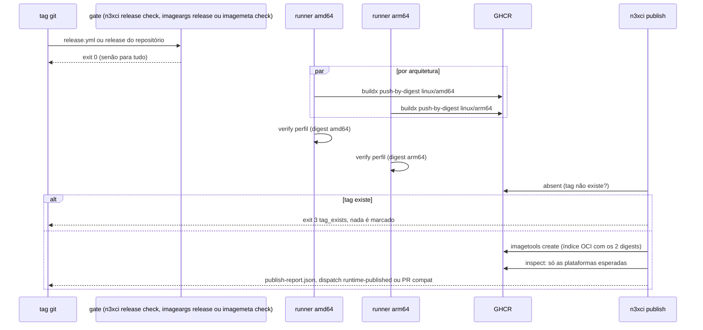
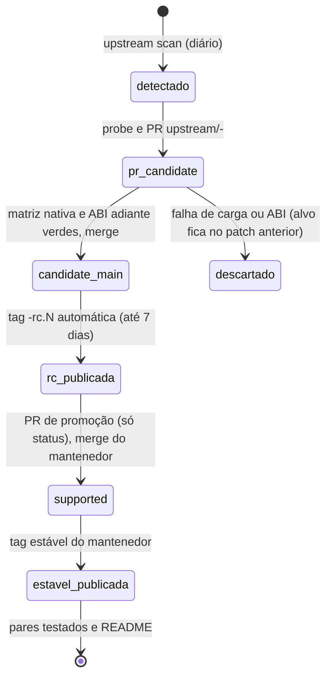
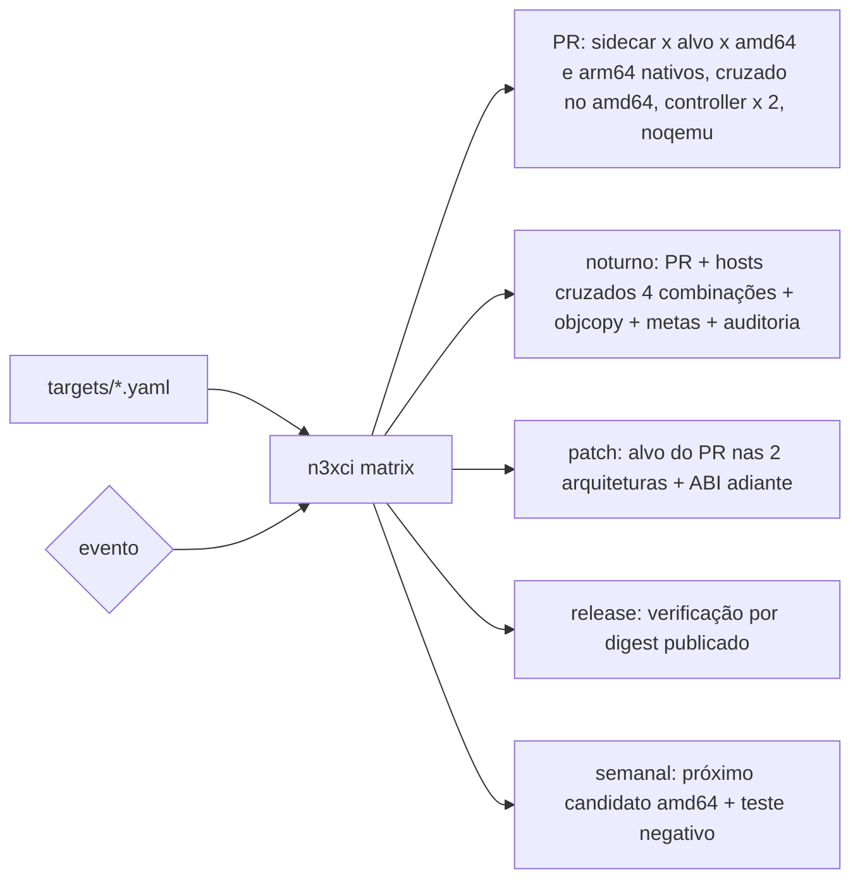

### FDD: Imagens de build, publicação no GHCR e matriz de CI (BLD-07)

Versão: 1.0
Data: 2026-10-21
Responsável: Guilherme Giusti

---

### 1. Contexto e motivação técnica

**Problema técnico.** As FDDs 19 a 24 definem o que o `n3x-plugin` faz dentro da imagem de build, e a FDD 21 deixou um Dockerfile de desenvolvimento (`n3x-dev/...`) que nunca é publicado (D-11). Sem imagens publicadas o operador não consegue escrever o Dockerfile multi-stage do FR-015, e sem uma CI de matriz o builder não cumpre as garantias que os outros documentos delegaram a ele: o alvo `candidate` só vira `supported` depois da "matriz nativa" (FDD 19), o hash independe do host "conferido na matriz da FDD 46" (FDD 21), o `objcopy` dá o mesmo hash "nas 4 combinações" (FDD 22), o teste de carga em arm64 "roda na CI nativa do builder para cada imagem" (ADR-004) e a imagem de runtime do sidecar é "publicada pelo processo comum" (FDD 28). Faltam, de forma verificável:

- o conteúdo exato de cada imagem publicada, com as versões embutidas, e a regra de semver de cada uma (o que é patch, minor e major);
- como uma tag é publicada em amd64 e arm64 sem nunca ser sobrescrita, e o que acontece com alvo `candidate` e com pré-release (P-04 das FDDs 19 e 28);
- a matriz alvo × arquitetura × tipo, onde cada célula roda, com que frequência e com que prova (símbolos, carga, hash);
- como um patch novo do Envoy 1.40.x ou do Istio 1.31.x é detectado, testado e promovido, e o teste contra o próximo candidato;
- a tabela de pares testados do README (ADR-001) e o processo comum de publicação usado também pelo `n3x-sidecar` e pelo `n3x-controller`;
- a medição das metas de tempo do build e de tamanho das imagens (L-29).

**Encaixe no HLD.** Esta FDD especifica, no `n3x-builder`, as seções "Imagens", "Versionamento e compatibilidade", "Catálogo de alvos" (promoção), "Ambiente de implantação", "Considerações de escalabilidade e disponibilidade" e "Dashboards e alertas" do HLD, e as linhas do builder na "Matriz de CI entre repositórios" do HLD de plataforma ("Build e carga do `.so`" e "Próxima versão candidata do Envoy e cada patch do Istio"). Quem consome:

- operador: as imagens `ghcr.io/giustech/n3x/sidecar-builder` e `controller-builder`, os Dockerfiles de `examples/` e a tabela de pares
- FDDs 28 e 30: o processo comum de publicação (workflow reutilizável e ferramenta `n3xci`) para `ghcr.io/giustech/n3x/sidecar` e `controller`
- FDD 47 (SDK-15): tabela de pares, política de tags e recomendação de espelho, para os guias
- FDD 48 (SDK-16): imagens publicadas, registro `compat/images.json` e formato de `compat/pairs.json`, para a CI cruzada
- FDD 49 (SID-11): a matriz e o fluxo por patch aceitam o alvo `istio-1.31` sem mudança de código

**Atores.** CI do `n3x-builder` (GitHub Actions), CI do `n3x-sidecar` e do `n3x-controller` (chamam o processo comum), bot `n3x-ci-bot` (GitHub App que abre PRs e issues; hipótese de nome), mantenedor (aprova PRs de catálogo, cria tags de release), operador (usa as imagens), GHCR e Docker Hub (registros de destino e de origem).

**Limites.** Aqui ficam o conteúdo e a publicação das imagens de build, a matriz de CI do builder, o fluxo de patch, promoção e próximo candidato, a tabela de pares (formato e teste de par mínimo) e o processo comum de publicação. Não ficam: a lógica do `add` e do `build` (FDDs 19 a 24), o conteúdo das imagens de runtime (FDDs 28 e 30), a integração ponta a ponta e a CI cruzada entre repositórios (FDD 48), os guias (FDD 47), o adaptador e a imagem `istio-1.31` (FDD 49). Assinatura e SBOM ficam fora da v1 (PRD, "Fora de escopo").

**Suposições**
- FDDs 19 a 24 implementadas, com o Dockerfile de desenvolvimento da FDD 21 já acrescido das linhas das FDDs 22 (`binutils-multiarch`) e 23 (Envoy nativo, índices e `symindex`)
- Os cinco repositórios são públicos no GitHub, o que dá runners `ubuntu-24.04` (amd64) e `ubuntu-24.04-arm` (arm64) hospedados sem custo (hipótese, H-01; FDD 28 usa o mesmo)
- O GHCR aceita índice OCI (`application/vnd.oci.image.index.v1+json`) e não tem tag imutável nativa; a imutabilidade é garantida pelo processo (hipótese, spike CI-03)
- `docker buildx` 0.13 ou mais novo nos runners (`push-by-digest`, `imagetools create`, `--no-cache-filter`)
- Valores do catálogo (digest, commit, glibc, pseudo-versão) vêm da fase 0 (L-21, FDD 19)

**Restrições**
- Nomes das imagens e tags imutáveis, nunca apagadas, publicadas pela CI do GitHub Actions (ADR-009)
- Semver próprio por imagem e tabela de pares no README (ADR-001)
- amd64 e arm64 em índice OCI via `docker buildx`; bases fixadas por digest (HLD; PRD "imagens publicadas no formato OCI")
- Compilação dupla com comparação de hash (ADR-007); teste de carga nativo em arm64 para cada imagem (ADR-004)
- Alvo novo ou patch novo entra como `candidate` e só vira `supported` depois da matriz nativa (HLD; FDD 19)
- `controller-builder` sem toolchain C e sem alvo (HLD)
- O builder não tem serviço nem endpoint de métricas (FDDs 20 a 23); a observabilidade é de CI
- Documentação em pt-BR; identificadores, campos, comandos e rótulos em inglês

**Rastreabilidade**
- PRD 1.5: FR-015 (imagens por alvo e arquitetura, semver próprio, `docker buildx` multi-arquitetura, `controller-builder` sem sufixo de alvo, secret de build); "Dependências": "Toolchain Go e C fixados", "Registro de containers e repositórios", "Política de ABI do Envoy, verificada na CI a cada patch"; requisitos de compatibilidade ("imagens publicadas no formato OCI", "imagens base fixadas por digest"); critérios de aceite "dois builds do mesmo Dockerfile em máquinas diferentes geram o mesmo hash" e "os mesmos plugins geram `.so` para `envoy-1.40` e `istio-1.31`, em amd64 e arm64, e cada imagem carrega o seu `.so` sem erro"; "Testes e validação" (carga do `.so` em cada imagem, teste negativo com `.so` de Envoy mais novo, reprodutibilidade em amd64 e arm64); "Fora de escopo" (assinatura e SBOM)
- HLD do `n3x-builder`: "Imagens", "Versionamento e compatibilidade", "Catálogo de alvos", "Ambiente de implantação", "Considerações de escalabilidade e disponibilidade", "Meta de disponibilidade", "Dashboards e alertas", riscos do Istio, do SDK Go do Envoy, do arm64 cruzado, de pares errados e de build não reproduzível; HLD de plataforma, "Matriz de CI entre repositórios" e risco "matriz cara demais"
- ADRs do `n3x-builder`: ADR-001 (semver por imagem e tabela de pares), ADR-004 (teste de carga nativo), ADR-007 (build reproduzível), ADR-009 (GHCR e tags imutáveis); ADR-008 do `n3x-sdk` (CI cruzada em `n3x-sdk/deploy/`, que fica com a FDD 48); ADR-009 de plataforma (sem tracing)
- Lacunas do README:
  - **L-29 fechada:** as metas de build (60 s com cache, 3 min sem cache, até 5 plugins, amd64 nativo) e o prazo de 7 dias para imagem `candidate` viram metas medidas pela CI noturna, com alerta e sem bloquear release (hipótese, H-10; contrato 13)
  - **L-59 aplicada (fechada na FDD 21):** imagens publicadas e Dockerfiles de `examples/` com `FROM --platform=$BUILDPLATFORM` e `ARG TARGETARCH`; teste em runner sem `binfmt` (contratos 4 e 7)
  - **L-60 aplicada (fechada na FDD 23):** toda `sidecar-builder` publicada traz `/usr/share/n3x/symbols/<arch>.json` das duas arquiteturas e o Envoy só da arquitetura da imagem; a verificação confere o índice de uma plataforma contra o binário da outra (contrato 6)
  - **L-21 aplicada:** valores do catálogo vindos da fase 0, e o fluxo de patch reaproveita o `probe` da FDD 19 (contrato 9)
- Pedidos de FDDs anteriores atendidos: FDD 07 (alvos simulados do `sdktest` iguais ao catálogo), FDD 16 (capacidades comparadas pelo `adapter_loaded`; `go.mod` com `envoy_go_sdk`), FDD 19 (alvo copiado byte a byte, `builder.yaml` com o SDK do `n3x-plugin`, política de `candidate`, teste de capacidades), FDD 20 (`pinned` e metas de duração), FDD 21 (publicar a partir do mesmo Dockerfile, matriz entre hosts nas 4 combinações), FDD 22 (`binutils-multiarch`, `objcopy` nas 4 combinações com hash igual, alerta `objcopy`), FDD 23 (L-60, `verify-report.json`, alerta `load-test`, teste negativo do próximo candidato), FDD 24 (`govulncheck`, cópia da base, meta do passo 4, versões do `protoc-gen-go` do corpus), FDD 28 (processo comum depois de `imageargs release`, recusa de tag existente, tabela de pares com versão da `sidecar` e digest da base, PR automático da cópia do catálogo, P-04), FDD 30 (publicação nas duas arquiteturas e `image.json` contra a tag, P-05)

---

### 2. Objetivos técnicos

- **Tag publicada é imutável e baixável.** Invariante: nenhuma tag das quatro imagens `n3x/*` é sobrescrita nem apagada. Medida: tentativa de republicar uma tag existente sai com `tag_exists` em até 30 s e sem nenhum push; a auditoria noturna resolve 100% das tags de `compat/images.json` para o digest registrado.
- **Nenhuma tag sem prova.** Invariante: a tag só é criada depois que as duas plataformas passaram na verificação do perfil (contrato 6). Para cada alvo publicado e cada arquitetura, a imagem compila o plugin core mais o `n3x.example`, passa na comparação de símbolos e no teste de carga nativo, e dois builds dão o mesmo hash. Medida: 0 tags criadas com verificação vermelha (conferido pela ordem dos eventos em `publish-report.json`).
- **Hash independe da máquina.** Medida: na matriz noturna, hosts amd64 e arm64 compilam os dois destinos; as 4 combinações dão o mesmo `integrity.value` por destino, e o hash das seções `SHF_ALLOC` antes e depois do `objcopy` é igual em todas (0 divergências em 30 noites).
- **Sem QEMU para o operador.** Medida: os Dockerfiles de `examples/` constroem `linux/amd64,linux/arm64` sem alteração num runner amd64 sem `binfmt` registrado.
- **Patch novo vira imagem `candidate` em até 7 dias (L-29).** Medida: da data `created` da imagem do upstream até a pré-release `-rc` da `sidecar-builder` publicada, no máximo 7 dias corridos; acima disso, issue `upstream-stale`.
- **Build rápido (L-29).** Medida no runner `ubuntu-24.04` (4 vCPU), com 5 plugins além do core, p95 de 5 execuções noturnas: até 60 s com cache quente e até 180 s com cache frio, sem contar o download da imagem; destino arm64 cruzado em até 1,5 vez o amd64 nativo (hipótese, H-10).
- **CI de PR suportável por uma pessoa.** Medida: tempo de parede da CI de um PR comum até 25 min no p95 (hipótese, H-01).
- **Matriz estável.** Medida: pelo menos 95% das células verdes nas últimas 30 execuções noturnas da branch principal (hipótese, H-22).
- **Pares sempre publicados.** Medida: toda versão estável de imagem de build ou de runtime aparece em pelo menos um par testado em `compat/pairs.json` e no README em até 24 h depois da publicação.

---

### 3. Escopo e exclusões

**Incluído**
- Conteúdo das imagens publicadas `sidecar-builder` (por alvo) e `controller-builder`: caminhos, modos, versões, `ENV`, rótulos OCI e o que `n3x-plugin version` mostra (contrato 1)
- Regra de semver das duas imagens de build, tags git por imagem, arquivo `images/release.yaml` e o portão `n3xci release check` (contrato 2)
- Dockerfile único das imagens (`images/Dockerfile`, a partir do da FDD 21) com os acréscimos de publicação: `govulncheck`, cópia da base de vulnerabilidades, rótulos, versão vinda da tag (contrato 3)
- Interface do operador: `ARG` aceitos, secret, caches, `TARGETARCH` e os Dockerfiles de `examples/` testados como estão (contrato 4, L-59 aplicada)
- Processo comum de publicação: workflow reutilizável `oci-publish.yml` e a ferramenta `n3xci` (push por digest por arquitetura nativa, recusa de tag existente, índice OCI, registro), usado pelas quatro imagens (contrato 5)
- Verificação da imagem publicada por perfil (`sidecar-builder`, `controller-builder`, `sidecar`, `controller`), inclusive L-60 e `image.json` contra a tag (contrato 6)
- Matriz de CI: alvos × arquiteturas × tipo, gatilhos, runners, células e relatórios (`matrix-report.json`, `verify-report.json`) (contrato 7)
- Reprodutibilidade: compilação dupla em todo PR e matriz entre hosts nas 4 combinações com o `objcopy` (contrato 8)
- Detecção de patch do Envoy 1.40.x e do Istio 1.31.x, pré-release `candidate`, teste de ABI adiante e promoção para `supported` (contrato 9)
- Próximo candidato do Envoy e teste negativo do PRD (contrato 10)
- Tabela de pares: `compat/images.json`, `compat/pairs.json`, teste de par mínimo e seção do README (contrato 11)
- PR automático da cópia do catálogo no `n3x-sidecar` (contrato 12)
- Medição das metas de tempo e de tamanho (contrato 13, L-29)
- Alertas da CI por issue com rótulo, deduplicação e fechamento

**Excluído**
- Lógica do `add` e do `build`, códigos `N3X-Bxxx`, relator, análise, geração, compilação, manifesto, símbolos e carga: FDDs 19 a 24
- Conteúdo, endurecimento e testes próprios das imagens de runtime: FDD 28 (sidecar) e FDD 30 (controller); aqui só a publicação e as checagens genéricas do perfil
- Integração ponta a ponta (core, exemplo e controller em tráfego real), ambientes compose, kind e Istio, gatilhos entre os cinco repositórios e conformidade do SDK em proxy real: FDD 48 (SDK-16)
- Guias do operador e do autor, inclusive o texto sobre espelho e limites do GHCR: FDD 47 (SDK-15)
- Imagem de runtime `-istio-1.31`, adaptador e capacidades do `istio-1.31`: FDD 49 (SID-11); aqui só a matriz e o fluxo por patch, que já aceitam o alvo
- Benchmark do sidecar e simulador do controller: FDDs 50 e 51
- Assinatura de imagens, SBOM e atestados de proveniência: fora da v1 (PRD); a publicação desliga os atestados padrão do buildx (H-06)
- Tags móveis (`latest`, `1.1-envoy-1.40`): não existem na v1 (H-05)

---

### 4. Fluxos detalhados e diagramas

**Fluxo principal 1: PR no `n3x-builder` (gatilho `pull_request` e `push` na `main`)**
1. Jobs rápidos em amd64: `go vet`, `go test -race ./...`, `gosec`, `govulncheck` do próprio repositório, golden da FDD 21, `docs/erros.md` atualizado (FDD 20), catálogo offline e, se `targets/` mudou, catálogo online e regra de diff (FDD 19), corpus da análise (FDD 24) e o teste `TestCatalogMatchesSDKTargets` (capacidades de `sdktest.Targets()` iguais às do catálogo, pedido da FDD 07).
2. `n3xci matrix --event pr` lê `targets/*.yaml` e devolve as células (contrato 7). PR que só muda `docs/` ou `*.md` não roda a matriz (hipótese).
3. Cada célula roda no runner da sua arquitetura: constrói a imagem de CI (`images/Dockerfile`, tag local `n3x-ci/...`), o que já executa o build de fumaça da FDD 21 com o passo 7 nativo; depois compila o core mais o `n3x.example` duas vezes em containers novos (contrato 8); na `sidecar-builder` amd64, compila também o destino arm64 cruzado duas vezes (só símbolos, aviso `load_test_skipped`).
4. Célula `noqemu`: num runner amd64 sem `binfmt`, as imagens de CI das duas arquiteturas vão para um registro local (`localhost:5000`) e os Dockerfiles de `examples/` são construídos com `--platform linux/amd64,linux/arm64`.
5. Cada célula publica `verify-report.json` (FDD 23), `repro-report.json` (FDD 21) e `build-events.jsonl` (FDD 20); `n3xci report matrix` junta tudo em `matrix-report.json` e no `GITHUB_STEP_SUMMARY`.
6. Na `main`, falha de célula abre ou atualiza a issue com o rótulo do motivo (contrato 7, alertas); no PR, só marca o check vermelho.

**Fluxo principal 2: release de uma imagem de build**
1. O mantenedor cria a tag `sidecar-builder/vX.Y.Z[-pre]` ou `controller-builder/vX.Y.Z[-pre]` num commit da `main` (regra de proteção de tags: só mantenedores).
2. `release.yml` roda `n3xci release check` (contrato 2): formato da tag, commit na `main`, árvore limpa, `images/release.yaml` sem pseudo-versão, módulos resolvíveis, versão maior que a anterior e bump mínimo pela tabela de semver; decide quais alvos publicar (estável: só `supported` e `deprecated`; pré-release: todos).
3. Para cada alvo publicado, chama o workflow reutilizável `oci-publish.yml` (contrato 5): por arquitetura, no runner nativo, `docker buildx build` com push por digest (sem tag), sem atestados, mídia OCI; o build já roda o build de fumaça.
4. Verificação por plataforma no runner nativo, sobre o digest recém-enviado (contrato 6, perfil da imagem): conteúdo, rótulos, L-60, compilação dupla do core mais exemplo, símbolos e carga.
5. `n3xci publish absent` confere de novo que a tag não existe; `n3xci publish merge` cria o índice OCI com exatamente as plataformas esperadas e confere o resultado.
6. `n3xci publish record` grava `publish-report.json`; o bot abre o PR `compat/<imagem>-<versão>` com a linha nova em `compat/images.json`, os Dockerfiles de `examples/` com as versões novas (só em release estável) e roda o fluxo de pares (fluxo 6).
7. Se o release for pré-release de um alvo `candidate` e o teste de ABI adiante tiver passado, o bot avalia a promoção (fluxo 4).

**Fluxo principal 3: publicação de imagem de runtime pelo processo comum (pedido das FDDs 28 e 30)**
1. A tag `vX.Y.Z` do `n3x-sidecar` (com `core/vX.Y.Z` no mesmo commit) dispara o release dele, que chama `giustech/n3x-builder/.github/workflows/oci-publish.yml@<sha>` com `gate: go run ./images/tools/imageargs release --tag vX.Y.Z --target <alvo>`, `profile: sidecar`, os `--build-arg` de `imageargs args --format json` e `verify_cmd: make image-test TARGET=<alvo> ARCH=<arch> SMOKE=1 IMAGE=<ref@digest>`.
2. O processo é o mesmo do fluxo 2, passos 3 a 6. O gate do repositório roda antes de qualquer build; saída diferente de 0 interrompe tudo.
3. No `n3x-controller`, a tag `vX.Y.Z` (com `host/vX.Y.Z` no mesmo commit, se `host/` for módulo próprio) chama o mesmo workflow com `profile: controller`, `gate: go run ./images/tools/imagemeta check --tag vX.Y.Z` (pedido à FDD 30) e a verificação de `image.json` contra a tag (P-05 da FDD 30).
4. Ao final, o workflow envia `repository_dispatch` `runtime-published` ao `n3x-builder`, que roda o fluxo de pares.

**Fluxo principal 4: patch novo do Envoy 1.40.x ou do Istio 1.31.x e promoção**
1. `upstream.yml` roda todo dia às 06:00 UTC: `n3xci upstream scan` lista as tags de `docker.io/envoyproxy/envoy` (`^v1\.40\.[0-9]+$`) e de `docker.io/istio/proxyv2` (`^1\.31\.[0-9]+$`), uma família por arquivo de `targets/`, e acha patches maiores que o fixado.
2. Para cada patch novo sem PR aberto, roda o `probe` da FDD 19 (`go run ./internal/catalog/probe -target <id> -image <imagem>:<tag>`), grava o arquivo com `status: candidate` e o bot abre o PR `upstream/<alvo>-<tag>` com o rótulo `upstream-patch`.
3. O PR roda a matriz nativa completa do alvo (as duas arquiteturas, mesmo que o PR comum não exigisse) e o teste de ABI adiante: o `.so` da última `sidecar-builder` estável daquele alvo, tirado de `compat/images.json`, carregado no Envoy do patch novo nas duas arquiteturas (contrato 9).
4. Com o merge do PR, o bot cria a pré-release `sidecar-builder/vX.Y.(Z+1)-rc.N` (próximo patch, `N` crescente) e o fluxo 2 a publica com o alvo ainda `candidate`. O bot também abre o PR da cópia do catálogo no `n3x-sidecar` (fluxo 8).
5. Se a matriz da `main` depois do merge e a verificação da pré-release ficarem verdes nas duas arquiteturas, o bot abre o PR `promote/<alvo>-<tag>` que muda só `status` para `supported` (regra de diff da FDD 19). O merge é do mantenedor (H-09).
6. Depois da promoção, o mantenedor cria a tag estável; o portão aceita o alvo porque ele já está `supported`.
7. Se um patch ficar mais de 7 dias sem pré-release publicada (contado da data `created` da imagem do upstream), o `upstream.yml` abre a issue `upstream-stale`.

**Fluxo principal 5: noturno (03:00 UTC, `main`)**
- Tudo do fluxo 1 com as imagens de CI, mais: matriz entre hosts nas 4 combinações com o `objcopy` (contrato 8); medição das metas e do tamanho (contrato 13); catálogo online (FDD 19); auditoria das tags publicadas (contrato 11); tendência da taxa de sucesso da matriz.

**Fluxo principal 6: pares**
1. Disparado pelo fim de um release (fluxo 2 ou `runtime-published` do fluxo 3) ou à mão.
2. `n3xci pairs plan` escolhe os pares: para uma `sidecar-builder` nova com `core/` `X.Y`, as `sidecar` estáveis do mesmo alvo com major `X` e minor `>= Y`, a última patch de cada uma das 3 minors mais novas; para uma `sidecar` nova, o inverso; o mesmo vale para `controller-builder` e `controller` (H-14).
3. Para cada par e cada arquitetura, no runner nativo: constrói `ci/pairs/sidecar/Dockerfile` (forma do contrato 4, imagens por digest) com core e exemplo, roda `validate --so`, sobe o container com limite de memória e faz uma requisição; no controller, `validate`, `run` e `probe ready` (contrato 11).
4. O bot abre ou atualiza o PR `compat/pairs-<data>` com as linhas novas em `compat/pairs.json` e a seção gerada do README; PR só com `compat/` e a seção do README pode ter merge automático depois da CI verde (hipótese).

**Fluxo principal 7: próximo candidato (semanal, segunda às 05:00 UTC, amd64)**
1. `n3xci next resolve` escolhe o próximo candidato: a maior tag `v1.41.*` do `envoyproxy/envoy`, se existir; senão o digest atual de `envoyproxy/envoy-dev:latest`. Lê o commit por `envoy --version` e a pseudo-versão do SDK Go do Envoy por `go list -m <módulo>@<commit>` (hipótese, H-12).
2. Compila o `.so` só com o core, com o adaptador atual (`n3x_envoy140`) e o `envoy_go_sdk` do candidato, fora do `n3x-plugin` (que recusaria a versão), num módulo de CI com o `main` do golden `sidecar_core` da FDD 21 e o mesmo ambiente de `compile.Env`.
3. Compatibilidade adiante (informativo): se não compilar ou não carregar no Envoy do candidato, abre a issue `next-candidate`, sem bloquear nada.
4. Teste negativo do PRD: o mesmo `.so` é verificado na `sidecar-builder` do alvo `supported` atual; se o `abi.h` do candidato difere do fixado, o resultado esperado é `N3X-B011` ou `N3X-B012` com exit 6; se o `abi.h` é igual, o caso sai `skipped` com `reason: same_abi` (I-07).

**Fluxo principal 8: cópia do catálogo no `n3x-sidecar`**
1. Um push na `main` do builder que muda `targets/<alvo>.yaml` dispara `catalog-propagate.yml`.
2. O bot abre ou atualiza o PR `catalog/<alvo>` no `n3x-sidecar` com a cópia byte a byte em `images/runtime/catalog/<alvo>.yaml` e o `SOURCE.json` com o commit do builder e o SHA-256 (contrato 7 da FDD 28).
3. Se `envoy.image` mudou e o `buildinfo.Version` atual do sidecar já tem tag estável publicada, o mesmo PR sobe o patch de `buildinfo.Version` (pedido da FDD 28; H-19). Mudança só de `status` não sobe versão.

**Fluxos alternativos e exceções**
- **Tag já publicada:** `n3xci publish absent` sai com 3 (`tag_exists`) antes de qualquer push; a segunda conferência, logo antes do índice, pega a corrida entre dois workflows (a `concurrency` do GitHub já serializa a mesma tag). Os digests enviados sem tag ficam órfãos e não são apagados (são inacessíveis por tag e o GHCR os mantém).
- **Release estável com alvo `candidate`:** o alvo é pulado com a nota `candidate_in_stable`; se nenhum alvo sobrar, `no_target` (exit 3). Pré-release publica o alvo `candidate` com o aviso `target_status` gravado no `publish-report.json`.
- **Alvo `deprecated`:** publicado em release estável (correções de segurança), marcado como `deprecated` na tabela de pares.
- **Uma plataforma falha na verificação:** nenhuma tag é criada; o digest da outra plataforma fica órfão; o job sai com 5 e abre a issue `matrix` com o perfil e a regra.
- **GHCR ou Docker Hub indisponível:** 3 tentativas com espera de 2 s, 4 s e 8 s; depois sai com 4 (`registry_unavailable`); 429 do Docker Hub sai com `rate_limited` e o `upstream.yml` tenta de novo no dia seguinte.
- **Hash diferente entre hosts ou entre builds:** a célula falha com 6 (`repro_mismatch`) e abre a issue `reproducibility` com o `repro-report.json`; em release, bloqueia a tag.
- **`objcopy` muda o hash ou a seção não confere:** `objcopy_hash` (6) ou `N3X-B013` `section_check` e `integrity_mismatch` no build; issue `objcopy` (pedido da FDD 22).
- **Teste de carga falha num patch:** `N3X-B011` ou `N3X-B012` na célula; issue `load-test` com o `verify-report.json` (pedido da FDD 23); o PR de patch não é promovido.
- **ABI adiante quebrada:** o `.so` da imagem estável não carrega no Envoy do patch novo; `abi_forward` (6), issue `abi`; o alvo continua no patch anterior (contingência do HLD).
- **`probe` falha** (digest sumiu, `go list -m` falha): a issue `catalog` é aberta e o patch é tentado de novo no dia seguinte.
- **Bot sem token válido:** os jobs que abrem PR ou issue falham com `bot_auth`; a falha do próprio job aparece na lista de execuções do GitHub.
- **Par falha:** a linha entra em `compat/pairs.json` com `failed` e a regra, a seção do README mostra "falhou", e a issue `pairs` é aberta; um par falho nunca é apagado do arquivo.
- **Meta de tempo ou de tamanho estourada:** a execução noturna sai verde com aviso; três noites seguidas acima da meta abrem a issue `perf` ou `image-size`.
- **PR de fork:** roda a matriz com as imagens de CI, sem secrets e sem publicar; jobs que exigem o bot não rodam.

**Diagramas**

Sequência do processo comum de publicação (as quatro imagens):



Ciclo de vida de um patch e das imagens:



Células da matriz por evento:



---

### 5. Contratos públicos (assinaturas, endpoints, headers, exemplos)

**Contrato 1: imagens publicadas, tags, plataformas e conteúdo**
- Tipo: imagem OCI (índice multiplataforma)
- Assinatura/Rota: `ghcr.io/giustech/n3x/sidecar-builder:<versão>-<alvo>` e `ghcr.io/giustech/n3x/controller-builder:<versão>`
- Método: n/a (`docker pull`, `FROM`)
- Semântica:
  - `<versão>`: semver 2.0.0 sem `v`, com pré-release opcional (`1.0.3-rc.1`), sem metadado `+`; vem da tag git (contrato 2). `<alvo>`: `id` do catálogo; o sufixo casa com `-(envoy|istio)-[0-9]+\.[0-9]+$`, como na FDD 28
  - Plataformas: `linux/amd64` e `linux/arm64`, num índice `application/vnd.oci.image.index.v1+json` sem entradas de atestado; na `sidecar-builder`, exatamente as de `archs` do alvo
  - Imutável e nunca apagada (ADR-009); sem tags móveis (H-05); o operador fixa por tag e, de preferência, por digest
  - Conteúdo:

| Caminho | Modo | `sidecar-builder` | `controller-builder` | Origem |
| --- | --- | --- | --- | --- |
| `/usr/local/go` | da base | sim | sim | `golang:1.26.x-trixie` por digest (`images/release.yaml`) |
| `/usr/local/bin/n3x-plugin` | 0555 | sim | sim | `cmd/n3x-plugin` do commit da tag (FDD 21) |
| `/usr/local/bin/govulncheck` | 0555 | sim | sim | `golang.org/x/vuln/cmd/govulncheck` na versão fixada (pedido da FDD 24) |
| `/usr/share/n3x/vulndb/` | 0444 e 0555 | sim | sim | cópia da base no formato v1, tirada no build da imagem (`images/tools/vulnsnap`, H-15) |
| `/usr/share/n3x/pinned/{proxy/,go.sum,modules.txt}` | 0444 e 0555 | do `core/` | do `host/` | ferramenta `pin` (FDDs 20 e 21) |
| `/etc/n3x/builder.yaml` | 0444 | sim | sim | `pin` (FDD 19, contrato 2) |
| `/etc/n3x/target.yaml` | 0444 | sim | não | `targets/<alvo>.yaml` da tag, byte a byte (FDD 19) |
| `/opt/zig/` | da origem | sim | não | `zig` por versão e SHA-256 (FDD 21) |
| `/usr/bin/objcopy` | da origem | sim | sim | `binutils-multiarch` fixado (FDD 22) |
| `/usr/share/n3x/symbols/{amd64,arm64}.json` | 0444 | sim (as de `archs`) | não | `symindex` (FDD 23, L-60) |
| `/opt/n3x/envoy/envoy` | 0555 | sim (só a arquitetura da imagem) | não | `envoy.image` por digest (FDD 23) |
| `git` | da base | 2.31 ou mais novo | 2.31 ou mais novo | Debian da base (FDD 20) |
| `/n3x/work`, `/out` | 0755, vazios | sim | sim | Dockerfile |

  - `ENV`: `GOTOOLCHAIN=local`; na `sidecar-builder`, `PATH` com `/opt/zig`, `ZIG_GLOBAL_CACHE_DIR` e `ZIG_LOCAL_CACHE_DIR` em `/root/.cache/zig`. Sem `GOFLAGS`, `GOPROXY`, `GOPRIVATE` nem `N3X_*` (o operador passa por `ARG`, contrato 4)
  - Usuário: root (o `RUN` do operador precisa escrever em `/n3x/work` e `/out`); o teste de carga troca para o UID 17000 (FDD 23)
  - Rótulos: `org.opencontainers.image.{title,description,source,version,revision,created,licenses=Apache-2.0,base.name,base.digest}` e `io.n3x.{image.kind,builder.version,go.version,sdk.version,runtime.module,runtime.version,core.version}`; na `sidecar-builder`, também `io.n3x.{target,target.status,envoy.image,glibc,zig.version}`. Só para inspeção: o `n3x-plugin` nunca lê rótulos
  - Tamanho (hipótese, H-11): `sidecar-builder` até 650 MiB comprimidos e 2 GiB descomprimidos por plataforma; `controller-builder` até 450 MiB comprimidos e 1,4 GiB descomprimidos

**Exemplo de requisição**
```text
docker buildx imagetools inspect ghcr.io/giustech/n3x/sidecar-builder:1.0.3-envoy-1.40
docker run --rm ghcr.io/giustech/n3x/sidecar-builder:1.0.3-envoy-1.40@sha256:5d0e... n3x-plugin version
```

**Exemplo de resposta** (digests ilustrativos)
```text
Name:      ghcr.io/giustech/n3x/sidecar-builder:1.0.3-envoy-1.40
MediaType: application/vnd.oci.image.index.v1+json
Digest:    sha256:5d0e9a71c3b8...
Manifests:
  Name:      ghcr.io/giustech/n3x/sidecar-builder:1.0.3-envoy-1.40@sha256:a1c47e02f9d3...
  Platform:  linux/amd64
  Name:      ghcr.io/giustech/n3x/sidecar-builder:1.0.3-envoy-1.40@sha256:7b90d5e81c24...
  Platform:  linux/arm64

builder        1.0.3 (sidecar)
go             1.26.1
sdk            github.com/giustech/n3x-sdk v1.2.0
runtime        github.com/giustech/n3x-sidecar/core v1.0.0
core           github.com/giustech/n3x-plugin-core v1.0.0
target         envoy-1.40 (supported)
```

---

**Contrato 2: semver das imagens de build, tags git, `images/release.yaml` e portão de release**
- Tipo: convenção de tags do repositório, arquivo YAML e CLI interna (`go run ./ci/n3xci release check`)
- Assinatura/Rota:
  ```text
  tags git:  sidecar-builder/v<X.Y.Z[-pre]>   controller-builder/v<X.Y.Z[-pre]>
  arquivo:   images/release.yaml (format: 1)
  go run ./ci/n3xci release check --tag <tag> [--previous auto|<tag>] [--format text|json]
  ```
- Método: processo; resultado em stdout (JSON ou texto), problemas em stderr no formato `<caminho>: <texto> [<regra>]`
- Semântica:
  - **Uma tag por imagem (H-02):** cada imagem tem semver próprio (ADR-001); a versão da imagem é a da tag, gravada em `builder.yaml` pelo `pin --builder` e nos rótulos. A versão do SDK é a do `go.mod` do `n3x-builder` (a compilada no `n3x-plugin`); runtime e core vêm de `images/release.yaml`
  - **Uma versão da `sidecar-builder` publica todos os alvos permitidos (H-04):** release estável publica alvos `supported` e `deprecated`; pré-release publica também os `candidate`. Um patch do Envoy de um alvo republica os outros alvos na versão nova, sem mudança de conteúdo além da versão
  - **Tabela de bump mínimo (H-03).** O portão calcula o bump mínimo pelo que consegue comparar entre a tag anterior estável da mesma imagem e o commit (módulos de `images/release.yaml`, SDK do `go.mod`, imagem do Go, `targets/`); mudança de código do `n3x-plugin` não é detectável e fica com o mantenedor, que pode subir mais que o mínimo:

| Mudança | Bump mínimo |
| --- | --- |
| Correção do `n3x-plugin` sem mudar contrato; patch do Go (1.26.x), do `zig`, do `binutils`, do `govulncheck` ou da base `golang` | patch |
| Patch do Envoy ou do Istio de um alvo (`envoy.image`, `envoy.commit`, `envoy.glibc`, `istio.version` na mesma minor) | patch |
| Patch de `core/`, `host/`, SDK ou plugin core | patch |
| `envoy_go_sdk` diferente num alvo existente | minor |
| Minor de `core/`, `host/`, SDK ou plugin core; minor do Go | minor |
| Alvo novo em `targets/`; alvo retirado das releases (tags antigas continuam) | minor |
| Código, regra ou aviso novo do builder; `ARG` novo; regra de qualidade que vira erro depois dos 90 dias (FDD 24) | minor |
| Major de `core/`, `host/`, SDK ou plugin core | major |
| Quebra do Dockerfile do operador: caminho (`/out`, `/n3x/work`, nome do artefato), `ARG` removido, `ARG TARGETARCH` obrigatório, significado de exit code | major |
| Cópia nova da base de vulnerabilidades sozinha | não gera release (H-15) |

  - **Regras do portão** (saída 3, política; 2, entrada inválida): `tag_format` (fora de `<imagem>/v<semver>`), `tag_commit` (tag não aponta para o `HEAD` do job), `tag_not_on_main`, `dirty_tree`, `release_file` (`images/release.yaml` inválido, campo desconhecido), `pseudo_version` (pseudo-versão em `images/release.yaml` ou no SDK do `go.mod`), `module_unresolvable` (`go list -m` falha), `version_regress` (versão menor ou igual à última da mesma linha), `bump_too_small`, `catalog_invalid` (`catalog.LoadDir` falha), `no_target` (nenhum alvo publicável). Alvo pulado não é erro: sai em `targets[]` com `publish: false` e `reason`
  - Em pré-release, `version_regress` compara com a última pré-release da mesma versão base (`1.0.3-rc.2` depois de `1.0.3-rc.1`); o bump é calculado contra a última estável

**Exemplo de requisição** (`images/release.yaml` e o comando)
```yaml
format: 1
sidecar_builder:
  runtime: github.com/giustech/n3x-sidecar/core@v1.0.0
  core: github.com/giustech/n3x-plugin-core@v1.0.0
controller_builder:
  runtime: github.com/giustech/n3x-controller/host@v1.0.0
  core: github.com/giustech/n3x-plugin-core@v1.0.0
toolchain:
  go_image: golang:1.26.1-trixie@sha256:<64 hex>
  zig: { version: 0.15.1, sha256_x86_64: <64 hex>, sha256_aarch64: <64 hex> }
  binutils: 2.44-3
  govulncheck: v1.1.4
```
```text
go run ./ci/n3xci release check --tag sidecar-builder/v1.0.3 --format json
```

**Exemplo de resposta**
```json
{
  "image": "ghcr.io/giustech/n3x/sidecar-builder",
  "version": "1.0.3",
  "channel": "stable",
  "previous": "1.0.2",
  "required_bump": "patch",
  "changes": [
    { "kind": "envoy_patch", "target": "envoy-1.40", "from": "v1.40.2", "to": "v1.40.3", "bump": "patch" }
  ],
  "versions": { "sdk": "v1.2.0", "runtime": "github.com/giustech/n3x-sidecar/core@v1.0.0", "core": "github.com/giustech/n3x-plugin-core@v1.0.0", "go": "1.26.1" },
  "targets": [
    { "id": "envoy-1.40", "status": "supported", "publish": true, "tag": "1.0.3-envoy-1.40" },
    { "id": "istio-1.31", "status": "candidate", "publish": false, "reason": "candidate_in_stable" }
  ],
  "problems": []
}
```
```text
images/release.yaml: sidecar_builder.runtime: github.com/giustech/n3x-sidecar/core@v1.1.0 é minor nova; a tag sidecar-builder/v1.0.3 é só patch; use v1.1.0 [bump_too_small]
exit 3
```

---

**Contrato 3: Dockerfile único das imagens (`images/Dockerfile`)**
- Tipo: Dockerfile do repositório (estágios `sidecar-builder` e `controller-builder`)
- Assinatura/Rota:
  ```text
  docker buildx build -f images/Dockerfile --target sidecar-builder --platform linux/<arch> \
    $(go run ./ci/n3xci release args --tag sidecar-builder/v<versão> --target <alvo> --format buildx) ...
  docker buildx build -f images/Dockerfile --target controller-builder --platform linux/<arch> \
    $(go run ./ci/n3xci release args --tag controller-builder/v<versão> --format buildx) ...
  ```
- Método: n/a
- Semântica:
  - **Um Dockerfile só (H-20):** o `images/dev/Dockerfile` da FDD 21, com as linhas das FDDs 22 e 23, passa a `images/Dockerfile`; a imagem local `n3x-dev/...` (M2) e a publicada saem do mesmo arquivo, mudando só os `ARG` (`BUILDER_VERSION=0.0.0-dev` no desenvolvimento; a versão da tag no release). `make dev-images` mantém o comando da FDD 21 (pedido à FDD 21, pendente na consolidação)
  - **`ARG` de release** vêm de `n3xci release args`, que lê `images/release.yaml`, `targets/<alvo>.yaml` e a tag: `GO_IMAGE`, `ZIG_VERSION`, `ZIG_SHA256_*`, `BINUTILS_VERSION`, `GOVULNCHECK_VERSION`, `TARGET_ID`, `ENVOY_IMAGE`, `SIDECAR_RUNTIME`, `CONTROLLER_RUNTIME`, `CORE`, `BUILDER_VERSION`, `REVISION`, `CREATED`
  - **Acréscimos desta FDD:** estágio `govulncheck` em `$BUILDPLATFORM` (compila para `$TARGETARCH`, `CGO_ENABLED=0`, `-trimpath`); estágio `vulndb` em `$BUILDPLATFORM` com `images/tools/vulnsnap` (baixa `index/db.json`, `index/modules.json`, `index/vulns.json` e as entradas `ID/*.json` de `https://vuln.go.dev`, ou o arquivo único oficial se o spike CI-05 confirmar; prazo de 300 s; 3 tentativas; arquivos 0444 e diretórios 0555; a data da base é o `modified` de `index/db.json`, lido pela FDD 24 e pela verificação); os dois copiados no estágio `base`; rótulos nos estágios finais
  - **Onde roda:** o estágio `base` tem `RUN apt-get` (FDD 22) e o estágio final roda o build de fumaça com o teste de carga nativo (FDDs 21 e 23); por isso a publicação constrói cada arquitetura no runner nativo (contrato 5). Os estágios `tool`, `pin-*`, `symindex`, `govulncheck` e `vulndb` rodam em `$BUILDPLATFORM` e os `envoy-*` não têm `RUN`, então nenhum passo é emulado (I-08)
  - **Reprodutibilidade:** o artefato do operador é reproduzível (ADR-007); o digest da imagem de build não é, porque a cópia da base de vulnerabilidades e os pacotes do Debian mudam com o dia do build (hipótese, H-15). Uma tag é publicada uma única vez, então isso não afeta o operador

**Exemplo de requisição** (só os acréscimos sobre o Dockerfile das FDDs 21 a 23)
```dockerfile
ARG GOVULNCHECK_VERSION=v1.1.4
ARG BUILDER_VERSION=0.0.0-dev
ARG REVISION=unknown
ARG CREATED=1970-01-01T00:00:00Z

FROM --platform=$BUILDPLATFORM ${GO_IMAGE} AS govulncheck
ARG TARGETARCH GOVULNCHECK_VERSION
RUN set -eu; GOOS=linux GOARCH="$TARGETARCH" CGO_ENABLED=0 \
      go install -trimpath "golang.org/x/vuln/cmd/govulncheck@${GOVULNCHECK_VERSION}"; \
    f="/go/bin/linux_${TARGETARCH}/govulncheck"; [ -f "$f" ] || f=/go/bin/govulncheck; \
    install -D -m 0555 "$f" /stage/govulncheck

FROM --platform=$BUILDPLATFORM ${GO_IMAGE} AS vulndb
WORKDIR /src
COPY . .
RUN go run ./images/tools/vulnsnap --source https://vuln.go.dev --out /stage/vulndb --timeout 300s

FROM ${GO_IMAGE} AS base
# ... linhas da FDD 22 (binutils-multiarch, git, /n3x/work, /out) ...
COPY --from=govulncheck /stage/govulncheck /usr/local/bin/govulncheck
COPY --from=vulndb /stage/vulndb/ /usr/share/n3x/vulndb/

FROM base AS sidecar-builder
# ... linhas das FDDs 21 e 23 (zig, pinned, builder.yaml, target.yaml, symbols, envoy) ...
ARG BUILDER_VERSION REVISION CREATED TARGET_ID ENVOY_IMAGE GO_IMAGE
LABEL org.opencontainers.image.title="n3x sidecar-builder (${TARGET_ID})" \
      org.opencontainers.image.source="https://github.com/giustech/n3x-builder" \
      org.opencontainers.image.version="${BUILDER_VERSION}" \
      org.opencontainers.image.revision="${REVISION}" \
      org.opencontainers.image.created="${CREATED}" \
      org.opencontainers.image.licenses="Apache-2.0" \
      io.n3x.image.kind="sidecar-builder" io.n3x.builder.version="${BUILDER_VERSION}" \
      io.n3x.target="${TARGET_ID}" io.n3x.envoy.image="${ENVOY_IMAGE}"
# os rótulos que dependem de arquivos gerados (sdk, runtime, core, go, glibc, status)
# vêm de n3xci release args, que lê os mesmos valores antes do build
```

**Exemplo de resposta** (linha do log do BuildKit no runner arm64 e a data da cópia da base)
```text
#31 [linux/arm64 sidecar-builder 9/9] RUN ... GOPROXY=off n3x-plugin build ...
#31 [7/9] verificando símbolos e carga (149 importados, 31 exportados; carga ok em 1.9s) ... ok 2.1s
#33 pushing ghcr.io/giustech/n3x/sidecar-builder@sha256:7b90d5e81c24... (push-by-digest)
/usr/share/n3x/vulndb/index/db.json: {"modified":"2026-10-20T19:03:11Z"}
```

---

**Contrato 4: interface do operador e Dockerfiles de `examples/` (L-59 aplicada)**
- Tipo: Docker BuildKit (Dockerfile multi-stage do operador)
- Assinatura/Rota: forma do contrato 8 da FDD 21; arquivos `examples/sidecar/Dockerfile` e `examples/controller/Dockerfile` no `n3x-builder`
- Método: n/a
- Semântica:
  - **`ARG` aceitos pela imagem** (lista de permissão da FDD 20): `GOPROXY`, `GOPRIVATE`, `GONOPROXY`, `GONOSUMDB`, `GOSUMDB`, `GOINSECURE`, `GOAUTH`, `NETRC`, `HTTP_PROXY`, `HTTPS_PROXY`, `NO_PROXY`, `SSL_CERT_FILE`, `SSL_CERT_DIR`, `N3X_LOG_FORMAT` (FDD 20), `N3X_VULNDB` (FDD 24); `TARGETOS` e `TARGETARCH` automáticos do BuildKit, expostos por `ARG TARGETARCH` antes da linha `build` (FDD 21); secret `git_auth` (FDD 20); caches `--mount=type=cache,target=/go/pkg/mod` e `target=/root/.cache`
  - **Gerados no release (H-21):** depois de um release estável, `n3xci examples render` reescreve os dois arquivos com as versões e digests recém-publicados e com o par mais novo da tabela; o PR `compat/...` os leva para a `main`. A CI testa os arquivos como estão na `main`, sem `sed`
  - **Só plugins públicos:** os exemplos usam `github.com/giustech/n3x-sdk/example@v<SDK da imagem>` (FDD 13), que o `add` resolve; o secret aparece montado e é opcional
  - **Recomendação de espelho:** por limite de download do GHCR (ADR-009), o guia (FDD 47) recomenda copiar por digest para o registro do operador (`docker buildx imagetools create --tag <espelho>:<tag> ghcr.io/...@sha256:<digest>`), o que preserva o digest e mantém o par conferível

**Exemplo de requisição** (`examples/sidecar/Dockerfile`, gerado; digests ilustrativos)
```dockerfile
# syntax=docker/dockerfile:1
# Gerado por n3xci examples render no release sidecar-builder/v1.0.3. Testado na CI sem alteração.
FROM --platform=$BUILDPLATFORM ghcr.io/giustech/n3x/sidecar-builder:1.0.3-envoy-1.40@sha256:5d0e9a71c3b8... AS build
RUN --mount=type=cache,target=/go/pkg/mod \
    n3x-plugin add github.com/giustech/n3x-sdk/example@v1.2.0
ARG TARGETARCH
RUN --mount=type=secret,id=git_auth \
    --mount=type=cache,target=/go/pkg/mod \
    --mount=type=cache,target=/root/.cache \
    n3x-plugin build

FROM ghcr.io/giustech/n3x/sidecar:1.0.4-envoy-1.40@sha256:7e0c5a91d2b4...
COPY --from=build /out/libn3x.so /usr/lib/n3x/libn3x.so
```
```text
docker buildx build --platform linux/amd64,linux/arm64 -f examples/sidecar/Dockerfile -t localhost:5000/teste:ci --push .
```

**Exemplo de resposta** (runner amd64 sem `binfmt`)
```text
#14 [linux/amd64->amd64 build 4/4] RUN ... n3x-plugin build                    DONE 41.8s
#15 [linux/amd64->arm64 build 4/4] RUN ... n3x-plugin build                    DONE 47.2s
#15 [7/9] verificando símbolos e carga (cruzado: só símbolos) ... ok 0.4s
#17 [linux/arm64 stage-1 2/2] COPY --from=build /out/libn3x.so /usr/lib/n3x/   DONE 0.1s
noqemu: /proc/sys/fs/binfmt_misc/qemu-aarch64 ausente; build multiplataforma ok
```

---

**Contrato 5: processo comum de publicação (`oci-publish.yml` e `n3xci publish`)**
- Tipo: workflow reutilizável do GitHub Actions (`workflow_call`) e CLI (`n3xci publish`)
- Assinatura/Rota:
  ```text
  uses: giustech/n3x-builder/.github/workflows/oci-publish.yml@<sha de 40 hex>
  go run github.com/giustech/n3x-builder/ci/n3xci@<versão> publish absent --ref <imagem>:<tag>
  go run github.com/giustech/n3x-builder/ci/n3xci@<versão> publish merge  --ref <imagem>:<tag> --digest linux/amd64=sha256:... --digest linux/arm64=sha256:...
  go run github.com/giustech/n3x-builder/ci/n3xci@<versão> publish record --ref <imagem>:<tag> --out publish-report.json
  ```
- Método: workflow chamado por `release` de cada repositório; processo
- Semântica:
  - **Entradas do workflow:** `image` (uma das quatro, sem tag), `tag`, `profile` (`sidecar-builder`, `controller-builder`, `sidecar`, `controller`), `dockerfile`, `target_stage`, `build_args` (JSON de `imageargs args --format json`, de `n3xci release args` ou de `imagemeta`), `platforms` (padrão `linux/amd64,linux/arm64`), `gate` (comando que tem de sair com 0 antes de tudo), `verify_cmd` (comando do repositório rodado por plataforma com `IMAGE=<ref@digest>` e `ARCH`), `source_date_epoch` (verdadeiro na FDD 28, para `rewrite-timestamp=true`), `channel` (`stable` ou `prerelease`, conferido contra a tag). Saídas: `index_digest`, `platform_digests` (JSON), `report` (nome do artefato)
  - **Por arquitetura no runner nativo (H-06):** `docker buildx build --platform linux/<arch> --provenance=false --sbom=false --output type=image,name=<imagem>,push-by-digest=true,name-canonical=true,push=true,oci-mediatypes=true`; nenhuma tag é escrita nessa etapa
  - **Ordem fixa:** gate, build e push por digest, verificação do perfil (contrato 6) e `verify_cmd` em cada plataforma, `absent`, `merge`, conferência do índice, `record`, aviso aos pares. Qualquer etapa com erro para tudo e nenhuma tag é criada
  - **Recusa de tag existente:** `absent` faz `imagetools inspect --raw <ref>`: 404 segue; 200 sai com 3 `tag_exists` e mostra o digest existente; outra resposta é tentada 3 vezes (2 s, 4 s, 8 s) e sai com 4 `registry_unavailable`. `merge` chama `absent` de novo logo antes do `imagetools create`. O workflow usa `concurrency: oci-publish-<imagem>-<tag>` sem cancelar a execução em andamento
  - **Índice conferido:** depois do `merge`, `imagetools inspect --raw` precisa dar mídia OCI, exatamente as plataformas de `platforms`, com os digests enviados, e nenhuma entrada `unknown/unknown`; senão sai com 5 `index_mismatch` (a tag já existe nesse ponto e não é apagada; o registro e a issue `registry` documentam o caso)
  - **Permissões:** só o job de publicação tem `packages: write`; o pacote no GHCR concede escrita só ao repositório dono; a exclusão de versões fica só com administradores da organização (spike CI-03); o token do bot (`actions/create-github-app-token`) só é pedido no passo de aviso
  - **Versão do workflow:** fixado por SHA nos chamadores e atualizado pelo Dependabot; entradas novas só por adição; mudança que quebra cria `oci-publish-v2.yml`
  - **`n3xci`** (hipótese de nome): CLI em `ci/n3xci` do `n3x-builder`, só biblioteca padrão, `golang.org/x/mod` e o pacote `artifact` do SDK; chama `docker buildx` e `git` por `exec.CommandContext`; saídas: 0 ok, 1 uso, 2 entrada inválida, 3 recusa de política, 4 registro ou rede indisponível, 5 verificação falhou, 6 divergência, 7 meta excedida (só com `--strict`)

**Exemplo de requisição** (chamador no `n3x-sidecar`, pedido à FDD 28)
```yaml
jobs:
  args:
    runs-on: ubuntu-24.04
    outputs: { json: ${{ steps.a.outputs.json }} }
    steps:
      - uses: actions/checkout@<sha>
      - id: a
        run: echo "json=$(go run ./images/tools/imageargs args --target envoy-1.40 --format json)" >> "$GITHUB_OUTPUT"
  publish:
    needs: args
    permissions: { contents: read, packages: write }
    uses: giustech/n3x-builder/.github/workflows/oci-publish.yml@3f9c0b7e5a1d2c4b6e8f0a1b2c3d4e5f6a7b8c9d
    with:
      image: ghcr.io/giustech/n3x/sidecar
      tag: 1.0.4-envoy-1.40
      profile: sidecar
      dockerfile: images/runtime/Dockerfile
      target_stage: runtime-envoy
      build_args: ${{ needs.args.outputs.json }}
      gate: go run ./images/tools/imageargs release --tag v1.0.4 --target envoy-1.40
      verify_cmd: make image-test TARGET=envoy-1.40 ARCH=$ARCH SMOKE=1 IMAGE=$IMAGE
      source_date_epoch: true
      channel: stable
    secrets: inherit
```

**Exemplo de resposta** (`publish-report.json`)
```json
{
  "format": 1,
  "image": "ghcr.io/giustech/n3x/sidecar",
  "tag": "1.0.4-envoy-1.40",
  "channel": "stable",
  "repository": "giustech/n3x-sidecar",
  "commit": "4f2c9d0e1a7b3c5d6e8f90a1b2c3d4e5f6a7b8c9",
  "index_digest": "sha256:7e0c5a91d2b4...",
  "platforms": { "linux/amd64": "sha256:3a91f0c4b8e2...", "linux/arm64": "sha256:c41d7f20a9b3..." },
  "steps": [
    { "step": "gate", "result": "ok", "ms": 4210 },
    { "step": "push_by_digest", "platform": "linux/amd64", "result": "ok", "ms": 61840 },
    { "step": "push_by_digest", "platform": "linux/arm64", "result": "ok", "ms": 66102 },
    { "step": "verify", "platform": "linux/amd64", "result": "ok", "ms": 38211 },
    { "step": "verify", "platform": "linux/arm64", "result": "ok", "ms": 41030 },
    { "step": "absent", "result": "ok", "ms": 412 },
    { "step": "merge", "result": "ok", "ms": 1903 },
    { "step": "index_check", "result": "ok", "ms": 388 }
  ],
  "warnings": [],
  "published_at": "2026-10-21T14:02:11Z",
  "run": "https://github.com/giustech/n3x-sidecar/actions/runs/123456789"
}
```
```text
erro: ghcr.io/giustech/n3x/sidecar:1.0.4-envoy-1.40 já existe (sha256:7e0c5a91d2b4...); tags são imutáveis (ADR-009); publique 1.0.5 [tag_exists]
exit 3
```

---

**Contrato 6: verificação da imagem publicada por perfil (`n3xci verify`)**
- Tipo: CLI (`n3xci verify --profile <perfil> --image <ref@digest> --platform linux/<arch>`), rodada no runner nativo de cada plataforma
- Assinatura/Rota:
  ```text
  go run ./ci/n3xci verify --profile sidecar-builder --image <ref@digest> --platform linux/amd64 \
     --peer <ref@digest da outra plataforma> --catalog targets/envoy-1.40.yaml --release images/release.yaml
  ```
- Método: processo; extrai arquivos com `docker create` e `docker cp` (funciona sem shell, inclusive na base distroless); relatório em `verify-image-<perfil>-<arch>.json`
- Semântica (cada linha é um `check` com resultado `ok` ou a regra; qualquer falha sai com 5):

| Perfil | Checagens |
| --- | --- |
| todos | rótulo `org.opencontainers.image.version` igual à versão da tag (`label_version`); `revision` igual ao commit (`label_revision`); plataforma do manifesto igual a `--platform` (`platform_mismatch`) |
| `sidecar-builder` | `/etc/n3x/target.yaml` com SHA-256 igual a `targets/<alvo>.yaml` do commit e modo 0444 (`target_copy`, pedido da FDD 19); `builder.yaml` com `builder` igual à versão, `sdk.version` igual à build info de `/usr/local/bin/n3x-plugin` e `runtime` e `core` iguais a `images/release.yaml` (`builder_yaml`, pedido da FDD 19); índices das arquiteturas de `archs` presentes, com `target`, `envoy.image` e `glibc` iguais ao catálogo (`symbols_index`); `binary_sha256` do índice da própria plataforma igual ao SHA-256 de `/opt/n3x/envoy/envoy` (`symbols_binary`, FDD 23); o índice da outra arquitetura igual, byte a byte, ao da imagem `--peer` e o `binary_sha256` dele igual ao Envoy da `--peer` (`symbols_peer`, L-60); `objcopy --info` com `elf64-x86-64` e `elf64-littleaarch64` (`objcopy_formats`, FDD 22); `govulncheck -version` igual ao fixado (`govulncheck_version`); `vulndb/index/db.json` com `modified` no máximo 2 dias antes de `created` (`vulndb_fresh`); `pinned/` com `proxy/`, `go.sum` e `modules.txt` (`pinned`); `git` 2.31 ou mais novo (`git_version`); `n3x-plugin version --log-format json` (FDD 19, contrato 6) sai com 0 em até 1 s e bate com `builder.yaml` (`version_cmd`); funcional: core mais exemplo compilados duas vezes no destino nativo com carga e no outro destino cruzado, hashes iguais (`functional`, contrato 8) |
| `controller-builder` | as linhas de `builder.yaml`, `objcopy_formats`, `govulncheck_version`, `vulndb_fresh`, `pinned`, `git_version`, `version_cmd`; ausência de `/opt/zig`, `/etc/n3x/target.yaml`, `/opt/n3x` e `/usr/share/n3x/symbols` (`controller_extra`); funcional: binário do controller com core e exemplo duas vezes, SHA-256 do arquivo igual |
| `sidecar` | `/etc/n3x/target` igual a `<alvo>\n`, modo 0444 (`runtime_target`, FDD 25); `io.n3x.core.version` igual à versão (`label_core`); `org.opencontainers.image.base.digest` igual ao digest de `envoy.image` da cópia do catálogo na ref de `SOURCE.json` (`base_digest`, FDD 28); `User` `17000:17000`, `Entrypoint` `["/usr/local/bin/n3x"]`, `Cmd` `["run"]` (`runtime_config`; no alvo `istio-*`, `1337:1337`, pela FDD 49); depois, o `verify_cmd` do repositório (FDD 28, contrato 9) |
| `controller` | `/usr/share/n3x/image.json` igual a `{"format":1,"kind":"controller","module":"github.com/giustech/n3x-controller/host","version":"<versão da tag>"}` (`image_json`, P-05 da FDD 30); rótulo `io.n3x.host.version` igual (`label_host`); `User`, `Entrypoint` `["/usr/local/bin/n3x-controller"]` e `Cmd` `["run"]` (`runtime_config`); nenhum `/usr/local/bin/n3x-controller` na imagem base (`runtime_binary`, ADR-001); depois, o `verify_cmd` do repositório |

**Exemplo de requisição**
```text
go run ./ci/n3xci verify --profile controller --image ghcr.io/giustech/n3x/controller@sha256:91ab... \
  --platform linux/arm64 --tag 1.0.2
```

**Exemplo de resposta** (`verify-image-controller-arm64.json`, com uma falha)
```json
{
  "format": 1,
  "profile": "controller",
  "image": "ghcr.io/giustech/n3x/controller@sha256:91ab...",
  "platform": "linux/arm64",
  "checks": [
    { "check": "label_version", "result": "ok" },
    { "check": "image_json", "result": "image_json", "detail": "version 1.0.1 no image.json; a tag é 1.0.2" },
    { "check": "label_host", "result": "ok" },
    { "check": "runtime_config", "result": "ok" },
    { "check": "runtime_binary", "result": "ok" }
  ],
  "result": "failed",
  "duration_ms": 2210
}
```

---

**Contrato 7: matriz de CI (gatilhos, células, runners e relatórios)**
- Tipo: workflows do GitHub Actions e CLI (`n3xci matrix`, `n3xci report matrix`)
- Assinatura/Rota:
  ```text
  .github/workflows/ci.yml               pull_request, push na main
  .github/workflows/nightly.yml          schedule 03:00 UTC, workflow_dispatch
  .github/workflows/release.yml          push de tags sidecar-builder/v*, controller-builder/v*
  .github/workflows/oci-publish.yml      workflow_call (contrato 5)
  .github/workflows/upstream.yml         schedule 06:00 UTC (contrato 9)
  .github/workflows/next-candidate.yml   schedule segunda 05:00 UTC (contrato 10)
  .github/workflows/pairs.yml            repository_dispatch runtime-published, workflow_call, workflow_dispatch (contrato 11)
  .github/workflows/catalog-propagate.yml push na main com mudança em targets/ (contrato 12)
  go run ./ci/n3xci matrix --event pr|nightly|patch|release --targets targets/ [--changed <arquivo>...]
  ```
- Método: GitHub Actions; o gerador imprime o JSON de `strategy.matrix`
- Semântica:
  - **Dimensões:** alvo (os arquivos de `targets/`: hoje `envoy-1.40`; `istio-1.31` entra quando o arquivo existir, FDD 49) × arquitetura (`amd64` em `ubuntu-24.04`, `arm64` em `ubuntu-24.04-arm`, H-01) × tipo (`sidecar-builder` por alvo; `controller-builder` sem alvo). Nenhuma célula usa QEMU: cada arquitetura roda no runner dela, e o destino cruzado é compilação cruzada pura
  - **Células por evento:**

| Evento | Células | Prova por célula |
| --- | --- | --- |
| `pr` (e `push` na `main`) | `sidecar-builder` × alvo × {amd64, arm64} nativo; destino arm64 cruzado no amd64; `controller-builder` × {amd64, arm64}; `noqemu` | imagem de CI com build de fumaça; core mais exemplo duas vezes com hash igual; símbolos e carga no nativo; só símbolos no cruzado; `noqemu` com os Dockerfiles de `examples/` |
| `patch` (PR que muda `targets/`) | as do `pr` só para os alvos mudados, sempre nas duas arquiteturas nativas, mais ABI adiante | igual ao `pr`, mais o `.so` da última estável carregado no Envoy novo (contrato 9) |
| `nightly` | as do `pr` para todos os alvos, mais `cross-host` (4 combinações), `perf`, `image-size`, `catalog-online`, `tags-audit` | contratos 8, 11 e 13 |
| `release` | uma verificação por plataforma do digest publicado (contrato 6) | o perfil inteiro, inclusive o funcional |
| `next` | uma célula amd64 | contrato 10 |

  - **Frequência do arm64 nativo (resposta ao ASSUNTO):** em todo PR, porque o runner hospedado existe e a linha "Build e carga do `.so`" do HLD de plataforma pede amd64 e arm64 em todo PR; o que é pesado (4 combinações, metas, tamanho, auditoria) fica à noite, como pede o risco "matriz cara demais" (I-01). Contingência: arm64 nativo só à noite e em PR que muda `targets/`, `images/` ou `internal/{compile,symbols,manifest}`
  - **Prazos por célula (hipótese):** 30 min no PR, 90 min à noite, 60 min por plataforma no release; `timeout-minutes` no job
  - **Relatórios:** cada célula grava `verify-report.json` (campos da FDD 23: `target`, `envoy_image`, `arch`, `native`, `index_sha256`, `imports`, `exports`, `findings`, `load_test`, `rule`, `load_ms`, `ready_ms`), `repro-report.json` (FDD 21) e `build-events.jsonl` (FDD 20); `n3xci report matrix` junta tudo em `matrix-report.json` e numa tabela alvo × patch × arquitetura no `GITHUB_STEP_SUMMARY`
  - **Alertas por issue (H-17):** só na `main`, à noite e no release; `n3xci alert` abre uma issue por (rótulo, chave), comenta nas repetições e fecha depois de 3 execuções verdes seguidas da mesma chave. Rótulos: `matrix`, `reproducibility`, `load-test`, `objcopy`, `abi`, `upstream-stale`, `next-candidate`, `registry`, `pairs`, `perf`, `image-size`; `catalog` continua o da FDD 19

**Exemplo de requisição**
```text
go run ./ci/n3xci matrix --event pr --targets targets/
```

**Exemplo de resposta** (JSON de `strategy.matrix`, encurtado)
```json
{
  "include": [
    { "cell": "sb-envoy-1.40-amd64", "kind": "sidecar-builder", "target": "envoy-1.40", "status": "supported", "arch": "amd64", "runner": "ubuntu-24.04", "native": true, "cross": ["arm64"], "double_build": true },
    { "cell": "sb-envoy-1.40-arm64", "kind": "sidecar-builder", "target": "envoy-1.40", "status": "supported", "arch": "arm64", "runner": "ubuntu-24.04-arm", "native": true, "cross": [], "double_build": true },
    { "cell": "cb-amd64", "kind": "controller-builder", "target": "", "arch": "amd64", "runner": "ubuntu-24.04", "native": true, "cross": [], "double_build": true },
    { "cell": "cb-arm64", "kind": "controller-builder", "target": "", "arch": "arm64", "runner": "ubuntu-24.04-arm", "native": true, "cross": [], "double_build": true },
    { "cell": "noqemu", "kind": "examples", "target": "envoy-1.40", "arch": "amd64", "runner": "ubuntu-24.04", "native": false, "cross": ["arm64"], "double_build": false }
  ]
}
```
```json
{
  "format": 1,
  "event": "nightly",
  "commit": "9b1e3c7a2f40d5e6a7b8c9d0e1f2a3b4c5d6e7f8",
  "cells": [
    { "cell": "sb-envoy-1.40-arm64", "result": "ok", "load_test": "ok", "load_ms": 1904, "integrity": { "arm64": "sha256:b9af..." }, "duration_s": 612 },
    { "cell": "sb-envoy-1.40-amd64", "result": "failed", "code": "N3X-B012", "rule": "not_ready", "issue": "#214" }
  ],
  "success_ratio_30": 0.967
}
```

---

**Contrato 8: reprodutibilidade, matriz entre hosts e `objcopy` (`n3xci repro`)**
- Tipo: CLI e artefato `repro-report.json`
- Assinatura/Rota:
  ```text
  go run ./ci/n3xci repro build   --image <ref> --dest amd64|arm64 --set ci/sets/core-example.txt --out out/<host>-<dest>-<n>
  go run ./ci/n3xci repro compare --in out/ --out repro-report.json
  ```
- Método: processo; o `build` roda `docker buildx build --target verify-export` de `ci/repro/Dockerfile`, que copia `/n3x/build/out/` (antes do `objcopy`) e `/out/` (depois) para `--output type=local`
- Semântica:
  - **Conjunto:** `ci/sets/core-example.txt` com uma linha `add` por plugin: só o `n3x.example` (o core entra sempre); o conjunto de metas é outro (contrato 13)
  - **Compilação dupla (todo PR e todo release):** duas execuções em containers novos, com caches vazios na primeira e quentes na segunda e o contexto em caminhos diferentes; o `integrity.value` (seções `SHF_ALLOC`, ADR-002) é igual nas duas; o controller compara o SHA-256 do arquivo inteiro (FDD 21)
  - **Entre hosts (noturno, pedido das FDDs 21 e 22):** host amd64 compila amd64 (nativo) e arm64 (cruzado); host arm64 compila arm64 (nativo) e amd64 (cruzado). Por destino, os dois hosts dão o mesmo hash
  - **`objcopy` nas 4 combinações (pedido da FDD 22):** em cada combinação, `artifact.ComputeIntegrity` sobre o `.so` antes do passo 8 (`/n3x/build/out/libn3x.so`) e depois (`/out/libn3x.so`) dá o mesmo valor, igual ao `integrity.value` de `/out/manifest.json`; a seção `.n3x_manifest` existe sem `SHF_ALLOC`. Falha: `objcopy_hash` (6) e issue `objcopy`
  - **Divergência:** `repro_mismatch` (6) com o primeiro par de seções diferentes (nome, deslocamento, tamanho) para orientar a investigação; issue `reproducibility`

**Exemplo de requisição**
```text
go run ./ci/n3xci repro compare --in out/ --out repro-report.json
```

**Exemplo de resposta**
```json
{
  "format": 1,
  "image": "n3x-ci/sidecar-builder:envoy-1.40",
  "set": "core-example",
  "combos": [
    { "host": "amd64", "dest": "amd64", "native": true,  "runs": 2, "pre_objcopy": "sha256:b9af...", "post_objcopy": "sha256:b9af...", "manifest": "sha256:b9af..." },
    { "host": "amd64", "dest": "arm64", "native": false, "runs": 2, "pre_objcopy": "sha256:41c0...", "post_objcopy": "sha256:41c0...", "manifest": "sha256:41c0..." },
    { "host": "arm64", "dest": "arm64", "native": true,  "runs": 2, "pre_objcopy": "sha256:41c0...", "post_objcopy": "sha256:41c0...", "manifest": "sha256:41c0..." },
    { "host": "arm64", "dest": "amd64", "native": false, "runs": 2, "pre_objcopy": "sha256:b9af...", "post_objcopy": "sha256:b9af...", "manifest": "sha256:b9af..." }
  ],
  "by_dest": { "amd64": "same", "arm64": "same" },
  "result": "ok"
}
```

---

**Contrato 9: patches, pré-release `candidate`, ABI adiante e promoção (`n3xci upstream`, `n3xci promote`)**
- Tipo: workflows agendados e CLI
- Assinatura/Rota:
  ```text
  go run ./ci/n3xci upstream scan  --targets targets/ --out upstream-report.json
  go run ./ci/n3xci upstream open  --report upstream-report.json      (bot: PR upstream/<alvo>-<tag>)
  go run ./ci/n3xci promote check  --target <id> --rc <tag> --out promote-report.json
  ```
- Método: processo; registro consultado pela API de distribuição (lista de tags e config da imagem)
- Semântica:
  - **Detecção (H-08):** uma família por alvo: `envoy-X.Y` olha `docker.io/envoyproxy/envoy` com `^vX\.Y\.[0-9]+$`; `istio-X.Y` olha `docker.io/istio/proxyv2` com `^X\.Y\.[0-9]+$` (FDD 49 herda sem código novo). Patch novo é o maior patch acima do fixado; a data de referência do prazo de 7 dias é o `created` da config da imagem `linux/amd64`. Credencial do Docker Hub opcional (`DOCKERHUB_TOKEN`) contra limite de taxa
  - **PR de patch:** arquivo gerado pelo `probe` da FDD 19, com `status: candidate`; o PR roda o evento `patch` da matriz. Idempotente: branch fixa por (alvo, tag); patch mais novo que chega com PR aberto atualiza o mesmo PR
  - **ABI adiante (PRD, "Política de ABI do Envoy"):** o `.so` (core mais exemplo) da última `sidecar-builder` estável do alvo, tirado por digest de `compat/images.json`, é carregado no Envoy do patch novo em amd64 e arm64 nativos pelo harness da FDD 23 (`go test -tags image ./internal/symbols/...` com `N3X_TEST_SO` e `N3X_TEST_EXPECT=ok`, pedido à FDD 23); falha bloqueia o PR (`abi_forward`, issue `abi`)
  - **Pré-release automática:** merge de PR com rótulo `upstream-patch` faz o bot criar a tag `sidecar-builder/v<próximo patch>-rc.<N>`; o portão (contrato 2) trata como pré-release
  - **Promoção (H-09):** `promote check` exige, para o alvo e o commit do merge: a matriz `push` da `main` verde nas duas arquiteturas e a verificação da pré-release publicada verde nas duas plataformas; aí o bot abre `promote/<alvo>-<tag>` mudando só `status: supported`; o merge é humano
  - **Atraso:** patch detectado há mais de 7 dias (pelo `created`) sem pré-release publicada abre `upstream-stale`

**Exemplo de requisição**
```text
go run ./ci/n3xci upstream scan --targets targets/ --out upstream-report.json
```

**Exemplo de resposta**
```json
{
  "format": 1,
  "checked_at": "2026-10-21T06:00:41Z",
  "targets": [
    {
      "id": "envoy-1.40",
      "repository": "docker.io/envoyproxy/envoy",
      "pinned": "v1.40.2",
      "latest": "v1.40.3",
      "created": "2026-10-18T22:10:05Z",
      "lag_days": 2.3,
      "pr": "giustech/n3x-builder#231",
      "prerelease": null,
      "action": "pr_updated"
    }
  ],
  "stale": []
}
```

---

**Contrato 10: próximo candidato e teste negativo (`n3xci next`)**
- Tipo: workflow semanal e CLI
- Assinatura/Rota:
  ```text
  go run ./ci/n3xci next resolve --base targets/envoy-1.40.yaml --out next.json
  go run ./ci/n3xci next build   --next next.json --image n3x-ci/sidecar-builder:envoy-1.40 --out out/next.so
  go test -tags image ./internal/symbols/... -run TestExternalSO   (N3X_TEST_SO=out/next.so N3X_TEST_EXPECT=fail|ok)
  ```
- Método: processo; resultado em `next-report.json`
- Semântica (H-12):
  - **Próximo candidato:** maior tag `vX.(Y+1).*` do `envoyproxy/envoy`; sem ela, o digest de `envoyproxy/envoy-dev:latest`. Commit por `envoy --version`; pseudo-versão do SDK Go do Envoy por `go list -m`; `abi.h` lido do módulo baixado
  - **Build fora do `n3x-plugin`:** módulo `ci/next/` com o `main` igual ao golden `sidecar_core` da FDD 21, `require` do `core/` da imagem e do SDK Go do Envoy do candidato, `go build -buildmode=c-shared -tags n3x_envoy140` com o ambiente de `compile.Env`; o manifesto da cópia é gravado pelo harness da FDD 23. Falha de compilação é resultado `compile_failed` (informativo)
  - **Adiante (informativo):** carga do `.so` no Envoy do candidato; falha abre `next-candidate`
  - **Negativo (PRD):** se o SHA-256 do `abi.h` do candidato difere do `abi_header_sha256` do índice atual, `N3X_TEST_EXPECT=fail` e o resultado precisa ser `N3X-B011` ou `N3X-B012` com exit 6; se é igual, `skipped` com `reason: same_abi` (I-07). Um `.so` de ABI diferente que carrega sem erro é falha do teste (`negative_passed`), com issue `next-candidate`

**Exemplo de requisição**
```text
go run ./ci/n3xci next resolve --base targets/envoy-1.40.yaml --out next.json
```

**Exemplo de resposta** (`next-report.json`)
```json
{
  "format": 1,
  "base": { "target": "envoy-1.40", "envoy_image": "envoyproxy/envoy:v1.40.3@sha256:3b1d...", "abi_header_sha256": "e3b9a1..." },
  "next": { "image": "envoyproxy/envoy-dev:latest@sha256:aa71...", "commit": "d81f...", "envoy_go_sdk": "github.com/envoyproxy/envoy/source/extensions/dynamic_modules/sdk/go v0.0.0-20261019180212-d81f2c3b4a5e", "abi_header_sha256": "51c0f7..." },
  "forward": { "compile": "ok", "load_test": "ok", "load_ms": 2011 },
  "negative": { "expected": "fail", "code": "N3X-B012", "rule": "abi_mismatch", "exit": 6, "result": "ok" }
}
```

---

**Contrato 11: registro de imagens e tabela de pares (`compat/`, README e `n3xci pairs`)**
- Tipo: arquivos JSON versionados no `n3x-builder`, seção gerada do README, evento `repository_dispatch` e CLI
- Assinatura/Rota:
  ```text
  compat/images.json   registro de toda tag publicada das quatro imagens (só cresce)
  compat/pairs.json    pares testados (só cresce; linha falha nunca é apagada)
  README.md            seção entre <!-- n3x:pairs:begin --> e <!-- n3x:pairs:end -->, gerada
  go run ./ci/n3xci pairs plan   --images compat/images.json --new <ref:tag> --out plan.json
  go run ./ci/n3xci pairs test   --plan plan.json --arch amd64|arm64 --out pairs-<arch>.json
  go run ./ci/n3xci pairs render --pairs compat/pairs.json --readme README.md
  repository_dispatch: event_type runtime-published
  ```
- Método: processo; PR do bot no `n3x-builder`
- Semântica:
  - **`compat/images.json` (`format: 1`):** um item por tag publicada: `image`, `tag`, `channel` (`stable` ou `prerelease`), `index_digest`, `platforms`, `repository`, `commit`, `published_at`, `run`; na `sidecar-builder`, também `target`, `target_status`, `runtime`, `sdk`, `core` e `go`; na `sidecar`, `target` e `base_digest`. Entra pelo `publish record` (contrato 5)
  - **Seleção (H-14):** compatibilidade do ADR-001 (mesma major, minor da runtime maior ou igual à do `core/` ou `host/` embutido; na série 0, minor igual, FDD 22); para cada lado novo, a última patch de cada uma das 3 minors compatíveis mais novas do outro lado, só estáveis; pré-releases só se pedido à mão
  - **Teste de par mínimo (por arquitetura, nativo):** `sidecar`: build de `ci/pairs/sidecar/Dockerfile` (core e exemplo, imagens por digest); `docker run ... validate --so /usr/lib/n3x/libn3x.so` sai com 0 (FDD 25, P-02); `docker run --read-only --tmpfs /tmp --memory 256m --cpus 1` com o `n3x.yaml` mínimo e o app de eco de `ci/pairs/compose.yaml` loga `startup_completed` em até 10 s (FDD 27) e uma requisição na `17000` volta 200 com `x-n3x: 1` no eco (FDD 13); `controller`: `dev-cert`, `validate`, `run` e `probe ready` com 0 em até 15 s (FDD 30). Integração completa fica na FDD 48
  - **Regras do par:** `glibc_older` quando `io.n3x.glibc` da runtime é menor que `envoy.glibc` do alvo da imagem de build (o `.so` exige até essa glibc; pedido da FDD 23); `base_diff` é só informativo (patches diferentes do Envoy são compatíveis pela política de ABI); `incompatible` quando a regra de minor do ADR-001 recusa (não deveria ser planejado; indica erro no plano)
  - **Formato do par:** `kind` (`sidecar` ou `controller`), `builder{tag,digest}`, `runtime{tag,digest,base_digest}`, `versions{runtime_module,built_with,runtime,sdk,core,go}`, `target`, `results{amd64,arm64}` (`ok`, `failed`, `skipped`), `rule`, `source` (`pair` aqui; `e2e` pela FDD 48), `channel`, `run`, `tested_at`
  - **README:** duas tabelas (sidecar e controller), uma linha por par `ok` nas duas arquiteturas, mais nova primeiro, até 30 linhas por tabela; pares falhos e o histórico completo ficam em `compat/pairs.json`
  - **`runtime-published`:** enviado pelo `oci-publish.yml` com `client_payload` igual ao `publish-report.json` resumido (`image`, `tag`, `index_digest`, `platforms`, `repository`, `commit`, `channel`); o `n3x-builder` roda `pairs.yml` e acrescenta o item em `compat/images.json`
  - **Auditoria (noturna, H-18):** toda tag de `compat/images.json` resolve, com `imagetools inspect`, para o `index_digest` registrado; tag sumida ou com outro digest abre `registry`; toda semana, `docker pull` das duas plataformas da tag mais nova de cada linha

**Exemplo de requisição**
```text
go run ./ci/n3xci pairs render --pairs compat/pairs.json --readme README.md
```

**Exemplo de resposta** (linha de `compat/pairs.json` e a seção gerada do README)
```json
{
  "kind": "sidecar",
  "target": "envoy-1.40",
  "builder": { "tag": "ghcr.io/giustech/n3x/sidecar-builder:1.0.3-envoy-1.40", "digest": "sha256:5d0e9a71c3b8..." },
  "runtime": { "tag": "ghcr.io/giustech/n3x/sidecar:1.0.4-envoy-1.40", "digest": "sha256:7e0c5a91d2b4...", "base_digest": "sha256:3b1d6f0a..." },
  "versions": { "runtime_module": "github.com/giustech/n3x-sidecar/core", "built_with": "1.0.0", "runtime": "1.0.4", "sdk": "1.2.0", "core": "1.0.0", "go": "1.26.1" },
  "results": { "amd64": "ok", "arm64": "ok" },
  "rule": "",
  "source": "pair",
  "channel": "stable",
  "run": "https://github.com/giustech/n3x-builder/actions/runs/987654321",
  "tested_at": "2026-10-21T15:20:44Z"
}
```
```text
<!-- n3x:pairs:begin -->
| sidecar-builder | core/ embutido | sidecar | base do Envoy (digest) | amd64 | arm64 | testado em |
| --- | --- | --- | --- | --- | --- | --- |
| 1.0.3-envoy-1.40 | 1.0.0 | 1.0.4-envoy-1.40 | envoyproxy/envoy:v1.40.3 (sha256:3b1d6f0a...) | ok | ok | 2026-10-21 |

| controller-builder | host/ embutido | controller | amd64 | arm64 | testado em |
| --- | --- | --- | --- | --- | --- |
| 1.0.1 | 1.0.0 | 1.0.2 | ok | ok | 2026-10-21 |
<!-- n3x:pairs:end -->
```

---

**Contrato 12: PR automático da cópia do catálogo no `n3x-sidecar` (pedido da FDD 28)**
- Tipo: workflow `catalog-propagate.yml` e CLI (`n3xci catalog propagate`)
- Assinatura/Rota:
  ```text
  go run ./ci/n3xci catalog propagate --target <id> --builder-commit <40 hex> --repo giustech/n3x-sidecar
  ```
- Método: GitHub API pelo bot (permissões `contents: write` e `pull_requests: write` só no `n3x-sidecar` e no `n3x-builder`, hipótese)
- Semântica:
  - Gatilho: push na `main` do builder que muda `targets/<id>.yaml`
  - Branch fixa `catalog/<id>` no `n3x-sidecar`, atualizada a cada mudança (um PR aberto por alvo)
  - Conteúdo: `images/runtime/catalog/<id>.yaml` byte a byte e `images/runtime/catalog/SOURCE.json` com `ref` igual ao commit do builder e o SHA-256 (formato da FDD 28)
  - Versão (H-19): se `envoy.image` mudou e já existe tag estável para o `buildinfo.Version` atual, o PR sobe o patch da constante `Version` em `core/buildinfo` (a linha precisa ser `Version = "X.Y.Z"`, pedido à FDD 28); senão, não muda a versão
  - O PR descreve o status do alvo; com `candidate`, avisa que só uma pré-release do sidecar pode ser publicada (política do contrato 2, aplicada também à `sidecar` pelo perfil)

**Exemplo de requisição**
```text
go run ./ci/n3xci catalog propagate --target envoy-1.40 --builder-commit 9b1e3c7a2f40d5e6a7b8c9d0e1f2a3b4c5d6e7f8 --repo giustech/n3x-sidecar
```

**Exemplo de resposta**
```json
{
  "repo": "giustech/n3x-sidecar",
  "branch": "catalog/envoy-1.40",
  "pr": "giustech/n3x-sidecar#88",
  "files": {
    "images/runtime/catalog/envoy-1.40.yaml": "sha256:0c4e8f...",
    "images/runtime/catalog/SOURCE.json": "ref=9b1e3c7a2f40d5e6a7b8c9d0e1f2a3b4c5d6e7f8"
  },
  "version_bump": { "from": "1.0.4", "to": "1.0.5", "reason": "envoy_image_changed" },
  "target_status": "candidate",
  "action": "pr_updated"
}
```

---

**Contrato 13: metas de tempo e de tamanho (`n3xci perf`, L-29)**
- Tipo: célula noturna e artefato `perf-report.json`
- Assinatura/Rota:
  ```text
  go run ./ci/n3xci perf run --image <ref> --set ci/sets/bench.txt --runs 5 --out perf-report.json [--strict]
  go run ./ci/n3xci perf size --image <ref@digest> --out size-report.json
  ```
- Método: processo
- Semântica (H-10, H-11):
  - **Conjunto:** `ci/sets/bench.txt` com 5 plugins além do core: o `n3x.example` e 4 plugins gerados pelo `n3x-new` (FDD 14) na versão do SDK da imagem, guardados em `ci/bench/` e servidos por `GOPROXY=file://` com `GOSUMDB=off` (como os testes da FDD 19). "Até 5 plugins" do HLD é lido como 5 além do core (I-11)
  - **Quente:** caches do BuildKit (`/go/pkg/mod`, `/root/.cache`) cheios, camadas do estágio de build invalidadas com `--no-cache-filter build`, imagem já baixada. **Frio:** `docker buildx prune -af` antes, imagem já baixada. O download da imagem é medido à parte (`pull_s`)
  - **Medida:** tempo de parede do estágio `build` (do primeiro `add` ao fim do `build`) no runner `ubuntu-24.04`, p50 e p95 de 5 execuções; por passo, a partir de `build-events.jsonl`; destino arm64 cruzado no mesmo host
  - **Metas:** total quente até 60 s e frio até 180 s (L-29); arm64 cruzado até 1,5 vez o amd64; por passo, as metas das FDDs 20 (passo 2 em 5 s quente), 24 (passo 4 em 20 s), 21 (passos 5 e 6 em 5 s e 20 s quentes), 23 (passo 7 em 3,5 s) e passos 8 e 9 juntos em até 2 s (hipótese). As metas por passo frias das FDDs 20 a 24 são tetos de passo, não somam a meta total (I-02)
  - **Tamanho:** comprimido pela soma dos `layers[].size` do manifesto de cada plataforma; descomprimido pelo `docker image inspect`; metas do contrato 1
  - **Alerta:** meta estourada é aviso no resumo; 3 noites seguidas acima abrem `perf` ou `image-size`; as 30 primeiras noites são de calibração e só registram (hipótese)

**Exemplo de requisição**
```text
go run ./ci/n3xci perf run --image n3x-ci/sidecar-builder:envoy-1.40 --set ci/sets/bench.txt --runs 5 --out perf-report.json
```

**Exemplo de resposta**
```json
{
  "format": 1,
  "runner": "ubuntu-24.04",
  "plugins": 5,
  "warm": { "p50_s": 44.1, "p95_s": 51.7, "meta_s": 60, "steps_p95_ms": { "resolve": 3810, "analysis": 17220, "generate": 4410, "compile": 18905, "verify": 3120, "manifest": 690, "output": 140 } },
  "cold": { "p50_s": 151.3, "p95_s": 168.0, "meta_s": 180 },
  "arm64_cross_ratio": 1.21,
  "pull_s": 38.4,
  "size": { "linux/amd64": { "compressed_mib": 571, "uncompressed_mib": 1712 }, "linux/arm64": { "compressed_mib": 548, "uncompressed_mib": 1655 } },
  "exceeded": [],
  "calibration": false
}
```

---

### 6. Erros, exceções e fallback

**Matriz de erros previstos e tratamentos**

| Condição | Onde | Regra e saída | Tratamento |
| --- | --- | --- | --- |
| Tag fora do formato, fora da `main`, árvore suja | portão | `tag_format`, `tag_not_on_main`, `dirty_tree` (3) | nada é construído |
| Pseudo-versão ou módulo que não resolve em `images/release.yaml` | portão | `pseudo_version`, `module_unresolvable` (3) | nada é construído |
| Bump menor que o mínimo, versão que regride | portão | `bump_too_small`, `version_regress` (3) | mensagem com a versão mínima |
| Release estável sem alvo `supported` ou `deprecated` | portão | `no_target` (3) | alvos `candidate` só em pré-release |
| Gate do repositório (`imageargs release`, `imagemeta check`) sai diferente de 0 | `oci-publish.yml` | saída do gate | o workflow para; o motivo é o do repositório (FDDs 28 e 30) |
| Build da imagem falha (fumaça, `symindex`, `pin`, `objcopy --info`) | build por arquitetura | erro do BuildKit | nenhum push; issue `matrix` no release |
| Tag já existe | `publish absent` ou `merge` | `tag_exists` (3) | nenhuma tag; orienta a próxima versão |
| GHCR ou Docker Hub sem resposta, 5xx | qualquer chamada de registro | `registry_unavailable` (4) | 3 tentativas: 2 s, 4 s, 8 s |
| 429 do Docker Hub | `upstream scan` | `rate_limited` (4) | tenta no dia seguinte; credencial opcional |
| Verificação de uma plataforma falha | `verify` | regra do contrato 6 (5) | nenhuma tag; digests órfãos ficam |
| Índice com plataforma a mais, a menos ou atestado | depois do `merge` | `index_mismatch` (5) | issue `registry`; a tag não é apagada; nova versão corrige |
| Hash diferente entre builds ou hosts | célula, release, noturno | `repro_mismatch` (6) | issue `reproducibility`; no release, sem tag |
| Hash muda com o `objcopy` | noturno | `objcopy_hash` (6) | issue `objcopy` |
| `N3X-B011` ou `N3X-B012` na célula | célula | código do build (6) | issue `load-test` com `verify-report.json` |
| `.so` estável não carrega no patch novo | PR de patch | `abi_forward` (6) | PR não é promovido; issue `abi` |
| `.so` de ABI diferente carrega no Envoy atual | semanal | `negative_passed` (6) | issue `next-candidate`; reavaliar a premissa do teste |
| Patch sem pré-release em 7 dias | `upstream.yml` | `upstream_stale` | issue `upstream-stale` |
| Par falha | `pairs test` | `pair_failed` com a regra (6) | linha `failed` registrada; issue `pairs` |
| Meta de tempo ou tamanho estourada | noturno | `perf_exceeded`, `size_exceeded` (7 só com `--strict`) | aviso; 3 noites seguidas abrem issue |
| Token do bot inválido ou sem permissão | jobs do bot | `bot_auth` (4) | job vermelho; nada é publicado por causa disso |
| Tag auditada sumiu ou mudou de digest | noturno | `tag_missing`, `tag_moved` (6) | issue `registry`; investigação manual |

**Estratégias de resiliência**
- **Timeouts:** 30 s por chamada de registro; 300 s para o `vulnsnap`; `timeout-minutes` de 30 (PR), 90 (noturno) e 60 (release por plataforma); dentro do build, os prazos das FDDs 20 a 24 (hipótese de valores de job)
- **Retries:** só em chamadas de registro e rede (3 tentativas com espera de 2 s, 4 s e 8 s) e no `vulnsnap` (3 tentativas); build, verificação e testes nunca são repetidos automaticamente, porque são determinísticos e uma nova tentativa esconderia instabilidade (FDD 23)
- **Backoff e circuit breaker:** o `upstream.yml` adia para o dia seguinte depois de 429; não há circuit breaker (jobs de vida curta)
- **Serialização:** `concurrency` por (imagem, tag) na publicação e por alvo nos PRs do bot

**Política de fallback**
- Sem fallback silencioso: a publicação nunca cai para build emulado, nunca cria tag com uma plataforma só, nunca sobrescreve tag, nunca pula a verificação e nunca publica alvo `candidate` em versão estável
- O que é informativo não bloqueia: metas, próximo candidato (parte adiante), `base_diff` dos pares e auditoria semanal de pull
- Falha da automação do bot nunca publica nada: no pior caso, um PR ou uma issue deixa de ser aberto e o job fica vermelho

**Invariantes**
- Toda tag publicada aponta para um índice OCI com exatamente as plataformas esperadas, cada uma verificada antes da tag
- A tag é escrita no máximo uma vez; `compat/images.json` e `compat/pairs.json` só crescem
- Uma imagem estável da `sidecar-builder` só existe para alvo `supported` ou `deprecated` no commit da tag
- O `/etc/n3x/target.yaml` da imagem é idêntico ao `targets/<alvo>.yaml` do commit da tag
- O índice de símbolos de uma arquitetura é idêntico nas duas plataformas da mesma tag e casa com o binário do Envoy da plataforma correspondente
- O mesmo conjunto dá o mesmo hash por destino em qualquer host, antes e depois do `objcopy`
- Nenhum job de PR de fork recebe secret ou publica

---

### 7. Observabilidade

**Métricas**
- O builder não tem endpoint de métricas (HLD; FDDs 20 a 23). As medidas de CI são campos de artefatos, mostrados no `GITHUB_STEP_SUMMARY`:
  - `success_ratio_30` (fração de células verdes nas últimas 30 noites, lida dos `matrix-report.json` anteriores pela API do GitHub, retenção de 90 dias; meta 0,95)
  - `warm.p95_s`, `cold.p95_s`, `arm64_cross_ratio`, `steps_p95_ms`, `pull_s` (`perf-report.json`)
  - `size.<plataforma>.compressed_mib` e `uncompressed_mib` (`size-report.json`)
  - `by_dest` e `combos[]` (`repro-report.json`); `load_ms`, `ready_ms`, `findings` (`verify-report.json`)
  - `lag_days` por alvo (`upstream-report.json`; meta 7)
  - `steps[].ms` por publicação (`publish-report.json`)
- Nenhuma métrica nova nos runtimes

**Logs**
- `n3xci` escreve em stderr um evento JSON por linha com `N3X_LOG_FORMAT=json` (texto por padrão), no espírito da FDD 20: campos `ts`, `level`, `msg` (evento), `cmd`, `image`, `tag`, `digest`, `platform`, `check`, `rule`, `detail`, `run`
- Eventos: `gate_passed`, `gate_failed`, `digest_pushed`, `tag_absent`, `tag_exists`, `index_created`, `index_verified`, `index_mismatch`, `verify_check`, `verify_failed`, `repro_compared`, `repro_mismatch`, `upstream_found`, `upstream_stale`, `promote_ready`, `pair_tested`, `pair_failed`, `catalog_propagated`, `perf_measured`, `perf_exceeded`, `alert_opened`, `alert_updated`, `alert_closed`
- **Proteção de dados:** `GITHUB_TOKEN`, a chave do app do bot, `DOCKERHUB_TOKEN` e o `git_auth` de teste (canário `n3x-canary-`) nunca aparecem: os valores são mascarados pelo Actions (`::add-mask::`) e pelo `n3xci`, e a CI procura o canário nos artefatos com `secrettest.Leaks` (FDD 03). Não há PII
- **Cardinalidade:** um relatório por célula; até 100 checagens por perfil

**Tracing**
- Sem tracing (ADR-009 de plataforma). Não há spans

**Dashboards e alertas**
- Painel: resumo do job noturno com a tabela alvo × patch × arquitetura (`load_test`, `load_ms` contra 3 s, regra), as 4 combinações por destino, as metas e o tamanho, e a seção de pares do README
- Alertas (issue por rótulo, deduplicada, fechada depois de 3 verdes): falha da matriz na `main` ou à noite (`matrix`); hashes diferentes (`reproducibility`); `objcopy` (`objcopy`, pedido da FDD 22); falha de carga num patch do Envoy 1.40.x ou do Istio 1.31.x (`load-test`, pedido da FDD 23); ABI adiante (`abi`); patch sem imagem `candidate` em 7 dias (`upstream-stale`, HLD); próximo candidato (`next-candidate`); registro (`registry`); pares (`pairs`); metas (`perf`, `image-size`)

---

### 8. Dependências e compatibilidade

| Componente | Versão mínima | Observações |
| --- | --- | --- |
| GitHub Actions, runners `ubuntu-24.04` e `ubuntu-24.04-arm` | hospedados | repositórios públicos (H-01); arm64 nativo sem custo |
| Docker Buildx e BuildKit | buildx 0.13, BuildKit 0.13 | `push-by-digest`, `name-canonical`, `oci-mediatypes`, `imagetools create`, `--no-cache-filter`, `rewrite-timestamp` |
| GHCR | n/a | índice OCI; sem tag imutável nativa (spike CI-03) |
| Docker Hub | n/a | origem de `envoyproxy/envoy`, `envoyproxy/envoy-dev` e `istio/proxyv2`; limite de taxa |
| `golang` (Debian trixie) | 1.26.x por digest | base das duas imagens (FDD 21) |
| `zig` | 0.15.x por SHA-256 | FDD 21 |
| `binutils-multiarch` | 2.44 (hipótese) | FDD 22 |
| `govulncheck` | v1.1.4 (hipótese, FDD 24) | compilado no estágio `govulncheck` |
| Base de vulnerabilidades do Go | formato v1 | `vulnsnap` (H-15) |
| `protoc-gen-go` e `protoc-gen-go-grpc` | v1.31.0, v1.34.2 e v1.36.x; v1.5.1 (H-16) | corpus legítimo da FDD 24, fixados em `testdata/analysis/tools/go.mod`; a CI falha com `corpus_version_missing` se o core fixado usar uma versão fora da lista |
| Ações do GitHub (`checkout`, `setup-buildx`, `login`, `create-github-app-token`, `upload-artifact`) | fixadas por SHA | atualizadas pelo Dependabot |
| FDDs 19 a 24 | implementadas | catálogo e `probe`, relator e `pinned`, Dockerfile e `compile.Env`, `artifact` e `objcopy`, índices e harness `go test -tags image`, `govulncheck` |
| FDD 13 | `example/vX.Y.Z` publicado com o SDK | conjunto `core-example` e exemplos |
| FDD 14 | `n3x-new` da versão do SDK | plugins de `ci/bench/` |
| FDD 28 | `imageargs`, `make image-test` | gate e `verify_cmd` da `sidecar` |
| FDD 30 | `imagemeta` | gate (`check`, pedido) e `image.json` |
| FDDs 25 e 27 | contratos | `validate --so`, `startup_completed`, limite de memória exigido |

**Itens de spike para esta FDD** (hipótese até rodar)

| # | O que confirmar | Onde afeta |
| --- | --- | --- |
| CI-01 | `ubuntu-24.04-arm` constrói a imagem e roda o teste de carga do Envoy 1.40 arm64 nos prazos da FDD 23 (V-08) | contrato 7 |
| CI-02 | `push-by-digest` mais `imagetools create` com `--provenance=false` e `oci-mediatypes=true` geram índice OCI só com as 2 plataformas, aceito pelo GHCR | contrato 5 |
| CI-03 | O `GITHUB_TOKEN` com `packages: write` não apaga versões quando a exclusão é só de administradores; um push com tag existente sobrescreve (o que justifica a checagem) | contrato 5 |
| CI-04 | Listagem paginada de tags e leitura do `created` no Docker Hub sem credencial, dentro do limite de taxa | contrato 9 |
| CI-05 | Forma de copiar a base de vulnerabilidades (arquivo único oficial ou por ID), tamanho e tempo | contrato 3 |
| CI-06 | `--no-cache-filter build` reexecuta os `RUN` com os mounts de cache cheios | contrato 13 |
| CI-07 | O runner `ubuntu-24.04` vem sem `binfmt` do QEMU registrado (senão, o job `noqemu` remove o registro antes do teste) | contrato 4 |

**Garantias de compatibilidade**
- Tags imutáveis e nunca apagadas (ADR-009); sem tags móveis em nenhuma das quatro imagens
- Caminhos da imagem de build do contrato 1, `ARG` aceitos e nomes dos artefatos estáveis na major da imagem; mudança é major (contrato 2)
- Rótulos `io.n3x.*` só por adição; o `n3x-plugin` nunca depende deles
- `compat/images.json`, `compat/pairs.json` e os relatórios `format: 1` só crescem por adição; consumidores (FDDs 47 e 48) ignoram campo desconhecido
- `oci-publish.yml`: entradas só por adição; quebra vira arquivo novo; chamadores fixam por SHA
- Matriz guiada pelo catálogo: alvo novo (inclusive `istio-1.31`) entra sem mudar workflow
- Regra de compatibilidade de runtime do ADR-001 (mesma major, minor da runtime maior ou igual; série 0 com minor igual) é a mesma usada no plano de pares

---

### 9. Critérios de aceite técnicos

- **Conteúdo da `sidecar-builder`:** a verificação do perfil passa nas duas plataformas da primeira tag publicada de `envoy-1.40`: `target.yaml` com o mesmo SHA-256 do catálogo do commit, `builder.yaml` com `sdk` igual à build info do `n3x-plugin`, índices `amd64.json` e `arm64.json` presentes, `binary_sha256` de cada um igual ao `/opt/n3x/envoy/envoy` da plataforma correspondente, índice da outra arquitetura igual byte a byte entre as duas imagens, `objcopy --info` com os dois formatos, `govulncheck` na versão fixada, base de vulnerabilidades com no máximo 2 dias, `pinned` e git 2.31
- **Conteúdo da `controller-builder`:** verificação do perfil verde nas duas plataformas; sem `zig`, sem alvo, sem Envoy e sem índices
- **Funcional por imagem:** para cada alvo publicado e cada arquitetura, o core mais o `n3x.example` compilam, passam na comparação de símbolos e no teste de carga nativo (`adapter_loaded` com as capacidades do catálogo, FDD 23) e o destino cruzado passa só nos símbolos com `load_test_skipped`
- **Tag imutável:** republicar `1.0.3-envoy-1.40` sai com 3 `tag_exists` em até 30 s, sem nenhum push (conferido pelo log do buildx e pela ausência de `digest_pushed`); dois workflows simultâneos para a mesma tag criam no máximo uma tag
- **Ordem da publicação:** em `publish-report.json` de toda publicação, `index_created` vem depois de `verify` ok nas duas plataformas; uma falha injetada no `verify` de arm64 deixa 0 tags criadas
- **Índice OCI:** toda tag publicada tem `mediaType` OCI de índice, exatamente `linux/amd64` e `linux/arm64` e nenhuma entrada `unknown/unknown`
- **Portão:** casos de tabela com tag sem `v`, tag fora da `main`, árvore suja, pseudo-versão, minor do `core/` com bump de patch (`bump_too_small`), versão menor que a anterior e release estável só com alvo `candidate` (`no_target`) saem com 3 e a regra; patch do Envoy com bump de patch passa
- **Política de `candidate`:** pré-release com `envoy-1.40` em `candidate` publica `1.0.3-rc.1-envoy-1.40`; release estável no mesmo estado pula o alvo com `candidate_in_stable`; a `sidecar` estável com catálogo `candidate` é recusada pelo gate da FDD 28 com o mesmo resultado (pedido)
- **Reprodutibilidade em todo PR e release:** duas compilações do conjunto `core-example` em containers novos dão o mesmo `integrity.value` em amd64 nativo, arm64 nativo e arm64 cruzado; o controller dá o mesmo SHA-256 do arquivo
- **Entre hosts e `objcopy` (noturno):** as 4 combinações dão `by_dest` `same` para amd64 e arm64, e `pre_objcopy`, `post_objcopy` e `manifest` iguais em cada combinação, em 30 noites seguidas
- **Sem QEMU:** os Dockerfiles de `examples/` constroem `linux/amd64,linux/arm64` sem alteração num runner amd64 com `/proc/sys/fs/binfmt_misc/qemu-aarch64` ausente; o mesmo build com o Dockerfile do HLD (sem `--platform`) falha nesse runner com `exec format error`
- **Patch novo:** com um registro falso que publica `v1.40.3`, o `upstream.yml` abre o PR `upstream/envoy-1.40-v1.40.3` com `status: candidate` em uma execução; uma segunda execução não abre outro PR; com `created` de 8 dias e sem pré-release, abre `upstream-stale`
- **Promoção:** o PR de promoção só é aberto depois da matriz da `main` e da verificação da pré-release verdes nas duas arquiteturas, e muda só a linha `status` (regra de diff da FDD 19 passa)
- **ABI adiante:** o `.so` da última estável carrega no Envoy do patch candidato nas duas arquiteturas; um `.so` de teste com ABI errada (fixture `abi-mismatch.so` da FDD 23) no mesmo lugar faz o PR falhar com `abi_forward`
- **Teste negativo:** com `abi.h` diferente, o `.so` do próximo candidato falha na imagem atual com `N3X-B011` ou `N3X-B012` e exit 6; com `abi.h` igual (simulado), o caso sai `skipped` com `same_abi`
- **Pares:** depois de cada release estável de qualquer das quatro imagens, `compat/pairs.json` e o README ganham pelo menos um par testado nas duas arquiteturas em até 24 h; um par com runtime de glibc menor que a do alvo sai `failed` com `glibc_older`
- **Imagem de runtime pelo processo comum:** o release do `n3x-sidecar` e o do `n3x-controller` publicam pelo `oci-publish.yml`; uma `controller` com `image.json` de outra versão é recusada com `image_json` antes da tag (P-05 da FDD 30)
- **Catálogo propagado:** uma mudança de `envoy.image` na `main` do builder abre ou atualiza o PR `catalog/envoy-1.40` no `n3x-sidecar` com a cópia byte a byte, o `SOURCE.json` com o commit e o bump de patch quando a versão atual já é estável
- **Capacidades:** `TestCatalogMatchesSDKTargets` compara `sdktest.Targets()` com `targets/*.yaml` e falha com uma capacidade a mais no catálogo de teste
- **Metas (L-29):** o `perf-report.json` noturno traz `warm.p95_s`, `cold.p95_s`, `arm64_cross_ratio` e os passos; depois da calibração, as metas são 60 s quente, 180 s frio e 1,5 vez no cruzado; o tamanho fica dentro do contrato 1
- **Auditoria:** 100% das tags de `compat/images.json` resolvem para o digest registrado na execução noturna; uma tag falsa trocada no registro de teste abre `registry` com `tag_moved`
- **Alertas:** cada rótulo do contrato 7 tem um teste de `n3xci alert` com GitHub falso: abre uma issue, comenta na repetição, fecha depois de 3 verdes
- **Sem segredo nos artefatos:** busca com `secrettest.Leaks` em todos os artefatos e logs da CI acha 0 ocorrências do canário e dos tokens
- **CI de PR:** tempo de parede até 25 min no p95 de 20 PRs (hipótese)
- **Qualidade:** `go vet` e `go test -race ./ci/... ./images/tools/...` passam; cobertura de linhas de `ci/n3xci` de no mínimo 85% (a mesma das FDDs 19 a 21); os workflows passam no `actionlint`; todas as ações e o workflow reutilizável fixados por SHA

---

### 10. Riscos e mitigação

### Matriz cara demais para uma pessoa

- **Probabilidade:** média
- **Impacto:** PR lento, fila de runners e alvos sem teste, principalmente arm64 e `istio-1.31`
- **Mitigação:**
    - Só o necessário por PR (core mais exemplo, sem 4 combinações nem metas); pesado à noite (HLD de plataforma)
    - Matriz guiada pelo catálogo e filtro de caminhos para PR só de documentação
    - Cache do BuildKit por célula (`type=gha`) para as imagens de CI
- **Plano de contingência:** arm64 nativo só à noite e em PR que muda `targets/`, `images/` ou os pacotes do build (I-01)

### Patch do Istio ou do Envoy quebra o `.so`

- **Probabilidade:** alta (Istio, PRD)
- **Impacto:** alvo sem imagem nova; operador preso no patch anterior
- **Mitigação:**
    - Patch entra como `candidate`; matriz nativa e ABI adiante antes da promoção
    - Detecção diária e meta de 7 dias com alerta
- **Plano de contingência:** manter o último patch que passou (HLD) e documentar o uso sem Istio naquele serviço

### SDK Go do Envoy muda e quebra o adaptador

- **Probabilidade:** alta (HLD)
- **Impacto:** alvo novo ou patch não compila
- **Mitigação:**
    - Próximo candidato semanal compila o core contra o SDK do candidato antes de o catálogo mudar
    - Troca de `envoy_go_sdk` é minor e volta o alvo a `candidate` (FDD 19)
- **Plano de contingência:** segurar o alvo na pseudo-versão anterior (HLD)

### Build não reproduzível entre hosts

- **Probabilidade:** média
- **Impacto:** prova de origem do ADR-007 perde valor
- **Mitigação:**
    - Compilação dupla em todo PR e release; 4 combinações à noite; relatório com a primeira seção diferente
- **Plano de contingência:** documentar "compile cada destino no mesmo tipo de host" (FDD 21) até a correção

### Tag sobrescrita ou apagada no GHCR

- **Probabilidade:** baixa
- **Impacto:** operador com digest diferente para a mesma tag; quebra da reprodutibilidade
- **Mitigação:**
    - Checagem dupla de ausência, `concurrency` por tag, só o job de publicação com `packages: write`, exclusão só por administradores
    - Auditoria noturna contra `compat/images.json`
- **Plano de contingência:** publicar a versão seguinte, registrar o incidente na issue `registry` e manter no README o digest correto da tag afetada

### Limite de download do GHCR ou do Docker Hub

- **Probabilidade:** média
- **Impacto:** build do operador ou CI falhando por 429
- **Mitigação:**
    - Recomendação de espelho por digest no guia (FDD 47); credencial opcional do Docker Hub na CI
- **Plano de contingência:** espelho do projeto num segundo registro numa minor futura (fora da v1)

### Imagem de build pesada

- **Probabilidade:** alta
- **Impacto:** primeiro build do operador lento (download)
- **Mitigação:**
    - Só o Envoy nativo e índices pequenos da outra arquitetura (L-60); meta de tamanho medida toda noite
- **Plano de contingência:** binário do Envoy sem informação de depuração e base de vulnerabilidades comprimida, numa patch

### Automação do bot com permissão demais

- **Probabilidade:** baixa
- **Impacto:** PR ou tag indevida em outro repositório
- **Mitigação:**
    - GitHub App instalado só no `n3x-builder` e no `n3x-sidecar`, só `contents` e `pull_requests`; tags estáveis só por mantenedores; PRs do bot sempre revisados, exceto os só de `compat/`
- **Plano de contingência:** revogar a instalação; os fluxos manuais continuam funcionando

### Teste negativo instável por ABI igual

- **Probabilidade:** média
- **Impacto:** falso vermelho ou falso verde no teste do PRD
- **Mitigação:**
    - Condição pelo SHA-256 do `abi.h` (`same_abi`); fixture `abi-mismatch.so` da FDD 23 como prova determinística no PR
- **Plano de contingência:** manter só a fixture como teste negativo obrigatório e o próximo candidato como informativo

### Pares desatualizados ou combinados errado pelo operador

- **Probabilidade:** média
- **Impacto:** sidecar ou controller não sobe
- **Mitigação:**
    - Pares testados a cada release das quatro imagens, com digest; mensagem de versão do runtime (FDD 22)
- **Plano de contingência:** o runtime recusa antes do tráfego; o operador ajusta a tag pela tabela
